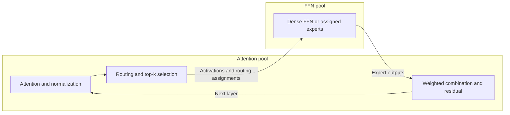

# Attention-FFN Disaggregation (AFD)

Attention-FFN Disaggregation (AFD) places attention and feed-forward network (FFN) computation on independently configured workers.
TokenSim models the resulting decode pipeline: attention, activation transfer, FFN execution and result return, repeated across the model's layers.
The simulation estimates how worker allocation, context length, expert routing, micro-batching and communication affect token latency, throughput and memory capacity.
It executes discrete events using operator measurements or analytical estimates; it does not execute model weights on accelerators.
Configuration names retain the `af` prefix.

## Workload and placement

The modeled system has an attention pool, denoted A, and an FFN pool, denoted F.

| Component | Modeled responsibility |
| --- | --- |
| A workers | Request ownership, key/value (KV) cache, attention projections and kernels, normalization, residual state and token generation |
| F workers | Dense FFNs, routed experts and shared experts assigned to their physical ranks |
| Router and output combination | Placement follows the selected execution protocol, described below |
| Prefill workers | Complete-model prefill before requests enter the AFD decode pipeline |

A and F can use different device types and independent tensor parallelism (TP), data parallelism (DP) and pipeline parallelism (PP).
Expert parallelism (EP) distributes the F pool's experts across its TP/DP ranks within each pipeline stage.
An A replica retains its requests and KV state while different F replicas service their FFN work.
Changing the number of F workers does not create additional request owners or KV capacity.
Explicitly colocated A/F roles share the same physical compute and memory budgets.

AFD applies to decode in the current serving model.
Prefill uses ordinary complete-model workers and the standard operator-table latency model.
Separate prefill and decode pools hand off the initial KV state through the configured KV-transfer mechanism.
This cost is separate from the per-layer A/F activation traffic.
The AFD configuration has one decode link and its A/F execution domains, with no `phases` selector.
The fixed-batch DeepSeek helper starts from an existing context and measures decode only; its results exclude prefill and request-arrival effects.
See [DeepSeek-V3 multi-head latent attention (MLA)](deepseek-v3-mla.md) for model geometry, cache storage and attention operator coverage.

## Layer execution and scheduling

For each layer and micro-batch, the simulation constructs a directed acyclic graph (DAG) of compute operations, transfers and collectives.
The following diagram shows the default `partial_return` protocol with routing on A:



Dense layers execute their FFN without expert routing.
Mixture-of-experts (MoE) layers track each token's selected experts, the resulting token count per expert and the ranks owning the required expert shards.
This captures uneven expert load, TP reductions and EP movement.
Shared experts contribute their own computation and transfers.
Model embedding, final normalization, output projection and token selection contribute to whole-model decode latency.

An execution domain can set `parallel.pipeline_layer_counts` to assign positive contiguous layer counts to its PP stages.
The array must contain one count per stage and sum to the model's layer count.
Prefill, decode, KV admission and KV handoff use these same boundaries.
A/F return routes connect only pipeline stages sharing a model layer.

An AF link can enable `colocated_dense_reuse` when A and F execute on the same physical ranks.
Eligible dense layers consume complete local activation replicas and retain replicated residuals without A/F endpoint copies.
The runtime still charges tensor-parallel reductions and reserves residual storage.
Directional casts, sharded collective outputs and remote F replicas retain the ordinary transfer protocol.
The planner and trace validator check local replica ownership, tensor coverage and producer dependencies.

The default `partial_return` protocol supports router placement on either A or F.
F returns the selected experts' outputs, and A performs weighted combination and residual addition.
When routing runs on F, the required expert IDs and weights also reach the A-side consumers.
The `vllm_afd` protocol places routing and weighted combination on F and returns a combined hidden activation for each original token.
Its current supported configuration is an all-MoE Qwen3 model without shared experts, bfloat16 (BF16) precision, TP=PP=EP=1 and one F service replica.
Multiple A replicas may share that F replica when native control timing is disabled.

`af_block_size` limits the query tokens in one A-side micro-batch.
Ordinary decode contributes one query token per request; recomputation or multi-token verification can contribute more.
Requests remain whole when packed into micro-batches, and a request exceeding this limit is rejected.
Independent micro-batches and A owners can progress concurrently when their dependencies and physical resources permit.
An individual micro-batch waits for its required FFN results before advancing to the following layer.

Under `partial_return`, compatible F work from different A owners can form one larger invocation.
Each combined invocation contains at most one micro-batch from each A owner.
The F pool collects ready inputs for `ffn_batch_wait_us`, subject to the layer, operator, rank, precision and token limit.
The default collection window is 5 microseconds when pooling across multiple A replicas.
One A replica uses no collection window, and a zero window groups inputs ready at the same simulated timestamp.
Late arrivals form another batch.
An indivisible input larger than the aggregation limit executes alone.
This captures both the FFN batch-size efficiency of pooling A requests and the collection and device-queue delays introduced by batching.

Multi-A `vllm_afd` uses a different synchronization rule: every configured A peer must submit the matching round and micro-batch before F proceeds.
Disabling optional FFN batching does not remove this peer barrier.
Missing peers leave the transaction pending, and a failed peer aborts its transaction.
The native control-timing path currently supports one A worker and one F worker (1A1F).

## Compute, communication and overlap

An operation becomes ready after its declared producers finish.
It starts when its compute or communication resources admit it and completes after its estimated service time.
These dependencies determine the simulated critical path and the overlap between A computation, F computation and transfers.
The simulator does not assume that every transfer is hidden by computation.

Compute estimates use each rank's actual operator shape, context lengths, expert assignments and precision.
Operator tables provide compatible measurements, interpolation or extrapolation; analytical fallback uses the configured device's compute and memory characteristics.
Ragged decode attention accounts for the individual context lengths, and local attention uses the model's per-layer windows.
Analytical expert estimates use the local token-assignment histogram, while measured aggregate MoE rows retain their balanced-equivalent batch interpretation.
The [operator latency model](operator-latency-model.md) describes measurement matching and fallback policies.

Cross-pool payloads follow the required activation and output tensor slices and their wire precision.
A token sent to several expert destinations generates the corresponding destination traffic.
TP and EP collectives contribute additional communication according to their actual participant groups.
F-side combination changes the return traffic because the combined result replaces separate expert outputs.
Transfers already represented at the A/F boundary are excluded from internal expert dispatch estimates to avoid charging them twice.

The default `physical` communication model groups devices into explicitly placed nodes.
Each node has one shared local communication budget and separate inter-node transmit and receive budgets.
A remote transfer reserves the source transmit and destination receive resources together.
Transfers sharing a resource queue in first-in, first-out order; transfers using disjoint resources overlap.
Analytical transport service combines fixed latency with wire bytes divided by the effective bandwidth.
Hierarchical collectives include their local and inter-node phases; an AllReduce uses local ReduceScatter, inter-node shard AllReduce and local AllGather.
Node bandwidths, latencies and `node_size` are configurable per communication domain to match the target cluster fabric.

The alternative `flat_link` model uses catalog link classes and configured resource lanes.
Its fabric mode supports separate full-duplex directions or a shared half-duplex lane.
Its endpoint mode models shared transmit/receive injection budgets per worker.
Each execution domain's `communication_plan` entry can set `algorithm` to `ring`, `tree`, `direct` or `auto`.
The default is `ring` and preserves existing service times.
`auto` compares the analytical ring and tree costs for the current participant count and tensor size.
`direct` models a nonblocking fabric such as NVSwitch multicast or a compiler-scheduled LPU interconnect when explicitly selected.
The input payload is per rank, so AllGather returns a buffer whose size is the input size multiplied by the participant count.
Algorithm selection reaches layer collectives, embedding reduction and output gathering, and is retained in runtime plans and transport traces.
The `physical` wire scheduler uses ring routing and validates the selected policy before execution.
Complete-model prefill uses the hierarchical collective backend, while the domain policy governs the AF operator DAG.
Physical node budgets determine contention in `physical` mode; flat-link duplex settings govern the `flat_link` model.

Optional host submission, control and completion costs are accounted for separately from device computation and transport service.
The analytical CUDA-graph setting configures host submission and device-kernel launch overheads for graph-captured execution under analytical operator fallback.

## Memory and precision

Capacity is checked on every physical device using the weights, execution workspaces and KV shards placed there.
The modeled allocation must satisfy

$$
M_{\mathrm{weights},r} + M_{\mathrm{workspace},r} + M_{\mathrm{KV},r}
\leq u_r M_{\mathrm{device},r},
$$

where `u_r` is the configured `gpu_memory_utilization` fraction for device `r`.
Additional KV limits can reduce the available cache budget.
A replicas own their attention and KV shards; F replicas store their assigned dense, routed and shared-expert weights without request KV caches.
Moving FFN weights off A can increase its resident request capacity, while the F weight and workspace budgets can constrain the useful A:F ratio.
Admission uses the limiting A-rank capacity and shared physical memory reservations.
The native `AFService` reserves the declared peak resident context and does not model paging or preemption.

Weights, activations, KV caches and the two transfer directions can use different supported dtypes.
Weight and KV precision affect storage and compute estimates; wire precision affects transferred bytes.
Required encode/decode conversions consume compute time at the sender and receiver.
Precision changes therefore alter the memory, compute and communication models together.

Ordinary attention models can supply one `attention_windows` entry and one `attention_geometries` entry per layer.
Geometry entries define `head_dim`, `num_key_value_heads` and optional `k_eq_v` projection sharing.
Shared K/V projections retain two distinct transformed cache tensors.
Complete-model prefill groups stages' owned layers by their actual geometry and uses the declared operator weight formats.
Analytical GPU prefill also honors the selected graph-kernel overhead without changing the device catalog or LPU startup costs.
The [LP30 and Rubin guide](lpx.md) describes the Gemma catalog and optional SRAM workspace accounting.

Ordinary transformers declare additional block operations under the model's `block_layout` mapping.
These settings drive both AF decode and complete-model prefill, independently of model names and device families.

| Field inside `block_layout` | Default | Modeled operation |
| --- | --- | --- |
| `attention_output_norm` | `false` | Normalize attention output before the residual addition and FFN input normalization. |
| `ffn_output_norm` | `false` | Normalize FFN output before its residual addition. |
| `value_norm` | `false` | Normalize each local value head. |
| `embedding_scale` | `false` | Multiply embedding outputs once at the input pipeline stage. |
| `layer_scale` | `false` | Multiply each layer's residual output by its scalar. |
| `logit_softcap` | `0` | Apply final logit softcapping when the configured bound is positive. |

Scaling and softcapping use generic elementwise estimates and retain the selected backend's provenance.
Additional output-normalization weights and learned layer scalars are reserved on each tensor-parallel rank that owns the layer.
An empty mapping preserves the existing ordinary-transformer composition.
The mapping is rejected for MLA and compressed-module models, whose operator boundaries have separate estimators.

## Configure and run

Worker groups select the A/F devices, and execution domains select their parallel layouts.
The following settings control the principal AFD modeling choices.

| Setting inside `af` | Modeling choice |
| --- | --- |
| `enabled` | Enable AFD decode |
| `execution_domains` | A/F placement and TP/DP/PP/EP layouts |
| `execution_protocol` | Default `partial_return` or restricted `vllm_afd` synchronization and return semantics |
| `router_location` | A- or F-side routing under `partial_return` |
| `af_block_size` | Maximum query tokens in an A micro-batch |
| `ffn_batching` | Combine compatible ready F work under `partial_return`; defaults to `true` |
| `ffn_batch_wait_us` | F collection window; defaults to the 5-microsecond assumption |
| `ffn_batch_max_tokens` | F batch token limit; zero selects `af_block_size * A_DP` |
| `transfer_topology_mode` | Default physical node budgets or explicit flat links |
| `communication_domains` | Node inventory, placement, bandwidth and latency in physical mode |
| `links` | A/F endpoints, resource groups and optional directional wire dtypes |
| `communication_timing` | Optional separated host and control costs |

`--block_size` independently controls tokens per KV block.
The existing [cluster examples](../data/clusters/af) provide starting layouts.
This small serving run includes complete-model prefill and AFD decode:

```bash
python benchmark.py \
  --cluster data/clusters/af/decode_half_duplex.json \
  --model llama-3-8b \
  --latency_backend operator_table \
  --latency_fallback analytical_only \
  --batching paged-attn \
  --block_size 16 \
  --distribution burst \
  --request_count 2 \
  --prefill_mean_len 16 \
  --prefill_range_len 0 \
  --decode_mean_len 4 \
  --decode_range_len 0 \
  --verbose none \
  --results_path outputs/afd-example
```

`af_runtime_state` reports the modeled placement, component storage and KV capacity.
`af_trace` reports AF iteration summaries.
The [global operator trace](operator-latency-model.md#global-operator-tracing) separates dependency readiness, resource queueing and service time across ordinary prefill and AF decode.
Use `--trace_mode full` with the main simulation CLI to export it.
The global configuration controls serving trace collection; the legacy cluster `af.trace_enabled` field applies to low-level compatibility entry points.
A shared F invocation can appear in several request traces; physical utilization and operation totals count that execution once.
`af_operator_stats` and `af_latency_providers` identify measurement coverage and analytical assumptions.
`af_phase_fidelity` distinguishes aggregate complete-model prefill from rank-local AFD decode.
Report the workload, A/F allocation, context distribution, precision and timing provenance with throughput or latency results.
Throughput per device must include F devices in the device count and state whether prefill devices are included.
Host time spent running TokenSim is separate from the simulated accelerator latency.

## Reference systems and architectural alignment

TokenSim's AFD runtime captures the execution protocols and resource boundaries established by production disaggregated serving designs.

| Reference | Modeled capabilities |
| --- | --- |
| [Step-3 paper](https://arxiv.org/abs/2507.19427), Sections 3 and 7 | A/F hardware specialization, independently sized FFN micro-batches, bidirectional activation movement and communication/computation pipelining across layers. |
| [FastAFD blog](https://haoailab.com/blogs/fastafd/) and [source](https://github.com/hao-ai-lab/FastAFD) | A-side routing, F-side expert aggregation (`partial_return`) and multi-micro-batch compute/transfer overlap. |
| [vLLM AFD plugin](https://github.com/vllm-project/afd-plugin) | Role ownership, layer/micro-batch identities, peer barrier synchronization and F-side weighted combination (`vllm_afd`). |

The runtime models device-level compute slots and hierarchical or flat-link fabric budgets in a hardware-agnostic manner across GPU, LPU and NPU backends.
Supplying device-specific operator tables and link parameters tailors the simulation to CUDA, Ascend or custom accelerator fabrics.
