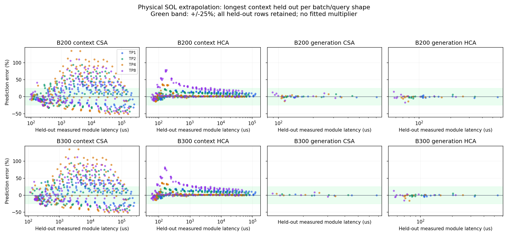

# DSV4 attention 表外 SOL 增长修正

日期：2026-10-07。接续 `bd7a637` 的整批 decode 修复，本阶段只修改
native attention 的表外增长模型和相关多轴邻点取值。

旧 `_analytical_work` 把整个实测模块乘 compressed-work 比例，KV 长度
增长时也放大了投影和权重读取。新模型按 AIC
`perf_database/dsv4.rs:dsv4_attention_sol_ms` 分解 FLOP/byte，使用设备
峰值计算与 HBM 带宽，外推式为：

```
predicted(target) = measured(boundary) × SOL(target) / SOL(boundary)
SOL = max(sum(component_flops / component_peak), sum(bytes) / HBM_bandwidth)
```

投影、compressor 和权重读取不依赖 KV 长度；SWA 有 128 窗口上限；
CSA 稀疏 attention 在 top-1024 后饱和，但 indexer logits 遍历全部
compressed KV；HCA 无 indexer，compressed attention 随 context/128
增长。prefill 以闭式因果求和计入 chunk 内的长度增长，避免逐 token 循环。

参数按只读 vLLM `30f5c01d4ebb` 核对：grouped 输出投影是 FP8 block，
compressor `quant_config=None`、indexer weights_proj 为 BF16，其他低秩
投影和 indexer query projection 使用 FP8。相对 AIC 原公式，显式补上
CSA indexer compressor 的权重读取，并按当前源码分配 dtype。

增长模型暂用借表 FlashMLA source 的 KV 584 B/state、indexer 132 B/state，
这两项来自 collector 默认和当前源码推断，历史 vLLM 0.24.0 的实测布局
尚未独立核实；不能称完全匹配参考。配置参数可单独表示 serving 的
512 / 68 B/state，但本阶段没有将两者比值乘到整个实测模块，也没有
应用 FlashMLA/FlashInfer 固定系数。prefill indexer KV 的批内复用沿用
AIC SOL 近似，不宣称实际 HBM 读取恰好等于公式。

非可分的 FLOP/byte 模型还暴露了多轴查表问题：batch 外推/插值选到
某个邻点时，内层 context 外推须用该邻点 batch 计算增长，再执行
外层 batch 操作。此前内层用最终目标 batch，会错误重复使用目标的
roofline 比例。`bind_analytical_axes` 仅在 native attention 普通和
支持切片 lookup 上启用，通用 backend 保持原路径。

精确实测值、范围内插值规则、低形状 clamp、64x 外推边界和 source
记录均保留。没有删除非单调点，没有新增吞吐拟合参数。MTP q=4 KV
读取复用、完整 draft 层和 context/decode 混合投影计费仍需独立完成。

## 留出实测点

`scripts/audit_agentx_attention_sol.py` 在每个相同 discrete/batch/query
形状中留出最大 context，至少保留两个较小长度点，不使用留出值拟合。
数据为 B200 1,296 点、B300 1,248 点；所有原始表保持不变。完整逐点证据
在 `data/reference/agentx-attention-sol/holdout.json`。

TP1 的绝对误差中位数（括号内为旧公式）：

| 分项 | B200 | B300 |
|---|---:|---:|
| context CSA | 17.9% (1,212.8%) | 18.9% (1,188.6%) |
| context HCA | 5.7% (208.0%) | 5.6% (208.9%) |
| generation CSA | 1.2% (51.9%) | 0.3% (21.0%) |
| generation HCA | 1.7% (18.7%) | 1.5% (14.6%) |

TP1 generation 的全部留出点误差在 25% 内。context CSA 的 TP1 为
102/151 与 96/145 点在 25% 内，不能宣称所有外推满足门槛。
TP2/4/8 的长 chunk CSA 仍有较大误差，最大约 135.5%；这些点全部保留，
后续曲线须单独检查此限制。较长 context 的 kernel 效率变化和 module
内部重叠不由单个 util-hold 标量完全表达。



B200 batch=64 的 source-layout 预测（us）：

| context | CSA 旧 → SOL | HCA 旧 → SOL |
|---|---:|---:|
| 16K | 180.300 → 180.300 | 125.800 → 125.800 |
| 128K | 1,165.166 → 280.783 | 564.387 → 138.528 |
| 1M | 9,044.094 → 1,084.645 | 4,073.081 → 240.355 |

## 完整窗口

全仓逻辑测试：489 passed，14 subtests passed，32 个已有 warning，132.34 秒。
日志 `/tmp/agentx-attention-sol-tests.log`。B200/B300 各预热 + 3,600 秒完整
测量均已完成，结果目录为 `native-attention-sol/20261007-physical-growth/`。
严格验收证据为 `data/reference/agentx-attention-sol/pipeline-validation.json`。
运行使用全部 393 trace 池、seed0、SimpleCPU、原生 attention/MoE/mHC
和当前 MTP。配对基线为 `native-decode-batch/20261007-full-batch-v2/`。
当前阶段不代表最终三 seed 精度验收完成。

B200 已完整结束并通过源码/数据 SHA、请求来源、完整输出、取消、资源
释放、静态预算和时间守恒核对（`b200-validation.json`）：输出吞吐
1,759.873 token/s，相对上一阶段 +66.98%，相对参考 −51.10%；p90 TTFT
67.349 s、p90 ITL 0.133493 s；GPU/CPU 首次命中率 28.9390% / 66.0402%，
抢占 56 次（基线 28）。预算固定不变，但更快的闭环带来不同请求集合、
峰值占用和驱逐次数。validator 最初将动态计数当作固定预算比较，已限定
只排除 `peak_used_slots` 和 `evictions` 并保留其逐 rank 前后值；其他
预算字段继续逐项严格相等。

B200 attention / MoE 累计 GPU 秒为 5,862.497 / 8,579.296，占分项约
38.0% / 55.6%。因此不能把剩余误差全部归因于 attention 后端；需继续
核对 MTP 成本和原生 MoE 在不均匀 DP batch 下的组合估算。B300 对应占比
为 attention 53.8%、MoE 39.5%。

两个主点最终结果（8 GPU 合计）：

| 指标 | B200 | B300 |
|---|---:|---:|
| 预热成功请求 | 2,171 | 4,249 |
| 预热模拟秒 | 1,861.860 | 2,643.651 |
| profiling 成功 / 取消请求 | 7,623 / 102 | 15,607 / 300 |
| 成功请求观察窗口 (s) | 3,629.913 | 3,629.677 |
| 输入吞吐 (token/s) | 231,381.085 | 499,860.284 |
| 输出吞吐 (token/s) | 1,759.873 | 3,634.417 |
| 相对配对基线提高 | 66.98% | 95.17% |
| 相对参考吞吐误差 | −51.10% | −42.86% |
| p90 TTFT (s) | 67.349 | 29.783 |
| p90 TTFT 误差 | +315.57% | +57.45% |
| p90 ITL (s) | 0.133493 | 0.107737 |
| p90 ITL 误差 | +165.68% | +117.71% |
| GPU 输入命中率 | 28.9390% | 94.7667% |
| GPU 命中率相对误差 | −57.58% | +5.41% |
| GPU 命中率差（百分点） | −39.2840 | +4.8667 |
| CPU 输入命中率 | 66.0402% | 0.7433% |
| CPU 命中率相对误差 | +178.35% | −54.65% |
| CPU 命中率差（百分点） | +42.3142 | −0.8957 |
| 抢占次数 | 56 | 0 |

输入 token 分母与参考 bmk 一致，GPU/CPU 分开核对。**最终 25% 精度门槛
尚未通过**，也没有用本阶段 seed0 代替后续最终三 seed 曲线验收。

profiling 分项累计 GPU 秒（含 dummy batch）：

| 分项 | B200 | B300 |
|---|---:|---:|
| attention | 5,862.497 | 10,636.736 |
| MoE | 8,579.296 | 7,794.742 |
| GEMM | 137.890 | 148.491 |
| elementwise | 755.604 | 1,081.735 |
| lm_head | 89.087 | 91.450 |
| comm / overhead | 0 / 0 | 0 / 0 |

decode 批数为 150,930 / 148,492，query 行为 11,430,760 / 23,480,649。
组件总和、native attention 计时与 DP local compute 均一致；取消全部确认，
最终只有 null slot，无在途预留和 CPU/DMA pin。校验确认仅三个运行时源文件
改变，实验配置、模型、数据与静态容量均与配对基线一致。

只读后续核查已记录 `mtp-cost-followup.json`：当前源码的 first draft
pass 使用整个 target batch，后续两个 pass 各一 query/request；h_proj
处理 hc_mult 条残差，draft SWA/MoE/mHC 和 target verify logits 也需核对。
此 evidence 不代表已修改 MTP 成本。缓存准入的 full-ISL 检查已核对
源码默认 `scheduler_reserve_full_isl=True`，不能因 B200 gate 频繁就
无依据地移除；内存预算的 buffer 生命周期仍是另一项待核实工作。
