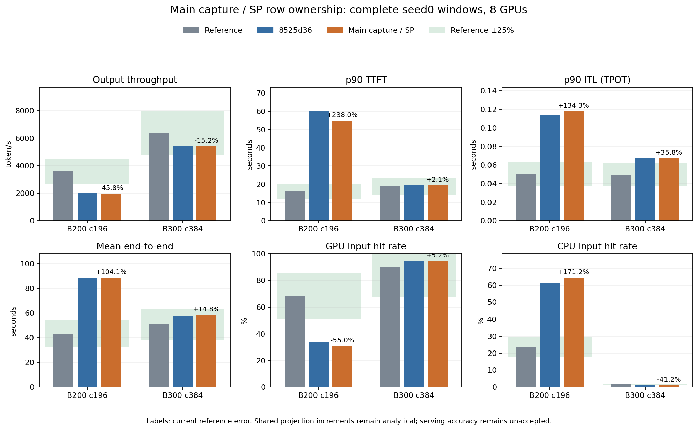

# 主干capture/SP计算行数归属

接续 `8525d36`。本部分按固定vLLM `30f5c01d4ebb` 的完整
forward tensor与SP分片修正主干工作；实际request query、KV
读取、MTP接受长度和selected logits保持各自原有归属。
模型、catalog、原始operator表、trace、capacity及scale不改动。

## 已核实的源码范围

source在mHC/norm后all-gather并切到`positions.shape[0]`进入
attention，共享输入/输出投影处理完整tensor；attention之后
reduce-scatter进入FFN，router收到SP shard。eligible FULL decode
以同步descriptor尺寸执行，真实sparse/indexer/KV query按原
metadata，而填充不产生request进度。输出hc_head/final norm
此前已经按完整descriptor计费，本部分复用同一owner不重计。

## 实现

`operator_table.py`用一个target-forward helper取得eligible DP
descriptor行，否则使用actual logical tensor。mHC与两处norm
按SP predicate使用ceil(full/TP)；router也收到该SP行数，完整
attention投影和TP通信使用full tensor，SP gather尾部切到
positions长度。generic非DSV4原路径不改变。新增主干logical/
full/padding/SP/tail及逐层norm/router/projection/mHC ledger，
在profile reset和result JSON中保留。

`deepseek_v4_attention.py`对eligible decode capture只补shared
投影bound的正增量：在actual-query source key上把common rows
增到max(descriptor, source floor)，以已有shared/phase SOL
allocation归一化到原全模块anchor。其余phase工作和原query
索引、KV复用预算不增；每kind/context只查询一次，没有额外
完整投影module或重复source-floor费。context/mixed保持eager
logical tensor，非法更大的capture输入会明确拒绝。

新统计的capture source-floor/projection-bound layer rows是
row-weighted allocation预算，不冒充实际tensor或测得kernel
分项；actual logical/descriptor/padding为独立整数ledger。
全module表仍无法分离component launch/fusion，正增量是已有
SOL组成近似，不是测量；没有额外overlap或serving拟合。

| 本rank20行代表形状 | mHC/norm/router行 | attention projection行 |
|---|---:|---:|
| TP1，远端decode64，capture | 64 | 64 |
| TP4，远端decode64，capture | 16 | 64 |
| TP4，远端context512，eager | 5 | 20 |
| TP8/DP1，本rank20 | 3 | 20 |
| TP8/DP1，staged q1 eager | 3 | 20 |

两SKU的实施后只读owner核对均符合上表；源表floor已覆盖
descriptor时新增投影cost为0。证据为同目录
`capture-ownership-followup.json` / `ownership_review.py`。

## 测试

专项 **46 passed、7 subtests passed**。新回归覆盖capture全输入
与20个原query、TP4 router/shard、远端context强制eager、TP8
尾部、staged q1、source floor覆盖/heterogeneous floor、每模块
单query及shared-only增量、invalid context/capture拒绝，及
新main ledger的导出/序列化/reset。

全仓 **575 passed、103 subtests passed**，32个已有warning，
192.90秒。log与hash在 `data/reference/agentx-capture-rows/`
`full-tests.txt` / `scope-audit.json`。runtime四个修改文件：
operator backend、native attention、result schema及聚合导出。

strict validator继承完整请求/output/input/取消、缓存/预留/
DP/MMA/FLOP/source身份检查；新增main full与head full一致、
TP1主点norm/router/mHC层权重、capture query/descriptor/padding
和正increment/source-floor bound守恒。TP4/8 source契约由
专项源码形状测试验证，正式扩展曲线仍属最终当前代码矩阵。

## source版本范围的未完成项

原始Parquet hash与import记录一致，额外metadata为空，没有
kernel revision。GB200行内版本unknown，GB300行内0.5.11；
目录及collection meta为0.5.10。公开SGLang0.5.11 tree没有
预期DSV4路径，不能用tag猜测原patched collector环境。
collector代码`cached_sglang`和`use_fp8_dispatch=True`提供API
线索，但不是某个历史commit或其完整调度的证据。

此前fixed192容量fingerprint及离线场景仍未采用；整数谱/
pipe/source geometry/cache traffic和更宽归一化继续D级并保持
待核实。不依靠更小误差选择版本；该数据缺口不改变已核实
的main row-owner修正或原全部目标。
证据：`source-provenance-audit.json`。

## 后续显存阶段的只读证据

本部分未修改memory budget。`memory-identity-followup.json`核对
class-cached对称buffer、shared L1 X别名、ring内expert中间结果、
独立BF16 y、model-level topk/MTP hidden及per-device FlashInfer
128MiB workspace；这些存储形状不能直接当作瞬时峰值相加。

新增`memory_lifetime_review.py`提取pinned model/layer/mHC的实际
Python函数体，使用假tensor存储和kernel stub核对引用拓扑。
4个行数、3/61层及fused/fallback分支共16个案例均显示mHC
transition最多同时保留3个不同hyper-residual存储，且返回后
完全释放：model外层赋值在RHS执行期间保留旧residual，层内
attention residual和新FFN residual暂时同时存在。该multiplicity
不随层数累加，证据为`memory-lifetime-probe.json`。

这不是CUDA allocator/graph峰值测量；scratch shape、attention/
FFN数值kernel、stream/编译器/SP不在probe范围。TP1 FlashInfer
融合输出FP8、其他TP的BF16/quant staging、target/drafter持久
hidden和graph输出存储仍需分别建立live intervals。保持原
runtime/NCCL预留，不以参考KV容量误差选择更小预算。

`buffer_geometry_review.py`从pinned native的alignment、ring、
SF、pool、workspace ABI及shared别名重建连续存储区间，复现
此前全部分项字节；EP4/8、SM132/148和shared0/1新增16个
离线案例。SM仍为假设场景，原实测timing的kernel provenance
仍未匹配；这些区间不构成参考设备的allocated-byte测量。
证据：`buffer-geometry-probe.json`。

参考使用MRV2。target和MTP各有独立topk buffer，target/drafter
各有独立hc-expanded hidden；对称buffer只在完整cache key
相同时复用。MRV1常驻inputs_embeds与MRV2多模态条件分配
属于两个替代分支，不相加；target graph不包含logits，而
drafter graph包含compute_logits/sample，graph live范围不同。

本轮还重跑当前lookup/SOL的原表留出，B200/B300分别1,296 /
1,248点，全部记录与历史diagnostic相同。TP1 generation全部
通过，CSA context TP4仅57/151、50/145在25%内，最大绝对
误差134.742% /135.535%。capture行归属修正不关闭这些外推
问题；原始布局留出也不是FlashMLA→FlashInfer或q=4校正的
正式精度证据。复算产物与保留的历史完整记录逐字节一致，
以`current-attention-holdout-audit.json`保存当前源码、复算及
历史hash；全部留出记录继续保留在
`data/reference/agentx-attention-sol/holdout.json`。

## 两SKU完整窗口与成对分析（已验收）

全仓通过后冻结四个runtime文件，启动B200 c196/B300 c384
seed0原benchmark：全部393 trace为池，完整预热、3,600秒
issue、30秒grace及最多10秒取消收尾。原子PID/命令身份已
记录，观察超时不重启/替代；两组single/combined strict与
成对分析已完成，源码、模型、catalog、数据、配置及容量
身份通过核验。本部分的实现范围验收通过，整体精度未通过。

B200原进程exit0，完整预热2,171个成功请求，profiling成功
8,303、取消112；全部393 trace池、3,600秒issue和等待/取消
收尾均通过strict检查。输入/输出/取消、缓存引用/预留释放、
DP时间、main/head行数及capture source-floor增量守恒通过。
单点证据为 `b200-validation.json` / `b200-analysis.json`。

| B200指标 | 上一提交8525d36 | 本部分 | 相对参考误差 |
|---|---:|---:|---:|
| 输出token/s（8 GPU） | 2,009.013 | 1,951.106 | −45.792% |
| 输入token/s（8 GPU） | 258,429.288 | 258,158.956 | −45.154% |
| p90 TTFT（s） | 59.939587 | 54.778145 | +238.001% |
| p90 ITL（s） | 0.113885 | 0.117729 | +134.306% |
| mean E2E（s） | 88.443360 | 88.526692 | +104.144% |
| GPU命中 | 33.6552% | 30.7026% | −54.997% |
| CPU命中 | 61.4440% | 64.3526% | +171.232% |
| 抢占 | 67 | 108 | — |

吞吐较上一提交−2.882%，TTFT−8.611%，ITL+3.375%；不能称为
性能改善或精度验收。main logical/full行数60,422,392 /
61,440,728，capture padding 1,018,336，shared正增量累计
2.593777秒。按每百万输出token作分析归一化，attention费用
+2.066%、MoE+1.813%、elementwise+0.659%；归一化不用于运行
拟合。rank4/2的完整输入准入门控14,351/11,797次，多个rank
接近21,021槽的池上限；闭环轨迹随计时改变，抢占增长需结合
最终成对结果解释，不能只凭汇总认定调度回归。

成功profiling请求的重复准入65→105，CPU重复加载7,929,600→
13,308,928 token，GPU重复加载756,224→1,808,128；generated
reload两类均为0，重算token反而196,716→188,253。包含取消
请求的额外准入共67→108，主要落在rank0/2/4/7（本轮
23/23/52/10，上一提交0/15/35/17）。这与高池占用/完整输入
门控共同记录，作为后续容量/生命周期阶段的诊断，保留
成功请求与含取消日志两种scope，不改变命中分母。

B300原benchmark PID2697723已exit0，wall 4,997.56秒；预热
4,249个成功请求，profiling成功21,780、取消234。原393 trace
池、完整3,600秒issue、30秒grace及最多10秒取消收尾通过。
main logical/full行数153,649,660 /160,045,336，capture padding
6,395,676，shared正增量累计19.086135秒。main/head/capture
budget及时间、请求、输出、缓存引用/预留释放全部守恒。
B300无抢占、重复准入、重复加载或重算；全部原进程已终止，
四个runtime hash保持与启动和全仓测试的版本一致。

| 指标（8 GPU合计） | B200本部分 | B200参考误差 | B300本部分 | B300参考误差 |
|---|---:|---:|---:|---:|
| 输出token/s | 1,951.106 | −45.792% | 5,393.582 | −15.199% |
| 输入token/s | 258,158.956 | −45.154% | 707,643.146 | −13.048% |
| p90 TTFT（s） | 54.778145 | +238.001% | 19.321935 | +2.147% |
| p90 ITL（s） | 0.117729 | +134.306% | 0.067222 | +35.842% |
| mean E2E（s） | 88.526692 | +104.144% | 58.420540 | +14.833% |
| GPU命中 | 30.7026% | −54.997% | 94.5464% | +5.168% |
| CPU命中 | 64.3526% | +171.232% | 0.9629% | −41.249% |
| 抢占 | 108 | — | 0 | — |

B300相对8525d36吞吐−0.099%，TTFT−0.243%、ITL−0.144%、
E2E+0.759%；每百万输出token分项gemm+1.042%、attention
−0.171%、MoE−0.338%、elementwise+1.280%。同步等待比例
B20029.614%→30.477%、B30017.540%→17.711%。这些归一化
仅用于成对分析，不回写运行费用。两版的预热时间相同，
profiling闭环轨迹仍会随计时改变，不能把总时间、额外准入
或逐项百分比独立解释为单一原因。

B300输入/输出吞吐、TTFT、E2E与GPU命中处于25%内，ITL与
CPU命中仍失败；B200所列7项均失败。GPU/CPU百分点差分别
为B200−37.520/+40.627、B300+4.646/−0.676。权重与KV容量
仍是冻结预算，不能以本阶段逻辑通过替代最终§5.2完整验收。

成对结果与各rank额外准入/重载scope：`paired-analysis.json`。
最终校验：`b200-validation.json` / `b300-validation.json` /
`pipeline-validation.json`；scope audit记录冻结runtime和分析/
图表hash。两组完整流程各执行一次，没有缩短、替代或重启。

- 结果：`results/agentx-dsv4-full/native-capture-rows/20261008-main-capture-sp/`；
- 证据：`data/reference/agentx-capture-rows/`；
- 验收：`scripts/validate_agentx_capture_rows.py`；
- 监测：证据目录 `monitor.py` / `monitor-state.json`。

整体25%尚未通过。source范围/shape效率、buffer存储身份及
生命周期、历史发生实例映射、匹配AIC、attention SOL留出及
最终当前代码三seed曲线/后端/消融/敏感性继续属于原目标。
