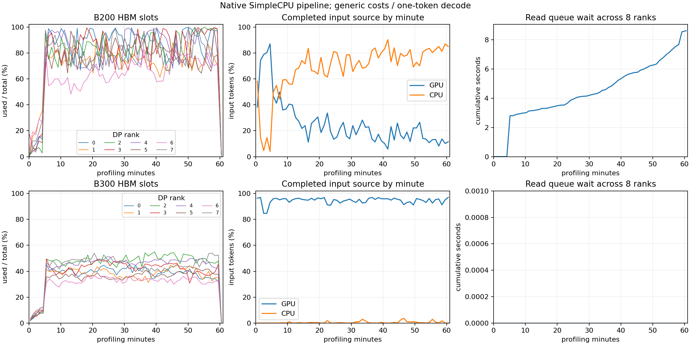

# 首次准入的输入来源与重新加载统计

本阶段修正原生回放的 GPU/CPU 命中口径。参考只读 vLLM `30f5c01d4ebb` 的 `scheduler.py:1034` 和 `metrics/stats.py:PrefillStats`：原始 prompt 的来源记录在首次准入，抢占后的重复 prefill 不覆盖这份观察。

此前 `cached_prefill_tokens` 等字段既控制本次计算的起点，也用于最终指标。重新准入时必须更新执行状态，却会同时把原始输入来源覆盖为最后一次 GPU/CPU 恢复。现在新增不可变 `PrefillSourceStats`，记录首次 GPU 命中、CPU 命中和原始未命中输入；执行状态仍按原流程更新。重新准入次数、GPU/CPU 重新加载 token、重算数量及最后一次准入观察独立记录，不改变调度、缓存、传输或输出推进。

首次快照只在实际接纳并完成 GPU 目标预留后创建；异步复制不必完成才记录来源，这与参考的准入观察一致。未被接纳就取消的请求标为未观察，来源字段为 null，不能伪造为零命中。成功请求必须有观察，缺失时拒绝导出精度指标。GPU、CPU、首次本地计算的输入分解严格相加为原始输入长度；重算不再次计入原始输入吞吐分母。

原生 `agentx_metrics` 和逐请求日志使用首次口径，同时保留 `latest_*` 用于复现旧统计。legacy workload 仍保留原有接口。五个新增用例覆盖快照不可变、重加载分别累计、首次 miss 后复用自己刚计算的 GPU 页、真实引擎中首次 CPU hit 抢占后转用 GPU、缺失观察拒绝补零及汇总分解。全仓 **396 项测试通过，92.150 秒**。逻辑测试不代替精度证据。

完整窗口保存于 `results/agentx-dsv4-full/simple-cpu/20261001-first-admission-stats/`；仍为全部 393-trace 池、种子 42/0、预热及 3,600 秒发出、30 秒宽限和最多十秒取消，通用算子与单 token decode。基线为 `20261001-inflight-reservation`。验证脚本逐请求对比身份、路由、结果、输入/输出长度和所有已有时间字段，要求完全一致；旧来源观察要求逐条等于新日志中的 `latest_*`。这样才能证明此次仅修正测量，而非改变负载或执行行为。

B200 完整结果的 6,750 条终态记录与基线的上述执行字段逐条完全一致，6750 条 last-admission 来源也能由 `latest_*` 精确复现。4,362 个成功请求中有 269 个重新准入，共计 1,981 次重新准入；16 个成功请求的首次与最后一次来源不同。首次 GPU/CPU 命中率为 23.727%/70.662%，最后准入为 23.939%/70.455%。因此该统计错误确实存在，但本次真实窗口只影响约 0.2 个百分点，不能解释相对参考的巨大差距。

重新准入的重复 CPU 加载合计 246,763,776 token、重复 GPU 恢复 10,645,248 token，首次来源不再次累计这些量。其中 rank4 的请求 6435 输入 379,520、输出 131，首次 CPU 命中 376,576；它重新准入至 82 次，重复 CPU 加载 30,502,656 token，最终记录的完成重算为 2,944 token。应区分反复加载与真正完成的重算，不能只凭重算 token 较少就判断没有 thrashing。

下一部分的具体调度检查：`scheduler.py:_handle_blocked_waiting_request` 让复制完成的请求回到 WAITING/PREEMPTED，继续在 waiting admission 内检查本次计算块；当前 `SimpleCPU._load` 可直接追加 RUNNING，而 `loaded_waiting` 也只检查序列名额。首次 context 分配不足时，这个请求会进入 running victim 路径而再次被抢占，可能重复导入完整前缀。该源码差异已定位，但仍须独立修复并通过完整窗口验证其影响；此次统计部分没有修改执行行为。

B300 完整窗口也已结束：10,396 发出、10,034 成功、362 取消；14,645 条预热加测量终态记录的执行字段与基线逐条完全一致。没有重新准入，首次与最后命中指标相同：GPU/CPU 为 94.710%/0.523%。两组共 21,395 条记录比较通过，两个池组最终 GPU 均只剩 null slot，CPU/DMA pin 和未来预留全部释放。

完整证据见 [逐请求不变与来源校验](../data/reference/agentx-first-prefill-source/pipeline-validation.json) 和 [资源校验](../data/reference/agentx-first-prefill-source/cache-validation.json)。运行代码与数据集 SHA-256 逐项核对，396 项测试及两个完整窗口不使用 smoke 验收。修正后的来源可作为后续参考比较口径，但性能和缓存行为仍远超 25% 误差目标，整体计划没有完成。

