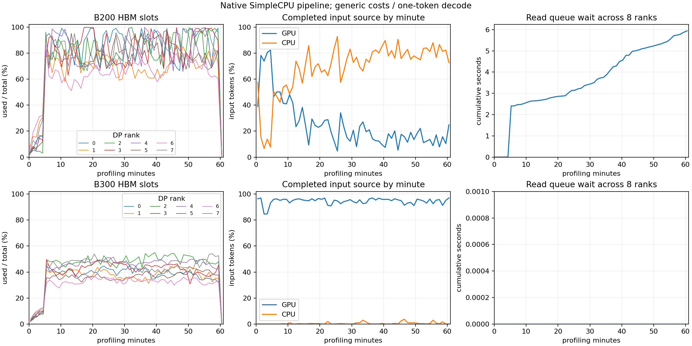

# 已加载 KV 的等待恢复与计算准入

本阶段修复 SimpleCPU 在复制完成后直接进入 RUNNING 的行为。前一阶段完整 B200 日志显示，请求 6435 的输入为 379,520、输出 131，却重新准入至 82 次，重复 CPU 加载 30,502,656 token。首先定位源码差异，保持硬件、容量、成本、带宽和种子不变，再完整对比。

只读源码基准为 `vllm-note` 的 `30f5c01d4ebb`。`scheduler.py:_handle_blocked_waiting_request` 在异步接收完成后把请求恢复为 WAITING/PREEMPTED；随后仍经过 waiting admission 的节流、token budget、序列名额和 `allocate_slots` 检查。分配不足时保持 KV-holding waiting，而不是进入 running victim 路径释放、重新加载已收到的前缀。copy completion 只证明数据可用。

SimpleCPU 现在将复制结束的请求放入 loaded waiting。调度器先处理既有 running 请求，再优先接纳已有 KV 的等待请求；完整输入剩余块与本步 query 的物理块分配都通过后才进入 RUNNING。恢复时分配源码规定的 speculative lookahead；被节流、预算耗尽、名额已满或 KV 分配不足则保留原页等待。正常准入不再记为重新导入，也不重新查 CPU。正在加载及已经加载的等待请求计入长 prefill 的 eligible count。

新增容量阻塞和 loaded resumption 计数及队列长度；取消清理等待队列、请求引用和未来承诺，DMA 引用仍按复制生命周期释放。非 lockstep worker 在 loaded waiting 有待执行 work 时保持可唤醒，旧 static/dynamic scheduler 的接口保持兼容。

四个新增用例覆盖真实引擎中复制期间出现晚到的独立 DMA 压力：计算分配不足时保留已加载页、仅一次导入且零抢占；释放压力后正常恢复；容量等待时取消不复活；运行中的 decode 先消耗预算，loaded prefill 遵守 cadence；非 lockstep 的容量释放唤醒。已有序列名额用例调整为复制完成后先等待下一 GPU 边界，继续验证最大 RUNNING 数和取消。全仓 **400 项测试通过，94.371 秒**，不将逻辑测试当作精度证据。

完整结果目录为 `results/agentx-dsv4-full/simple-cpu/20261001-loaded-kv-waiting/`，基线为 `20261001-first-admission-stats`。两组仍采用全部 393-trace 池、42/0 种子、预热及 3,600 秒发出、30 秒宽限和十秒取消。通用算子与单 token decode 继续是明确的未完成范围；本阶段针对加载恢复行为，不宣称完整模型精度通过。

B200 完整窗口正常结束并通过输出、来源、取消、物理引用、DP 时间、未来预留和 loaded-waiting 清理校验。测量发出 4,576、成功 4,351、取消 225；已加载容量检查累计阻止 5,718 次过早计算准入，成功恢复 2,869 次。代码快照与当前源码相同，基线配置、数据、后端和带宽假设逐项一致，运行时代码仅更改复制回调、调度器、worker 唤醒及日志。

| B200 完整窗口 | 修复前 | 修复后 |
|---|---:|---:|
| 抢占次数 | 2,131 | 86 |
| 成功请求重新准入次数 | 1,981 | 74 |
| 重复 CPU 加载 token | 246,763,776 | 9,791,744 |
| 重算 token | 846,147 | 121,251 |
| 任一测量请求最多准入次数 | 82 | 12 |
| 输出 token/s，8 GPU 合计 | 875.589 | 869.795 |
| 首次 GPU／CPU 命中率 | 23.727%／70.662% | 23.453%／70.930% |

大量重复导入的主要缺口得到隔离验证：复制完成后直接进入 running 会把尚不具备计算容量的请求送入抢占路径。保留 imported KV 等待后，抢占与重复加载大幅降低，没有提高容量或带宽。吞吐仍略降约 0.66%，与输入来源差距仍大，不能声称已经达到参考性能；后续主要需要原生模块耗时、真实 DP/MegaMoE 成本及 MTP 进度/校验对齐，同时继续核对剩余缓存行为。

B300 完整窗口结束：10,396 发出、10,034 成功、362 取消，2,047.526 token/s、GPU/CPU 命中 94.710%/0.523%，无抢占或重新准入；这些主要值与基线逐项完全相同。loaded waiting 成功恢复 69 次，容量门槛触发为零，符合 GPU 容量余量较大而读取较少的状态。

两组代码与数据 SHA-256、配置/后端/带宽身份及完整窗口流程验证通过；最终十六个 GPU 池只剩 null slot，loaded waiting、加载、预留、CPU pin 和 DMA pin 均归零。结构化证据见 [完整对比](../data/reference/agentx-loaded-kv-admission/pipeline-validation.json) 和 [缓存/引用校验](../data/reference/agentx-loaded-kv-admission/cache-validation.json)。400 项全仓测试及两个一小时主点完成，未使用 smoke。B200 抢占减少 95.964%，重复 CPU 加载减少 96.032%，但模型精度尚未达到 25% 门槛，计划仍未完成。

