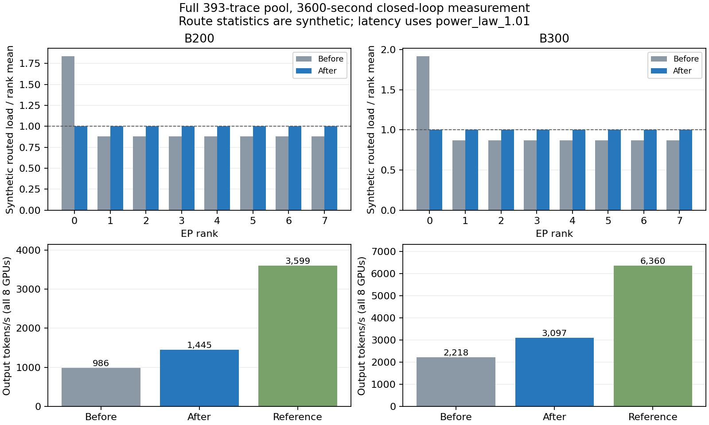

# 整步专家路由统计与固定负载计时

本部分处理研究计划的算子耗时任务 9，并补齐 routed expert 的 MXFP4 查询。基线为 `2f8e3d0` 的原生低秩 GEMM 完整主点。模型、权重、HBM/CPU 静态容量、回放、router、准入、token 预算、带宽和种子保持相同。MegaMoE 模块、shared expert、原生 attention/mHC/MTP 及完整曲线继续由后续独立修改完成。

旧统计逐请求生成均匀直方图；每个单 token decode 都把 top-6 route 放到专家 0–5，同一步所有请求因而集中在同一 EP rank。现在先累加整步没有显式直方图的 token 数，再生成一份合成直方图。完整轮次按商分配，每个专家收到相同 base；余数沿各 EP rank 交错的专家顺序分配，并在后续 step 继续当前轮次。49 个 decode 请求的 294 个 route 在 DEP8 中分为 36/37 个，而非集中于 rank0。连续 64 个单 token step 可覆盖全部 384 个专家各一次。长 prefill 使用同一个算法，统计工作量由 route 数线性扫描改为最多扫描专家数。

明确提供的 prefill/decode/expert histogram 不被合成分布覆盖。归一化缓存按 request、prefill/decode 阶段和源直方图身份区分，避免 prefill 的缓存值在 decode 阶段误用于另一个直方图。均匀合成统计是近似，并不是观测到的 `power_law_1.01` 路由；它不能改变已确认的耗时分布。

DSV4 cost query 固定使用 `power_law_1.01`，dtype 从整体 FP8 改为模型声明的 routed-expert MXFP4。B200/B300 各有 27 个同硬件、同 Pro 几何、TP1/EP8 的对应 token 点，覆盖全局 token 1–16,384，源 kernel 为 `vllm_mxfp4moe_flashinfer_trtllm_mxfp4_mxfp8_trtllmmxfp4expertsmodular`。耗时估算携带实际选中的分布；power-law 测量已包含其负载偏斜，不再按统计直方图二次查最忙 rank。其他模型若回退到 power-law 数据也遵守此规则，balanced/analytical 的原有独立不均衡处理继续保留。

这些表仍是临时 kernel 对照，不是参考使用的 DeepGEMM MegaMoE。当前独立 EP 通信仍单列，不能将本部分描述为完成 native dispatch/combine/shared expert 的全部计时。下一部分改用已确认的 GB200/GB300 MegaMoE 借表方案，其 `num_tokens` 是 rank 本地值；native 模块的 DP 非均匀形状和 shared expert 的计时范围必须重新核对。

零负载专家现在计入平均负载分母；否则单个热点专家会被误报为均匀。预热后清零 MoE 数值统计时保留模型及 placement 元数据，保证正式测量的分母仍为完整专家数。backend 输出分别声明统计近似、计时分布、dtype 和尚未接入的 kernel 范围。

八个新增回归用例覆盖 DEP8 余数分散、请求分区不改变整步统计、跨 step 轮转与长 prefill route 守恒、显式 prefill/decode 直方图切换、native dtype/固定分布/一次查询、缓存后的 power-law 元数据及无重复惩罚、零负载专家分母、采集 manifest。**全仓 413 项测试通过，93.729 秒**。第一次完整运行包含一个浮点精确比较的失败；断言改为数值容差后重新运行整仓测试，最终成功快照见 [测试证据](../data/reference/agentx-moe-distribution/test-validation.json)。逻辑测试不作为模型精度证据。

当前完整实验目录为 `results/agentx-dsv4-full/moe-distribution/20261001-whole-step-routes/`。B200 c196 与 B300 c384 均使用全部 393 条 trace 池和 42/0 种子；预热后发出 3,600 秒，宽限 30 秒，再按十秒取消流程收尾。**两个完整窗口均已正常结束，413 项全仓测试和完整管线验收通过。模型精度仍未通过 25% 门槛。**

B200 的 2,171 个预热请求全部成功；正式发出 6,657、成功 6,512、到期取消 145，进程正常退出，实际耗时 1,888.856 秒。完整核对确认首次输入来源、输出长度、取消确认、物理 used/free、loaded waiting、未来预留、GPU/CPU DMA pin、DP 时间与分项守恒，源码与数据快照一致。专家 route 数为 267,237,378，与本步 scheduled token 加 dummy token 的 top-6 路由数相等；每个估算只有一次 MoE 查询，253,184 次查询均匹配/插值/外推相同 dtype 与分布的表，没有落到另一分布。证据见 [B200 完整验收](../data/reference/agentx-moe-distribution/b200-validation.json)。

| B200 完整窗口（8 GPU 合计） | GEMM 基线 | 本部分 |
|---|---:|---:|
| 输出 token/s | 986.135 | 1,445.321 |
| 专家统计最大/平均负载 | 8.545652 | 1.000003 |
| 显式 straggler rank·秒 | 2,104.100 | 0 |
| 抢占次数 | 214 | 260 |
| 首次 GPU 命中率 | 24.592% | 26.751% |
| 首次 CPU 命中率 | 69.816% | 67.851% |

输出吞吐提高 46.564%，但与参考仍有明显差距，不能把这一部分描述为精度通过。均匀的合成 route 统计不代表实际专家分布变得均匀；成本仍来自带偏斜的 power-law 表。抢占次数增加也需保留，闭环执行速度、发出集合与缓存竞争发生了变化，不能仅由这个前后总数给出固定到达条件下的归因。

B200 的重复准入集中于 rank 0/2/3/4，分别为 150/35/59/16，其他 rank 为零；rank0 比基线增加 86 次，其他 rank 合计减少 40 次。最高采样占用分别达到 99.86%/99.97%/99.53%/99.94%，但 near-full 采样次数没有一致上升。它表明容量边缘的时序与具体请求竞争仍需分析，不能把全部增加简单归因于平均占用变高。GPU/CPU 静态预算、allocator 和 scheduler 源码未改变。

B300 的 4,249 个预热请求全部成功，预热模拟时间 1,425.767 秒；正式发出 14,196、成功 13,887、到期取消 309，错误为零，取消全部确认。有效指标窗口 3,629.972 秒，进程实际耗时 4,026.414 秒；实际耗时不作为吞吐分母。代表层 route 数 539,129,190，与 scheduled/dummy token 数一致；260,784 次估算对应恰好 260,784 次 MoE 查询，全部使用指定 dtype 与分布。合成专家最大/平均负载为 1.000001，显式 straggler 为零。各 rank 最高采样 GPU 占用为 35.58%–53.71%，无重复准入、重算或抢占。

| B300 完整窗口（8 GPU 合计） | GEMM 基线 | 本部分 |
|---|---:|---:|
| 成功请求 | 10,638 | 13,887 |
| 输出 token/s | 2,218.252 | 3,097.304 |
| 专家统计最大/平均负载 | 9.274794 | 1.000001 |
| 显式 straggler rank·秒 | 2,715.349 | 0 |
| 抢占次数 | 0 | 0 |
| 首次 GPU 命中率 | 94.633% | 94.541% |
| 首次 CPU 命中率 | 0.630% | 0.751% |

B300 吞吐提高 39.628%。p90 TTFT 为 17.076 秒，参考误差 −9.729%，达到优先目标；p90 ITL 为 119.462 ms，参考误差 +141.408%。B200 p90 TTFT/ITL 为 69.402 秒/140.971 ms，参考误差 +328.233%/+180.563%。输出吞吐误差仍为 −59.844%/−51.302%；GPU 命中率相对误差 −60.788%/+5.162%，CPU 相对误差 +185.976%/−54.156%，分别记录而非以总命中率替代验收。GPU 的绝对差为 −41.471/+4.641 个百分点，CPU 为 +44.124/−0.888 个百分点。

两组的原始数据与源码 SHA-256、基线提交和配置/后端/带宽身份全部通过核对；两个完整窗口中的 used+free、RUNNING 上限、输入来源、输出、取消、未来预留、CPU/GPU DMA 引用、loaded waiting、MoE route/专家/EP 负载以及分项/DP 时间全部通过守恒与边界检查。最终十六个 GPU 池只保留 null slot，所有等待、在途加载、未来预留、pin 和写回任务归零。完整证据见 [两组验收与前后对比](../data/reference/agentx-moe-distribution/pipeline-validation.json)。

B200/B300 的 MoE 分项从 48.37%/49.36% 降到 25.75%/27.97%，GEMM 占比变为 55.58%/46.64%。这是当前近似路径、当前闭环请求集合的分解，不等于真实 serving 的算子占比。下一部分仍按计划接入 MegaMoE/shared expert；完整 attention 模块表已含低秩投影，后续不能把当前独立 GEMM 再叠加一次来掩盖计时范围差异。



复现完整核对及对比图：

```bash
python scripts/validate_agentx_moe.py \
  results/agentx-dsv4-full/moe-distribution/20261001-whole-step-routes \
  --output data/reference/agentx-moe-distribution/pipeline-validation.json \
  --plot data/reference/agentx-moe-distribution/routes-and-throughput.png
```

验收检查当前源码和数据快照、基线提交源码与已提交结果 checksum、配置/缓存预算不变、每个 rank 的首次输入来源和取消/释放、零 straggler、每个估算的一次 MoE 查询、代表层 route 与实际 scheduled/dummy token 数守恒、专家/EP 负载守恒和 profiling 分项/DP 时间守恒。整步统计只代表一个 MoE 层；61 层中的 hash/learned 结构保持，成本目前都使用已确认的同一负载近似。

后续 native 模块的只读审计见 [数据与源码缺口记录](../data/reference/agentx-moe-distribution/native-module-gap-audit.json)，未用于本次计时。GB200/GB300 的 EP8/Pro/power-law MegaMoE 分别有 16/19 行；GB200 记录的 framework version 为 unknown，GB300 为 0.5.11，而两者目录 metadata 都记为 0.5.10，不能抹去这项差异。generation/context 的 symmetric buffer capacity 也不相同；vLLM 源码使用 scheduler 的完整 token 预算，因此容量差异须保留。图模式按 DP 同步后的 padded descriptor，eager 保留各 rank 本地 token 数；TP>1 的 sequence parallel 还会改变专家输入行数，不能继续把 leader 的 token 数当作每个 EP rank 的本地值。
