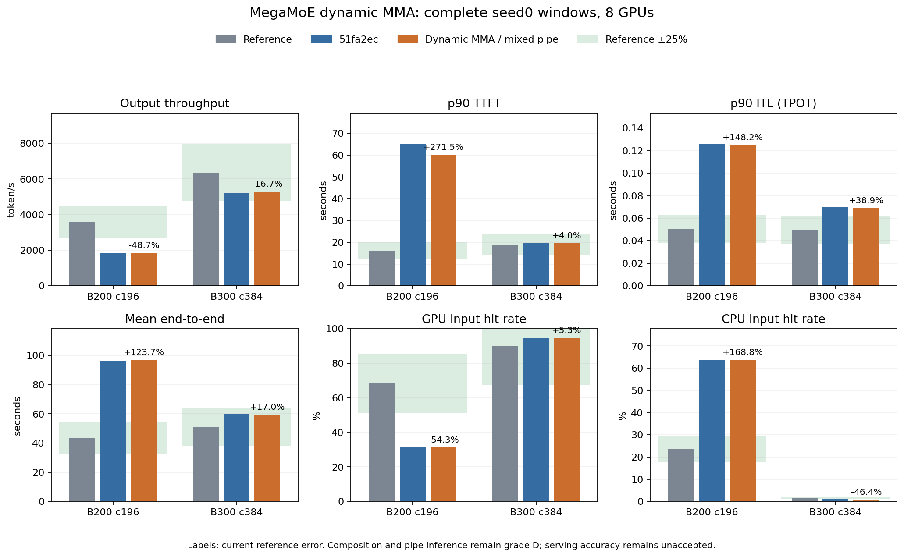

# MegaMoE 动态MMA尾部与混合输入pipe

接续 `51fa2ec`。本部分修正已核实的动态MMA执行行数，并把
原生MXF8F6F4的理论计算上限与FP4权重存储格式区分；完整/有效
输入、每M task权重/scales加载、shared、扫描及关键source
dispatch/combine沿用上一阶段。模型、原表、trace、capacity、
MTP接受规则和全部scale输入不改动。

## 源码依据和实现范围

固定DeepGEMM `e1f418c2a4f20818221f6b0e578b4c2f634d4c3f` 的
scheduler先计算每个expert M task的`valid_m`；对齐16后，kernel
交换A/B并据此更新MMA descriptor N。所有候选BLOCK_M均为16的
倍数，所以整数专家的总MMA行为`16*ceil(received/16)`，不是
每M task都执行完整BLOCK_M。例如BM240、expert1行，MMA实际16行，
上一版本的完整tile预算为240行。

`deepseek_v4_moe_work.py`按该尾部计算FLOP；每M task仍执行权重/
scales的完整TMA预算，不因MMA尾部减少或直接抵扣未实测L2流量。
fractional spectrum继续使用原有期望占用权重，明确不冒充真实
整数route直方图。新增work对象的MMA行、FLOP和issued weight
bytes；`deepseek_v4_moe.py`导出source/target逐层计权的相应ledger。

原生opcode为`tcgen05.mma.cta_group::2.kind::mxf8f6f4.block_scale`，
UMMA_K32；heuristic对`fp8xfp4`和`fp8xfp8`使用同一MXFP8FP4
family。原工作模型从权重storage dtype `mxfp4`取得pure NVFP4
峰值，与实际FP8 activation / FP4 weight的指令family不一致。
本部分在native work model内采用catalog FP8理论pipe：两SKU
均为4.5PF/s；保留FP4存储byte数和原全模块实测锚点，不改动
全局dtype alias或hardware catalog。

该pipe选择是**D级source/operand family推断**，不是mixed-input
issue cycles或效率的实测。历史kernel版本和buffer geometry、
原表经验rank偏斜、phase重叠及cache traffic仍有不确定性；没有
新增每SKU吞吐系数、没有serving拟合，也没有把mean-row整模块
替代关键rank。uniform全有效形状仍直接返回原始module锚点。

依据：上一阶段 `data/reference/agentx-moe-valid-work/`
`mma-ownership-followup.json` 的78个整数案例、固定kernel/
scheduler/ptx/heuristic源码，以及NVIDIA PTX matrix shape/scale
kind说明；本部分的source hash见 `agentx-moe-mma/scope-audit.json`。

## 逻辑验证

专项 **34 passed、17 subtests passed**。回归检查动态尾部与M
partition独立、compute-bound算术成本、每M task权重加载仍随
partition变化、subtoken期望工作不膨胀为全expert、all-padding
保留扫描但MMA/FLOP为0、两SKU理论pipe绑定和source/target
MMA/FLOP ledger的导出、层权重及reset。

全仓 **557 passed、80 subtests passed**，32个已有warning，
185.26秒。日志和hash：`data/reference/agentx-moe-mma/full-tests.txt`
及同目录scope audit。两个runtime文件为本部分唯一runtime修改。

完整窗口validator沿用上一阶段逐请求、输入/输出、取消释放、
缓存/预留/DP时间和完整/有效行检查；新增MMA行×6HI与FLOP
交叉守恒、TP1主点的有效selection下界、理论pipe及其D级说明。
source/target issued weight bytes记录期望TMA预算，不标为实测
HBM miss或真实route字节。

## 原表增长诊断

同一批原始实测行的摘要hash与上一阶段一致。相邻向上留出最大
误差仍为B20022.237%、B30021.419%。进一步保留全部同phase/
有效capacity、≤8倍的双向留出，而非只验相邻增长方向：

| 双向范围 | 上一版本超25%的对数 | 当前超25%的对数 | 当前最大绝对误差 |
|---|---:|---:|---:|
| B200，同申请/有效capacity，72对 | 26 | 20 | 67.083% |
| B300，同有效capacity，36对 | 18 | 18 | 65.092% |

小generation区的memory/启动/占用近似仍不能被该MMA修正解释；
最大误差仍为8→64。明确的指令计数修正不等于归一化范围或整体
25%精度通过，任务10.2仍需继续处理source shape效率、traffic、
历史kernel/buffer差异。结果为 `work-growth-followup.json`。

## 合成collector谱的独立诊断

`spectrum_review.py`仅抽取并执行原collector的四个CPU函数，
用新设的0/1/2种子生成十个uniform形状的integer histogram。
每个样本核对全局selection=valid rows×6、每expert≤valid rows、
每token6个expert唯一。未修改runtime或原始实测行；这些样本
不是实测serving route，也不是原计时表未记录的历史histogram。

原helper在384个expert上全局采样，再进行整数取整、守恒调整
和最重rank移到0。当前proxy对每个rank使用相同48-expert中点
谱，因此没有rank间方差。新样本的关键rank M task数与当前
local proxy之比，三个种子范围如下：

| 每rank输入行 | sampled max tiles / local proxy范围 |
|---:|---:|
| 1 | 1.333–1.333 |
| 2 | 1.211–1.644 |
| 8 | 1.259–1.301 |
| 64 | 1.122–1.242 |
| 1024 | 1.169–1.321 |
| 4096 | 1.285–1.675 |

这进一步说明local midpoint proxy不能被称为关键rank实际任务
数，整数任务分布与最大rank需要分别处理；原模块anchor中
保留的经验偏斜不保证在不同有效行数/partition下保持同一比例。
但这些task比值不测量startup、HBM/L2 miss、overlap或issue
效率，不能直接折算serving吞吐或作为新增straggler惩罚。
下一归一化阶段需要与上述缺口一并处理；当前工作模型仍保持
冻结。结果和helper hash为 `spectrum-followup.json`。

## 固定残差解释的可行性

进一步只读检验一个常见解释：在分析work上添加同一非负常数
`c`，能否解释全部同phase/有效capacity、≤8倍的原表对。
预测仍为`anchor_measured*(heldout_work+c)/(anchor_work+c)`；
将每对±25%条件化为关于c的两个线性不等式，再求交集。
没有选值、没有加入runtime，也没有使用serving reference吞吐。

所有交集为空，甚至分phase处理也不成立：

| 约束集合 | 交集下界（分析work µs） | 交集上界 | 可行 |
|---|---:|---:|---|
| B200 generation | 113.846 | -33.270 | 否 |
| B200 context | 0 | -21.275 | 否 |
| B300 generation（同有效capacity） | 105.518 | 49.788 | 否 |

B200 generation8→64要求c≥113.846，而512→128已要求
c≤-33.270；B3008→64要求c≥105.518，而4→1要求c≤49.788。
因此不能通过一项固定残差修正整个范围，也不能把低shape
模块时延直接认定为startup并逐SKU添加一个更有利的常数。

c是归一化公式的分析work单位，不是隔离测得的启动时延；
这些约束用来拒绝单常数解释，不能冒充留出验证了一个fitted
预测器。根因仍需处理shape效率、分布/取整、traffic和版本
范围，不能由上述空交集反推出某项真实kernel成本。
可复现公式及逐对约束：`residual-feasibility-followup.json`。

## 完整窗口（两组已严格验收）

全仓测试通过后已冻结runtime，启动B200 c196/B300 c384的seed0
主点：全部393 trace作为池、完整预热、3,600秒issue、30秒grace
及最多10秒取消收尾。两个原benchmark均exit0，两组独立/合并
严格验收通过；source/config/dataset/capacity身份、逐请求输出、
取消释放、DP时间以及MMA/FLOP/输入行ledger通过，未替换运行。

- 结果：`results/agentx-dsv4-full/native-moe-mma/20261008-dynamic-tails-pipe/`；
- 证据：`data/reference/agentx-moe-mma/`；
- 验收：`scripts/validate_agentx_moe_mma.py`；
- 监测：证据目录 `monitor.py` / `monitor-state.json`，不重启benchmark。

### B200完整结果

原进程exit0，完整预热2,171成功；测量7,834成功、96取消、
cancel_unreturned=0。严格验收通过原始输入/输出、source/config/
dataset/capacity身份、最终缓存/加载/在途预留释放、DP时间和
target/draft全输入/有效行守恒，也通过新MMA/FLOP交叉守恒及
理论pipe/D级范围检查。监测启动CLI的仓库import path缺口已
修复；只重跑validator并恢复监测，未重启或替换benchmark。

| 指标（8 GPU合计） | `51fa2ec` | 当前 | 参考相对误差 |
|---|---:|---:|---:|
| 输出token/s | 1,833.427 | 1,846.150 | -48.708% |
| 输入token/s | 238,426.892 | 239,855.502 | -49.043% |
| p90 TTFT秒 | 65.018327 | 60.202234 | +271.469% |
| p90 ITL秒 | 0.125575 | 0.124725 | +148.230% |
| 平均E2E秒 | 96.160640 | 97.011901 | +123.711% |
| GPU命中率% | 31.3993 | 31.1607 | -54.325% |
| CPU命中率% | 63.6045 | 63.7761 | +168.802% |

吞吐+0.694%，TTFT-7.407%；抢占64→73，GPU/CPU参考分别差
-37.062/+40.050个百分点。MoE每百万输出token分析成本
2,247.667→2,229.156秒（-0.824%），同步等待占比27.852%→27.801%。
变化很小，且E2E略增；真实计数修正和逻辑通过不能证明整体
性能精度改善至目标。缓存/闭环轨迹仍会改变完成工作组成。

source/target逐层计权MMA行约70,109,992,988.397和
25,274,499,283.365；对应expert FLOP约9.263e18和3.339e18，
都与6HI系数守恒。这些是D级期望谱的建模work ledger，
不是硬件计数器或真实整数route实测。

验收和分析为 `b200-validation.json` / `b200-analysis.json`。
原B300窗口现已完成，运行期间runtime hash保持冻结；当前整体
25%精度未通过，任务10.2的更宽归一化和原计划其他项继续保留。

### 最终成对结果

两组全部393 trace为池、完整预热及一小时issue协议一致。
B300预热4,249成功，测量21,398成功、217取消，
cancel_unreturned=0；两组正式length cap=0，最终在途、GPU引用、
加载、DMA pin和prefill预留无残留。计时pipe仍是D级理论推断，
不是硬件issue cycles实测。

| 指标（8 GPU合计） | B200 | B300 |
|---|---:|---:|
| 输出token/s | 1,846.150 | 5,297.304 |
| 较`51fa2ec`变化% | +0.694 | +1.867 |
| 输出参考误差% | -48.708 | -16.713 |
| 输入token/s | 239,855.502 | 701,445.389 |
| p90 TTFT秒 | 60.202234 | 19.675390 |
| p90 ITL秒 | 0.124725 | 0.068731 |
| 平均E2E秒 | 97.011901 | 59.548159 |
| GPU命中率% | 31.1607 | 94.6567 |
| CPU命中率% | 63.7761 | 0.8790 |
| 抢占 | 73 | 0 |

| 参考相对误差% | B200 | B300 |
|---|---:|---:|
| 输入token/s | -49.043 | -13.810 |
| p90 TTFT秒 | +271.469 | +4.016 |
| p90 ITL秒 | +148.230 | +38.891 |
| 平均E2E秒 | +123.711 | +17.049 |
| GPU命中率 | -54.325 | +5.291 |
| CPU命中率 | +168.802 | -46.367 |

B300 GPU/CPU参考分别差+4.757/-0.760个百分点。吞吐、TTFT、
E2E和GPU命中仍在25%内，ITL/CPU命中仍失败；B200多项失败。
本部分完成代码、逻辑和完整窗口验收，不关闭整体精度目标。

按每百万输出token分析，MoE成本B2002,247.667→2,229.156秒、
B300552.530→527.211秒（分别-0.824%/-4.582%）；B300其他非零
组件变化绝对值均<0.97%。同步等待B30016.662%→17.211%，
不能以某个分项单独推断全部闭环行为的改善或回归。B300最大
峰值41,585槽在rank2，full-input gate仅rank1/5的1/3次，仍无
抢占；B200接近满池的压力和实际完成工作组成继续单独保留。

B300 source/target逐层计权MMA行约88,657,927,785.611和
62,626,052,899.616，对应FLOP约1.171e19/8.274e18，6HI关系
及有效selection下界通过。两组所有estimate仍使用初版D级
非均匀组成，更宽原表归一化20/72、18/36失败及critical-rank
整数谱、cache traffic和版本缺口继续由后续独立阶段处理。

完整验收：`pipeline-validation.json`；成对分析：
`paired-analysis.json`；可复现脚本及PNG/SVG均在
`data/reference/agentx-moe-mma/`。分析归一化、合成谱和残差
可行区间没有作为runtime修正系数。最终当前代码三seed矩阵
与其他原计划项目仍未完成。

最终当前代码三seed矩阵、后端/消融/敏感性、capture/SP主干、
存储生命周期、历史发生实例映射、匹配AIC和attention SOL留出
仍属于原目标，整体目标保持进行中。
