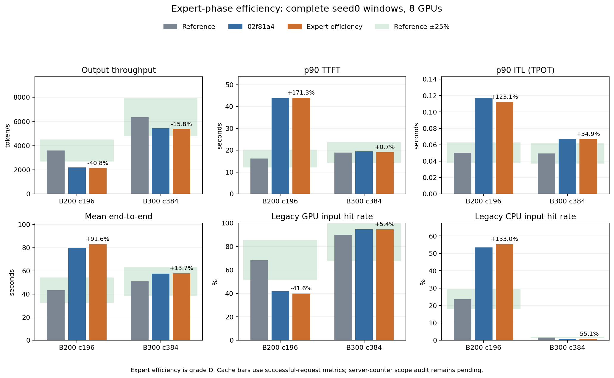

# Source-supported expert-phase efficiency transfer

Prepared in an isolated worktree, then integrated after explicit MTP commit
`02f81a4` and acceptance/analysis of all four original K3/K0 windows.
Preparation overlay and code hashes were verified before integration.
The integrated full suite passed601 tests/339 subtests in213.76 seconds,
with32 existing warnings. Both original primary complete windows have
completed and passed strict checks; paired analysis and plots are complete.

The previous constant full-module efficiency normalization fails15/72 B200
and14/36 B300 same-phase/effective-capacity directed operator comparisons.
Raw source anchors, dtype, histogram assumptions and full-input geometry
remain unchanged. The new estimate retains startup/input/final-combine work
at the original anchor efficiency and changes only expert/fused-dispatch
efficiency relative to same-capacity measured rows.

For source/target physical expert work Es/Et and target common work Ct,
the routed estimate is `A/Ws * (Ct + Et * gamma(Et)/gamma(Es))`, where A is
the original full-input module anchor, Ws is its physical work and gamma is
interpolated measured-module/work efficiency. Component efficiency is not
measured: assigning the whole-module efficiency shape to expert work remains
explicit grade D. Uniform input/routing has ratio1 and preserves A exactly.
Zero routing has no expert work and retains common work. Shared expert cost
continues to use its full owned rows without this adjustment.

Curves require at least3 distinct expert-work coordinates at one phase and
effective capacity. Missing metadata, singleton capacity, ambiguous work,
cross-capacity interpolation, invalid capacity and cross-buffer regimes
retain the previous physical normalization. No mean valid-rank module query,
latency scale, residual constant or unmeasured L2 traffic credit is introduced.

Supported source groups: B200 EP4/8 generation capacity576(10 rows) and
context capacity32832(6 rows); B300 EP4/8 generation capacity192(8 rows).
B300 other capacities and context have only singleton records. Reporting
these gaps is necessary; successful small-generation holdouts do not establish
full B300 context normalization or nonuniform serving accuracy.

Independent withheld-target operator oracles cover all72/36 directed
comparisons within8x, with maxima21.982%/21.813% and no error over25%.
Logic guards cover original uniform anchors, full-input/common scope,
zero routed work, metadata/capacity fallbacks and one full-row module lookup
for unequal ranks. A64-row padding example raises the routed estimate;
the change is not selected from its serving throughput effect.

Full isolated tests:601 passed,339 subtests passed,32 existing warnings,
211.48 seconds. The test log, code hashes, directed oracles and independent
shape/coverage audits are preserved in the main workspace under
`data/reference/agentx-mtp-execution/`. The historical source kernel revision,
real phase timers and nonuniform/padding performance truth remain unresolved.

Only this stage's two runtime files, tests and report were integrated.
The full integrated suite and B200/B300 primary full windows are required before
committing. Keep all393 traces, full warmup,3,600 simulated issue seconds,
30-second grace and up-to10-second cleanup. Final current-code curves, seed
coverage and the complete25% gate remain required.

Current-stage evidence is under `data/reference/agentx-moe-phase-efficiency/`.
`integration-audit.json` records the parent commit and checked preparation
hashes; `baseline-validation.json` aliases the already accepted K3 points
without changing original results. `validate_agentx_moe_phase_efficiency.py`
retains full source/config/cache/row/FLOP/cancel/time checks and additionally
checks common/expert routed-time conservation, efficiency categories,
same-capacity coverage, K3 command/transfer identity and every pool window.

Original full-window batch: `results/agentx-dsv4-full/native-moe-phase-efficiency/20261008-expert-shape/`. Benchmark PIDs3652354/3652282 are recorded with actual commands in `processes.json`; both original runs exited0 and passed single/combined strict checks. Frozen source hashes, final paired analysis and plots are retained.

## Original complete windows accepted

B200's original window exited0 in2,131.39 wall seconds and passed all strict
source/config/data/cache/row/FLOP/time checks. Profiling completed8,823
successful/90 cancelled requests;90 cache-pool windows were audited. Seven
metrics and all-terminal readmission accounting are retained in
`b200-validation.json`/`b200-analysis.json`.

| B200 metric | Current | Change versus02f81a4 | Reference error |
|---|---:|---:|---:|
| Output token/s | 2,132.462 | −2.478% | −40.753% |
| Input token/s | 277,618.234 | −4.143% | −41.020% |
| p90 TTFT, s | 43.974075 | +0.371% | +171.336% |
| p90 ITL, s | 0.112103 | −4.345% | +123.109% |
| Mean E2E, s | 83.070475 | +4.265% | +91.562% |
| GPU input hit | 39.8628% | −4.707% relative | −41.570% relative |
| CPU input hit | 55.2883% | +3.424% relative | +133.028% relative |

Preemptions/extra admissions fall49→36, principally on ranks3/4 (18/14).
CPU reload tokens fall6,817,280→5,430,528 and recomputed tokens135,431→111,658;
generated GPU/CPU reloads remain zero. Derived static capacity is unchanged.
Normalized MoE cost rises3.851% per million output tokens, while attention
falls1.396%; DP sync-wait fraction rises0.286690→0.291124. These are analysis
normalizations, not serving factors, and the changed closed-loop workload
does not isolate a single cost effect. Improved directed operator holdouts
do not establish nonuniform serving accuracy. Overall25% remains failed.

B300's original window also exited0 and passed strict checks in5,021.47 wall
seconds, with no preemption. Its output is5,358.027 token/s (−1.571% versus
02f81a4,−15.758% reference error), p90 TTFT19.050704s (+0.713% reference),
p90 ITL0.066779s (+34.947%) and mean E2E57.842442s (+13.697%). The existing
successful-request GPU/CPU hit metrics are94.7415%/0.7354%.

Both original runs retain all393 traces as the pool, full warmup,3,600 issue
seconds,30-second grace and up-to10-second cleanup. No benchmark was
restarted. Individual/combined strict validation, result/request-log hashes,
all-terminal readmissions, component normalization and capacity/source
identity are retained in `pipeline-validation.json`, point analyses and
`paired-analysis.json`. The original uniform anchors and shared/common scope
remain intact; actual nonuniform timing is still unmeasured.

The displayed cache-rate reference errors use the existing successful-request
metrics. Reference bmk rates derive from exported server prompt-source
counters; first-output/cancellation/scrape scope still needs a separate audit.
These cache errors remain legacy diagnostics pending that alignment. This
does not resolve the throughput/latency failures or establish overall25%.

Generated run and test logs are retained locally and ignored by Git. Their
immutable hashes, source identity and concise suite results remain in
`scope-audit.json`, `verification-summary.json` and preparation metadata;
raw pytest/observer/launcher output is not versioned.

The three large generated attention holdout/frontier detail dumps also remain
local and ignored. `attention-diagnostic-summary.json` retains their complete
summary statistics, provenance, file sizes and immutable hashes. The audit
scripts and source identities remain versioned so details can be reproduced;
no measurements or historical results are deleted.

## Read-only next-stage preparation

Fresh attention source-layout holdouts reproduce361 failures over25% per
SKU. The official AIC4-neighbor joint-log frontier diagnostic reduces these
to332/335 but still fails, so it is not integrated as an accuracy solution.
`attention_frontier_review.py`/`attention-frontier-prototype-followup.json`
retain all targets and source ownership. SGLang topk_transform calibration
cannot be directly applied to vLLM's different sampler kernel; source hashes
and this limit are in `attention-topk-provenance-followup.json`.

`aic_attention_review.py` uses the official AIC Rust module API at Pro/TP1/4,
BF16 attention,FP8 KV andFP8-block projection geometry. All eight raw source
Parquets match retained originals. Initial generation API-coordinate errors
are explicitly marked and retained; the corrected query uses AIC total
length `source_step+1` and native raw past-step keys. This covers attention
module import/query semantics, not a complete target-vLLM mixed serving step.
Source/layout/SOL and in-grid interpolation differences remain visible.

The next preparation is isolated at
`/tmp/tokensim-agentx-attention-causal-20261008`. Pinned vLLM causal row bounds
and DeepGEMM Q-block spans expose incorrect rectangular prefill indexer work
and source-generation coordinate interpretation. Correcting these also
exposes the missing B300 batch floor at non-grid contexts and cached match
ownership. The352-case oracle host-compiles the original source span function;
it verifies integer descriptors, not GPU time or HBM misses.

The isolated suite passes607 tests/2,640 subtests in225.62 seconds with32
existing warnings. Source/work checks preserve original generation anchors
at runtime `source_step+1`; current main sources remain frozen. Revised
source-layout holdouts still fail356 points per SKU, with maxima135.856%/
136.653%; this preparation does not close long-context or overall accuracy.
`attention-isolated-worktree.json` records the checked MoE overlay, seven
next-stage file hashes, failed initial fixtures, successful suite and limits.
Integration/full primary windows must follow this MoE stage's original
acceptance/analysis/independent commit.
