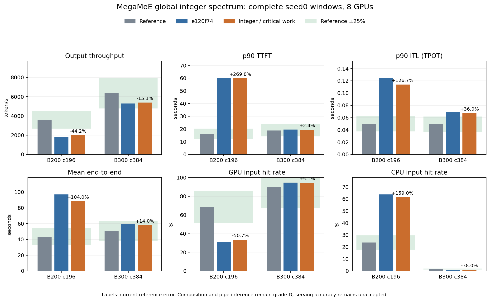

# MegaMoE 全局整数谱与关键rank工作量

接续 `e120f74`。本部分替代每rank相同的48-expert fractional
midpoint proxy：在全局expert空间生成固定source-family整数
样本，保留整数M task和MMA尾部，再计算每种放置下的关键rank
成本。原表、catalog、model、trace、capacity、MTP接受规则、
scale及完整source输入费用不改动。

## 源码和候选验证

原collector helper在全局384个expert上采样power_law_1.01，
round、按每expert≤global valid rows截断、round-robin恢复
selection总量，最后将max-load rank移到0。上一local midpoint
proxy没有rank方差，也没有真实整数ceil；已保存的新合成source
样本揭示两者差异，但没有恢复原计时histogram或serving route。

离线候选先执行原helper的CPU函数，固定诊断种子0/1/2。在每个
histogram内分别计算所有rank的BLOCK_M、MMA16对齐、完整每M
task权重/scales和activation work；每个放置取max-rank成本。
对未知hot-rank身份比较所有cyclic placement，再平均critical
work，不平均完整input或用mean-row整模块替代critical费用。
所有uniform全有效形状继续返回原始module anchor。

原表双向同phase/有效capacity、≤8倍留出：B20020/72→15/72、
B30018/36→14/36超25%，最大67.083%/65.092%→52.598%/50.789%。
这些结果支持继续核查源分布范围，但不能声明归一化整体通过。
部分相邻比较变差：32→64约26.788%/26.053%超界，保留全部
失败点，没有挑选更有利seed或删除样本。离线文件为
`data/reference/agentx-moe-spectrum/prototype-validation.json`。

## 可移植实现及明确限制

正式运行只使用既有NumPy依赖，不导入AIC或Torch。新模块
`deepseek_v4_moe_spectrum.py`使用局部MT19937和CPU float32
inverse-CDF、round-to-even、clip与原round-robin计数规则。
三个固定synthetic draws不消耗global NumPy/Python RNG，也不
改变MTP模拟seed；整数selection=global valid rows×topk和每
expert≤global valid rows始终成立。immutable histogram/geometry
缓存跨source/target/worker复用，不跨profile统计误计热身。

原CPU helper的10个EP4/8快照（global rows8/64/128/512/8192、
三seed）与实现一致，测试不依赖外部helper。额外高范围核对
到131,072行的已检查样本一致；262,144行seed0有两个计数差异，
源于float32 library reduction边界，已明确保留，不声称任意
CPU/library的bit-exact复现或历史表seed匹配。
核对原helper和正式模块的36个新样本、changed-count数量及
selection总量保存在同目录 `port-validation.json`，不使用
离线prototype代替正式模块的端口检查。

`deepseek_v4_moe_work.py`按真实完整input选择BLOCK_M，保留
largest input扫描、shared及关键source dispatch/combine。
expert math、M task和roofline分别按各rank的整数谱计算；每
cyclic placement保留max rank，再平均其critical work。fused
expert/dispatch使用这些样本的`mean(max(expert,dispatch))`，
没有额外straggler multiplier。MMA/FLOP/issued weight ledger
现在是critical synthetic work的期望，不是owned实际GPU FLOP
计数器，继续以D级标注。

cyclic placements不是所有任意permutation或真实expert mapping；
固定三draw也不是完整统计置信区间。原始module histograms、
kernel revision/buffer geometry、mixed issue效率、HBM/L2 traffic
和phase overlap仍未测得。没有per-SKU常数、serving拟合、无证据
L2抵扣或原表修改；原表anchor中经验skew不能被称为已恢复。

## 验证

专项 **42 passed、37 subtests passed**：原helper snapshot、全局
integer守恒/unique-topk、rank variance、max-load marker、critical
rank不被变成mean、BLOCK_M分区/尾部、cyclic invariant、all-padding、
CPU RNG隔离、immutable cache和profile ledger均覆盖。

全仓 **565 passed、100 subtests passed**，32个已有warning，
181.80秒。log/hash为 `data/reference/agentx-moe-spectrum/full-tests.txt`
和同目录scope audit。runtime只改work model与新增spectrum模块。

正式增长诊断原始行hash与上一阶段相同：双向失败15/72、14/36，
最大52.598%/50.789%；相邻32→64仍失败。因此逻辑修正不等于
25%精度通过，source shape效率/traffic和版本范围仍需继续。

## 完整窗口（两组已严格验收）

全仓通过后已冻结两个runtime文件，B200 c196/B300 c384的原
seed0 benchmark子PID已核对。全393 trace为池，完整预热、
3,600秒issue、30秒grace和最多10秒取消收尾；观察超时不替换
或重启运行。两组独立/合并strict检查与成对分析完成后再提交。
两组原进程现均exit0，单点及联合strict检查通过；运行期间
source hash与full-suite版本一致，成对结果如下。

- 结果：`results/agentx-dsv4-full/native-moe-spectrum/20261008-global-integer-critical/`；
- 证据：`data/reference/agentx-moe-spectrum/`；
- 验收：`scripts/validate_agentx_moe_spectrum.py`，继承全请求/缓存/
  input/DP/MMA/FLOP检查，并核对synthetic范围和无mean-row替代；
- 监测：证据目录 `monitor.py` / `monitor-state.json`。

整体原目标、剩余cost范围、capture/SP输入归属、存储生命周期、
历史发生实例映射、匹配AIC、attention SOL留出及最终当前代码
三seed曲线/后端/消融/敏感性均未据本阶段逻辑测试宣布完成。

### B200完整结果

原进程exit0，完整预热2,171成功；测量8,346成功、146取消，
cancel_unreturned=0、正式length cap=0。单点strict检查通过逐
请求input/output、版本/config/dataset/capacity身份、最终
引用/加载/DMA/prefill预留清理、DP时间、target/draft全输入与
有效行，以及MMA/FLOP/source费用范围守恒。

| 指标（8 GPU合计） | `e120f74` | 当前 | 参考相对误差 |
|---|---:|---:|---:|
| 输出token/s | 1,846.150 | 2,009.013 | -44.183% |
| 输入token/s | 239,855.502 | 258,429.288 | -45.097% |
| p90 TTFT秒 | 60.202234 | 59.939587 | +269.849% |
| p90 ITL秒 | 0.124725 | 0.113885 | +126.656% |
| 平均E2E秒 | 97.011901 | 88.443360 | +103.952% |
| GPU命中率% | 31.1607 | 33.6552 | -50.669% |
| CPU命中率% | 63.7761 | 61.4440 | +158.973% |

输出+8.822%、input+7.744%；ITL-8.691%、E2E-8.832%；
TTFT仅-0.436%。抢占73→67，GPU/CPU参考分别差约
-34.568/+37.718个百分点。改善不代表整体25%验收通过；
capacity、prefix/闭环轨迹和完成工作组成的影响仍需保留。
按每百万输出token分析，MoE2,229.156→1,902.796秒（-14.641%），
同步等待占比27.801%→29.614%。归一化只用于分析，不作为
runtime倍率；分项比例随统一expert工作及闭环轨迹改变。

验收为 `b200-validation.json`。B300原完整窗口和成对strict
检查已完成，见下节；整体精度仍未通过。

### 最终成对结果

B300完整预热4,249成功；测量21,853成功、215取消，
cancel_unreturned=0、正式length cap=0。两组source/config/
dataset/capacity/seed身份、原始output/input、MMA/FLOP/DP
ledger及最终GPU引用、在途加载、DMA pin和prefill预留清理均
通过。histogram仍是D级synthetic，未作为硬件route实测。

| 指标（8 GPU合计） | B200 | B300 |
|---|---:|---:|
| 输出token/s | 2,009.013 | 5,398.921 |
| 较`e120f74`变化% | +8.822 | +1.918 |
| 输出参考误差% | -44.183 | -15.115 |
| 输入token/s | 258,429.288 | 711,921.546 |
| p90 TTFT秒 | 59.939587 | 19.369015 |
| p90 ITL秒 | 0.113885 | 0.067319 |
| 平均E2E秒 | 88.443360 | 57.980610 |
| GPU命中率% | 33.6552 | 94.4737 |
| CPU命中率% | 61.4440 | 1.0154 |
| 抢占 | 67 | 0 |

| 参考相对误差% | B200 | B300 |
|---|---:|---:|
| 输入token/s | -45.097 | -12.522 |
| p90 TTFT秒 | +269.849 | +2.396 |
| p90 ITL秒 | +126.656 | +36.039 |
| 平均E2E秒 | +103.952 | +13.968 |
| GPU命中率 | -50.669 | +5.088 |
| CPU命中率 | +158.973 | -38.049 |

B300 GPU/CPU参考分别差约+4.574/-0.624个百分点。其吞吐、
TTFT、E2E和GPU命中在25%内，ITL/CPU仍失败；B200多项失败。
本部分逻辑与完整窗口通过不关闭整体25%目标或更宽归一化。

MoE每百万输出token分析成本B2002,229.156→1,902.796秒，
B300527.211→497.347秒（-14.641%/-5.665%）；B300其他非零
组件变化绝对值<0.94%。同步等待占比B20027.801%→29.614%、
B30017.211%→17.540%，不把比例上升单独认定为同步回归。
closed-loop完成工作/长度/缓存组成均随执行成本改变，runtime
没有新增归一化倍率。B300各rank full-input gate均0，峰值
44,441槽在rank2，无抢占；B200仍接近容量边缘。

B200 full/valid/padding为132,581,000/127,890,490/4,690,510；
B300341,563,416/326,258,334/15,305,082。padding占3.538%/
4.481%，逐层2.126%/3.729%，zero-routed rank pass440/4。
所有693,696/949,120次estimate使用composition；全输入、有效
selection下界及MMA×6HI/FLOP交叉守恒成立，仍是建模关键rank
期望预算，不是owned实际GPU操作计数。

严格验收：`pipeline-validation.json`；成对分析：
`paired-analysis.json`；脚本与PNG/SVG均在
`data/reference/agentx-moe-spectrum/`。保留全部15/72、14/36
双向失败、32→64相邻失败及source version/capacity限制。
历史fixed192场景未被采用；下一部分继续核对实际source范围。
最终当前代码三seed矩阵及其他原计划项目仍未完成。

## 只读历史kernel几何核对

公开DeepGEMM历史源码说明了版本几何的实质差异：

| snapshot | 输入capacity对齐 | BLOCK_M/其他配置 |
|---|---|---|
| 26/04 `7f2a703ed51a` | wrapper按选定BM对齐 | 该snapshot固定BM192，mixed FP8/FP4和动态valid尾部已存在 |
| 26/07 `559d79fb6994` | LCM384 | 16/32/64/96/128/192按active rows阈值选择；小形状K256、部分epilogue warpgroups变化 |
| 本轮pinned `e1f418c2a4f` | LCM1920 | 16/32/64/128/192/240、当前source heuristic |

原表effective capacity与fixed192 fingerprint相符：B200全部
16行、B300全部19行匹配；July384只匹配0/16、6/19；pinned1920
均0。matching fingerprint不证明实际collector kernel commit，
fork或额外alignment策略也可能一致；原始版本仍未选定。

进一步只改变离线partition为BM192的敏感性场景，仍采用当前
整数/critical与其余work公式：双向失败15→5（72对）、14→5
（36对），最大误差46.258%/46.090%。该场景不是完整April
kernel重建，也没有匹配其ring/shared/schedule。它说明历史
几何差异值得优先核对，但不能因为误差较小就选一个版本，
更不能声明已修正计时。所有original anchor/表/runtime保留原值。

canonical URL、commit/hash、逐行capacity fingerprint和全部
场景误差为 `kernel-history-followup.json`；原snapshot临时文件
只读取，未修改reference vLLM目录、未下载历史镜像。
