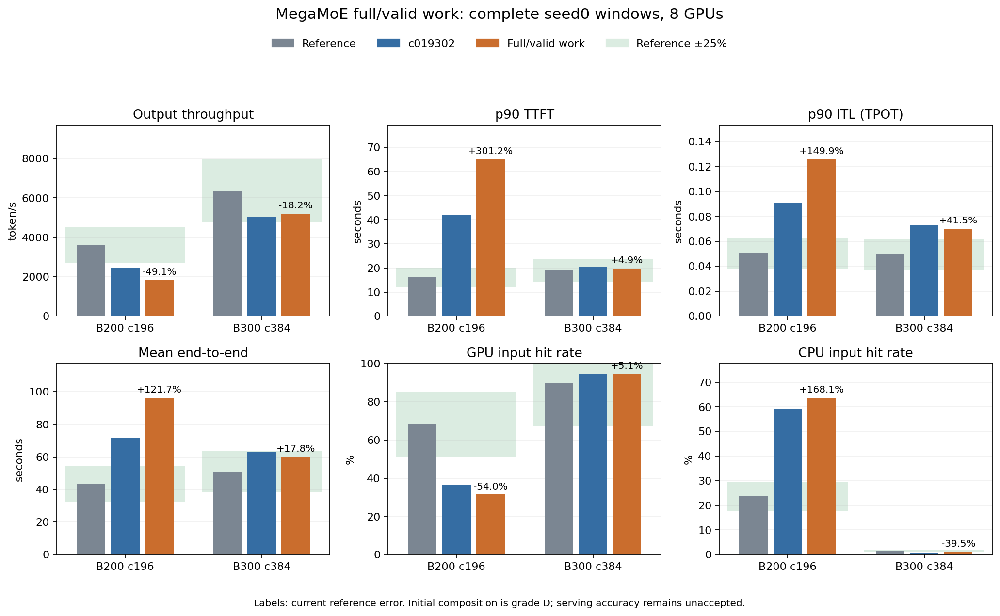
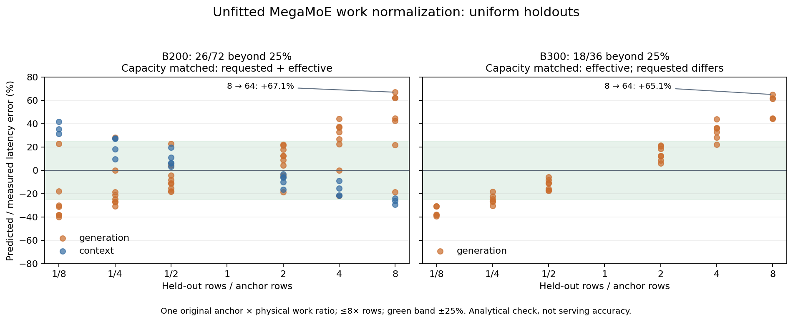

# MegaMoE 完整输入、有效路由与工作量组成

接续 `c019302`。本部分区分完整前向/捕获输入与有效路由行数，
补齐 contiguous SP padding mask、idle/dummy 和三个 MTP pass，
以完整模块实测锚点归一化非均匀/部分padding的物理工作估算。
模型、原表、trace、capacity和所有timing scale保持原值。

## 源码与实现

只读 vLLM `30f5c01d4ebb` 默认 `VLLM_MOE_SKIP_PADDING=1`；输入
staging 把padding的top-k ID改为−1、weight改为0。DeepGEMM发送
与专家计数只处理非负ID，输入量化、扫描、BLOCK_M选择与shared
expert却仍使用整个forward tensor。`sp_padding_mask`与`sp_shard`
采用同一个连续切片，并把新增的SP尾部填为True。

`RankShape`新增valid token/request身份，保留原完整forward形状；
idle/dummy有正的forward输入但有效路由为0。MTP初始pass沿用
target的有效query，后两个pass按有效request计数，dummy前向和
图形状继续存在。EP的每个SP子rank使用其实际切片有效范围。

计时不把最大rank替换为平均行数。使用最大完整input的uniform
实测模块作锚点；source/target分别计算：输入staging/scans、按
每个rank完整输入选择BLOCK_M后的有效expert tile、最慢发送方
的NVLink payload与最终source-side combine。归一化为target/source
物理phase工作，保留uniform全有效样本精确值，shared成本仍按
完整自有输入计入。未再添加独立EP all-to-all或straggler惩罚。

统计新增owned full/valid/padding和layer rows、zero-routed pass，
并导出uniform锚点/组合routed耗时和有符号差额。main与draft均
参与汇总，routed+shared仍与总moe组件守恒。

## 明确的估算范围

非均匀cost属于**D级source-derived composition**。原表未提供
分项timer或逐专家直方图；采用collector的power_law_1.01 inverse
CDF中点分位数构建期望local spectrum，实测锚点保留经验rank
偏斜，但没有声称复现某次真实route。fractional占用不直接变为
全专家整数tile；每token unique-top-k上限与selection总量守恒。

按source BLOCK_M、完整tile FLOP预算和逐tile weight/scales traffic
估算（后续源码审计确认MMA有效尾部动态缩小，需独立修正），未
抵扣未实测的跨M-tile L2缓存。fused dispatch/expert采用roofline
重叠界，输入与final combine另外保留，startup来自原hardware
catalog参数。historical kernel revision、expert分布、缓存流量和
phase overlap仍有不确定性；不根据吞吐或reference误差调整参数。

因此某些非均匀eager形状可能比旧uniform-max surrogate更贵：旧
maximum不是在所有BLOCK_M几何下都成立的物理上界。离线形状
仅作为归属诊断；正式结果必须通过两个完整窗口，不能为提升吞吐
直接缩小成本或用mean-table值代替完整module。

## 验证与完整窗口

专项 **40 passed、15 subtests passed**。全仓 **553 passed、78
subtests passed**，32个已有warning，184.42秒。日志保存在
`data/reference/agentx-moe-valid-work/full-tests.txt`。

回归覆盖uniform锚点、graph full/valid差异、SP[8,8,4,0]有效
切片、SP尾部、MTP/dummy、all-padding仍有扫描与正执行耗时、
BLOCK_M由完整输入选择、selection守恒、导出/重置和组件时间。

运行期间冻结runtime，B200 c196和B300 c384原seed0窗口均exit0，
两组独立及合并严格验收通过：
全部393 trace为池、完整预热、3,600秒issue、30秒grace及取消
收尾。source/config/dataset/capacity身份、请求计数、最终释放、
DP时间和target/draft/MoE行数守恒均通过；成对分析如下。

- 结果：`results/agentx-dsv4-full/native-moe-valid-work/20261008-full-valid-rows/`；
- 证据：`data/reference/agentx-moe-valid-work/`。

整体25%和最终当前代码三seed全矩阵仍未完成，stage逻辑通过不
代表模型精度通过。后续capture主干成本、buffer生命周期、历史
发生实例映射、匹配AIC和SOL留出问题继续按原计划独立处理。

## 运行期间的独立源码核对

新增可复现的只读诊断 `data/reference/agentx-moe-valid-work/capture_review.py`，
结果为同目录 `capture-ownership-followup.json`。覆盖两SKU的TP1/4/8、
同步decode、远端context强制eager和TP8 staged q=1。没有修改冻结的
六个runtime文件，没有将离线候选增量加入当前模拟。

本地源码在主干mHC之后all-gather进入attention，再reduce-scatter
进入FFN/router。图执行的投影使用完整descriptor行数；主干mHC、
norm和router使用完整SP分片，实际sparse query保留真实metadata。
target输出head已经使用descriptor行数，不应再次补计。

| 代表形状：本rank20行 | 当前mHC行 | 当前router行 | 源码mHC/router行 |
|---|---:|---:|---:|
| TP1，远端decode64行 | 20 | 20 | 64 |
| TP4，远端decode64行 | 5 | 20 | 16 |
| TP4，远端context512行，eager | 5 | 20 | 5 |
| TP8/DP1，本rank20行 | 3 | 20 | 3 |

其中TP4的router问题同时影响eager和capture，不只缺少图填充。
补计attention共享投影必须保留源表下限：B300 CSA的20行查询已
使用64行源形状，同一64行capture不产生额外共享增量。候选SOL
分配只是诊断，不能作为实测分项；当前两个完整窗口仍只验收MoE
完整/有效行及cost组成，主干capture/SP另作后续独立阶段。

`monitor.py`只观察原benchmark PID及命令身份、核对冻结source hash，
在原进程正常完成后逐SKU及合并执行严格validator。它不启动或
重启模拟；运行状态保存在 `monitor-state.json`。

独立的 `buffer_sm_review.py` 重放pinned ring容量公式，复现此前
132/148 SM情景的native buffer大小。64–256 SM假设扫查显示：
B200同一71,040行ring覆盖98–217 SM，B300同一122,880行ring覆盖
64–169 SM；更高情景跨越1,920行对齐边界，会增加28.13MiB。
这解释两项原情景相同，但不证明实际SM数或完全独立于SM。
结果为 `buffer-sm-sensitivity-followup.json`；持久buffer仍按未
SP分片的scheduler预算计算，当前memory/capacity和generic reserve
均未改动。后续存储身份和生命周期另作独立实现及完整验收。

## B200完整结果及归因

B200原进程exit0，全393 trace池、完整预热、一小时issue、30秒
grace和取消释放通过严格检查。预热2,171成功；测量7,846成功、
144取消、cancel_unreturned=0，正式length cap=0。validator同时
验证target/draft/MoE全输入行、61层/单层计权和真实调度有效行
守恒。全窗没有uniform全有效pass，因此Counter导出未包含该零
类别；验收读取改为缺省0，仍严格核对类别合计，不修改runtime。

| 指标（8 GPU合计） | 上一提交 | 当前 | 参考相对误差 |
|---|---:|---:|---:|
| 输出token/s | 2,451.044 | 1,833.427 | -49.061% |
| 输入token/s | 316,008.485 | 238,426.892 | -49.346% |
| p90 TTFT秒 | 41.831277 | 65.018327 | +301.186% |
| p90 ITL秒 | 0.090656 | 0.125575 | +149.921% |
| 平均E2E秒 | 71.902900 | 96.160640 | +121.748% |
| GPU命中率% | 36.2642 | 31.3993 | -53.975% |
| CPU命中率% | 59.0805 | 63.6045 | +168.079% |

吞吐下降25.198%，抢占59→64；相对参考GPU/CPU分别差
-36.8237/+39.8785个百分点。逻辑验收通过不代表精度通过，当前
B200精度比上一提交更差，不能宣称本部分提升性能。

MoE owned full/valid/padding为123,768,710/119,612,830/4,155,880；
padding占3.358%，按层计权后占1.973%，zero-routed rank pass376。
所有614,112 pass均进入非均匀/部分padding组成。当前uniform锚点
累计8,684.598秒，组合routed累计14,742.173秒，比锚点高69.751%；
signed difference=-6,057.575秒，shared214.151秒，二者与MoE
component14,956.324秒守恒。每百万输出token的MoE分析成本
1,264.146→2,247.667秒，上升77.801%；此归一化没有用于runtime。

这使非均匀BLOCK_M和未实测tile-cache traffic/phase overlap成为
后续成本诊断重点。保留原表及D级估算，不为回到参考吞吐调整
参数。同步等待占比34.074%→27.852%同时下降，也不能单独视为
性能改善：统一的组MoE成本变大，会减少相对等待比例。

rank4完整输入门限计数14,667最高，GPU命中约3.46%，接近满池；
rank7取消30最多。rank6 GPU命中约72.54%，峰值槽位17,463；
各rank压力不同且闭环轨迹已变，不把吞吐变化直接归为准入回归。
模型、原表、数据池和容量预算均保持原值。

验收：`b200-validation.json`；分析：`b200-analysis.json`（均在
`data/reference/agentx-moe-valid-work/`）。B300完整结果及合并严格
验收已完成，见下节；整体目标和原生成本范围修正仍未完成。

## 两组完整成对结果

两组均使用全部393 trace池、完整预热、3,600秒issue和30秒
grace。B300预热4,249成功，测量21,285成功、246取消，
cancel_unreturned=0，正式length cap=0；两组最终缓存引用、
DMA pin、加载、在途prefill预留和取消状态均无残留。

| 指标（8 GPU合计） | B200 | B300 |
|---|---:|---:|
| 输出token/s | 1,833.427 | 5,200.193 |
| 较c019302变化% | -25.198 | +2.877 |
| 输出参考误差% | -49.061 | -18.239 |
| 输入token/s | 238,426.892 | 690,914.303 |
| p90 TTFT秒 | 65.018327 | 19.848340 |
| p90 ITL秒 | 0.125575 | 0.070011 |
| 平均E2E秒 | 96.160640 | 59.925115 |
| GPU命中率% | 31.3993 | 94.5209 |
| CPU命中率% | 63.6045 | 0.9912 |
| 抢占 | 64 | 0 |

| 参考相对误差% | B200 | B300 |
|---|---:|---:|
| 输入token/s | -49.346 | -15.104 |
| p90 TTFT秒 | +301.186 | +4.930 |
| p90 ITL秒 | +149.921 | +41.478 |
| 平均E2E秒 | +121.748 | +17.790 |
| GPU命中率 | -53.975 | +5.140 |
| CPU命中率 | +168.079 | -39.521 |

B300相对参考GPU/CPU分别差约+4.621/-0.648个百分点。B300
吞吐、TTFT、E2E和GPU命中保持在25%内，ITL和CPU命中仍失败；
B200多项失败。本部分并未达到整体精度门槛，也不替代最终
当前代码的三seed曲线、后端、消融与敏感性实验。

B300 full/valid/padding为330,425,112/317,513,208/12,911,904；
padding占3.908%，逐层占3.246%，zero-routed pass4；全部
907,648次estimate为composition。uniform锚点10,742.972秒，
composed routed9,957.200秒，signed difference+785.771秒。
MoE每百万输出token分析成本590.764→552.530秒，下降6.472%；
attention仅+0.475%，其余非零组件变化绝对值均<0.56%。这些
分析归一化没有作为runtime倍率。rank2峰值47,513槽最高、
完整输入gate21次，其余rank为0，且均无抢占；与B200接近满池
的非均匀压力不同。闭环轨迹和完成工作组成的变化继续保留。

严格验收：`pipeline-validation.json`；成对分析：
`paired-analysis.json`；可复现脚本和PNG/SVG均位于
`data/reference/agentx-moe-valid-work/`。六个runtime文件与启动
时hash一致，原始表、模型、trace、容量、seed和scale输入未改。

## 非均匀成本的进一步诊断（不改runtime）

`work_growth_review.py`使用上一个同phase原始实测点作为唯一
锚点，以当前物理work比例预测下一个点；目标实测值不进入公式。
所有uniform实测点在正式runtime仍直接返回原锚点，这里只检查
组成模型能否解释其增长。没有拟合参数或调整原始表。

| 原表留出范围 | 对数 | 超25%的对数 | 最大绝对误差 |
|---|---:|---:|---:|
| B200，同申请/有效buffer capacity | 14 | 0 | 22.237% |
| B300，同有效buffer capacity，申请值不同 | 7 | 0 | 21.419% |

B200最大误差来自generation8→16；B300同有效容量的比较也以
8→16为最大误差。B300申请capacity随点变化，不把其所有其他
邻点伪称为同容量留出。B200 generation固定512/有效576，
context固定32768/有效32832；B300前7对generation点的有效
capacity均为192。当前pinned源码的token alignment=1920，与
原记录不同，历史DeepGEMM版本仍未核实。

源码的weight TMA坐标包含expert和N/K，不包含M-block；因此
不同M tile重复访问同一批权重。scheduler按M-block/N-cluster
枚举任务。heuristic明确说每M block有权重reload成本，但未
实测其HBM/L2分摊。当前模型对每tile完整权重/scales计流量，
不抵扣未实测L2；这是显式估算，不能把TMA请求字节声称为实测
HBM miss字节。小M行数的BLOCK_M边界也会使raw work不连续：
例如B200 uniform80→81行，work271.706→217.272µs，而BM16→32。
这只是解析边界诊断，没有该相邻点的实测时延证据。

uniform增长留出通过并不验证非均匀rank、真实expert histogram、
M tile cache、fusion/overlap或端到端精度，继续保留D级和B200
退化结果。证据：`work-growth-followup.json`；原始行的摘要校验值、
源码校验值、每对预测/误差、容量身份和边界诊断均已保存。

### 扩展到运行时归一化方向和8倍范围

相邻向上的14/7对不足以覆盖partial/unequal工作相对完整锚点的
缩小方向。补查同phase/有效capacity、相差不超过EP8倍率的
所有双向原表对；每次仍只用一个anchor实测值，不用held-out
时延构造预测，也没有选择能通过的方向或删除失败样本。

| 双向8倍范围 | 对数 | 超25%的对数 | 最大绝对误差 |
|---|---:|---:|---:|
| B200，同申请/有效capacity | 72 | 26 | 67.083% |
| B300，同有效capacity，申请值不同 | 36 | 18 | 65.092% |

两SKU最大误差均为generation8→64：B200预测521.637µs，实测
312.203µs；B300预测508.915µs，实测308.262µs。相邻单步误差
可以在25%内，多步work归一化仍累计超界。uniform全有效运行
依然精确返回原表，但这不能证实partial/非均匀组成的效率沿用。
因此不能以14/7对相邻结果宣称该组成增长范围整体通过25%。

该缺口转入后续独立成本修正：区分issued TMA bytes与HBM/L2
traffic，检查源模块shape效率、旧版buffer/kernel几何和target
非均匀BLOCK_M之间的归属；保留完整输入扫描、shared、最慢
source dispatch/combine和真实有效行。不使用serving拟合倍数，
不以mean-row整模块替换关键rank，也不直接抵扣未实测L2流量。
两组完整窗口及成对验收现已完成；这些成本缺口另作独立修正。

### 明确的MMA尾部计数缺口

继续核对pinned kernel和scheduler后确认：`TaskInfo.valid_m`取该
expert最后一个M block的真实剩余行；`get_umma_aligned_valid_m`
将其对齐到16；kernel交换A/B后，以该值更新MMA descriptor的N。
当前组成模型仍把每个M tile都按完整BLOCK_M估算FLOP，这与该
动态执行范围不一致，不应把完整tile预算当作源码实际MMA行数。

`mma_ownership_review.py`核对BLOCK_M16/32/64/128/192/240和
13种整数专家接收行数，共78个案例。实际MMA行总量均为
`16*ceil(expert_received_rows/16)`；例如BM240、expert1行，
当前完整tile预算240行，pinned实际MMA16行。权重/scales的TMA
仍每M task执行，不能同时按该尾部减少整份权重读取或直接抵扣
未实测L2。fractional期望谱也不声称为真实整数route直方图。

另一待核对项是计算pipe：实际opcode为
`tcgen05.mma.cta_group::2.kind::mxf8f6f4.block_scale`、UMMA_K32，
而当前storage dtype `mxfp4`映射到`nvfp4`峰值。PTX文档把混合
E4M3/E2M1的MXF8F6F4与E2M1成对的MXF4/MXF4NVF4分列，K/scale
形状不同；opcode区别本身不证明issue cycles或某次实测吞吐。
现阶段先记录需独立核实的计算上限，不能为对齐reference选择
一个更有利的pipe速率。

这些证据进一步具体化任务10.2。当前六个runtime文件仍不改动；
原完整结果保留并明确为初版D级组成，不宣称该FLOP预算已对齐
真实kernel。证据：`mma-ownership-followup.json`，包含源码hash、
canonical URL、78个整数案例及计算pipe的未核实范围。
