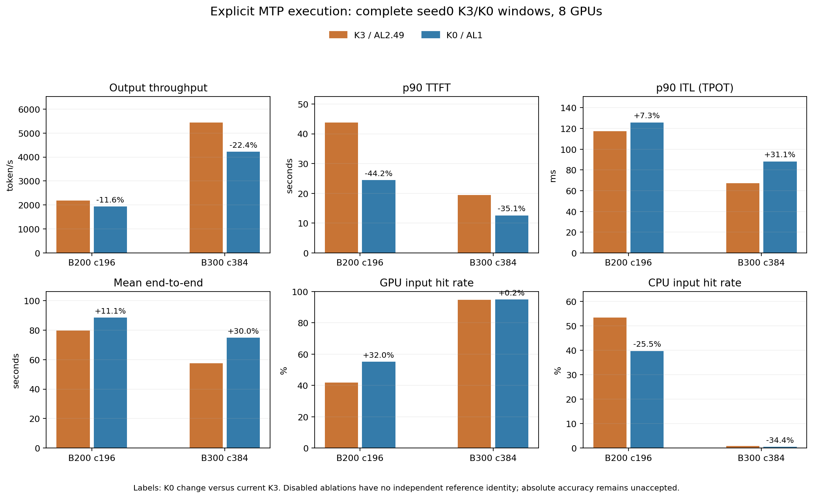

# Explicit MTP execution and disabled ablation

Prepared in an isolated worktree while native-memory windows were frozen,
then integrated after native-memory commit `8c42261`. Its original complete
windows have all completed and passed strict implementation validation.
Enabled K3 behavior matches `8c42261` exactly. Overall reference accuracy
and the final current-code experiment matrix remain incomplete.

The `nomtp` matrix previously set acceptance length to1 while leaving cache K3.
The scheduler used q1/lookahead0, but workers still initialized q4/draft K3 and
allocated the MTP weights, KV and persistent buffers. A disabled-backend unit
that directly injected q1 did not cover this worker configuration path.

`--mtp_num_speculative_tokens` now carries K through the runner and worker.
K0 with AL1 removes the draft estimator, MTP weights and KV groups, draft
persistent/graph buffers, and makes target/dummy query width1. Explicit K3/AL1
keeps drafting, q4 and lookahead3 while output progress is one token. K3/AL2.49
retains the original reference behavior, including its random2/3 progress.
Without an explicit K, existing AL2.49 callers use K3 and AL1 callers disable
the full path. Invalid K/acceptance combinations are rejected.

The matrix `nomtp` points now explicitly use K0. Enabling/disabling the path
does not alter architecture metadata, target embeddings or lm_head dtype.
The reusable MTP module weights are counted once when enabled, regardless of
the number of draft iterations, and are omitted when the module is disabled.

Eight real initialized workers per SKU verify scheduler, backend and DP dummy
state. Disabled cases have no MTP weight tensors, draft KV/eagle groups,
target/drafter hidden, draft topk or draft graph descriptors. An AL1-on case
retains q4 and lookahead3. A shape-only disabled step records one main MoE
pass and no draft counters. All8 K3 reference memory budgets remain identical
to the frozen native-memory launch audit.

The tests also keep positive speculative reservation coverage: explicit K3
uses physical ends515/1027 rather than the prior ghost-disabled configuration.
The source-derived remaining commitments are243+1 and33+1, including virtual
window positions that have already lost physical pages.

Isolated full repository validation: **595 passed,193 subtests passed**,32 existing
warnings,203.26 seconds. Integrated rerun: **595 passed,193 subtests passed**,
32 existing warnings,202.87 seconds; evidence is in
`data/reference/agentx-mtp-execution/full-tests.txt`. The initial suite's three fixture failures and the
successful rerun are both retained in the native-memory preparation evidence.

Native-memory's original full windows are strictly accepted and its commit
is complete; this stage is now integrated with a passing full suite. Both
original K3 primary full windows and both K0 disabled-path windows have
exited0 and passed strict validation. They retain the
393-trace pool, full warmup,3,600 simulated issue seconds,30-second grace and
up-to10-second cancellation cleanup. Final current-code ablations and random
experiment points still require the plan's seed coverage and accuracy audit.

Preparation metadata and source hashes:
`data/reference/agentx-native-memory/mtp-isolated-worktree.json` in the main
workspace. No serving multipliers, reference-capacity overrides or original
trace/operator/model changes are introduced by this stage.

Integrated runtime/source freeze and process identities are recorded in
`data/reference/agentx-mtp-execution/scope-audit.json` and `processes.json`.
Original benchmarks: B200 K3 `3228318`, B300 K3 `3228320`, B200 K0
`3228321`, B300 K0 `3228319`; observer sessions `44106` and `87379`. All four actual
eight-rank cache configurations match the derived explicit K configuration.
Results are under `results/agentx-dsv4-full/native-mtp-execution/20261008-effective-K/`.
The observer never restarts a benchmark after an observation timeout.

The next timing investigation remains read-only. In
`phase-efficiency-holdout-followup.json`, all72 B200 and36 B300 directed
same-phase/effective-capacity uniform comparisons with row ratios<=8 are
recomputed with each target measurement withheld. Full-input startup,
preparation and final combine retain the original anchor efficiency; only
expert/fused-dispatch work uses neighboring measured/work efficiency. The
failures over25% fall from15/14 to0/0, with maxima21.982%/21.813%.
Whole-module efficiency is still assigned to a component analytically; there
are no measured phase timers. Nonuniform/padding efficiency and historical
kernel correspondence remain unproven, and B300 singleton capacities/context
have no transfer curve. No runtime cost, original anchor, mean-rank module
query, cache credit or serving multiplier was changed by this investigation.

Complete-window analysis entry:
`data/reference/agentx-mtp-execution/analyze_complete_windows.py` checks result
hashes against strict validation before comparing K3 to the previous stage
and current K0/K3. Disabled points have no independent reference identity;
their speed/storage changes are ablations, not absolute accuracy acceptance.

B200 K3's original complete window has exited0 and passed strict validation.
All seven paired performance/cache metrics equal commit8c42261 exactly:
output2,186.639 token/s, p90 TTFT43.811635s, p90 ITL0.117195s,
GPU/CPU41.8317%/53.4578%,49 preemptions and563,928 draft passes.
Evidence: `b200-main-validation.json` / `b200-main-analysis.json`.
This verifies unchanged enabled behavior; overall reference accuracy remains
unaccepted. All four original B200/B300 K3/K0 windows are now accepted.

Next expert-phase transfer code is being prepared separately at
`/tmp/tokensim-agentx-moe-efficiency-20261008`, with ownership guards and
all original uniform anchors preserved. Its supported curves require at
least3 distinct expert-work coordinates at one phase/effective capacity;
missing/singleton capacity, cross-capacity or ambiguous work retains the
original normalization. Zero routed work retains all common input/startup
cost, and shared expert cost is unchanged. This implementation is isolated
and has not been merged, benchmarked or committed. Metadata is recorded in
`moe-isolated-worktree.json`; current MTP benchmark sources remain frozen.
The isolated full suite passes601 tests and339 subtests,32 existing warnings,
211.48 seconds. `moe-isolated-full-tests.txt` retains the log. This establishes
logic/source ownership coverage and the directed operator holdout checks;
actual nonuniform serving accuracy remains unaccepted, and the next-stage
primary complete windows have not started.

B200 K0's original complete window has exited0 and passed strict
disabled-path validation: warmup2,171 successful, profiling8,311 successful /
92 cancelled, output1,933.178 token/s, input253,899.186 token/s, p90 TTFT
24.432746s, p90 ITL0.125809s and mean E2E88.527665s. GPU/CPU hit rates
are55.1994%/39.8098%,39 preemptions and zero draft counts/components.
Weights decline133,615,585,400→131,450,759,116B and calculated pool slots
22,370→25,357; there are no capacity overrides. K0 output is11.591% lower
than current K3, while TTFT is44.232% lower and ITL7.350% higher. Module
cost, query width and storage all change; closed-loop trajectories change
too. This is not an isolated accepted-length multiplier.
Evidence: `b200-disabled-validation.json` / `b200-disabled-analysis.json`.

The first K0 validator rejected unnormalized explicit defaults and missing
K3 reference documentation. It now normalizes only inherited cache backend,
parallel/GPU declarations and host provenance, then checks real host budgets,
all other point fields, stable execution commands and complete transfer JSON.
The original run was retained and not repeated. Observer44106 stopped on
that validation error; observer87379 resumed the same original B300 processes.
Observer87379 has now completed combined validation successfully.
Repair evidence is `validator-bootstrap-followup.json`.

`aic_module_review.py` uses AIC's official `EngineHandle.for_database` /
`evaluate_ops_json` Rust interface with explicit legacy0.5.10 source access,
FP8-activation/MXFP4 weights,7168/3072 hidden/intermediate,384 experts/top6
and EP4/8. All58 GB200/B200 and70 GB300/B300 exact/midpoint module queries
match TokenSim's original-table lookup within2e-12us after the ms→us unit
conversion. Source Parquet hashes equal the retained imported originals.
This validates routed-only import/query semantics, not independent serving
accuracy, target-vLLM builder support, shared experts or the full mixed step.
The complete same-model/dtype AIC comparison remains unclosed. Evidence:
`aic-module-followup.json`.

`current-matrix-check.json` records the current35-point startup audit and
checks every declared TP/DP/EP/PP topology against its actual cluster,
GPU count and forwarded explicit K. All35 match, with the393-trace pool
and3,600-second issue window retained. This is configuration evidence,
not a replacement for current-code full curves or final seed coverage.

B300 K3's original complete window also exited0 and passed strict validation.
All seven paired metrics equal8c42261 exactly: output5,443.543 token/s,
p90 TTFT19.435934s, p90 ITL0.067346s, GPU/CPU94.7123%/0.7771%,
zero preemptions and710,496 draft passes. Evidence is
`b300-main-validation.json` / `b300-main-analysis.json`; the explicit K
configuration preserves the enabled reference behavior on both SKUs.

The isolated transfer shape audit in `moe-prototype-ownership-followup.json`
retains uniform anchors and zero-routed common cost exactly. A64-row padded
shape increases routed estimates207.854→281.637us on B200 and
205.264→276.696us on B300; full/common and shared cost are unchanged.
The mixed512-row example remains unchanged (boundary/singleton capacity
support). This diagnostic has no real nonuniform timing ground truth, and
the implementation is not selected because it improves serving throughput.

## Final four-point results and accuracy limits

B300 K0 also exited0 and passed strict disabled-path validation: warmup
4,249 successful, profiling17,760 successful/300 cancelled, zero draft
counts/components and no preemption. Its original window is retained;
no benchmark was restarted. Both K0 points have no independent reference
identity and are ablations, not absolute accuracy acceptance.

Throughput below is combined across eight GPUs; GPU and CPU hit rates
retain their respective input-token denominators.

| Metric | B200 K3 | B200 K0 | B300 K3 | B300 K0 |
|---|---:|---:|---:|---:|
| Output token/s | 2,186.639 | 1,933.178 | 5,443.543 | 4,224.009 |
| Input token/s | 289,617.468 | 253,899.186 | 712,099.257 | 570,630.847 |
| p90 TTFT, s | 43.811635 | 24.432746 | 19.435934 | 12.608688 |
| p90 ITL, s | 0.117195 | 0.125809 | 0.067346 | 0.088316 |
| Mean E2E, s | 79.672458 | 88.527665 | 57.642956 | 74.914725 |
| GPU hit | 41.8317% | 55.1994% | 94.7123% | 94.8791% |
| CPU hit | 53.4578% | 39.8098% | 0.7771% | 0.5100% |
| Preemptions | 49 | 39 | 0 | 0 |
| Derived GPU pool slots/rank | 22,370 | 25,357 | 91,260 | 95,246 |
| Draft passes | 563,928 | 0 | 710,496 | 0 |

K0 output falls11.591%/22.403% versus current K3. TTFT falls44.232%/35.127%,
while ITL rises7.350%/31.138% and E2E rises11.115%/29.963%. Module cost,
query width and storage all change, as do closed-loop trajectories,
admission and cache behavior. These are complete ablation effects.

Both disabled points reduce weight bytes/rank133,615,585,400→131,450,759,116.
Derived K0 KV budgets are31,159,411,188/117,038,938,364 bytes and
log-equivalent capacities2,466,945/5,728,614 tokens/rank. Capacity changes
follow the removed storage; no reserve deletion or capacity override is used.

| Enabled reference error | B200 | B300 |
|---|---:|---:|
| Input throughput | −38.471% | −12.500% |
| Output throughput | −39.248% | −14.413% |
| p90 TTFT | +170.333% | +2.750% |
| p90 ITL | +133.243% | +36.092% |
| Mean E2E | +83.726% | +13.304% |
| GPU hit, relative | −38.684% | +5.353% |
| CPU hit, relative | +125.313% | −52.588% |

B200 still fails multiple metrics. B300 ITL and CPU hit fail the25% gate;
CPU hit differs by−0.861913 percentage points, which does not replace its
relative-error criterion. Existing operator/kernel/allocator uncertainty is
unchanged. Seed0 stage windows do not replace final three-seed curves,
SimpleCPU/Mooncake/HBM comparisons, corrected MTP/cache ablations or transfer
sensitivity on the final source. Historical kernel correspondence, native
allocator/graph liveness, fixed historical routing occurrences, same-scope
AIC comparison and attention long-context holdouts remain open in the plan.

Original benchmark wall times are2,210.25/5,079.79/3,052.50/6,703.97 seconds
for B200 K3/B300 K3/B200 K0/B300 K0. `processes.json` now records all four
terminal statuses. `pipeline-validation.json`, all four point validation/
analysis files and `paired-analysis.json` retain strict checks and complete
comparisons. `scope-audit.json`, `progress.json` and
`final-closeout-check.json` verify frozen runtime/runner/matrix hashes,
passing suite/result/request-log identity, terminal status and analysis/plot
hashes. Overall reference accuracy remains unaccepted.
