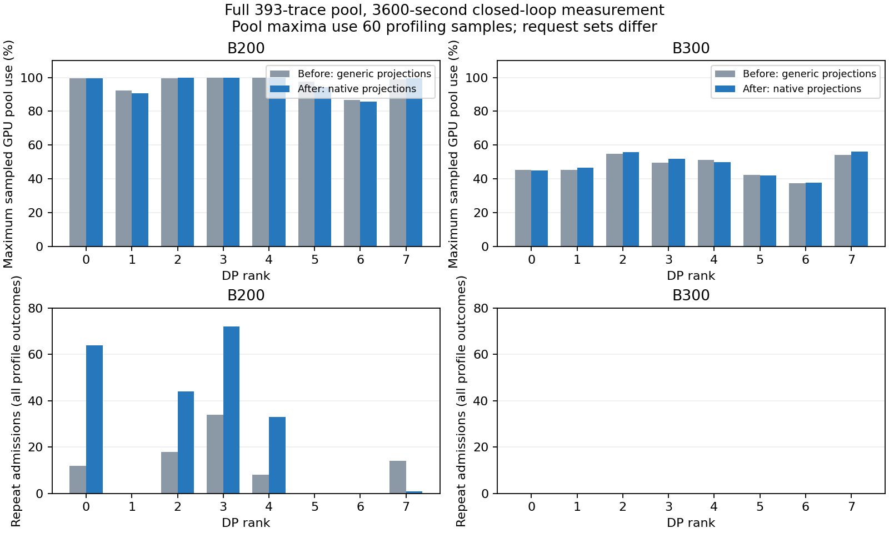

# DSV4 低秩投影与逐算子 GEMM dtype

本阶段把 DSV4 attention 的 GEMM 路径从通用 QKV/O 投影换为实际低秩与分组几何，并按 operator dtype 查询 router 和 lm_head。基线为 `18eba15` 的完整 SimpleCPU 管线；硬件、模型权重、KV/CPU 容量、回放、路由、调度、带宽和种子不变。其余 native attention/indexer/compressor/mHC/MegaMoE/MTP 成本继续分阶段实现。

只读源码 `30f5c01d4ebb` 的 `attention.py` 定义 replicated `fused_wqa_wkv`、column-parallel `wq_b`、分组 `wo_a` 和 row-parallel `wo_b`；`nvidia/ops/o_proj.py` 使用 `fp8_einsum("bhr,hdr->bhd")`，输出 BF16。所有主 attention 层有这些投影，TP 只分片三个实际 sharded 矩阵，不能把 replicated 输入投影再除 TP。

| TP1 矩阵 | 输入／输出几何 | dtype | 计时 |
|---|---|---|---|
| fused_wqa_wkv | 7168 → 1536+512 | FP8 block | GEMM 表优先 |
| wq_b | 1536 → 128×512 | FP8 block | GEMM 表优先 |
| wo_a | 16 组：4096 → 1024 | FP8 block，输出 BF16 | 一个 grouped kernel |
| wo_b | 16×1024 → 7168 | FP8 block | GEMM 表优先 |
| router | 7168 → 384 | BF16 | matrix 估算；融合 gate 附加工作待完善 |
| lm_head | 7168 → 129280 | BF16 | GEMM 表优先 |

Hash 路由的前三层仍计算 gate 矩阵以得到权重，不能因路由 ID 来自 hash table 就删除它。source `model.py:1058/1098` 的小 batch GateLinear 与大 batch bf16_mega_gate 两条路径都使用 gate weight。主投影 rows 使用本步实际 query token 数；本阶段仅修正 lm_head 的 BF16 查询，head 行数与 MTP verify/draft rows 随后整体对齐。

收尾复核发现一项已有的 head 行数近似：TokenSim 当前按完成 prefill 或 decode 的请求数查询 head，至少计一行；本地 V2 `model_runner.py:_prepare_inputs` 则在非投机路径为每个本步请求准备一行 logits，部分 prefill 的输出虽不会推进请求，仍执行输出投影。MTP 时还有 bonus/draft 行与 TP batch sharding。不能把 lm_head dtype 修正当成其调用次数已全部对齐，计划任务 12 保持未完成；这一处随 MTP 的 query/logits 行数改动一起修复并重新跑完整窗口。

TP4/TP8 的 local heads 为 32/16、local groups 为 4/2；fused_wqa_wkv 保持完整形状，另外三个权重各按 TP 分片。每层这四个矩阵在 TP1 为 299,892,736 个元素，旧稠密 QKV/O 估算为 946,864,128；这一差异来自结构，不由吞吐误差拟合。

新增 `grouped_gemm` 的几何键包含 groups、M/N/K、权重 dtype 和输出 dtype，work 包含各组独立权重、FP8 输入及 BF16 输出。解析模型对整个 grouped kernel 收取一次 launch，不能作为 16 次串行 GEMM 启动，也不能当成跨组稠密矩阵。现有 `mla_bmm` 表对应 V3 MLA、BF16 torch BMM 等路径，缺少匹配的 DSV4 FP8 einsum 形状与范围，未借作同配置实测。当前 grouped 项为明确的解析估算；新增表允许后续导入匹配测量。

Shared expert 在当前源码的 DEP8/TP1 DeepGEMM 路径可以融合进 MegaMoE；不能在未知计时范围的表上再独立叠加两个 GEMM。本阶段不修改 routed/shared MoE 组合，下一部分随匹配的 MegaMoE 表及原生代价一起核对。Indexer 与 compressor 的输入投影还存在多 stream overlap，也须一起核对模块表范围，避免投影重复计费。

`ShapeManifest` 的 DSV4 投影、router、head 采集请求同步更新为运行时形状，旧 GQA 模型不变。五个新增用例覆盖 TP1/4/8 参数分片守恒、引擎查询不再发出旧稠密形状、61 个 gate site、BF16 head、grouped bytes/FLOPs/单 launch、采集 manifest 与运行时匹配，以及计数重置不改变估算或缓存。收尾时重新执行 `python -m unittest discover -s tests -q`，全仓 **405 项测试通过，95.052 秒**，记录见 [完整测试证据](../data/reference/agentx-native-gemm/test-validation.json)。

profiling 开始时现在重置 `OperatorStats` 的查询计数、step count 与 component seconds，保留 lookup cache 和 shared missing-shape collection checklist。旧结果的时间分解包含预热，不能直接按 component totals 做前后百分比比较；本次要求所有 profiling component seconds 相加等于 DP 各 rank 的 local compute seconds（包括 dummy）。缺失形状清单仍为全程采集范围，报告明确标注。

完整结果目录为 `results/agentx-dsv4-full/native-gemm/20261001-low-rank-projections/`。两组保持全部 393-trace 池、42/0 种子、预热及 3600 秒发出、30 秒宽限和十秒取消。逻辑及单算子查询不作为精度证据，正式验证由两个完整主点与逐请求／池／时间守恒组成。完整原生算子与 MTP、两后端和曲线仍未完成，不因投影修正而提前判定精度通过。

两组进程均正常退出。B200/B300 的预热分别完成 2,171/4,249 个请求；正式测量发出 5,066/10,992，成功 4,828/10,638，到期取消 238/354，错误为零。吞吐的有效观察时长分别为 3,629.991/3,629.790 秒，包含宽限期内的完成，不能把分母固定为 3,600 秒。全部取消确认，最后十六个 GPU 池只保留 null slot；loaded waiting、加载、未来预留、GPU DMA pin、CPU pin 与写回任务均归零。

| 指标（输出吞吐为 8 GPU 合计） | B200 基线 | B200 本阶段 | B300 基线 | B300 本阶段 |
|---|---:|---:|---:|---:|
| 成功请求 | 4,351 | 4,828 | 10,034 | 10,638 |
| 输出 token/s | 869.795 | 986.135 | 2,047.526 | 2,218.252 |
| 首次 GPU 命中率 | 23.453% | 24.592% | 94.710% | 94.633% |
| 首次 CPU 命中率 | 70.930% | 69.816% | 0.523% | 0.630% |
| 抢占次数（整个测量阶段） | 86 | 214 | 0 | 0 |
| 重复 CPU 加载 token（成功请求） | 9,791,744 | 23,144,192 | 0 | 0 |

输出吞吐分别提高 13.376%/8.338%。这些是闭环一小时结果；执行速度改变后，发出时间、完成集合、trace 领取通道及缓存竞争也会变化，不把吞吐比解释为同一固定到达序列上的单算子加速比。

`validate_agentx_gemm.py` 核对当前运行时源码与数据 SHA-256，将基线全部运行时源码与提交 `18eba15` 逐文件对照，核对基线结果与已提交的 loaded-KV 验收记录。前后 point/defaults、后端、带宽假设、CPU connector 配置、完整缓存配置和各 rank 静态预算完全一致；变更范围仅为本阶段八个运行时文件。调度器、混合缓存管理器、SimpleCPU connector、router 和回放源码都未变化。动态驱逐次数和峰值占用属于结果，不能当作预算不一致。

同一原始请求和 pass 不足以证明路由身份相同：`replay.py:_make_request` 的 correlation UUID 还包含 lane。B200/B300 共有 4,561/10,396 个原始请求身份，其中 208/506 个改变了目标 rank；加入 lane 后真正共有的回放实例为 4,345/9,799 个，其输入、请求输出长度及目标 rank 全部一致。路由实例变化来自闭环领取通道变化，不能误报为 consistent-hash 算法漂移。

B200 全测量终态记录的重复准入在 rank 0/2/3/4 分别为 64/44/72/33，rank7 为 1，其余为零；对应总数 214。rank 0/2/3/4 的最高采样 GPU 占用分别为 99.715%/99.900%/99.772%/99.957%，与基线一样处于容量边缘。loaded-KV 容量门槛仍阻止 5,360 次过早恢复，每个窗口的物理 used+free 守恒，RUNNING 名额不超上限。B300 最高采样占用约 56.0%，没有容量门槛、重复准入或抢占。当前证据把退化定位到容量紧张的运行状态；它不证明余下调度行为已完全对齐，也没有固定到达诊断来单独归因吞吐、路由实例和 KV 竞争的影响。保留这项退化，在原生模块及 MTP 接入后继续核对。

抢占与完成的重算不能混为同一个计数：每次抢占立即计入 worker，`Request.finish_recompute` 只在上下文恢复完成时累计；恢复中再次抢占或到期取消不构成一次已完成重算。报告同时区分全部终态请求的重复准入和成功请求的重复加载，避免使用不同集合解释同一个总数。

本阶段 profiling 的分项和分别为 18,224.588/24,144.686 rank·秒，与 DP 各 rank 的 local compute seconds（含 dummy）一致；再加同步等待，与八个 rank 的测量总时间守恒。GEMM 占 38.00%/32.08%，MoE 占 48.37%/49.36%，显式通信占 7.12%/9.01%。这仍是当前近似路径的分解，不把它当成真实 serving 的分项。每种硬件探测的六种 token 形状中，三个普通低秩 GEMM 都精确命中对应实测，分组 `wo_a` 始终标为解析估算。

| 对照参考的相对误差 | B200 | B300 |
|---|---:|---:|
| 输出吞吐 | −72.602% | −65.123% |
| p90 TTFT | +569.550% | +30.806% |
| p90 ITL（当前单 token 路径） | +316.100% | +258.671% |
| GPU 命中率 | −63.953%（−43.630 个百分点） | +5.265%（+4.733 个百分点） |
| CPU 命中率 | +194.258%（+46.089 个百分点） | −61.536%（−1.009 个百分点） |

只有 B300 的 GPU 命中率达到优先目标，整体精度尚未达到相对误差 25% 的可接受门槛。B200/B300 的 KV 静态容量估算没有变化，仍分别偏差 −25.449%/−3.321%。下一部分优先修复 MoE 从每个请求的专家 0 开始分配的统计偏差，接入已确认的 DSV4 MegaMoE 计时范围；随后分阶段完成原生 attention、mHC 和 MTP，不用整体拟合系数补平已知缺口。

结构化完整证据见 [管线、版本与前后对比](../data/reference/agentx-native-gemm/pipeline-validation.json)。以下图的池占用是 60 个 profiling 窗口的采样最大值，重复准入包含成功和取消请求；它不表示固定请求序列的因果对照。



复现本阶段验收：

```bash
python scripts/validate_agentx_gemm.py \
  results/agentx-dsv4-full/native-gemm/20261001-low-rank-projections \
  --output data/reference/agentx-native-gemm/pipeline-validation.json \
  --plot data/reference/agentx-native-gemm/cache-pressure-comparison.png
```

该命令检查对应运行快照与当前运行时源码一致；后续代码变更后不能拿旧窗口冒充新版本验收，需使用新版本完整结果。每种硬件的模拟器实际耗时分别为 1,547.305/3,269.471 秒；这些实际耗时不作为模拟吞吐的分母。
