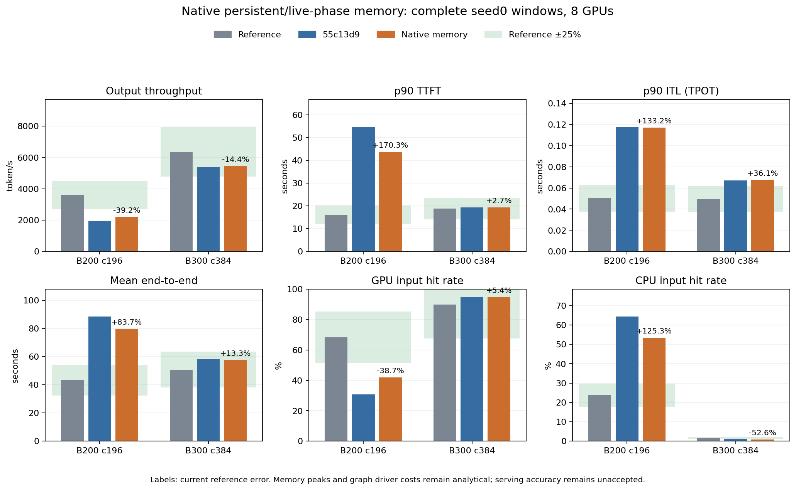

# 原生持久存储与活跃区间预算

接续`55c13d9`，独立推进缓存容量任务9.1。硬件catalog、模型/
权重、原operator数据、trace、调度参数、算子计时及scale均
保持原值。容量从源码存储形状重新计算，不使用参考pool覆盖。

## 实现范围

`deepseek_v4_buffers.py`移植pinned DeepGEMM e1f418c2a4f的
1920 capacity alignment、全部8个BLOCK_M候选、ring/live-pool
与SF容量、workspace ABI和连续存储区间。shared L1 X别名
不另计，其他shared/L1/L2/combine storage分别保留；同一
class cache key的target/MTP层共享一份持久分配。persistent
capacity仍使用未SP分片的scheduler token budget，SMS=148
为两SKU同一D级假设，不冒充参考设备query或已匹配timing
kernel版本。此前全部16个EP/shared/SM源码区间案例逐项复现。

新预算区分持久存储、eager live-phase bound和graph pool：

- target和drafter各自topk/hc hidden、per-device FlashInfer
  128MiB、factory-shared compressed/SWA RoPE、first-layer
  mHC broadcast权重与runner/drafter输入buffer；
- indexer单lane共享K-gather/radix：`40*max_model_len/4`
  compressed rows，MXFP4 values/scales各自256B对齐；
- model caller RHS保留的旧residual/hidden、层内attention/
  FFN residual、SP gather及tail owner、FP32 compressor投影、
  main/indexer query quant、TP1融合FP8输出与其他TP显式输出
  quant、grouped z、独立BF16 y、head/norm及selected logits；
- context/profiling indexer logits512MiB，chunk-loop RHS可能
  同时保留上一logits；FULL decode按padded压缩context形状；
- MTP全行norm/projection、外层wrapper保留的embedding和
  normalized hidden，SWA没有indexer；K次复用persistent。

多个layer site沿同一计算顺序使用source live intervals，不
再把每层workspace相加。graph按参考capture sizes和target
q=4/draft初始q=4、后续q=1的descriptor数量计数。一个共享
pool取最大target/draft live bound，单独保留target manager
output；每descriptor增量用source target profiler的1MiB floor
作D级proxy（同样用于未测draft），不称为实际driver测量。
eager peak与graph pool相加，不用未知allocator overlap扣减。

generic attention继续此前估算；generic fused-MoE没有native
ring，保留其未核实的activation/EP envelope。engine显式
传入实际execution和attention backend，预算不根据EP配置
擅自认定使用native kernel。runtime/NCCL4,169,138,176B完整
保留，未删除3.5GiB reserve或加入negative overlap credit。

## 初版主点预算

| 项目（GiB/每GPU） | B200 | B300 |
|---|---:|---:|
| 权重 | 124.439 | 124.439 |
| runtime/NCCL reserve | 3.883 | 3.883 |
| 原生持久存储（含对称buffer） | 4.321 | 6.845 |
| eager live-phase bound | 3.401 | 6.802 |
| graph shared pool/output/driver proxy | 0.355 | 0.697 |
| KV可用 | 25.601 | 104.440 |
| GPU物理槽 | 22,370 | 91,260 |
| 上一提交GPU物理槽 | 21,021 | 87,073 |

native对称buffer2,246,689,664 /3,950,321,024B，首个容量
8192/16384向上对齐9600/17280。indexer共享workspace
714,080,256B，一份compressed与一份SWA RoPE各268,435,456B。
这些allocation/lifetime输入没有使用参考容量或serving误差。

## 测试与完整验证

专项**30 passed、20 subtests passed**。覆盖16个pre-port ABI/
存储oracle、shared alias/跨层cache、未分片persistent capacity、
三份residual、SP尾部owner、TP1 FP8 output、draft norm full
owner、indexer loop与decode logits区别、MTP disable/iteration
storage复用、generic/unfused分支、正扣除/槽整除/拒绝override。

全仓**587 passed、123 subtests passed**，32个已有warning，
191.10秒。四个runtime源码已记录hash。完整B200 c196 /
B300 c384：全部393 trace池、完整预热、3,600秒issue、30秒
grace及最多10秒取消收尾。原进程观察超时不重启。

strict validator继承前一阶段全部请求/取消/缓存引用/预留/
DP/时间/行/FLOP/source检查。容量变更逐rank复算，除budget/
computed slot及等效值外的cache字段必须一致；硬件、weights、
reserve、layout、配置与dataset均保持身份。live phase、连续
区间、persistent求和、graph各项和及KV槽整除余数单独校验。

- 结果：`results/agentx-dsv4-full/native-memory/20261008-storage-live-phases/`；
- 证据：`data/reference/agentx-native-memory/`；
- 验收：`scripts/validate_agentx_native_memory.py`。

两组原完整窗口均已完成single/combined strict验收，成对
分析与图表已完成。源码、配置、数据与容量变更可追溯；
本部分实施范围验收通过，整体精度未通过。

### B200原完整窗口（已严格验收）

原进程exit0，wall2,224.77秒。预热成功2,171，profiling
成功9,139、取消139；全部393 trace池、完整3,600秒issue及
grace/取消收尾通过。所有90个记录窗口的池容量/used/free/
DMA与CPU限容、最终null slot/在途预留释放、行/FLOP/DP/
组件时间及源码/配置/数据身份均通过。单点证据为
`b200-validation.json` / `b200-analysis.json`。

| B200指标 | 55c13d9基线 | 本部分 | 相对参考误差 |
|---|---:|---:|---:|
| 输出token/s（8 GPU） | 1,951.106 | 2,186.639 | −39.248% |
| 输入token/s（8 GPU） | 258,158.956 | 289,617.468 | −38.471% |
| p90 TTFT（s） | 54.778145 | 43.811635 | +170.333% |
| p90 ITL（s） | 0.117729 | 0.117195 | +133.243% |
| mean E2E（s） | 88.526692 | 79.672458 | +83.726% |
| GPU命中 | 30.7026% | 41.8317% | −38.684% |
| CPU命中 | 64.3526% | 53.4578% | +125.313% |
| 抢占 | 108 | 49 | — |

成功profiling请求重复准入105→49，CPU重复加载13,308,928→
6,817,280 token，GPU重复加载1,808,128→1,353,728，重算
188,253→135,431；generated reload两类仍0。含取消请求的
额外准入也为49，rank0/2/3/4分别8/7/12/22。rank4 GPU命中
9.47%、完整输入门控13,313次，仍属明显容量压力点。

同步等待比例30.477%→28.669%，每百万输出token的MoE分项
−12.036%、attention−1.352%、elementwise−0.565%，而GEMM
+1.954%、lm_head+1.334%。这些归一化用于分析，不回写费用；
静态算子计时完全未改，闭环batch/轨迹随容量变化，不能把
单项百分比当成隔离出来的原因。吞吐+12.072%、TTFT−20.020%、
E2E−10.002%，但所列7项性能/命中精度仍全部超过25%。

KV日志等效值另按一致分母比较：参考pool为8 GPU合计，先
按DEP8分为每rank，再与计算值比较，不把总pool与单rank
相除。对比证据为`capacity-reference-comparison.json`；它
不把逻辑等效token当成物理槽，不替代整体§5.2验收。

### 双SKU完整结果与成对结论

B300原进程也exit0，wall5,122.87秒。预热成功4,249，
profiling成功22,022、取消241；103个窗口全部通过限容/
used+free/引用/预留与时间/请求/计数守恒。B300无抢占、
重复准入、GPU/CPU重复加载或重算。原benchmark各执行一次，
未重启或替换；完整预热、393 trace池、3,600秒issue、
30秒grace及最多10秒取消收尾保留。

| 指标（8 GPU合计） | B200本部分 | B200参考误差 | B300本部分 | B300参考误差 |
|---|---:|---:|---:|---:|
| 输出token/s | 2,186.639 | −39.248% | 5,443.543 | −14.413% |
| 输入token/s | 289,617.468 | −38.471% | 712,099.257 | −12.500% |
| p90 TTFT（s） | 43.811635 | +170.333% | 19.435934 | +2.750% |
| p90 ITL（s） | 0.117195 | +133.243% | 0.067346 | +36.092% |
| mean E2E（s） | 79.672458 | +83.726% | 57.642956 | +13.304% |
| GPU命中 | 41.8317% | −38.684% | 94.7123% | +5.353% |
| CPU命中 | 53.4578% | +125.313% | 0.7771% | −52.588% |
| KV日志等效容量/每rank | 2,176,344 | −20.657% | 5,488,874 | +1.328% |
| 抢占 | 49 | — | 0 | — |

B300吞吐较55c13d9+0.926%，TTFT+0.590%、ITL+0.184%、
E2E−1.331%；GPU/CPU分别差+4.812/−0.862个百分点。B200
GPU/CPU分别差−26.391/+29.732个百分点。容量增加使B300
更多input留在GPU，CPU命中参考相对误差反而更大；不能
合并tiers掩盖差异。B300吞吐、TTFT、E2E、GPU命中与KV
容量在25%内，ITL/CPU失败；B200性能/命中各项仍失败，
KV容量已进入25%范围。这是seed0结果，不代替最终当前
代码三seed矩阵及完整§5.2验收。

B300同步等待比例17.711%→17.060%，每百万output的GEMM
−0.666%、attention−0.048%、MoE−0.198%、elementwise
+0.033%、lm_head−0.678%，均只用于分析归一化。两SKU
算子计时/scale与原始anchor不变，不能把负载轨迹的分项
变化当作算子bench增速；memory driver/allocator/SM与generic
fused路径的不确定性继续保留，任务9.1整体仍未关闭。

最终证据：`b200-validation.json` / `b300-validation.json` /
`pipeline-validation.json`、`paired-analysis.json`和图表；
source/test/result/hash及原PID终态记录可追溯。

两组原benchmark已启动并确认运行：B200 launcher2982961 /
benchmark2983190，B300 launcher2982962 /benchmark2983189。
child发现观察的5秒超时及首个日志未生成均已处理；仅补齐
原进程登记和observer的初始化状态，没有重新启动benchmark。
四个runtime hash仍与全仓测试/launch一致。监测入口为同目录
`monitor.py`，首次成功observer工具session77695。

`launch-budget-audit.json`独立记录持久项/live plans和容量：
pool槽增幅B200+6.417%、B300+4.809%，日志等效token为
2,176,344 /5,488,874。SM64..256离线扫描的native ring总字节
B2002,217,190,784..2,276,188,544，B3003,950,321,024..
3,979,819,904；只扫ring，不冒充不同SM下全部workspace或
参考硬件测量，正式主点仍两SKU同一148假设。

## 仍需核实的范围

live phase是source Python owner上界，parallel分支保守同活，
不是CUDA allocator/reserved-memory测量；kernel内部scratch、
metadata、sampler可选分支及fragmentation仍有不确定性。
graph driver proxy借用的是target profiler下限，不能证明
真实target/draft descriptor增量，也不能证明各capture pool
全部共用峰值。sm148是假设，原借表kernel来源仍未匹配。
generic fused-MoE预算仍待其实际backend storage/lifetime审计。

因此本部分逻辑和完整窗口通过后也不关闭全部9.1或整体25%。
继续source计时/shape效率、attention留出、历史回放实例
映射、匹配AIC及最终当前代码三seed曲线/后端/消融/敏感性。

## 等待原完整窗口期间的只读诊断

`attention_lifetime_review.py`独立提取pinned attention、Indexer
和输出投影函数体，使用shape-only numerical stubs，核对
5个行数×TP1/4/8×CSA/HCA/SWA共45个案例。返回后只保留
输出temporary，删除后所有tracked storage完全释放；alias
view持有base storage。partial shape峰值均在包含mHC/FFN的
运行budget内，8192行CSA的TP1/4/8约2.146/0.767/0.489GiB。
它不分配内部workspace/logits，parallel callback按一种顺序
执行，不证明GPU并行、allocator或整个live-bound的完整性。
证据为`attention-lifetime-probe.json`。

`interim-pool-audit.json`逐原PID核对command，并验证全部已
记录window的used+free=capacity、used不越界。中途B200部分
rank仍接近22,370槽上限，部分成功请求命中率和额外准入
只作为观察，不替代最终3,600秒结果。

`attention-growth-followup.json`对两SKU各24个最差context
留出点分解SOL，并用相同batch/query/TP的最近prefix独立
复算，误差与完整lookup完全相同：关键问题是该边界的效率
保持增长假设，不是新一轮多轴坐标混用。这48个点的较长
prefix实测反而小于其最近短prefix样本，例如B200 TP4/q4096
prefix4096→61440为3,348.6→2,159.8us，SOL增长比约1.514。
SOL单调增长无法从此anchor重建模块耗时下降，不删除数据
或用留出值选择缩放因子。kernel效率/动态top-k数据相关范围
需继续核对；pinned源码不等于已匹配0.24.0采集环境。

`routing-occurrence-followup.json`按conversation+root correlation
重审历史路由：B2002,165、B3004,594个conversation-occurrence
均对应唯一rank（原B300 conversation-only有498个跨rank）。
root correlation分别360/711个且各自仅属于一个source trace。
这提供了历史真实回放实例身份；原session_num在多个实例中
复用，不能作为tree key。native lane/play与历史UUID的跨运行
对应尚未实现，不以简单chronological/modulo映射冒充同一
实例；后续独立修改诊断router，正式曲线仍consistent-hash。

`mtp-disable-wiring-followup.json`复现当前nomtp消融接线缺口：
矩阵仅把AL设为1.0，scheduler停投机推进并用q1/lookahead0，
但worker CacheConfig仍default K3，actual expected-query表达式
得到4，backend仍构造K3的draft estimator和persistent hidden。
两SKU均复现；没有运行短性能窗口。已有disabled backend
单测直接注入q1，没有覆盖worker链路。当前主点AL2.49保持
冻结，后续作为独立实施阶段处理explicit MTP/K配置与worker/
cache/weight/backend/DP dummy/runner一致性，再重跑完整消融。
AL=1的接受实验和K=0的关闭实验需各自表达，不能只把结果
标题标成disabled，也不能把这个诊断改成正式吞吐拟合。

下一阶段已在独立工作区
`/tmp/tokensim-agentx-mtp-execution-20261008`准备。explicit K
贯通runner/worker/cache/weight/后端与dummy：K0移除draft
权重/KV/persistent/graph并用q1，K3/AL1仍保留q4/draft/预留；
AL2.49/K3主点全部8-rank memory budget与本部分冻结预算逐项
相等。真实worker接线回归8项/70 subtests、reservation+接线
15项/70 subtests通过；全仓复跑**595 passed、193 subtests**，
32已有warning，203.26秒。初次全仓有3个旧fixture失败，原因
是未显式开启K却依赖spec预留；改为explicit K3后按物理end
515/1027核对243+1 /33+1的承诺，并保留正lookahead测试。
全部日志保留在`mtp-isolated-*tests*.txt`，metadata为
`mtp-isolated-worktree.json`。本部分main runtime保持冻结；
下阶段未合入/提交或启动完整窗口，必须先完成本部分双SKU
strict验收与提交，再独立进行两SKU完整验证。

`work_domain_holdout_review.py`另作只读operator诊断：固定
phase/effective buffer capacity，每次移除目标实测行，在其它
原实测行的物理work坐标上插值measured/work效率。B200/B300
内部留出12/6个，均≤25%，最大绝对误差9.298% /8.326%；
边界分别4/2个也未超25%。没有使用目标耗时选邻点或拟合
serving参数，没有删除原行。证据为
`work-domain-holdout-followup.json`。这不能还原非均匀/
padding各分项效率，work标量也可能混合不同BLOCK_M/traffic；
源码kernel版本仍未知，不能据此关闭10.2、采用mean-row
module替代或改动正在运行的费用。

覆盖范围必须保留：B200同effective capacity有context6行和
generation10行；B300只有generation/capacity192的8行可以
做该留出，其它generation容量与全部context容量均只有
一行。因此该诊断没有证明B300完整generation/context的
efficiency插值，也没有证明跨capacity或真实非均匀归一化。
