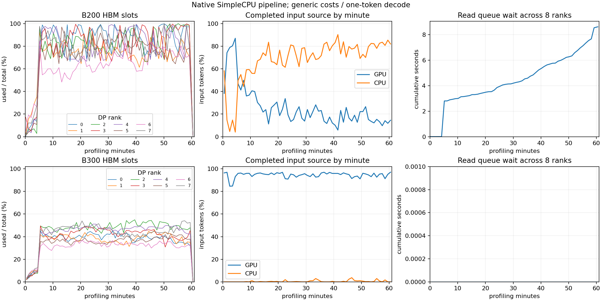

# 异步 CPU 加载的在途 prefill 预留

本阶段修复上一轮 SimpleCPU 管线暴露的准入缺口。基线为提交 `312af2e` 和 `data/reference/agentx-simple-cpu/pipeline-validation.json`：B200 一小时出现 2,098 次抢占、1,018,434 个重算 token，GPU/CPU 命中分别为 24.392%/70.022%。此次保留模型、HBM/CPU 预算、路由、调度参数、带宽与种子，增加源码要求的预留，不覆盖容量，也不调整带宽拟合结果。

只读基准继续为 `vllm-note` 的 `30f5c01d4ebb`。`scheduler.py:1197` 在 `load_kv_async` 时把 `_inflight_prefill_reserved_blocks()` 和当前请求的 `_spec_decode_step_blocks()` 加入 `reserved_blocks`。`kv_cache_manager.py:allocate_slots` 先检查完整输入相对当前 free 是否能放下，再要求本次真正分配不超过 `free - reserved_blocks`。这两个门槛分别实现，不能把所有请求的未来完整输入永久占用成物理页，或将其他预留重复扣到新请求的完整输入检查中。

`scheduler.py:2999` 的 `_request_remaining_blocks` 按全部 cache groups 求剩余准入块；窗口组受启动时相同的 admission cap 限制。`single_type_kv_cache_manager.py:get_num_blocks_to_allocate` 对已分配请求使用虚拟表长度。参考表保留已跳过位置的 null entries，而 TokenSim 的稀疏窗口表省略它们，因此新增 `remaining_admission_slots` 使用最后绝对索引加一；只统计当前持有的窗口页会多算预留。物理页引用和 CPU/DMA pin 仍按实际页计量。

调度器跟踪部分 GPU prefill、加载中的请求及复制完成但等待 RUNNING 空位的请求。分配推进后，预留依据实际表位置自动缩小；转入 decode、抢占、完成及取消时移除承诺。取消加载可先取消未来承诺，尚未完成的复制继续持有实际 DMA 引用。预热后重置统计不清空在途集合。日志增加当前 prefill 数、剩余预留及异步导入被预留阻止的次数；GPU-only 完整输入准入继续保留已有语义。

七个新增用例覆盖：512-token 分配后需预留 248 个后续 slot，加投机下一步 1 个；推进到 1,024-token 虚拟位置后剩余降为 38+1；null 前缀不应按物理长度计数；最后一个新 prefill chunk 不增加未来承诺；decode/抢占/取消释放；完整输入门槛与真正导入门槛独立；真实引擎中延后 CPU 导入、待旧 prefill 推进后放行且无抢占；加载中取消释放承诺而保留 DMA pin。全仓 **391 项测试通过，89.945 秒**。这些测试验证逻辑，不代替完整管线。

完整主点结果保存于 `results/agentx-dsv4-full/simple-cpu/20261001-inflight-reservation/`，仍使用全部 393-trace 池、种子 42/0、预热与 3,600 秒测量、30 秒宽限和最多十秒取消。运行时仍是通用算子成本与单 token decode；本阶段不宣称原生算子、MTP、Mooncake 或最终模型精度完成。

源码复核还发现一个独立统计缺口：`scheduler.py:1034` 的 `prefill_stats.set` 只记录首次准入，排除抢占后的重复 prefill；当前 TokenSim 的 GPU/CPU token 分解会在重新准入时覆盖为最后一次命中。此次前后对比保留相同口径，但抢占后的命中分解仍不能直接作为参考 bmk 口径的最终精度证据。应下一部分单独保留首次准入统计与重算统计，并完整验证，不能把这项差异当成缓存行为误差直接拟合。

B200 完整窗口结束并通过代码/数据身份、输出长度、token 分解、取消确认、物理引用、DP 时间及预留释放校验。新增门槛累计阻止 3,793 次导入；各 rank 预留峰值为 11,281–16,261 个 slot，最终预留全部归零。下表说明预留缺口真实存在，但它并非当前大量抢占的主要解释。

| B200 完整窗口 | 修复前 | 修复后 |
|---|---:|---:|
| 成功／取消 | 4,328／192 | 4,362／217 |
| 抢占次数 | 2,098 | 2,131 |
| 重算 token | 1,018,434 | 846,147 |
| 输出 token/s，8 GPU 合计 | 890.713 | 875.589 |
| GPU／CPU 命中率（当前最后准入口径） | 24.392%／70.022% | 23.939%／70.455% |
| p90 TTFT 秒 | 133.506 | 130.576 |
| p90 TPOT 秒 | 0.240 | 0.246 |

重算量下降 16.917%，抢占次数增加 1.573%，吞吐下降 1.698%。不能把增加预留描述成已经解决 thrashing。下一部分先修复上述首次准入统计，以区分原始输入来源与重新加载；继续核对窗口/压缩状态实际分配、GPU/CPU 导入和完整调度行为，再接入原生算子及 MTP。容量与带宽没有用日志覆盖。

B300 也完成完整窗口：10,396 发出、10,034 成功、362 取消，输出 2,047.526 token/s，GPU/CPU 命中 94.710%/0.523%，无抢占与重算。与上一提交的这些主要指标逐值完全一致，八个 rank 的预留门槛触发均为零；这与其较宽裕的容量一致，没有通过修改成本让结果改善。

两组运行的配置、数据集 SHA-256、后端、带宽利用率相同；运行时代码差异严格为缓存管理器、调度器及日志三个文件。当前源码 SHA-256 与运行快照逐项核对，两组输出／token／取消／引用／DP 时间和预留清理均通过。最终十六个 GPU 池只剩 null slot，在途集合及预留为零。证据见 [完整管线](../data/reference/agentx-prefill-reservations/pipeline-validation.json) 和 [前后对比](../data/reference/agentx-prefill-reservations/comparison.json)。

本次完成的是原生混合缓存在默认完整输入检查下的异步加载预留。完整计划保持未完成：首次准入统计、剩余抢占问题、CPU 淘汰后补充写回、Mooncake、MTP、原生算子、曲线及最终精度仍需推进；25%/10% 精度标准没有降低。
