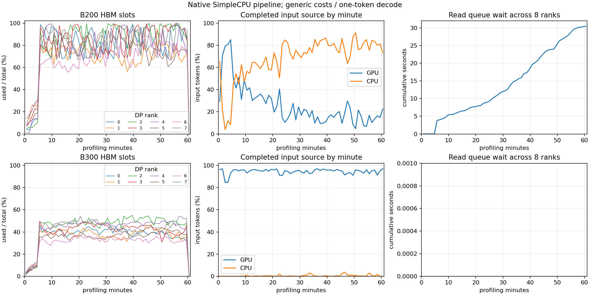

# SimpleCPU 原生异步复制与请求生命周期

本阶段将此前的外部页存储和 hybrid import API 接入真实引擎，完成 SimpleCPU 的按组查找、GPU 私有目标分配、异步加载等待、确认计算后的 eager 写回及取消释放。它是 CPU 运行时接入的一部分；Mooncake 共享服务和在途 prefill 的完整输入承诺继续分阶段实现。

参考只读源码 `vllm-note` 的 `30f5c01d4ebb`，重点为 `vllm/v1/simple_kv_offload/{manager,worker}.py` 和 `vllm/v1/core/sched/scheduler.py`。不下载历史镜像，不切换或修改参考源码。

SimpleCPU 每个 worker 有独立 CPU 池。当前源码的 `cpu_bytes_to_use` 是服务器整体预算，除以 world size；`cpu_bytes_to_use_per_rank` 显式覆盖。两个主点使用已记录启动配置的每 rank 356,125,000,000 字节，硬件可用 DRAM 分别为 3,095,781 / 2,964,436 MiB，来源及版本写入实验矩阵。B300 历史键有版本差异，当前配置使用明确的 per-rank 键。CPU slot 数由预算除以 1,228,800 字节的 packed stride 计算，再预留一个 null slot；未将历史 289,815 blocks 作为容量输入。

GPU lookup 先给出本地前缀，CPU lookup 只要求后续 full pages 及恢复边界的全部窗口状态，不要求早期前缀同时保留在 CPU。准入检查在 GPU-only 完整输入门槛前进行 CPU 查找，计入私有导入目标及剩余输入。复制期间请求不执行 forward，其他请求与 DP rank 可继续执行。`max_num_seqs` 限制 RUNNING；未完成复制的请求不占此配额。复制已完成但 RUNNING 满额的请求持有已加载 KV 等待，空位出现后优先恢复。

每次 kernel 确认计算后，只有完整且已发布的缓存页可以排入 eager 写回，同一步合并为一批。CPU 写入完成前不可 lookup，读写页都持有 pin，LRU 不能驱逐。GPU 源页与加载目标页有独立 DMA 引用，引用守恒检查同时核对请求与传输所有权。取消可先释放请求所有权；复制继续持有私有目标，完成后释放，取消加载不会发布 prefix 元数据或重新入队。最终在原有十秒取消 allowance 内排空传输，不延长成功请求的吞吐观测窗口。

传输读取硬件目录的 PCIe 每方向 128 GB/s 上限与 3 微秒延迟，读写各用共享方向队列。75% 利用率是缺少匹配实测时的假设，配置入口也接受 50% 和 100%。实际量按 packed backing stride 计费；请求加载等待包含排队，异步写回不计作阻塞 GPU 的等待。日志保存容量、使用与 peak、CPU eviction、方向字节数、排队/服务时间、加载请求和 DMA pin。

逐请求日志记录 GPU 命中、CPU 命中和剩余输入；完整结果只统计成功请求，并分别计算两种命中率。已有 legacy Mooncake 没有这些原生逐请求观测时，不补成 CPU 命中率零。方向链路累计统计包含预热；结果 connector 计数在 profiling 开始时重置，两种口径明确区分。

十二个逻辑及引擎用例覆盖完整混合组重载、GPU 前缀与 CPU 后缀合并、CPU lookup 改善完整输入准入、两个请求争用同一读队列、其他 rank 继续执行、加载期间取消、加载完成后排队期间取消、写回可见性与 pin、非 lockstep 取消、服务器/每 rank 预算及 legacy 指标缺失。全仓 **384 项测试通过，89.245 秒**。逻辑测试不作为模拟精度证据。

完整管线采用全部 393-trace 池、工作负载种子 42、模拟种子 0、预热加 3,600 秒发出窗口、30 秒宽限及最多十秒取消。首轮 `20261001-native-runtime` 在发现 loading 被错误计入 running 配额后主动终止，B200 当时已触发该限制；它仅保留为诊断数据。修正后的正式阶段结果目录为 `results/agentx-dsv4-full/simple-cpu/20261001-running-quota/`，逐请求、缓存窗口和运行身份均由脚本保存。

两个主点均正常退出，使用源码快照 SHA-256 校验当前运行时代码一致、数据集校验值不变。结构化证据见 [pipeline-validation.json](../data/reference/agentx-simple-cpu/pipeline-validation.json)。成功输出长度、GPU/CPU/计算输入分解、取消确认、引用释放和 DP 时间守恒全部通过；最终十六个 GPU 池均仅保留 null slot。

| 本阶段管线结果 | B200 c196 | B300 c384 |
|---|---:|---:|
| 预热发出／成功 | 2,171／2,171 | 4,249／4,249 |
| 预热模拟秒 | 1,934.41 | 2,790.00 |
| 测量发出／成功／取消 | 4,520／4,328／192 | 10,396／10,034／362 |
| 测量及收尾秒 | 3,630.05 | 3,630.36 |
| 输出 token/s，8 GPU 合计 | 890.71 | 2,047.53 |
| GPU／CPU 命中率 | 24.392%／70.022% | 94.710%／0.523% |
| p90 TTFT／TPOT 秒 | 133.506／0.240 | 27.114／0.193 |
| E2E mean 秒 | 192.573 | 148.482 |
| 抢占次数／重算 token | 2,098／1,018,434 | 0／0 |
| 同步等待占 GPU 步时 | 41.278% | 18.417% |

吞吐相对参考误差为 **−75.253%／−67.808%**，尚未达到 25% 标准。B300 GPU 命中率相对误差 +5.351%，达到优先的 10% 目标，但 CPU 命中率为 −68.101%；B200 的 GPU/CPU 命中率误差分别为 −64.247%／+195.128%。当前只验收资源生命周期，不能因合计命中率接近参考就宣布精度通过。

图中命中率按每分钟完成请求的输入 token 加权，方向排队曲线从 profiling 首个窗口起计；完整方向计数仍包含预热。B200 HBM 经常逼近满池，GPU 命中随窗口推进下降，CPU 替代大量前缀；B300 的 GPU 使用率约为 30%–55%，CPU 仅少量使用。两者每 rank CPU peak 远低于 331.67 GiB 预算，未触发 CPU 淘汰。累计读取排队 B200 为 43.314 秒、B300 为零，其中 B200 预热已有约 12 秒；写回方向两者均无排队。

成功请求输入／输出长度均值分别为 B200 的 101,545／747、B300 的 108,075／741，参考为 122,118／934、114,949／898。当前较慢的单 token／通用算子管线改变了闭环窗口内完成的请求组成，缓存命中差异不能全部归因于容量。成本分项仍包含预热，后续原生算子接入时须同时修正观测重置。

本阶段仍使用通用算子成本及单 token decode，不能将结果当成完整 DSV4/MTP 的最终精度验收。在途 prefill 的未来块承诺、Mooncake 共享身份与链路、CPU eviction 后已有 GPU hit 的重新写回、原生算子和 MTP 将继续单独实现并完整验证。当前公共恢复边界仍为 256 token；更细的 partial-hash 恢复也需继续核对。CPU 池与异步引用生命周期已接入，不将这些剩余行为误标为完成。

B200 的完整结果首先暴露了准入缺口：4,520 个测量请求中 4,328 成功、192 取消，取消未返回为零；输出 890.71 token/s，GPU/CPU 命中 24.392%/70.022%。相对上一阶段 HBM-only 的 187.28 token/s 有改善，但距离参考 3,599.26 token/s 仍远超 25% 误差标准。所有 GPU 池最终仅保留 null slot，CPU pin 和 DMA pin 均归零，逐请求与汇总 token 数、输出长度、取消确认及 DP 时间守恒通过。

这次发生 2,098 次抢占和 1,018,434 个重算 token；HBM-only 基线没有抢占。当前 CPU lookup 可以减少剩余计算，但异步导入在占有完整后缀时，没有从可用块中扣除其他在途 prefill 尚需的块。源码 `scheduler.py:_inflight_prefill_reserved_blocks` 在 `load_kv_async` 时加入这些承诺和 spec decode 的额外块，`kv_cache_manager.py:allocate_slots` 使用 `free - reserved_blocks` 检查真正分配。这里是下一部分优先修复的明确缺口；应完整对比修复前后的抢占、GPU/CPU 命中与吞吐，不能仅提高带宽或覆盖 GPU pool 大小掩盖问题。

CPU 池在本次 B200 窗口没有淘汰；按方向累计服务时间计算的 PCIe 占用远低于 1%，虽有短时读取排队，持续链路饱和并不是当前数据支持的解释。分项成本和请求组成仍受尚未接入的原生 GEMM/MoE 与 MTP 影响，因此本阶段只验收异步复制与资源生命周期，不验收最终性能或完整 CPU 调度对齐。
