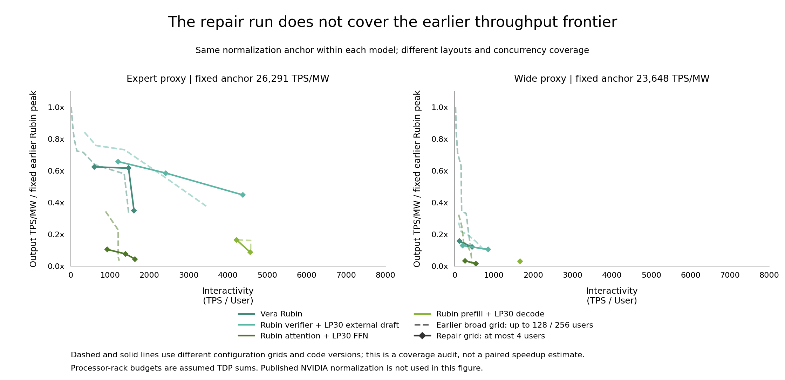

# LPX Figure 11 coverage and discrepancy audit

Audit date: October 20, 2026.
The repaired experiment contains enough repeated requests to check selected configurations, but it does not cover the deployment frontier needed to assess Figure 11.
Treating its local curves as a completed reproduction overstated the evidence.
This audit compares the saved full-workload runs and adds twelve native directed acyclic graph (DAG) cost-ablation replays.
It does not run the proposed expanded experiment grid or change simulator behavior.
Machine-readable values, input hashes and the exact analysis drivers are saved in [coverage-gap-audit.json](../experiments/lpx/results/coverage-gap-audit.json).

## Coverage and normalization

| Coverage | Earlier broad study | Repair validation |
| --- | --- | --- |
| Formal points, expert / wide | 28 / 58 | 11 / 7 |
| Layouts per mode, expert | Rubin 2, AF 2, PD 2, Draft 3 | One per mode |
| Layouts per mode, wide | Rubin 3, AF 3, PD 1, Draft 3 | One per mode |
| Maximum concurrent users, expert / wide | 256 / 128 | 4 / 4 |
| Decode micro-batch sizes | Expert 1; wide 1 and 4 | 1 |
| Attention replica variants | Wide study includes multiple variants | 1 |
| Communication settings with formal validation | Earlier implementation and assumptions | GPU auto, LPU direct, C2C 0.35 microseconds only |

The four execution modes are the Rubin baseline, attention and feed-forward disaggregation (AF), prefill and decode disaggregation (PD), and speculative decoding (Draft).
FFN denotes the model's feed-forward network.
The earlier studies also omit parts of the supported design space.
Their larger point count does not establish an exhaustive optimum.
The repair contains 9,002 completed measurement requests across eighteen unique formal points.
Repeating requests stabilizes those points without adding layouts, concurrency levels, hardware measurements or independent routing samples.
The fourteen rate probes cover only the expert AF layout with four execution slots and uniform arrivals.
They do not establish capacity for the other modes or Poisson arrivals.

The local plots divide efficiency by the Rubin peak found within each plotted dataset.
Removing the high-concurrency Rubin points changes this denominator substantially.

| Processor-rack anchor | Earlier broad study, TPS/MW | Repair validation, TPS/MW | Broad / repair |
| --- | ---: | ---: | ---: |
| Expert proxy | 26,291.09 | 16,403.87 | 1.603 |
| Wide proxy | 23,648.20 | 3,698.96 | 6.393 |

TPS/MW means output tokens per second per megawatt under the assumed processor-rack power budget.
An unchanged absolute efficiency appears 6.393 times higher when the wide repair denominator replaces the broader denominator.
This prevents cross-round vertical positions from establishing an efficiency improvement.
The following diagnostic uses the same earlier internal anchor for both datasets within each model.
The datasets still have different configuration grids and code versions, so the figure does not measure a paired performance change.
NVIDIA's unavailable absolute normalization denominator is separate from either internal anchor.

## Screening can mis-rank candidates

The expert Rubin TP4/PP2 configuration with four users measures 757.83 TPS/user in the short screen and 599.07 TPS/user in the formal run.
The short screen overestimates the formal value by 26.50%.
The screen uses two completed turns per user, two warmup steps, no minimum warmup duration and a 0.001-second minimum measurement duration.
The [study driver](../scripts/run_lpx_study.py) selects formal candidates from the short-screen Pareto frontiers.
A Pareto frontier retains points for which no other point improves both user speed and power efficiency.
A transient screening error can therefore affect which configurations receive formal validation.
The saved results establish this measurement discrepancy; they do not prove that a particular discarded point was the true optimum.

The current formal points take roughly 90 to 1,065 seconds of host time each, with a median near 289 seconds.
This explains the cost of a broad formal sweep.
It does not justify replacing deployment coverage with repeated requests on four fixed layouts.
A broader screen needs convergence checks and a margin around the estimated frontier before pruning candidates.

## The remaining latency depends on execution structure

The native single-query AF sample uses context length 404,199, seed 42 and the repaired communication settings.
Its selected causal path contains the following service costs.
Queueing and other operators account for the remaining time.

| Service category | Expert proxy, microseconds / share | Wide proxy, microseconds / share |
| --- | ---: | ---: |
| Attention | 172.13 / 28.2% | 789.25 / 42.4% |
| Collectives | 192.56 / 31.5% | 424.46 / 22.8% |
| A-to-F and F-to-A activation transport | 145.17 / 23.8% | 327.37 / 17.6% |
| Routed expert matrix computation | 14.48 / 2.4% | 146.89 / 7.9% |
| Complete native step | 610.79 | 1,860.50 |

Subtracting service costs from this selected path cannot account for changes in resource queues or the selected path after an intervention.
The ablation driver instead captures the native DAG, sets selected node durations and resource occupancies to zero, and reschedules resource queues with the replay kernel.
All other service times, ready delays and logical dependencies remain fixed.
Both baseline replays match the native step within 0.000001 microseconds.

| Frozen-DAG intervention | Expert reciprocal step rate | Wide reciprocal step rate |
| --- | ---: | ---: |
| Baseline | 1,637.22 | 537.49 |
| Zero routed expert matrix computation | 1,676.97 | 583.56 |
| Zero collectives | 2,391.00 | 696.36 |
| Zero A-to-F and F-to-A transport | 2,185.98 | 674.98 |
| Zero all transport | 3,774.94 | 946.02 |
| Zero attention and all transport | 10,779.33 | 3,734.00 |

These rates are single-step duration reciprocals, without prefill or full-request statistics.
The interventions deliberately remove physical work and do not describe realizable hardware or bound all possible deployments.
The approximate published AF endpoint of 3,470 TPS/user provides a diagnostic scale; its deployment and aggregation statistic are unavailable.
Within the captured expert execution, eliminating routed expert matrix computation improves the reciprocal rate by only 2.43%.
Within the captured wide execution, eliminating every transport node still yields only 946.02 steps per second.
These results direct investigation toward attention distribution, transfer granularity and scheduling alongside communication costs.
They do not support a universal model-utilization correction factor.

## Supported mechanisms and missing experiments

| Mechanism | Current status | Consequence for the experiment |
| --- | --- | --- |
| Decode micro-batching and multiple layouts | Supported, scarcely sampled after repair | Expand the repaired configuration grid |
| Native dynamic FFN batching | Supported by the native service; disabled by the study driver and rejected by sampled replay | Use a native pilot and validate a replay representation before a large sweep |
| Context parallelism | [Helix-style KV parallelism](lpx-context-parallel.md) supports colocated LP30 decode and prefill; non-colocated AF, prefill/decode handoff and drafting reject `a_cp != 1` | The AF proxies still require KV ownership and combine semantics across separate attention and FFN pools |
| Producer-ready vector streaming | Generic collective cost selection exists; vector-level dependencies and overlap are absent | Requires execution-model work and operator-level validation |
| Layer-dependent attention placement | Both proxies keep attention on GPUs | Needs explicit placement and capacity accounting before sweeping |
| Complete prefill scheduling | [CompletePrefill](../TokenSim/af/serving/prefill.py) aggregates a stage, reserves its global expert-parallel ranks during compute, then communicates | Native/replay agreement shares this approximation |
| Independent complete-model replicas | `a_replicas` can expand global expert parallelism | Do not interpret partial-model replicas as independent full deployments |
| DDR5 expert-weight streaming | Current selected layouts keep complete FFN weights in SRAM | Throughput and power conclusions apply to that residency assumption |

The [flat collective model](../TokenSim/comm/flat_collectives.py) omits topology routes, software launch, reduction arithmetic and compute overlap.
Selecting an idealized direct algorithm does not implement a hardware collective schedule.
The [model executor](../TokenSim/af/execution/model.py) executes layers sequentially with operator-level dependencies.
Increasing tensor parallelism beyond the eight KV heads replicates KV heads in the current setup; it does not distribute the 400K context as context parallelism would.
The colocated KV-parallel layouts distribute context only for pure-LPX deployments such as the Gemma study.

[NVIDIA's article](https://developer.nvidia.com/blog/how-nvidia-groq-3-lpx-unlocks-ultrafast-interactivity-at-long-context-on-nvidia-vera-rubin/) describes 320-byte transfer/compute overlap and transfer once per full-attention layer.
Those statements motivate checking granularity and placement, but do not disclose a complete executable schedule for Figure 11.
[SQD](https://arxiv.org/abs/2609.13134) studies an alternative fine-grained disaggregation scheme against attention/FFN disaggregation.
Its layer placement is a useful research hypothesis; the paper does not establish that Figure 11's AF curve uses SQD.

## Model and speculative-decoding assumptions need separate controls

The expert proxy has 36 layers, hidden width 2,880, head dimension 64 and 2,240 experts.
It expands expert count while keeping four active experts with intermediate width 2,880.
It therefore combines a large resident weight inventory with relatively little active expert computation per token.
The wide proxy changes hidden width to 8,192, layer count to 80, head dimension to 128 and expert intermediate width to 8,192.
Its attention and FFN costs change together, which prevents the two proxies from isolating expert-compute intensity.
The model definitions explicitly identify these configurations as sensitivity assumptions.
See the [expert model](../data/models/gpt-oss-2t-expert-proxy.yaml) and [wide model](../data/models/gpt-oss-2t-wide-proxy.yaml).

The expert single-user Rubin point is approximately 10% above the sampled published endpoint, AF is 53% below, PD is 40% below and Draft is 104% above.
These are endpoint scale comparisons across unmatched configurations.
The opposing directions still make a shared speed multiplier unsuitable as an explanation.
Draft assumes four proposed tokens, acceptance probability 0.8 and an unvalidated small draft model.
The native expert verification of five queries costs about 631.46 microseconds, versus about 624.36 microseconds for one ordinary query.
This favorable amortization produces an expert Draft/Rubin ratio around 2.72, compared with about 1.47 between the sampled published endpoints.
Draft-model quality, conditional acceptance and target verification cost require their own controls.
The [forty-eight existing sensitivity controls](../experiments/lpx/results/draft-sensitivity-evidence.json) use two turns per user and an earlier source fingerprint; they are not formal validation of the repaired draft configuration.

## Experiment expansion supported by this audit

1. Preserve absolute TPS/user and TPS/MW alongside a fixed shared per-model anchor when comparing rounds.
   Record a new common Rubin normalization only after the expanded grid is complete.
2. Screen the existing fourteen expert and fifteen wide layout templates with users `[1, 2, 4, 8, 16, 32, 64, 128, 256]` and micro-batches `[1, 2, 4, 8]`.
   The raw Cartesian product has 1,044 candidates; excluding micro-batches above the user count leaves 870 before capacity rejection.
   These are proposed candidates, not completed experiments.
3. Reject capacity-invalid inputs before profile construction, require stabilized windows for screening, and formally measure candidates near the frontier as well as those on it.
   Retain at least 500 completed requests and twenty turns per user for formal points.
   Compare selected frontier points across routing seeds and corpora; repeatedly cycling sixteen profiles with seed 42 does not create independent hardware evidence.
4. Run paired formal communication controls on identical layouts, users, seeds and workload windows.
   The repair's ring and 50-nanosecond variants have short controls, while only the auto/direct 350-nanosecond variant has formal runs.
5. Hold attention geometry fixed and preserve the expert-count/intermediate-width product while testing `(2240, 2880)`, `(1120, 5760)`, `(560, 11520)`, `(280, 23040)` and `(140, 46080)`.
   This varies active expert work while approximately preserving total expert parameters.
   Count any additional tensor partitions and memory requirements in the deployment budget.
6. Validate native FFN batching and prefill interference separately from streaming and layer placement that require implementation work.
   Context parallelism for separate attention and FFN pools also requires implementation work.
   Sweep draft acceptance, proposal length and draft-model cost separately from the AF experiment.

The processor budgets of 450 W per LP30 and 1,800 W per Rubin, GPU/LPU bridge costs and the two 2T architectures remain assumptions.
Operator and bridge measurements are required to apportion physical prediction error after correcting coverage and execution semantics.
The current evidence supports local implementation repairs and the diagnostic priorities above; it does not support a reproduced Figure 11 frontier.
