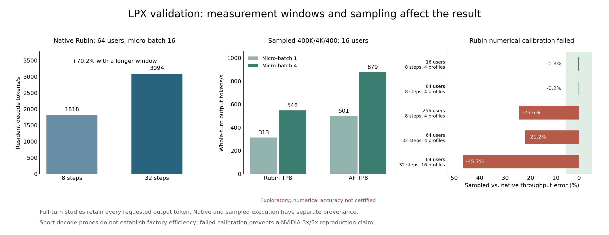

# LPX validation and load study

The original one- and two-client experiment was insufficient to estimate saturated performance or the distance from NVIDIA's projected curves.
The expanded study also found a measurement-window problem: native Rubin at 64 clients increased from 1,817.93 to 3,093.72 decode tokens/s when measurement increased from eight to 32 passes per cohort, a 70.2% change.
The optional sampled executor failed its declared 5% numerical-accuracy limit, with a maximum observed error of 45.8%.
Its complete-turn results are exploratory.
The software fixes and expanded testing do not establish NVIDIA's projected 3x/5x gains.

The study contains 65 complete-turn outcomes: 38 primary load/micro-batch outcomes, eight architecture outcomes, three window/seed outcomes, eight historical-parameter comparisons and eight native/replay calibration outcomes.
Of these, 57 retain the original 400,000 cached / 4,000 new / 400 output-token workload.
The eight calibration outcomes use 16 output tokens and are excluded from original-workload curves.
Every feasible original-workload point includes complete measured turns; capacity rejections remain explicit outcomes.
The [study evidence](../experiments/lpx/results/full-validation/study.json), [raw table](../experiments/lpx/results/full-validation/points.csv), [calibration decisions](../experiments/lpx/results/full-validation/calibration.json) and [experiment plan](../experiments/lpx/results/full-validation/plan.json) are committed.
Each source summary has a SHA-256 fingerprint and an independent grid/accounting audit.



## Code and test findings

The final software suite passes 469 unit tests with Black 24.2.0 and `git diff --check`.
The frozen experiment revision is `1cce799`; it passed 468 tests before the runs.
The final qualification changes label finite-window results and experimental replay, and preserve registered operator data when adding a memory allowance.
They do not change the measured scheduling or latency calculations for the catalog-backed experiments.

| Finding | Repair or validation |
| --- | --- |
| A late drain completion could overwrite the measurement end. | Freeze the closing boundary when the stop event triggers; reconstruct the earliest legal close independently from turn/token/interval evidence. |
| A short warm-up turn could restore only the cached prefix. | Restore cached plus new input for resident-decode warm-up; test a warm-up spanning multiple short turns. |
| Completed operator histories grew with every pass. | Stream resource metrics and release validated completed-iteration histories using stable trace positions. |
| Average utilization could conceal transient resource overlap. | Validate interval capacity globally for retained histories; retain runtime reservation checks for streaming execution. |
| Original-workload audits could accept fixed decode windows. | Require complete measured turns and independently validate committed token counts and decode intervals. |
| Prefill normalized unused output rows. | Skip final output normalization on nonterminal chunks and normalize only requested output rows on terminal chunks. |
| Communication arbitration and trace lookup revisited unrelated work. | Recheck changed resource queues and the current iteration's emitted events. |
| Tests checked local plausibility without sufficient independent timing oracles. | Add retained/streamed comparisons, closure reconstruction, atomic FIFO and wire-occupancy oracles, cache corruption checks and native/replay controls. |

The corrected closing boundary changes 14 of 16 short-window regression cases.
The largest old extension was 118.44 microseconds on a nominal two-millisecond measurement.
The seven feasible archived 400-token measurements pass the independent closing-boundary check.
Their source spans revisions, as recorded in the [historical report](lpx-native-results.md), so cross-revision comparisons remain explicitly qualified.

The queue/lookup optimization preserves all result and full-trace bytes in 16 mixed-mode differential cases.
Their shared digest is `230090a309334bb204c05d1f82bfdf8a4528d33229c0f1083640bdfe37ea251b`.
A separate 80-layer, 16-request AF pass retains 72,217 events, 0.011544797679070032 simulated seconds and the same timing/dependency digest.
Its host execution time falls from 57.69 to 45.77 seconds, a 20.7% reduction.
The prefill-normalization repair intentionally changes simulated work and is tested separately from these equivalence checks.

## Numerical calibration and measurement stability

The replay backend captures native operator graphs and runs their dependencies, endpoint injection occupancy and unit-capacity resource queues in C++.
Every profile must reconstruct its own isolated native duration within the stated floating-point tolerance before use.
The cache fingerprints source, model, effective hardware, links, configuration and runtime versions, and checks the saved graph body digest.
These checks establish profile reconstruction and input identity.
They do not establish concurrent timing accuracy.

Four native complete-turn controls use the same 400K cache and 4K suffix with 16 output tokens.
The largest replay error across their output-throughput and per-user decode metrics is 0.84%.
The native points were combined from a sequential checkpoint and two isolated workers, with source fingerprints retained in the assembled control summary.
The duplicate parent run was stopped after those completed points were available.
Four additional deterministic routing controls cover 64 and 256 clients on eight-layer Rubin/AF layouts and remain within 5%.
The full wide-model concurrency comparisons expose larger errors:

| Control | Native decode TPS | Sampled decode TPS | Relative throughput error |
| --- | ---: | ---: | ---: |
| Rubin, 16 clients, eight steps, four profiles | 1,109.73 | 1,106.66 | -0.28% |
| Rubin, 64 clients, eight steps, four profiles | 1,817.93 | 1,814.44 | -0.19% |
| Rubin, 256 clients, eight steps, four profiles | 2,596.41 | 1,984.39 | -23.57% |
| Rubin, 64 clients, 32 steps, four profiles | 3,093.72 | 2,436.78 | -21.23% |
| Rubin, 64 clients, 32 steps, 16 profiles | 3,093.72 | 1,678.62 | -45.74% |
| AF, 16 clients, eight steps, four profiles | 1,385.87 | 1,385.40 | -0.03% |
| AF, 64 clients, eight steps, four profiles | 3,839.90 | 3,838.39 | -0.04% |

The maximum 45.8% error includes the per-user metric.
Twelve of 15 gated numerical comparisons pass; three fail.
Seven additional comparisons against the archived original-workload results remain cross-revision references and are excluded from this gate.
The native AF 256-client diagnostic was stopped after more than two hours to honor the requested acceleration.
Its completed 16/64-client points are retained, and the unfinished native 256 point is unavailable.
No native timing is inferred for it from replay.

Finite routing samples, representative long contexts and changed equal-timestamp grant ordering are approximation sources.
The study does not isolate their relative contributions to every failed case.
Increasing the routing corpus alone did not produce convergence.
The short native probes also omit suffix prefill, KV handoff and speculative verification, so their decode rates cannot supply factory-efficiency denominators.

For the full-workload Rubin PP8 point at 64 clients and micro-batch 16, increasing the minimum complete turns from one to two changes output throughput from 1,610.54 to 1,720.40 TPS, or 6.8%.
Increasing from two to four turns reaches 1,791.52 TPS, another 4.1%.
Changing the sampled-routing seed from 42 to 43 at one turn changes the same point to 1,445.51 TPS, a 10.2% reduction.
The seed and window sensitivities are separate experiments and do not contribute competing maxima to the primary frontier.
The `steady_state` JSON key preserves compatibility; a finite recorded window does not certify saturation.

## Complete original-workload coverage

The primary grid covers 1, 4, 16, 64 and 256 resident users, micro-batches 1, 4 and 16, default/pipelined placements and 4,096/2,560-chip FFN pools.
It contains 24 feasible and 14 capacity-rejected outcomes.
Each stratum records its requested case/client grid, actual physical inventory and complete-turn settings.
The declared prefill chunk is 64 tokens for these strata, which bounds native profile-capture cost and changes the simulated scheduling policy.
The historical-parameter comparisons retain the original 256-token chunk.
Neither profile-count reduction nor chunk size scales a short output trace into 400 tokens.
Feasible points execute every requested output token and protocol operation.

The primary efficiency denominator is 38,061.98 TPS/MW, the highest sampled Rubin value across the primary load and micro-batch strata.
It comes from Rubin TP8 with 16 users and micro-batch four.
All allocated processors, including prefill and draft pools, are charged using the catalog's assumed 1,800 W/Rubin and 450 W/LP30, with zero added facility power.
Architecture and seed/window sensitivities use separate comparison scopes.

All values in this table are sampled and numerically uncertified:

| Deployment | Users | Micro-batch | TPS/user | Whole-turn output TPS | Normalized TPS/MW |
| --- | ---: | ---: | ---: | ---: | ---: |
| Rubin TP8 | 16 | 1 | 44.09 | 313.19 | 0.57143x |
| Rubin TP8 | 16 | 4 | 58.35 | 548.09 | 1.00000x |
| AF TP8 | 16 | 1 | 65.34 | 500.51 | 0.00697x |
| AF TP8 | 16 | 4 | 88.05 | 878.57 | 0.01224x |
| Rubin TP8/PP8 | 256 | 16 | 30.79 | 2,658.96 | 0.60641x |
| AF TP8/PP8, 4,096 LP30 FFN | 256 | 16 | 49.36 | 3,039.72 | 0.03851x |
| AF TP8/PP8, 2,560 LP30 FFN | 256 | 16 | 51.65 | 3,072.70 | 0.05840x |
| PD TP16 | 1 | 1 | 1,641.46 | 534.08 | 0.00573x |
| External draft TP8 | 1 | 1 | 766.77 | 309.77 | 0.18840x |

The same 16-user workload changes materially when the micro-batch changes, so client-count sweeps alone omit a relevant scheduling dimension.
Reducing the FFN inventory also changes allocated power and queue behavior.
The failed timing gate prevents these sampled values from establishing a hardware performance gain or an optimized global frontier.

## Memory and architecture sensitivity

The capacity study evaluates 63 declared model/layout/reserve combinations using the production rank ledger.
It covers additional LP30 allowances of zero, 32 MB and 64 MB per chip.
These are explicit assumptions added to existing catalog reserves.

| Wide-model deployment | Resident clients with zero extra LP30 allowance | With 64 MB extra |
| --- | ---: | ---: |
| Default Rubin TP8 | 17 | 17 |
| Default Rubin TP16 | 25 | 25 |
| Default AF TP8 | 25 | 25 |
| Rubin TP8/PP8 | 256 | 256 |
| AF TP8/PP8, either FFN inventory | 256 | 256 |
| PD TP16 | 1 | 0 |
| External draft TP8 | 3 | 2 |

The AF PP8 prefill pool limits the combined resident population to 256.
Flat-link admission accounts for resident weights/KV and catalog reserves without deriving every activation, compiler or allocator workspace requirement.
These limits describe resident-memory bounds.
The PD result's sensitivity to a 64 MB allowance makes a default fit insufficient evidence of an implementable device runtime.
Native context parallelism, paging and eviction are unavailable.
LP30-local attention at full-attention exchange boundaries and a compiler schedule at vector granularity are also unimplemented.

The wide proxy contains 2.077T parameters and activates 64.42B routed FFN parameters per token.
The expert-count sensitivity proxy contains 2.009T parameters and activates 3.58B routed FFN parameters per token, about 18 times less routed work.
At one user, its sampled PD decode rate is 4,576.62 TPS/user, compared with 1,641.46 for the wide proxy.
Its physical placement and assumed power also differ, so this comparison does not isolate a single architectural change.
Both proxies are declared assumptions; neither identifies NVIDIA's unpublished 2T architecture.
Model quality, draft acceptance accuracy and a hardware-calibrated compiler schedule remain outside the experiment.

## Reproduction and saved evidence

Full source summaries remain under `outputs/lpx-full-validation`; the committed compact bundles identify their exact bytes.
The [plan](../experiments/lpx/results/full-validation/plan.json) records primary and sensitivity configurations.
The [primary pipeline bundle](../experiments/lpx/results/full-validation/pipeline-m16/evidence.json) preserves measured turns and native-profile provenance.
The historical native source and decode diagnostics remain in their original output directories.

Run the primary pipeline stratum:

`--skip-audit` skips the repeated standalone layer probe; production point invariants and saved-result audits still execute.

```bash
python scripts/reproduce_lpx.py \
  --config experiments/lpx/full-validation-cases.json \
  --cases rubin-tp8-pp8 af-tp8-pp8 af-tp8-pp8-f2560 \
  --batches 16 64 256 \
  --micro-batch 16 \
  --prefill-chunk 64 \
  --execution-backend sampled-replay \
  --replay-samples 4 \
  --skip-audit \
  --jobs 2 \
  --output outputs/lpx-full-validation/pipeline-m16
```

Audit its complete requested grid and original token counts without another simulation:

```bash
python scripts/check_lpx_results.py \
  --summary outputs/lpx-full-validation/pipeline-m16/summary.json \
  --config experiments/lpx/full-validation-cases.json \
  --cases rubin-tp8-pp8 af-tp8-pp8 af-tp8-pp8-f2560 \
  --batches 16 64 256 \
  --original-workload \
  --export outputs/lpx-full-validation/pipeline-m16/rechecked
```

For sampled data this reports `accounting_passed` and `requires_separate_native_calibration`.
The independent numerical decision for the recorded study is `failed` in `calibration.json`.
The native backend remains the default.
