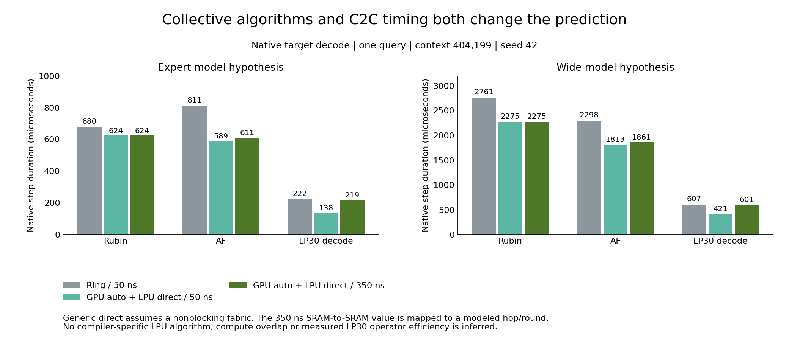
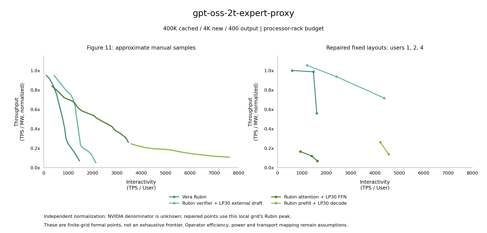
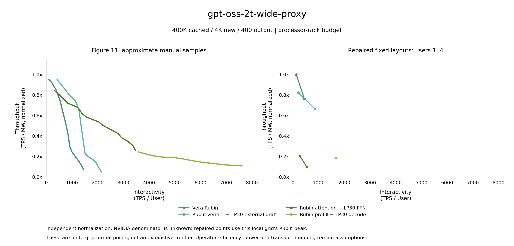

# Literature-constrained LPX implementation corrections and retests

Review date: October 20, 2026.
This update corrects attention/FFN (AF) collective algorithm configuration, GPU graph prefill cost and queries-per-second (QPS) parameter propagation, then retests the original workload of 400K cached tokens, 4K new input tokens and 400 output tokens.
The results check implementation behavior and parameter sensitivity; numerical reproduction of Figure 11 remains incomplete.

| Original source | Evidence checked | Implication for this update |
| --- | --- | --- |
| [SHIP paper](https://proceedings.mlsys.org/paper_files/paper/2026/file/9c20f16b05f5e5e70fa07e2a4364b80e-Paper-Conference.pdf) and [supplement](https://proceedings.mlsys.org/paper_files/paper/2026/file/9c20f16b05f5e5e70fa07e2a4364b80e-Supplemental-Conference.pdf) | Main page 6 and supplement pages 1–2 describe compiler selection of collectives by tensor size and network conditions, with interleaved computation and communication | Remove the fixed-ring limitation; the paper uses initial-generation Language Processing Units (LPUs), whose parameters remain separate from LP30 |
| [Official NVIDIA Collective Communications Library (NCCL) algorithm configuration](https://docs.nvidia.com/deeplearning/nccl/user-guide/docs/env.html#nccl-algo) | Multiple algorithms and automatic selection are supported | Retain algorithm selection for small GPU tensors; the generic `direct` approximation does not establish an NVLS implementation |
| [NVIDIA Hot Chips 2026](https://www.nvidia.com/en-us/events/hot-chips-conference/) and [reproduced original vendor slide](https://www.servethehome.com/wp-content/uploads/2026/08/NVIDIA-Groq-3-LPU-Hot-Chips-2026-Scale-Up-Interconnect.png) | The vendor states 350 ns static random-access memory (SRAM)→SRAM latency and network latency by reachable SRAM capacity | Add an explicit 0.35 μs mapping control; message size, frequency and the simulated hop boundary remain unknown |
| [SQD](https://arxiv.org/abs/2609.13134) | Pages 7–8 discuss placing sliding-window/linear attention and FFNs on SRAM devices; pages 17–18 explain measured anchors and projection limits | Supports investigating per-layer placement; distinguish the modified B200 anchor from Rubin/LPX projections |
| [AFD design-space study](https://arxiv.org/abs/2605.28302), [AFD performance-limit study](https://arxiv.org/abs/2602.09721) and [HeteroPanacea](https://arxiv.org/abs/2608.03741) | Discuss fixed communication costs, expert granularity, microbatches and resource ratios | Retain architecture and deployment sweeps without assigning a universal AF speedup multiplier |

The [source inventory](../experiments/lpx/literature-sources.json) records sources, PDF page counts, SHA-256 checksums of downloaded versions, hardware generations and limits on use.
SQD communication anchors come from a modified B200 system, including approximately 2 μs wire time, 5 μs dispatch and a 141 GB/s fetch path; these cannot directly calibrate LP30.
Its Rubin/LPX results are analytical projections; the original Figure 11 GPT-OSS-2T structure, rack ratios and absolute power denominator remain unavailable.

## Committed implementation corrections

`12fa24c` adds `ring`, `tree`, `direct` and `auto` options to AF flat-link collectives.
Complete results and traces in all four modes match their default-ring counterparts field by field.
Algorithm declarations cover per-layer communication, embedding reduction and output gathering, and enter configuration, execution plans, cache keys and traces.
`auto` compares generic ring/tree costs; `direct` explicitly assumes a nonblocking fabric and does not implement SHIP RedBcast, TiledRedBcast or PAARD.
The `physical` mode rejects algorithms lacking wire schedules before execution.

`11a2971` corrects inconsistent graph kernel parameters between GPU decode and full prefill, and reuses AA communication-parameter handling.
Hardware-context overrides propagate to native and replay workers and checkpoint keys; bandwidth, capacity and power retain their input values.
In four-user prefill controls, both TP8 and TP16 width-model cases decrease by approximately 2.694 ms, while expert-model cases decrease by approximately 1.215 ms.
The relative decrease is approximately 0.35%–1.24%, so this error explains a small part of the gap.

`d4266ea` corrects the QPS capacity entry point's failure to pass accepted shared command-line options to workers.
Algorithms apply to every execution pool, and communication overrides reach isolated requests and all rate probes.
All 555 tests, Black checks and diff checks pass.

## Native single-step and full-workload retests

All 30 native single-step controls pass independent directed acyclic graph (DAG) clock reconstruction and critical-path sum checks.
The plot uses a single query, context 404,199 and seed 42 to compare identical target models and layouts; these comparisons exclude prefill and full-request statistics.



The expert-model prefill/decode (PD) step decreases from approximately 222.44 μs with ring/50 ns to approximately 137.54 μs with direct/50 ns; mapping latency to 350 ns yields approximately 219.14 μs.
The inverse step times are approximately 4,496, 7,270 and 4,563 steps/s.
Proximity to the reference PD endpoint while retaining 50 ns does not validate the hardware prediction.
The 350 ns override covers only LPU chip-to-chip (C2C) communication; GPU–LPX cross-rack service retains the unmeasured 2 μs assumption.

The deduplicated formal set contains 18 points and 9,002 measured requests.
Every point completes at least 500 requests and at least 20 per user, with warmup reaching `max(1 second, 10×T_iso)` and measurement reaching `max(10 seconds, 100×T_iso)`.
Here `T_iso` denotes isolated full-request latency.
Per-request turns, continuously active users, raw results and manifest SHA-256 checksums have been verified.
The main controls use 1 and 4 users, with an additional 2-user expert-model run; microbatch size is one, routing samples are 16, seed is 42 and dynamic FFN batching is disabled.
The table lists single-user formal points in the same fixed-layout set, in generation-phase tokens/s/user.

| Mode | Expert-count expansion model | Width expansion model |
| --- | ---: | ---: |
| Rubin | 1,609.79 | 443.30 |
| AF | 1,637.06 | 537.49 |
| PD | 4,561.35 | 1,663.37 |
| Draft | 4,374.63 | 853.17 |

The paired ring/50 ns single-user AF coarse points are approximately 1,232.8 and 435.1, making these formal points approximately 32.8% and 23.5% faster.
This comparison combines algorithm and fixed-latency mapping changes; the 30 single-step controls identify their effects separately.
Rubin speed also changes with the GPU algorithm, so the absolute AF speed increase cannot all be attributed to deployment gains relative to Rubin.
AF remains outside the joint nondominated frontier of this limited point set for both models.
The plots show a small fixed-layout grid with independent panel normalization; current Rubin denominators also differ from the previous larger grid's peaks.
Vertical changes alone cannot determine the corrected TPS/MW improvement ratio.
The [coverage-gap analysis](lpx-coverage-gap-analysis.md) records experimental coverage, fixed-denominator comparisons, coarse-run bias and additional native DAG ablations.





Per-point CSVs for both processor-power scopes are stored at `experiments/lpx/results/literature-repair-*-points-*.csv`.
LP30 450 W and Rubin 1,800 W remain processor-budget assumptions and are excluded from measured rack-power claims.
The reference image's sampled horizontal uncertainty is approximately ±60 TPS/user; deployment, tokenizer and cross-request statistics remain undisclosed.

## AA communication constraints and capacity retests

The Artificial Analysis (AA) control rechecks only the candidate with 256 LP30 chips, TP16/PP16, BF16 weights, FP8 key/value (KV) cache and `rho_in=rho_out=1`.
The 10K and 100K cases each measure 50 serial requests plus five warmups; output lengths of 1,500/2,000 remain experimental assumptions.
AA speeds use nominal standardized tokens/s; `rho_in=rho_out=1` assumes a one-to-one ratio between native tokens and `o200k_base`, which cannot be verified without the original text.
The table reports results at the candidate's shared-efficiency multiplier limit; both cases record `target_outside_physical_efficiency_bounds`.

| C2C mapping | Collective launch | 10K speed | 100K speed | 10K difference | 100K difference |
| --- | ---: | ---: | ---: | ---: | ---: |
| 0.35 μs | 0 μs | 3,215.37 | 3,124.82 | −4.93% | −8.92% |
| 0.35 μs | 0.5 μs | 2,695.38 | 2,631.45 | −20.30% | −23.30% |

The zero-launch candidate meets current 100K holdout and context-ratio thresholds, while its 10K fitting target is unreachable; `holdout_passed` alone therefore cannot establish successful calibration.
These results constrain this candidate and timing mapping; they do not establish the fitting capability of every LP30 deployment or calibrate the vendor SRAM→SRAM latency as a per-hop value.

The expert-model AF uniform-arrival search with four execution slots saves 14 probes.
The highest passing candidate is 8.75599 QPS, the failing upper bound is 8.84816 QPS and the relative interval width is approximately 1.05%.
The doubled window is 54.249 seconds, all admission-wait and boundary-accounting checks pass, and the recommended 95% candidate is 8.31819 QPS.
This result is limited to uniform arrivals and the current layout; stable Poisson capacity remains unsearched, and rate probes are excluded from formal points requiring at least 500 requests.

The [retest evidence](../experiments/lpx/results/literature-repair-evidence.json) includes native reconstruction, formal request counts, communication-parameter propagation, AA results, all rate judgments, raw-file checksums and the complete experiment driver.
This update retains generic analytical collectives, aggregate prefill, fixed FFN microbatches, two assumed 2T structures and SRAM-resident layouts.
The added configuration does not implement SQD per-layer placement, 320-byte vector-level computation/communication overlap, context parallelism, dynamic FFN batching or DDR5 weight streaming.
Further gap reduction requires aligning these mechanisms and obtaining measurements of LP30 operators, GPU/LPU bridging and actual deployments.

Use the following command for retesting.
For the width model, select `gpt-oss-2t-wide-proxy` and replace the four layouts with `rubin-tp8 af-f2-ep128-pp10 pd-compact draft-lpx256`.
The additional two-user expert-model run uses a separate index and deduplicates by the same checkpoint key; exact commands remain in the evidence driver and raw output directories.

```bash
python scripts/run_lpx_study.py \
  --model gpt-oss-2t-expert-proxy \
  --cases rubin-tp4-pp2 af-tp8 pd-compact draft-lpx256 \
  --users 1 4 \
  --maximum-users 4 \
  --gpu-collective-algorithm auto \
  --lpu-collective-algorithm direct \
  --c2c-latency-us 0.35 \
  --samples 16 \
  --minimum-requests 500 \
  --minimum-turns 20 \
  --jobs 2 \
  --formal-jobs 2 \
  --output outputs/lpx-study/literature-repair/expert-auto-direct-350ns
```
