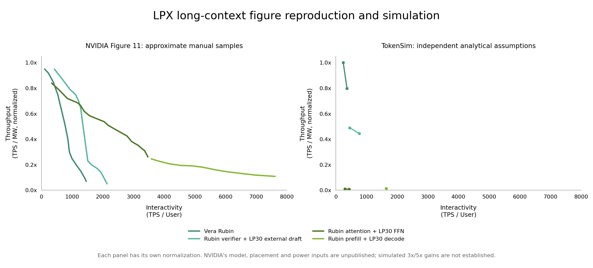

# Native LPX repair results

The [expanded validation study](lpx-full-validation.md) tests higher concurrency, micro-batches, memory allowances and measurement stability.
This report preserves the historical low-concurrency experiment and its original provenance.

The repair replaces the serialized full-model projection with production `ModelAFExecutor` serving.
The retained original-workload experiment finished all eight requested case/client combinations.
Seven points are feasible and one fails the declared static random-access memory (SRAM) capacity check.
The independent audit verifies the complete requested grid, original workload, physical inventories, power, token accounting, KV handoffs and Pareto frontiers.
The supplied NVIDIA Figure 11 is a vendor projection for a scaled GPT-OSS model.
The simulator uses independently declared proxies because the article does not give the scaled dimensions, deployed inventories, power figures or timing profiles needed to reproduce its numerical curves.

This is a low-concurrency validation run with one or two resident clients per deployment.
Those counts were selected to limit host execution time and do not establish throughput saturation.
The saved-result audit confirms the requested eight outcomes and their accounting; it does not validate that the sampled grid is sufficient for a deployment comparison.
The AF/PD efficiency ratios below apply only to those low-load operating points.
They do not establish the deployments' peak efficiency or an optimized performance gap to NVIDIA's curves.
The concurrency profiling procedure in the [experiment guide](lpx-reproduction.md#concurrency-coverage) addresses the missing load coverage.

## Implementation evidence

Attention–feed-forward network (AF) separation assigns attention and feed-forward networks (FFNs) to separate pools.
Prefill–decode (PD) separation assigns prompt processing and token generation to separate pools.
The repairs cover pipeline parallelism (PP), expert parallelism (EP) and key/value (KV) cache ownership.
The model precision includes eight-bit floating point (FP8), bfloat16 (BF16) and microscaling four-bit floating point (MXFP4).

| Defect or requirement | Implemented behavior | Verification |
| --- | --- | --- |
| Declared PP/EP geometry bypassed the production executor | Physical pipeline stages own their weights and KV; experts can be tensor-sharded within physical EP groups | `tests/af/runtime/test_pipeline.py`, `tests/af/runtime/test_expert_shards.py` |
| One serialized batch stood in for factory throughput | Independent cohorts contend on physical compute, host and endpoint resources | `tests/test_lpx_native.py`, including higher output under pipeline concurrency on a fixed inventory |
| Uniform full attention and FP8 storage hid GPT-OSS precision and KV behavior | Per-layer bounded/full windows, BF16 nonexpert weights and KV, packed MXFP4 experts with padding and scales | `tests/af/runtime/test_precision_layout.py`, model catalogs and runtime component ledgers |
| Aggregate link bandwidth could be multiplied by port count | Aggregate injection is counted per physical endpoint; aliases share reservations | `tests/test_lpx_hardware.py`, `tests/af/communication/test_endpoints.py` |
| Hop completion occupied injection for every small message | Analytical point-to-point injection reservations end after serialization; consumers wait for hop completion | Endpoint timing, capacity and utilization tests |
| PD recopied a retained warm prefix | Explicit cold/full and warm/incremental handoffs validate coverage, bounded tails and destination-local head replication | `tests/af/execution/test_serving_cohorts.py` and serving handoff tests |
| Speculative work and KV validity were incomplete | Full gamma-plus-one verification, rollback and required draft KV catch-up; independent draft prefill overlaps target prefill | Native verification, rejection/acceptance and overlap tests |
| A short window could omit the turn's suffix prefill | Measurement includes a minimum number of complete turns; warm-up is explicitly excluded and closing completions are retained | Native complete-turn token-count tests |
| Intermediate prefill chunks computed unused vocabulary logits | KV extends on every chunk and logits are emitted on the terminal chunk | Native chunked-prefill test |
| Saved metrics had insufficient arithmetic and provenance checks | Power snapshots and start/end revisions are exported; independent audits check inventory, units, complete turns, transfer bytes and frontiers | `scripts/check_lpx_results.py`, corruption tests |

The reproduction guide documents the [experiment inputs and remaining model limits](lpx-reproduction.md).
The [historical diagnosis](lpx-diagnosis.md) retains the measurements that motivated these repairs.
The historical outputs are preserved separately from the native run.

## Original-workload experiment

```bash
python scripts/reproduce_lpx.py \
  --skip-audit \
  --cases rubin-tp8 af-tp8 pd-tp16 draft-tp8 \
  --batches 1 2 \
  --jobs 3 \
  --plot \
  --output outputs/lpx-native-reproduction
```

The input is 400,000 cached tokens, 4,000 new tokens and 400 output tokens per request.
The target is `gpt-oss-2t-wide-proxy`: 80 layers, hidden width 8,192, 128 experts, top-4 routing and alternating 128-token local/full attention.
It has 2.077T total parameters and 64.42B activated routed-FFN parameters per token.
The independently specified four-layer draft model retains GPT-OSS-120B width.
Draft acceptance is a seeded 0.8 Bernoulli prefix model.
Neither the target proxy nor acceptance rate establishes the quality of an unpublished deployed model.

Processor power defaults are assumed 1,800 W per Rubin graphics processing unit (GPU) and 450 W per LP30 chip.
Every allocated processor contributes to the denominator, including idle expert ranks.
The experiment adds no facility allowance unless explicitly supplied.
GPU graph mode uses an assumed 4-microsecond host submission and 0.2-microsecond device-kernel overhead.
These are analytical inputs without measured calibration.

The recorded execution state identifies `3051bfe` as the worker startup revision, with structural DAG caching enabled.
The later `c2cce5a` change disables unproductive template compilation by default and preserves complete native results and traces in differential coverage.
An 80-layer decode probe also preserved its simulated time and 5,515 events while reducing host execution time from 2.20 to 1.41 seconds.
The long run was retained because that change affects simulator CPU cost, not modeled service time.

The legacy parent exporter recorded `b605db6` in its single revision field and marked the worktree dirty.
It did not record independent start/end revisions or a processor-power snapshot.
This retained run spans commits and cannot be attributed to one immutable revision.
The independent audit checks its saved hardware against the current catalog and reconstructs the assumed processor power.
The original summary remains unchanged; the committed evidence identifies its exact bytes with SHA-256 `dc1c3e33d5bb051ca5f13fce8be079ec80e1291737f3eb7db4c0cec664d052e8`.
New runs save both revision snapshots, processor-power provenance and the requested client counts.

## Completed low-concurrency measurements

TPS denotes tokens per second, and MW denotes megawatts.
TPS/user measures per-user decode speed, and output TPS measures the deployment's completed output across the entire turn.

| Case | Clients | TPS/user | Output TPS | TPS/MW | Normalized TPS/MW | Allocated power |
| --- | ---: | ---: | ---: | ---: | ---: | ---: |
| Rubin TP8 | 1 | 363.94 | 280.13 | 19,453.65 | 0.797413x | 14.4 kW |
| Rubin TP8 | 2 | 241.04 | 351.30 | 24,395.96 | 1.000000x | 14.4 kW |
| External draft TP8 | 1 | 764.12 | 468.52 | 10,845.47 | 0.444560x | 43.2 kW |
| External draft TP8 | 2 | 452.31 | 516.18 | 11,948.57 | 0.489777x | 43.2 kW |
| AF TP8 | 1 | 434.47 | 356.02 | 188.73 | 0.007736x | 1,886.4 kW |
| AF TP8 | 2 | 299.73 | 472.18 | 250.31 | 0.010260x | 1,886.4 kW |
| PD TP16 | 1 | 1,641.46 | 892.36 | 364.52 | 0.014942x | 2,448.0 kW |
| PD TP16 | 2 | — | — | — | — | Rejected: 643.09 MB required on a 500 MB rank |

Every feasible point passes the independent audit.
Their combined measured output is 4,000 tokens; warm-up and drain tokens are excluded.
The common efficiency denominator is 24,395.961707 TPS/MW, from Rubin TP8 with two clients.

| Deployment | Allocated Rubin GPUs | Allocated LP30 chips |
| --- | ---: | ---: |
| Rubin TP8 | 8 | 0 |
| External draft TP8 | 8 | 64 |
| AF TP8, including prefill | 24 | 4,096 |
| PD TP16, including prefill | 16 | 5,376 |

The single-client Rubin point contains exactly 400 measured output tokens, including 399 decode tokens.
Its measured wall interval is 1.427895 seconds, with 0.331573 seconds to the prefill output and no drain tail.
Its maximum reported resource utilization is 0.538435.
Interactivity uses decode-pass elapsed time; output throughput includes the complete suffix-prefill and decode turn.

The two-client point records 800 measured output tokens, including 798 decode tokens, over 2.277244 seconds.
Its maximum reported resource utilization is 0.675248 and its drain tail is 0.020937 seconds.
On the same eight GPUs and power assumption, concurrency increases factory output by 25.4% while per-user interactivity falls by 33.8%.

The single-client AF point allocates 24 Rubin GPUs and 4,096 LP30 chips.
It transfers 676,331,520 KV bytes for the measured warm-prefix handoff, including the retained local-window tails.
Its maximum reported resource utilization is 0.321808.
Its output rate is 1.0134 times the best completed Rubin output rate while its assumed allocated power is 131 times larger.
Its normalized TPS/MW is consequently about 0.00774 at this low-concurrency operating point.
Physical scheduling and correct power accounting expose this deployment's poor utilization; they do not establish the vendor's projected gain.

The two-client AF point transfers 1,352,663,040 KV bytes and records 800 output tokens over 1.694286 seconds.
Its maximum reported resource utilization is 0.426801.

The single-client external-draft point allocates eight Rubin GPUs and 64 LP30 chips.
It records 400 output tokens and 399 decode tokens over 0.853745 seconds.
Its 118 measured verification cycles commit those 399 decode tokens and charge 52 draft KV catch-up tokens.
Its maximum reported resource utilization is 0.648111, with no drain tail.

The two-client draft point records 800 output tokens over 1.549852 seconds, with maximum resource utilization 0.765602.
Its 240 measured verification cycles commit 798 decode tokens and charge 98 draft KV catch-up tokens across both requests.
An additional catch-up token belongs to warm-up and is excluded from that measured total.

The single-client PD point records 400 output tokens over 0.448251 seconds, including 0.205175 seconds to the prefill output.
It transfers 1,352,663,040 KV bytes, including destination-local replication when TP16 exceeds the eight KV heads.
Its maximum resource utilization is 0.336079 and it has no drain tail.

The production single-layer AF audit completes batches 1, 4 and 16 in 176.57, 360.59 and 1,112.73 simulated microseconds.
Its whole-model negative control requires 8,556,380,160 bytes on an LP30 rank with 500,000,000 bytes and correctly rejects execution.
The declared PD TP16/PP80 layout fits one request.
Two requests require 643,088,384 bytes on the output-head rank and exceed its 500 MB SRAM capacity.
Capacity rejection is a result of the declared deployment and is excluded from its frontier.

## Saved artifacts and verification

The [compact evidence](../experiments/lpx/results/native-reproduction/evidence.json) and [raw measurement table](../experiments/lpx/results/native-reproduction/points.csv) are committed with this report.
The evidence includes model and workload inputs, hardware assumptions, the source-summary digest, complete turns, verification totals and the successful grid audit.
The complete source summary remains at `outputs/lpx-native-reproduction/summary.json` and includes the resource-level details omitted from the compact evidence.
Export the checked evidence and raw table without running another simulation:

```bash
python scripts/check_lpx_results.py \
  --summary outputs/lpx-native-reproduction/summary.json \
  --config experiments/lpx/sweep.json \
  --cases rubin-tp8 af-tp8 pd-tp16 draft-tp8 \
  --batches 1 2 \
  --original-workload \
  --output outputs/lpx-native-reproduction/validation.json \
  --export outputs/lpx-native-reproduction/audited
```

The [comparison](../experiments/lpx/results/native-reproduction/comparison.png) retains separate reference and simulation panels with common displayed axes.
The [simulation figure](../experiments/lpx/results/native-reproduction/simulation.png) includes a low-efficiency inset for AF and PD.
The [reference reconstruction](../experiments/lpx/results/native-reproduction/reference.png) contains only manually sampled vendor points.
Editable Scalable Vector Graphics (SVG) versions accompany each Portable Network Graphics (PNG) image.
Validation passed all 446 tests with `python -m unittest discover -s tests -t .`, the pinned Black formatter and its check, and `git diff --check`.



Regenerate all figures from the original native summary:

```bash
python scripts/plot_lpx.py \
  --summary outputs/lpx-native-reproduction/summary.json \
  --output outputs/lpx-native-reproduction
```

The historical serialized experiment covered 84 combinations with 61 feasible outcomes.
Its fastest Rubin, draft, AF and PD points were 464.25, 962.78, 505.62 and 1,521.64 TPS/user respectively.
The native run's corresponding maxima are 363.94, 764.12, 434.47 and 1,641.46 TPS/user.
The native target has wider layers, more activated parameters and different precision, and the sampled placements and client counts differ.
These numbers compare two declared experiments and do not isolate the effect of an individual repair.

## Interpretation limits

NVIDIA describes compiler-prescheduled chip-to-chip (C2C) transfers and overlap at 320-byte vector granularity in the [target article](https://developer.nvidia.com/blog/how-nvidia-groq-3-lpx-unlocks-ultrafast-interactivity-at-long-context-on-nvidia-vera-rubin/).
The simulator uses whole-operator service with explicit endpoint reservations and does not implement that compiler schedule.
Its flat-link collective service uses a ring model.
Native context parallelism is explicitly rejected.
Local attention remains on the configured attention pool; an LP30-local-attention placement at full-attention exchange boundaries is not implemented.
Those limits restrict the high-interactivity region and feasible LP30 decode concurrency.

The manually sampled reference and simulated points have separate normalization denominators.
The simulation denominator is the best Rubin TPS/MW among its completed feasible points.
The retained experiment samples only one topology per mode at one and two clients.
It does not measure saturated AF/PD service across the full default or pipeline sweeps.
The finite client/topology sweep does not establish the factory's globally optimized Pareto frontier.
The historical and native experiments also use different model precision and architecture assumptions, so their numerical differences do not isolate one code repair.
The declared deployments improve single-client decode interactivity while charging much larger processor inventories.
The measured AF and PD efficiencies reach only 0.010260x and 0.014942x of the best sampled Rubin efficiency.
The native experiment does not reproduce NVIDIA's projected 3x/5x gains.
