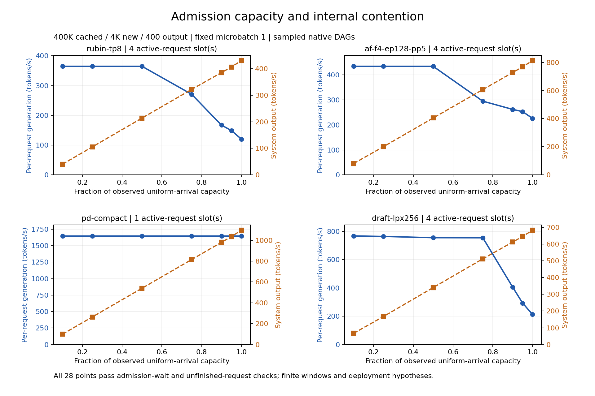
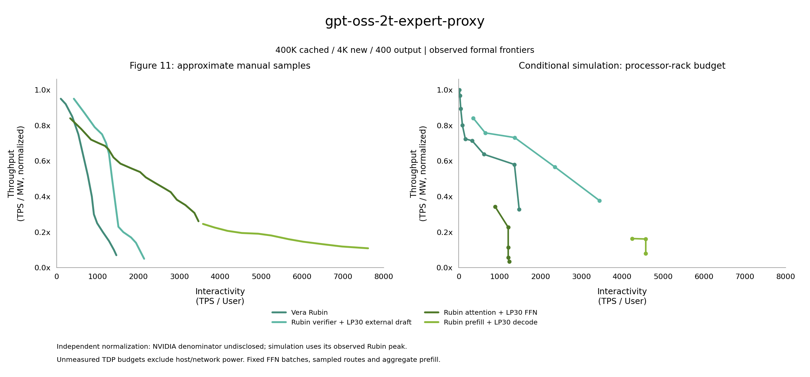
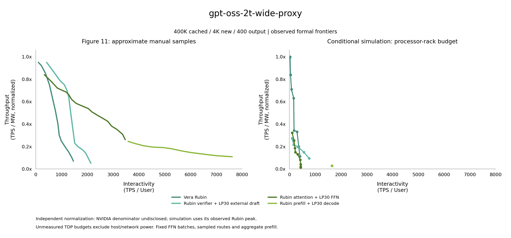
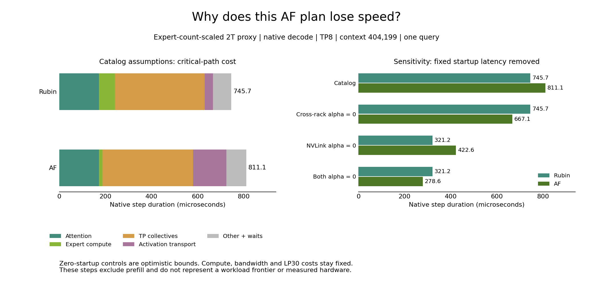

# Groq 3 LPX calibration and Figure 11 study guide

This plan covers Artificial Analysis (AA) single-client calibration and four inference deployments from NVIDIA Figure 11.
Configuration and source review date: October 20, 2026.
The [Groq hardware evidence audit](groq-hardware-evidence.md) records additional papers, chip generations and communication evidence.

## Known conditions and reproduction scope

Keep the published workload and hardware generation consistent with the blog.
Record undisclosed deployment parameters as separate assumptions; a successful fit does not establish the original configuration.

| Experiment | Public conditions | Missing conditions |
| --- | --- | --- |
| AA Gemma 4 31B | Reasoning model; 10K and 100K inputs; 50 serial requests per group; client concurrency 1; median output speeds 3,382 and 3,431 tokens/s; `o200k_base` | Native token counts and original text, actual LPU count, parallel layout, precision, server batch, GPU roles, speculative decoding and runtime version |
| Figure 11 | GPT-OSS 120B expanded to 2T parameters; 400K cached input, 4K new input, 400 output; Rubin baseline and three Rubin/LP30 combinations; projected performance | Expansion method, active parameter count, precision, rack counts and ratios, concurrency, horizontal-axis statistic, power scope, draft model and acceptance rate |

AA tests a private prerelease endpoint supplied by NVIDIA through Google Cloud Private Service Connect (PSC).
Request conditions come from the [100K chart and footnotes](https://developer-blogs.nvidia.com/wp-content/uploads/2026/08/nvidia-groq-3-lpx-gemma-4-100k-artificial-analysis.webp) and [10K chart and footnotes](https://developer-blogs.nvidia.com/wp-content/uploads/2026/08/nvidia-groq-3-lpx-gemma-4-10k-artificial-analysis.webp).
The [general AA methodology](https://artificialanalysis.ai/methodology/performance-benchmarking) supplies workload, token and timing rules without the endpoint's deployment inventory.
The [NVIDIA article](https://developer.nvidia.com/blog/how-nvidia-groq-3-lpx-unlocks-ultrafast-interactivity-at-long-context-on-nvidia-vera-rubin/) describes Figure 11 as a projection; workload lengths and axes appear in the [original chart](https://developer-blogs.nvidia.com/wp-content/uploads/2026/08/gpt-oss-2t-interactivity-throughput.webp).

Results with a complete deployment inventory may use the label `published-configuration-reproduction`.
Results containing material assumptions use `published-workload-hypothesis`.

## Hardware, model structure and capacity checks

| Unit | Public specification | Configuration requirement |
| --- | --- | --- |
| Rubin NVL72 | 72 GPUs, 36 Vera CPUs, 20.7 TB HBM4, NVLink 6 | Pin the specification version and record both device and rack counts |
| LPX | 256 LP30 chips, 128 GB SRAM, 12 TB DDR5 | Model static random-access memory (SRAM) and DDR5 separately |
| LP30 | 500 MB SRAM and 150 TB/s SRAM bandwidth per chip | Preserve decimal capacity and units |
| LPX compute and interconnect | 315 PFLOPS FP8; approximately 40 PB/s aggregate SRAM bandwidth; 640 TB/s aggregate scale-up bandwidth | Distinguish compute precision, individual links, endpoint aggregates and bidirectional definitions |

Specification sources are [NVL72](https://www.nvidia.com/en-us/data-center/vera-rubin-nvl72/), [LPX](https://www.nvidia.com/en-us/data-center/lpx/) and the [architecture explanation](https://developer.nvidia.com/blog/inside-nvidia-groq-3-lpx-the-low-latency-inference-accelerator-for-the-nvidia-vera-rubin-platform/).
Record 150 TB/s multiplied by 256, or 38.4 PB/s, separately from the published rounded 40 PB/s.
Rack aggregate bandwidth cannot serve as per-chip bandwidth or GPU-to-LPX link bandwidth.
Groq v1's 215 W, 16 ports and FP16 compute specification are excluded from measured LP30 parameters.
The restored configuration labels LP30 BF16 compute, 450 W power, Rubin 1,800 W power and effective cross-rack bandwidth as assumptions.
The restored path models SRAM residency only and does not treat 12 TB DDR5 as equally fast SRAM.
Compressed-weight unpacking cost is charged separately; four-bit storage cannot directly double LP30 FP8 compute capability.
LP30's 2.5 TB/s bidirectional aggregate injection is split into 1.25 TB/s per direction, with an individual 112 Gb/s link listed separately as 14 GB/s.
Charge the aggregate injection budget once without multiplying it by 96 ports.
LP30 links explicitly use an alpha-beta assumption with zero small-message bandwidth ramp and collective efficiency one.
These are unmeasured model assumptions chosen to match native AF link charging.
Generic NCCL defaults of a 1 MB ramp and 0.5 collective efficiency do not apply to this LPU hypothesis.
AF communication workspace counts toward capacity in both flat-link and physical topology modes; network charging does not determine buffer residency.
Here AF denotes attention/feed-forward network disaggregation, LPU denotes Language Processing Unit, and NCCL denotes NVIDIA Collective Communications Library.

Represent physical inventory as `m * NVL72 + n * LPX`, with separate prefill, attention, feed-forward network (FFN), target and draft allocations.
Historical sweep configurations account for allocated physical ranks and do not automatically represent fully populated racks.
Rack comparisons must specify unallocated chips' capacity, idle power and network resources.
A 256-chip rack does not directly imply tensor parallelism (TP) of 256; separately check whether context partitioning requires additional support.

Gemma 4 uses a pinned version of the [official text configuration](https://huggingface.co/google/gemma-4-31B-it/blob/main/config.json).
The model has 60 layers, hidden width 5,376, FFN width 21,504, 32 query heads, vocabulary 262,144 and tied embeddings.
Each group has five local layers with window 1,024 followed by one global layer, for ten groups total.
Local layers use head dimension 256 and 16 key/value (KV) heads; global layers use dimension 512 and 4 KV heads, including shared K/V semantics.
Check gated GELU, Q/K normalization, projection shapes, KV storage and output operations against the [reference implementation](https://github.com/huggingface/transformers/blob/main/src/transformers/models/gemma4/modeling_gemma4.py).
Public BF16 weights do not establish AA serving precision.

NVIDIA has not supplied the actual GPT-OSS-2T structure.
The restored width/layer-count and expert-count expansion models are separate sensitivity hypotheses, with total parameters, active parameters, FFN parameters and attention structure recorded independently.
Both distinguish local/global attention and low-precision expert weights.
A total near 2T parameters cannot alone determine compute and storage costs.

Check per-device capacity before each run, including weights, quantization metadata, workspace and peak KV.
The FFN side of attention/FFN disaggregation (AFD) holds FFN/expert shards and workspace; the attention side holds attention state and request KV.
Expert parallelism (EP) changes placement, while sparse per-token activation does not remove storage for inactive experts.
For fully SRAM-resident FFN weights, screen capacity with `ceil(FFN_weight_bytes / usable_SRAM_per_rack)` and then check actual TP replication and EP allocation.
Mark candidates requiring unsupported DDR5 weight streaming as unavailable.

## AA single-client calibration

Each virtual user has at most one active request and submits another only after its completion event.
Measure 50 successful requests each at 10K and 100K, with warmup requests recorded separately.
Five warmups are an initial project setting.
Use different prefixes across AA requests to avoid accidental cache reuse.

| Case | Standardized input length | Initial output-length assumption | Target median speed |
| --- | ---: | ---: | ---: |
| `aa-10k` | 10,000 | 1,500 | 3,382 tokens/s |
| `aa-100k` | 100,000 | 2,000 | 3,431 tokens/s |

Output lengths use the minimum requirements of the general AA workload; original lengths for the 50 requests are unavailable.
Replace assumptions when original records become available; otherwise report length sensitivity.
Repeating an identical deterministic request 50 times does not produce 50 independent accuracy samples.
`--max_num_seqs 1` limits admission within a worker and still permits an admission queue, so it cannot establish a serial client.

Define `rho_in = native_input_tokens / o200k_input_tokens` and `rho_out = native_output_tokens / o200k_output_tokens`.
Use `native_input_tokens = rho_in * AA_input_tokens` for simulated inputs and `native_output_speed / rho_out` for predicted AA speed.
Prefer ratios from identical text with a pinned tokenizer; when text is missing, treat ratios as sensitivity parameters without assuming one.
Save submission, admission, initial output, terminal output and actual token counts, and take the median of per-request generation-phase speeds.
Also save time to first token (TTFT) and full-request speed, preserving differences between streamed chunks and native per-token accounting.
When reasoning tokens are hidden, match AA's rule for the final-answer interval.

Screen feasible deployment hypotheses with 64, 128 and 256 LPUs, keeping the same configuration across both contexts.
Record precision, parallel layout, GPU participation and speculative decoding separately; two observations cannot determine all settings.
A pure-LPU resident deployment with speculative decoding disabled is a candidate hypothesis when its architecture and capacity can be represented.

Save unfitted results with operator, communication and fixed-overhead breakdowns.
With architecture, hardware and token assumptions fixed, fit at most one shared correction parameter using 10K alone and hold out 100K; reverse the split for diagnosis.
Enforce physical compute and bandwidth limits without fitting separate context coefficients.
The existing operator `calibrate` command expects per-operator measurements and cannot accept two overall speeds as operator records.
Reuse experiment checkpoints and provenance when adding a calibration wrapper.

Suggested project acceptance thresholds are at most 10% holdout speed error and at most 5% relative error in the 100K/10K speed ratio.
The public ratio is approximately 1.01449; missing raw variance prevents establishing statistical significance for this difference.
Single-user dense calibration does not validate mixture-of-experts (MoE), high-concurrency batching, Rubin, cross-rack communication or power.

Run conditional AA calibration:

```bash
python scripts/calibrate_lpx_aa.py \
  --rho-in 1 \
  --rho-out 1 \
  --lpu-counts 64 128 256 \
  --tp 8 16 32 \
  --weight-dtypes fp8 bf16 \
  --kv-dtypes bf16 fp8 \
  --requests 50 \
  --warmup-requests 5 \
  --jobs 4 \
  --output outputs/lpx-study/aa-rho1
```

This command explicitly selects `rho_in = rho_out = 1` as a hypothesis to test.
Save ratio-sensitivity experiments in separate directories.
Each candidate checks residency capacity at both input lengths before executing 50 measured requests and five warmups per length.
The independent AA client uses the ordinary full-model `OperatorTableLatencyBackend`, with per-layer attention and physical TP/pipeline-parallel (PP) communication from the existing backend.
This path advances the SimPy clock token by token for a dense full-model pipeline without cross-request contention.
The AA script fixes `colocated=True`: attention and FFN share the same physical LP30 ranks, and the LPU full-model backend estimates both prefill and decode.
`--lpu-counts 256 --tp 16` gives TP16/PP16 on 256 LP30 chips, without an additional Rubin attention or GPU prefill pool.
Internal reuse of `AFService` and the `af.enabled=True` configuration structure does not establish physical A/F disaggregation.
`--jobs` controls candidate-configuration process count; simulated AA client concurrency remains independently fixed at 1.
A stage representative evaluates equal service times for identically shaped TP ranks, with accounting scope recorded in results.
Figure 11 AF, external draft and multi-client contention continue to use native `ModelAFExecutor`.
Both paths share operator and hardware provenance without maintaining separate Groq floating-point-operation (FLOP) formulas.

The NVIDIA blog discusses LPX long-context attention acceleration and AA Gemma 4 measurements together, while listing three Rubin/LP30 combinations in the Figure 11 section.
This supports LPU full-model decode as an AA candidate hypothesis; endpoint attention placement, prefill device, LP30 allocation and TP/PP remain undisclosed.
Captions establish a private endpoint, Google Cloud PSC, 50 serial requests per group and client concurrency 1, without establishing A/F disaggregation.
BF16 weights, FP8 KV, a 4096 prefill chunk, five warmups and `rho_in = rho_out = 1` in the command are project assumptions.
The blog's output-precision and unchanged-quality statements do not specify runtime weight and KV data types.

Default calibration uses only 10K to fit a shared compute/memory-bandwidth efficiency multiplier.
All effective efficiencies remain between zero and one; fixed startup overhead and communication are excluded from fitting.
100K is used only for holdout checks.
`--no-fit` outputs uncalibrated values only.
`aa-summary.json` records per-request timing, unit conversions, capacity rejection reasons, unfitted values, fit parameters and holdout errors.
These deterministic length-based requests do not reproduce AA's original 50 input texts.
AA caches identical computation shapes within the same dense backend by default, while executing every request and per-token clock advance.
The key includes input length, computed position, query width, phase, recomputation state and the logits switch.
This cache applies only to AA single-client dense execution, excluding MoE and multi-user contention.
`--no-step-cache` disables it; tests confirm matching per-request timestamps field by field.
With caching enabled, operator statistics count unique evaluated shapes, while measured requests remain 50.

## Figure 11 workload and deployments

Use 400,000 cached tokens, 4,000 new tokens and 400 output tokens, giving nominal input 404,000 and peak context approximately 404,400.
The chart does not disclose its tokenizer; label temporary native-token use as a counting assumption.
Keep target model, precision and token assumptions identical within each comparison group.
Each user owns an independent resident prefix; initial cache construction is outside the measurement window, while cache capacity always counts.
Each turn's 4K new tokens attend to the existing context and generate 400 outputs.
Reset request boundaries to the fixed prefix; investigate continuously growing sessions separately.
Charge cross-pool KV handoffs where required and distinguish full from incremental transfer.

| Curve | Execution roles |
| --- | --- |
| Rubin | Complete target execution on GPUs |
| Rubin ATTN + LP30 FFN | GPU attention/KV, LPU FFN and bidirectional per-layer activation transfer |
| Rubin Prefill + LP30 Decode | Full GPU prefill, KV handoff and full LPU decode |
| Rubin Verifier + LP30 Draft | Separate small draft, GPU target verification, acceptance/rejection and two KV states |

The restored script covers all four native execution paths.
The current AF hypothesis places every attention layer on GPUs and transfers activations at each layer.
The NVIDIA article separately describes one transfer per full-attention layer without disclosing local-layer placement or fusion.
This mapping in mixed local/global models remains unverifiable against the original deployment; retain the difference when presenting the current AF curve.
External draft execution charges prefill, incremental generation, full verification width, rejection position, KV rollback and required recomputation.
Only committed target tokens count as output; proposed and rejected tokens add cost without increasing throughput.
Size verification workspace as microbatch request count multiplied by verification width.
Sweep draft lengths 1, 2, 4 and 8 and acceptance rates separately; acceptance remains an unmeasured assumption.

## QPS capacity search

Queries per second (QPS) denotes arrival rate, while users denote unfinished-request slots.
Maximum QPS with near-zero admission wait defines only one configuration's capacity boundary.
Retain both the frontier meeting the admission-queue budget and the frontier of all stable points.

Measure isolated full-request latency `T_iso` for each feasible configuration and begin with uniform arrival rate `0.05 / T_iso`, doubling successively.
After backlog growth or excessive admission delay appears, refine the boundary to approximately 2% QPS resolution.
Use binary search only over intervals with monotonic feasibility; densify scans and retain all feasible intervals if batching introduces nonmonotonic behavior.
95% of the highest passing QPS provides an initial operating point with headroom.

Suggested passing conditions use project-selected thresholds:

- Steady-state completion rate differs from arrival rate by at most 1%, with window-boundary requests reconciled separately.
- Backlog has no sustained positive trend, including after doubling the measurement duration.
- Admission-delay P95 is at most `max(50 microseconds, 0.01 * T_iso)`.
- Rejections, memory failures, growing unfinished-request counts and eviction recomputation are retained in reporting.

Record admission wait separately from prefill/decode handoff, FFN batch wait, device wait and network wait.
Concurrent pipelines may contain internal resource wait.
Retest promising intervals with Poisson arrivals and seeds 0–4 under an explicit queue budget.
The LPX entry point uses `--qps` and `--arrival-pattern` for uniform or Poisson open arrivals.
`scripts/search_lpx_capacity.py` searches each deployment and saves probes, boundary accounting and doubled-window retests.
The search assumes local monotonic feasibility; results retain search scope and untested nonmonotonic batching intervals.

## Fixed users, parallel execution and frontier construction

A user is a logical client maintaining at most one unfinished request and submitting another immediately on completion.
The main experiment uses zero think time.
Record user count, measured request count, attention replica count and decode microbatch size separately.
`--users` specifies total users; the legacy `--batches` name aliases the same setting.
`--micro-batch` defaults to one; requests progress synchronously within larger groups.
`--a-replicas` controls attention-service replicas, with resources and power charged separately.
Sweep fixed users over `1, 2, 4, 8, 16, 32, 64, 128, ...` until capacity or latency limits.
Achieved QPS is measured; in steady state, check counts with `N = achieved_QPS * mean_request_latency`.
Generation-phase speed cannot substitute for full-request latency in this equation.

Also sweep `0.1, 0.25, 0.5, 0.75, 0.9, 0.95, 1.0` times each configuration's QPS capacity.
With fixed users and rate limiting, submit the next request at the later of previous completion and the rate deadline.
Save target QPS, achieved QPS, users and intentional wait, explicitly recording targets missed under backpressure.

Within each physical inventory, screen legal TP/PP/data-parallel (DP)/EP layouts and batch limits `1, 2, 4, 8, 16, 32, 64`.
AFD also sweeps A:F allocation, `af_block_size` and FFN wait windows of 0, 5 and 20 microseconds.
Initial rack candidates may use NVL72 counts 1, 2 and 4 and LPX counts 1, 2, 4, 8, 16 and 32, rejecting capacity failures before execution.
Densify only observed nondominated regions and describe results as feasible frontiers within the searched scope.

Independent physical configurations, users, seeds and loads may run in separate processes.
A QPS boundary search depends on previous probes and remains sequential; searches for different configurations may run in parallel.
`--jobs 4` permits four host processes without changing any point's simulated users, resource contention or power.
Each point has a separate SimPy environment and random stream; the parent aggregates results in configuration order.
Checkpoints reuse parameter, code and input fingerprints; rerunning an interrupted command executes only incomplete or invalidated points.
Default `--resume` reuses fully committed points; `--no-resume` recomputes selected points.
The parent updates `partial-results.json`, while children commit their own checkpoints; unknown runtime errors raise, and configuration/capacity failures become `infeasible`.
Reduce `--jobs` at high memory use to prevent host swapping from distorting execution time.

Formal sweeps should warm up for at least `max(1 second, 10 * T_iso)`, measure for at least `max(10 seconds, 100 * T_iso)` and complete at least 500 requests and 20 per user.
These are formal-run targets; short restored-script defaults provide preliminary checks and require explicitly increased windows and complete turns.
Count steady-state tokens by commit times within the window, excluding out-of-window output from boundary-crossing requests.
Randomized experiments use seeds 0–4; deterministic repetitions do not provide independent confidence-interval samples.

## Commands and parameters

These commands use the fixed-user entry point; independent deployment/user combinations can run in parallel.

Full-workload example:

```bash
python scripts/reproduce_lpx.py \
  --cases rubin-tp8 af-tp8 pd-tp16 draft-tp8 \
  --users 1 4 16 \
  --micro-batch 1 \
  --measurement-turns 20 \
  --measurement-seconds 10 \
  --jobs 4 \
  --plot \
  --output outputs/lpx-study
```

This smoke run shortens input and output while retaining long-context capacity checks; it cannot represent original-workload performance:

```bash
python scripts/reproduce_lpx.py \
  --skip-audit \
  --cases rubin-tp8 af-tp8 pd-tp16 draft-tp8 \
  --users 1 \
  --new-tokens 8 \
  --output-tokens 8 \
  --measurement-seconds 0.003 \
  --jobs 4 \
  --output outputs/lpx-smoke
```

Use the corresponding configuration for the expert-count expansion model:

```bash
python scripts/reproduce_lpx.py \
  --model gpt-oss-2t-expert-proxy \
  --config experiments/lpx/expert-sweep.json \
  --users 1 4 \
  --jobs 2 \
  --output outputs/lpx-expert-study
```

### Parameter reference

| Parameter | Meaning |
| --- | --- |
| `--model`, `--draft-model` | Model catalog name or YAML path |
| `--config`, `--cases` | Deployment matrix file and selected deployment names |
| `--cached-tokens`, `--new-tokens`, `--output-tokens` | Workload-length overrides |
| `--prefill-chunk` | New tokens per full-model prefill operation |
| `--warmup-steps` | Minimum warmup decode steps per group before measurement |
| `--warmup-mode` | `resident_decode` provides an untimed snapshot; `prefill_and_decode` also processes the warmup suffix |
| `--measurement-seconds`, `--measurement-turns` | Minimum measurement duration and completed turns per group; both must be satisfied before measurement closes |
| `--acceptance` | Assumed acceptance probability at each candidate position |
| `--execution-mode`, `--graph-kernel-us` | GPU eager/graph execution and assumed device overhead |
| `--endpoint-transfer-occupancy` | Reserve only wire time or conservatively reserve full service time at endpoints |
| `--handoff-mode` | `incremental` or `full` KV handoff |
| `--rubin-watts`, `--lp30-watts`, `--facility-watts` | Explicit power overrides and additional facility budget |
| `--rubin-reserve-bytes`, `--lp30-reserve-bytes` | Additional device memory reservation |
| `--trace` | Save complete native traces for single-user points |
| `--retain-timing-history` | Save measured resource history and disable online resource statistics |
| `--audit-only`, `--skip-audit` | Run only the AF layer audit or skip that precheck |

## Metrics, power and result checks

| Metric | Definition and status |
| --- | --- |
| Generation speed | Ordinary per-token generation uses `(output_tokens - 1) / (last_output_at - first_output_at)`; speculative commits retain their timestamps |
| Full-request speed | `output_tokens / (completed_at - submitted_at)` |
| System throughput | Committed target output tokens in the steady-state window divided by window duration |
| Current horizontal axis | P50 generation speed of complete measured requests; short windows without complete requests are separately labeled as decode-time-weighted values |
| Figure 11 main plot | Per-request generation-speed P50, with full-request speed, TTFT and time-per-output-token (TPOT) distributions also reported; this choice remains an assumption |
| Vertical axis | TPS/MW with explicit power scope; retain throughput and mark missing power when no power input is available |

The restored configuration uses device thermal design power (TDP) assumptions plus `--facility-watts`, which cannot be called measured rack power.
The final power table covers unique physical GPUs/LPUs, prefill, draft, CPU/host, memory and network; colocated A/F resources are charged once.
Report rated budgets and load power separately when data are available.
Output absolute tokens/s (TPS) and TPS/MW, then normalize every curve against one shared Rubin baseline.
The original chart's absolute normalization baseline is undisclosed, so independent normalization cannot establish absolute coordinate reproduction.

Output nondominated points per mode while retaining all raw points and infeasibility reasons.
Also compute the joint frontier across modes.
Compare the chart's vertical 3× at equal horizontal coordinates and horizontal 3×/5× at equal vertical coordinates; these factors do not enter parameter fitting.
Recovered reference coordinates are explicitly labeled manual samples, with sampling error recorded in comparisons.

### Outputs and independent checks

`summary.json` records code version, worktree state, target and draft models, configuration assumptions, resource allocations, infeasible points and per-mode frontiers.
`points.csv` retains users, generation speed, absolute output throughput, power and normalized efficiency.
Per-point results include token commits, decode intervals, turns, KV handoffs and verification events.
Warmup and drain outputs are excluded from the measurement window.

```bash
python scripts/check_lpx_results.py \
  --summary outputs/lpx-study/summary.json \
  --original-workload \
  --export outputs/lpx-study/evidence
```

`--original-workload` checks 400K/4K/400 and complete measured turns without validating undisclosed NVIDIA deployment settings.
The checker verifies inventory, power provenance, units, measurement boundaries, output counts, KV bytes and frontier coverage.
`--plot` or `scripts/plot_lpx.py` generates sampled reference, independent simulation and side-by-side plots.
Reference and simulation normalization sources are documented separately; manual samples are excluded from calibration.

## Execution sequence and deliverables

Gemma text architecture is available in `data/models/gemma-4-31b-text.yaml`, with per-layer head dimensions, KV heads, windows and shared K/V projections.
Shared K/V projections retain two transformed KV caches.
Figure 11 full-model prefill sums per-layer operator costs into aggregate pipeline-stage events, while decode expands per-layer dependency graphs.
Expert precision propagates to the prefill operator backend.
Cached prefill uses complete KV reads and roofline latency; fixed startup overhead does not scale with FLOP ratios.
AA token alignment and the serial-user driver provide conditional calibration.
Figure 11 reuses restored native paths for configuration capacity checks, QPS boundaries, fixed-user sweeps and denser scans of nondominated intervals.
QPS search and request statistics reuse the same native AF experiment entry point.

Deliverables include source inventories, calibration errors and sensitivity, capacity search records, per-user timing, cache occupancy, absolute/normalized curves and power assumptions.
Per-point checkpoints reside in `.experiments/<fingerprint>/` under the output directory and contain `manifest.json` and `result.json`.
New implementation follows `CONTRIBUTING.md` and verifies behavior with small deterministic tests.

## Completed implementation checks

The October 20, 2026 cached-prefill regression uses the width-expanded 2T hypothesis, `rubin-tp8`, one user, 400K cached tokens, 8 new tokens and 8 output tokens.
This diagnostic workload is excluded from full-workload Figure 11 results.
The cached-attention fix reduces TTFT from approximately 12.0194 seconds to 0.006146 seconds, while generation speed remains approximately 364.6 tokens/s.
FLOP-ratio amplification of fixed startup overhead caused the anomaly.
Per-layer attention, MXFP4 prefill and shared K/V projection checks pass all 502 tests.

Capacity-search example:

```bash
python scripts/search_lpx_capacity.py \
  --cases rubin-tp8 af-tp8 pd-tp16 draft-tp8 \
  --users 1 4 16 \
  --prefill-chunk 4000 \
  --duration-multiple 100 \
  --resolution 0.02 \
  --jobs 4 \
  --output outputs/lpx-capacity
```

Each configuration's isolated request determines initial QPS and observation windows.
`--duration-multiple` is measurement duration divided by isolated full-request latency and defaults to 100.
`capacity.json` retains all probes; passing candidates are retested with doubled windows before a 95% QPS recommendation is provided.
Admission-wait P95, unadmitted requests at window end and backlog growth enter the decision separately.
Open-arrival users limit simultaneously executing requests, while admission backlog is recorded independently.
Fixed-user requests trigger later submissions through completion events.
Native directed acyclic graph (DAG) template caching is enabled by default; `--no-dag-template-cache` disables it for per-point comparisons.

## Sampled DAG replay and native controls for extended sweeps

Four modules, including `scripts/lpx/replay_engine.cpp`, were restored from common historical revision `6c1f857` of `afd` and `codex/perf-integrated-defaults`.
Restoration covers sampled native DAGs and resource scheduling while retaining native submission, cache handoff and speculative verification.
Replay generates full-model samples through the current operator backend and uses a C++ scheduler to replay dependencies and contention on each resource.
Every sample checks that independently reconstructed latency equals native latency and caches by source, device, model, memory reservation and full-configuration fingerprints.

`--execution-backend sampled-replay` enables this path; the entry point defaults to `native`.
`--replay-samples` specifies routing samples per decode shape and defaults to four.
`--replay-prefill-samples` defaults to one.
`--replay-cache` specifies the sample cache directory.
`--seed` overrides workload seed without changing host process count.

Long-context replay fixes context at a representative position within each phase and selects from a finite routing corpus.
Repeated turns for one user reuse deterministic sample selection and cannot estimate independent variance of a real serving system.
A finite corpus may bias expert hotspots as users increase, requiring corpus-size convergence checks.
Both fixed-user frontiers and QPS searches support replay, while important controls require `native` with the original 400K/4K/400 workload.
Results use version three and `sampled_native_dag_replay`; independent checks establish counts and provenance, while numerical accuracy requires native comparison.
Native results retain version two and existing executor tags.
The two result types require separate accuracy statements.

```bash
python scripts/reproduce_lpx.py \
  --execution-backend sampled-replay \
  --replay-samples 16 \
  --cases rubin-tp8 af-tp8 pd-tp16 draft-tp8 \
  --users 1 4 16 \
  --prefill-chunk 4000 \
  --measurement-turns 20 \
  --measurement-seconds 10 \
  --jobs 4 \
  --seed 0 \
  --plot \
  --output outputs/lpx-study/replay-seed0
```

Compare 4, 16 and 64 samples separately and save native-control errors for each round.
Replay applies the same capacity checks as native execution and rejects configurations unable to hold KV or weights.

Open-arrival capacity checks count both admission backlog and admitted unfinished requests.
Checking admission wait alone can accept overloaded configurations with rapid admission and steadily growing internal wait.
Allowed unfinished-request growth in the latter half of the window is the larger of one boundary request and 1% of all window arrivals.
Open arrivals currently require `--micro-batch 1`.
Synchronous microbatches apply to fixed-user sweeps, counting every cohort member in arrivals and admissions.

Static return routing for large PP layouts connects only F/A stages sharing model layers.
Same-layer return paths exclude disjoint PP stages.
Per-device binding and EP-group validation reuse an index built once to avoid repeated full-rank scans.
The native LPX entry point reuses `host_collection` to reduce host garbage-collector scans without changing simulated clocks or event order.
Regression comparisons require identical complete per-point results across the optimization.

## Current study entry point and batching protocol

`python scripts/run_lpx_study.py` generates deployment matrices, screens capacity by user count and extends sweeps.
`--phase coarse` saves initial sweeps, `--phase formal` retests observed frontiers, and `--phase all` runs both phases consecutively.
User count expands while boundary throughput gain exceeds 2%, stopping at capacity failure, insufficient gain or `--maximum-users`.
Formal points default to at least 500 completed requests and 20 per user, with measurement windows based on isolated full-request latency.

`--warmup-seconds` and `--warmup-steps` both constrain active warmup.
The model continues running during warmup, and measurement begins only after both thresholds.
The study entry point sets warmup to at least `max(1 second, 10 * T_iso)` from each configuration's isolated latency.

`--micro-batch` and `--a-replicas` set synchronous microbatch size and target attention replicas separately.
`--cases` selects deployments from the matrix.
`--prefill-tp8-pp4` selects an independent 8-way TP, 4-way PP prefill pool as a cache-placement and pipeline sensitivity case.
External-draft cases can set `draft_a_replicas` to add attention/KV replicas while retaining the existing global EP placement for MoE experts.

LPX experiments explicitly disable dynamic FFN batching by default; `--micro-batch` still sets fixed microbatches.
`--ffn-batching` and `--ffn-batch-wait-us` apply only to native dynamic-batching experiments.
Fixed DAG replay rejects dynamic FFN batching because merged requests change operator costs beyond the fixed sample.
The colocated LPX full-model entry point supports `f_tp=1` EP layouts and pure expert TP with a single attention replica and `f_ep=1`.
The F side preserves declared expert TP shards, while EP groups occupy physical ranks across attention replicas.
Colocated configurations combining expert TP greater than one with EP or multiple attention replicas are explicitly rejected because full-model prefill does not support that hybrid layout.
Per-layer batch wait in multi-replica native execution is an execution cost that must remain in replay graphs and cannot be replaced by fixed compensation.
This check rejected draft samples with a 20-microsecond mismatch during this study; affected older sweeps remain diagnostic records only.

External draft currently shares an assumed accepted prefix within a synchronous microbatch; the main draft sweep uses microbatch one.
Independent per-request acceptance and asynchronous draft batching remain unvalidated.

Large-sweep `index.json` files retain point summaries, checkpoint locations and completed count audits.
Complete token, resource and request timing arrays remain in each `result_file` and are excluded from repeated parent-process transfer.
`python scripts/report_lpx_study.py --index ... --output ...` generates per-mode and joint frontiers, CSVs and PNG/SVG plots from compatible indexes.
All curves for one target model share the observed Rubin peak as their normalization baseline.
`analysis.json` exports `comparisons` at generation-speed floors 100, 250, 500, 1000, 2000 and 4000 tokens/s and normalized throughput-efficiency floors 0.1, 0.25, 0.5, 0.75 and 1.0.
For each threshold, select the highest other metric among observed feasible points and retain configuration, users and ratio relative to Rubin.
These ratios share a performance floor; sparse candidates may each exceed it, so comparisons describe a discrete searched set.
When no Rubin point meets the threshold, the ratio is null.
Export allocated-processor budgets separately from processor budgets rounded to 72-GPU/256-LPU racks; both remain distinct from measured rack power.
Formal retests use the union of each mode's coarse frontier under both power scopes.
Rounding small deployments to racks changes efficiency order, so selecting by allocated-processor power alone misses pipeline candidates.
Selection and export share power calculations; candidates retain original configuration and users, and duplicates run once.

The AA entry point supports `--c2c-latency-us` and `--collective-launch-us`, overriding communication assumptions only within that experiment process.
Mapping the 350 ns SRAM-to-SRAM constraint onto per-hop and collective fixed costs still requires validation; default catalog parameters remain separate.

## October 20, 2026 experiment record

This study uses the original 400K cached, 4K new-input and 400-output workload.
Both 2T models are architectural hypotheses; active parameters below count linear operations only and exclude attention computation that grows with KV length.

| Model hypothesis | Total parameters | Active linear parameters per token | Global / local attention layers |
| --- | ---: | ---: | ---: |
| Width and layer-count expansion | 2.077T | 78.235B | 40 / 40 |
| Expert-count expansion | 2.009T | 5.350B | 18 / 18 |

Active linear parameter counts differ by approximately 14.6×.
Similar total parameter counts do not determine Figure 11 compute cost.
Formal fixed-user points use seed 42, 16 decode routing samples, fixed microbatches and explicitly disabled dynamic FFN batching.
Each point warms up for at least `max(1 second, 10 * T_iso)`, measures for at least `max(10 seconds, 100 * T_iso)` and satisfies both 500 completed requests and 20 turns per user.
Native controls, alternate routing corpora and seed experiments are saved separately; short-output controls are excluded from 400-token formal frontiers.

### AA calibration and parameter sensitivity

Of 36 deployment candidates, 7 pass capacity checks at both context lengths.
For `rho_in = rho_out = 1`, BF16 weights, FP8 KV, 256 LP30 and TP16/PP16, fitting the shared efficiency multiplier 1.06552 using 10K alone predicts 3,382.11 tokens/s at 10K and 3,277.91 tokens/s for the 100K holdout.
The 100K relative speed error and context-speed-ratio relative error are both 4.46%, meeting this plan's conditional thresholds.
The [AA and native-control evidence](../experiments/lpx/results/aa-and-native-controls.json) records per-request timing and source checksums.

This fit uses catalog communication assumptions and cannot identify the real endpoint configuration.
With per-hop latency 350 ns and zero collective launch cost, 10K remains approximately 4.93% low even at the physical efficiency limit.
Adding 0.5 microseconds of collective launch cost gives approximately 20.30% and 23.30% error at 10K and 100K.
The mapping from the public 350 ns transfer boundary to simulated hops and collectives remains unknown, so catalog communication parameters retain assumption labels.
Figure 11 uses unfitted hardware and operator parameters; the AA single-user dense fit multiplier is excluded from MoE, multi-user and Rubin models.

With original efficiencies fixed and fitting disabled, tokenizer-ratio sensitivity is as follows.
Each case measures 50 requests, with ratios supplied as input assumptions.

| `rho_in` | `rho_out` | 10K relative speed error | 100K relative speed error | Context-speed-ratio error |
| ---: | ---: | ---: | ---: | ---: |
| 0.8 | 1.0 | 0.55% | 4.54% | 4.02% |
| 1.2 | 1.0 | 0.70% | 5.91% | 5.25% |
| 1.0 | 0.8 | 24.23% | 18.47% | 4.64% |
| 1.0 | 1.2 | 17.19% | 21.03% | 4.64% |

### Frontier selection correction

Initial formal candidates were selected only by allocated-processor power budgets.
After rounding to full racks, 8-GPU and 72-GPU configurations may carry equal GPU processor budgets, changing candidate efficiency order.
This omitted 10 expert-model points, 11 width-model points and 5 points in the microbatch-4 width branch.
Commit `9abacc5` sends the union of per-mode coarse frontiers under both power scopes to formal retesting and reuses shared power calculations.
All 536 tests pass, and existing exports match field by field after the power-calculation refactor.

### Open-arrival capacity and bursty traffic

The following four configurations complete uniform-arrival retests at `0.1, 0.25, 0.5, 0.75, 0.9, 0.95, 1.0` times maximum candidate QPS, for 28 points.
Lower-rate points run for at least 100 isolated-request durations; maximum candidates run for at least 200.
All pass admission-wait budgets, window-boundary accounting and unfinished-request growth checks.
Completed request counts vary with QPS; these capacity checks are separate from formal frontier points requiring at least 500 requests.

| Configuration | Concurrent execution slots | Maximum candidate QPS | Admission-wait P95 budget | Maximum-candidate retest window |
| --- | ---: | ---: | ---: | ---: |
| `rubin-tp8` | 4 | 1.08415 | 12.91 ms | 258.27 s |
| `af-f4-ep128-pp5` | 4 | 2.04430 | 10.39 ms | 207.89 s |
| `pd-compact` | 1 | 2.75340 | 3.63 ms | 72.64 s |
| `draft-lpx256` | 4 | 1.72623 | 7.17 ms | 143.38 s |

All QPS search bounds resolve to within 2%, with monotonic feasibility assumed only in observed local intervals.
The four-slot PD configuration fails capacity checks and supplies no multi-user throughput conclusion.
A short-window draft candidate fails its doubled-window check; the table's candidate is obtained only after lengthening the search window.
Failed and passing records are both retained.

The uniform-arrival Rubin recommendation is approximately 1.030 QPS.
With Poisson arrivals and seeds 0–4, admission-wait P95 becomes approximately 3.52–6.85 seconds, exceeding the approximately 12.91 ms budget for every seed.
At approximately 0.515 QPS, two seeds still exceed P95 limits and another retains an admission backlog at window end.
At approximately 0.257 QPS over 260 seconds, all five seeds have zero admission-wait P95 and no terminal admission backlog.
This is an observed low-rate feasible point; maximum Poisson QPS remains unsearched.
The [QPS capacity evidence](../experiments/lpx/results/rate-capacity-evidence.json) includes checkpoint checksums, point decisions and all 15 Poisson records.

Internal device and network wait can reduce generation speed even when admission wait meets its budget.
In this sweep, Rubin generation-speed P50 decreases from approximately 364.8 to 120.3 tokens/s, AF from approximately 434.5 to 226.2 and draft from approximately 767.9 to 213.0.
PD uses one execution slot and remains approximately 1,648.3 tokens/s.
The plot's blue line shows request generation-speed P50, orange shows system output throughput, and lines connect observed points only.



### Routing corpus, prefill chunk and native controls

Initial comparisons of 4, 16 and 64 routing samples use original output length and two turns per user as short-window diagnostics.
Draft generation-speed P50 at 16 users varies approximately 6.7% with sample count.
Extending the same draft configuration to at least 500 completed requests reduces the 16-versus-64-sample difference at 16 users to approximately 0.042% in speed P50 and 0.047% in system throughput.
Deterministic sample selection repeats across turns, so these requests cannot establish independent confidence intervals for a real serving system.

In expert-count model controls with 4 users and 32 output tokens, native/replay system throughput differs approximately 0.11% and generation-speed P50 approximately 13.36%.
Initial-token order and the composition of completed requests differ in the two short runs.
Restoring 400 output tokens reduces 16-sample replay error to 0.37% in speed P50 and 0.31% in throughput.
Using 64 and 256 routing samples in the same 400-token control yields approximately 0.51% and 2.64% speed-P50 error.
Increasing samples therefore does not monotonically reduce P50 error in an individual short window.

The `prefill_chunk=256` versus `4000` comparison preserves 400K/4K/400, seed 42, 16 routing samples and fixed microbatch one.
In four-user controls with two turns per user, chunk 256 has approximately 11.05% lower system throughput for Rubin, 23.17% for AF and 26.43% for draft.
Formal frontiers use chunk 4000; chunk 256 results are retained separately.

Full-model prefill aggregates compute and communication by pipeline stage, labeled `prefill_aggregate` in traces.
This representation does not expand per-operator overlap between different requests' prefill layers.
Native and replay controls share this representation, so their agreement cannot validate the prefill approximation.
The [sensitivity evidence](../experiments/lpx/results/sensitivity-evidence.json) records settings and checksums for routing corpora, five workload seeds, chunks and native controls.

### Speculative acceptance and draft length

Each model sweeps draft lengths 1, 2, 4 and 8, per-position acceptance probabilities 0.5, 0.8 and 0.95, and 1 and 4 users, for 48 points total.
Each point runs two full turns per user and passes token-commit, verification-event, KV-rollback and resource-count audits.
Acceptance probabilities and draft-model quality are unmeasured assumptions.
These short runs are excluded from formal frontiers requiring at least 500 requests; main curves retain length 4 and acceptance 0.8.

The table gives single-user generation-speed P50 in tokens/s.

| Model hypothesis | Length 1, acceptance 0.5 | Length 8, acceptance 0.5 | Length 8, acceptance 0.8 | Length 8, acceptance 0.95 |
| --- | ---: | ---: | ---: | ---: |
| Width and layer-count expansion | 459.3 | 359.7 | 799.6 | 1,316.9 |
| Expert-count expansion | 1,821.0 | 1,737.4 | 3,851.5 | 6,287.7 |

At low acceptance, longer candidate sequences increase uncommitted computation.
In both settings, length 8 at acceptance 0.5 is slower than length 1 at the same acceptance.
Speeds obtained by raising assumed acceptance do not validate draft quality or identify NVIDIA's acceptance rate.
The [speculative-decoding sensitivity evidence](../experiments/lpx/results/draft-sensitivity-evidence.json) includes committed-token counts, verification counts and raw-result checksums for all 48 points.

### Four-user full-workload native controls

The table uses 400K cached tokens, 4K new tokens and 400 outputs with one complete measured request per user, keeping model, layout, precision, fixed microbatch and seed identical across native and replay execution.
Replay uses 16 routing samples.
These four-request controls check simulation-path differences; formal frontiers separately meet the 500-request requirement.

| Model and configuration | Native speed P50 | Replay speed P50 | Relative speed error | Relative system-throughput error |
| --- | ---: | ---: | ---: | ---: |
| Width expansion, `rubin-tp8` | 125.28 | 121.04 | 3.39% | 0.51% |
| Width expansion, `af-f4-ep128-pp5` | 223.76 | 223.05 | 0.32% | 0.18% |
| Width expansion, `draft-lpx256` | 196.17 | 196.68 | 0.26% | 0.37% |
| Expert expansion, `rubin-tp8` | 478.44 | 476.68 | 0.37% | 0.31% |

Speed units are tokens/s/user.
All three width controls and the expert control pass original-workload, per-token, KV and physical-power accounting checks.
Native controls retain project hardware assumptions, so passing checks cannot replace hardware measurements.
The [multi-user native-control evidence](../experiments/lpx/results/multiuser-native-evidence.json) records inputs, per-point errors and checksums.

### Expert-count expansion formal frontier

This model completes 28 formal points and 23,417 full measured requests.
Per-point verification confirms at least 500 requests and 20 per user, together with required warmup and measurement durations.
Formal results use the union of candidates under both power scopes, with input/result SHA-256 verification.

The table selects the highest-efficiency observed point per mode under the full-rack processor budget.
Speed, throughput and power in each row refer to the same operating point.

| Mode | Users | Generation-speed P50 | System output TPS | Processor budget MW | Normalized efficiency |
| --- | ---: | ---: | ---: | ---: | ---: |
| Rubin | 256 | 13.29 | 3,407.32 | 0.1296 | 1.000 |
| AF | 16 | 888.02 | 12,745.18 | 1.4112 | 0.344 |
| PD | 2 | 4,239.79 | 6,507.69 | 1.5120 | 0.164 |
| Draft | 16 | 350.79 | 5,416.81 | 0.2448 | 0.842 |

Additional runs raise the Rubin normalization baseline under this power scope from approximately 21,039 to 26,291 TPS/MW, approximately 25.0%.
Under allocated-processor budgets, the best Rubin efficiency remains `rubin-tp4-pp2` with 32 users and a baseline approximately 189,352 TPS/MW.
The two power scopes select different layouts.

Attention replicas in these configurations share global EP expert placement; the sweep excludes independent full-target replicas, dynamic FFN batching and DDR5 weight streaming.
The frontier covers only saved layout, microbatch and user grids.
These conditional curves differ from the reference; NVIDIA's model expansion, layout, compiler mapping and normalization denominator remain undisclosed.
Rack budgets count processor TDP assumptions only, excluding host, network and facility power.

The [formal-point, KV-reservation, threshold-comparison and frontier evidence](../experiments/lpx/results/expert-formal-evidence.json) retains all 28 formal points and coarse capacity rejections.
The [allocated-processor plot](../experiments/lpx/results/expert-frontier-allocated_processors.png) and [rack-processor plot](../experiments/lpx/results/expert-frontier-processor_racks.png) each share their own observed Rubin peak.
The two panels below have independent normalization denominators; reference curves use manual coordinates with sampling-error labels.



### AF single-token critical-path attribution

One native decode sample uses the expert-count model, context 404,199 and seed 42; Rubin and AF both use attention TP8 with dynamic FFN batching disabled.
Critical-path statistics sum one dependency path without adding parallel-rank service times.
Native clock, dependency-path sum and independent DAG reconstruction agree.

| Critical-path component | Rubin microseconds | AF microseconds |
| --- | ---: | ---: |
| Attention compute | 172.13 | 172.13 |
| TP all-reduce and all-gather | 389.10 | 392.87 |
| Routed-expert compute | 69.56 | 14.48 |
| Bidirectional activation transfer | 36.17 | 145.17 |
| Total latency, including other operations and wait | 745.70 | 811.11 |

FFN compute saves approximately 55.08 microseconds, while bidirectional transfer increases approximately 109.00 microseconds.
Current catalog fixed latencies are 0.5 microseconds for NVLink and 2.0 microseconds for GPU–LPX cross-rack transfer; neither is calibrated against corresponding hardware measurements.
The AA single-user dense fit does not constrain Rubin collectives or GPU–LPX transfer parameters.
This breakdown explains faster expert compute with slower overall decode in this sample and cannot determine actual LPX deployment performance.
The [critical-path evidence](../experiments/lpx/results/decode-critical-path-evidence.json) includes complete operation breakdowns, network parameters and provenance labels.

### Width and layer-count expansion formal frontier

Base, microbatch-four, nine-attention-replica and five-attention-replica with independent-prefill-pipeline branches complete 58 formal points and 48,235 full measured requests.
Each passes the same request-count, per-user-turn, measurement-boundary and SHA-256 checks as the expert model.
The table selects the highest-efficiency observed point per mode under rack-processor budgets.

| Mode | Users | Generation-speed P50 | System output TPS | Processor budget MW | Normalized efficiency |
| --- | ---: | ---: | ---: | ---: | ---: |
| Rubin | 128 | 24.43 | 3,064.81 | 0.1296 | 1.000 |
| AF | 128 | 102.29 | 10,782.15 | 1.4112 | 0.323 |
| PD | 1 | 1,648.29 | 1,101.36 | 1.6272 | 0.029 |
| Draft | 16 | 101.77 | 1,582.49 | 0.2448 | 0.273 |

The rack-processor Rubin normalization baseline is approximately 23,648 TPS/MW.
Under allocated-processor budgets, the best Rubin point is `rubin-tp8`, microbatch four, four users, approximately 541.76 TPS and a 14.4 kW budget, yielding a baseline approximately 37,622 TPS/MW.
Both models together save 278 coarse points, including 74 rejected by capacity or configuration constraints.
Formal results total 86 points and 71,652 full measured requests.

Within this searched grid, joint nondominated frontiers contain Rubin, PD and draft for both models and both power scopes; AF remains outside.
AF has higher system output throughput and requires greater SRAM-resident LPU inventory and processor budget.
This result depends on the stated structure, communication, global EP placement and power assumptions.
The reference deployment and absolute normalization baseline remain missing, so results retain the `published-workload-hypothesis` interpretation.

The [width-model formal evidence](../experiments/lpx/results/wide-formal-evidence.json) includes all 58 points, per-role KV reservations and coarse rejection reasons.
The [allocated-processor plot](../experiments/lpx/results/wide-frontier-allocated_processors.png) and [rack-processor plot](../experiments/lpx/results/wide-frontier-processor_racks.png) each use their own shared Rubin peak.
The [width-model CSV](../experiments/lpx/results/wide-points-processor_racks.csv) and [expert-model CSV](../experiments/lpx/results/expert-points-processor_racks.csv) save request speed, system throughput, budgets, QPS, TTFT and raw-result paths.
Original per-token events, per-user timing and resource statistics remain in the `outputs/lpx-study` checkpoints referenced by evidence files.



### Colocated expert TP correction and result review

Configuration-generator inspection found that colocated layouts silently replaced declared `f_tp>1` with a larger EP group.
Commit `b372e05` preserves representable pure-expert TP layouts and rejects mixed TP/EP or multiple-attention-replica combinations unsupported by full-model prefill.
Pure expert TP with one attention replica and `f_ep=1` passes full prefill and decode regression checks.
Integrated formatting, all 539 tests and diff checks pass.

Measured colocated layouts in this study use `f_tp=1` and `a_tp=f_ep`, so the EP-size formula is identical across the correction.
Small deterministic controls in all four modes produce matching complete results and traces field by field.
Original sweep checkpoints retain their generation-time code and input fingerprints; consistency controls appear as `colocated_layout_fix` in multi-user native-control evidence.

Re-export curves for both models and both power scopes from audited formal indexes:

```bash
python scripts/report_lpx_study.py \
  --index outputs/lpx-study/expert-fixed16/formal/index.json \
    outputs/lpx-study/wide-fixed16/formal/index.json \
    outputs/lpx-study/wide-mb4-fixed16/formal/index.json \
    outputs/lpx-study/wide-rack-dp9-mb4/formal/index.json \
    outputs/lpx-study/wide-af-rack-dp5-mb4/formal/index.json \
  --verify-bytes \
  --output outputs/lpx-study/final-analysis
```

### Figure 11 gap attribution and additional native controls

Current curves have multiplicative gaps, and AF deployment gains rank differently from the reference, leaving numerical Figure 11 reproduction incomplete.
The table compares the rightmost observed generation-speed endpoint of each curve in tokens/s/user.
Reference values are manually sampled with approximately ±60 reading uncertainty; deployment, power and concurrency differ across curves, so endpoint differences do not represent prediction error under equal service constraints.

| Mode | Sampled Figure 11 endpoint | Width-model endpoint | Expert-count-model endpoint | Expert-model relative endpoint difference |
| --- | ---: | ---: | ---: | ---: |
| Rubin | 1,460 | 409.65 | 1,478.14 | +1.2% |
| AF | 3,470 | 435.13 | 1,232.80 | −64.5% |
| PD | 7,620 | 1,648.29 | 4,575.55 | −40.0% |
| Draft | 2,140 | 761.40 | 3,444.24 | +60.9% |

The expert-model Rubin endpoint is near the sampled value while AF is low and draft is high; one uniform speed multiplier cannot align all four modes.
The hypotheses' active linear parameter counts differ 14.6×, changing the attention/FFN cost ratio.
Approximately 2T total parameters do not determine deployment gains, and one matching Rubin endpoint cannot validate expert-count expansion.

The additional 33 native single-step controls cover seven communication settings per model on Rubin/AF paths and five extra expert-model attention TP layouts.
All use context 404,199, one query, seed 42 and fixed FFN microbatches and pass independent DAG clock reconstruction and critical-path sum checks.
Communication overrides apply to copied hardware contexts, leaving catalog and formal-frontier inputs at original values.
The table gives expert-model TP8 native step times in microseconds; zero fixed latency retains original bandwidth, compute and LP30 communication costs.

| Communication control | Rubin | AF | Inverse AF step time, steps/s |
| --- | ---: | ---: | ---: |
| Catalog parameters | 745.70 | 811.11 | 1,232.88 |
| Zero cross-rack fixed latency only | 745.70 | 667.11 | 1,499.01 |
| Zero NVLink fixed latency only | 321.20 | 422.61 | 2,366.27 |
| Zero both fixed latencies | 321.20 | 278.61 | 3,589.30 |

Under catalog parameters, expert compute decreases from 69.56 microseconds on Rubin to 14.48 on AF, saving approximately 55.08 microseconds.
Bidirectional activation transfer increases from 36.17 to 145.17 microseconds, approximately 109.00 microseconds.
Zero NVLink fixed latency removes 388.50 microseconds from AF, and zero cross-rack fixed latency removes 144.00, totaling approximately 65.7% of original step time.
This establishes strong implementation sensitivity to fixed latency and communication plans without determining real hardware parameter error.
With both removed, Rubin inverse step time also rises to approximately 3,113.29, leaving AF only 1.153× faster.
This fixed-layout control still does not explain the reference AF/Rubin endpoint ratio of approximately 2.38×, whose actual layouts are undisclosed.

At this diagnostic stage, `flat_link` decode in `TokenSim/af/providers/traffic.py` directly charges ring costs, with 14 fixed-latency rounds for TP8 all-reduce and 7 for all-gather.
That path does not use the ordinary collective backend's automatic algorithm selection.
Changing NVLink `half_bandwidth_bytes` from 1 MiB to zero leaves Rubin and AF single-step results identical for both models.
This decode gap therefore depends on ring rounds, fixed latency and payload bytes, without a contribution from NCCL's small-message bandwidth ramp.
Forced ring is a capability limit of the diagnostic implementation; its match to target-system small-message collective algorithms and fusion boundaries remains unverified.
Expert-model AF step times for attention TP1/2/4/8/16/32 are approximately 1,386.04, 891.01, 726.74, 811.11, 1,244.18 and 2,126.72 microseconds.
TP4 beats the main sweep's TP8 in this control but reaches only approximately 1,376.01 steps/s; increasing TP alone does not remove the gap.
These are single-decode controls and are excluded from full-request frontiers.



The [NVIDIA article](https://developer.nvidia.com/blog/how-nvidia-groq-3-lpx-unlocks-ultrafast-interactivity-at-long-context-on-nvidia-vera-rubin/) describes AF cross-rack transfer once per full-attention layer.
The current implementation places all 36 attention layers on GPUs and transfers bidirectionally at every layer, while only 18 layers use full attention.
Local-layer bidirectional transfer service totals approximately 72.58 microseconds, or 8.9% of the current AF step.
This service-cost decomposition does not simulate KV, contention or overlap changes after local-layer migration and cannot establish measured gains from another placement.
Check local placement, consecutive-layer fusion, attention TP and expert TP/EP together; deleting half the transfers cannot alone explain the full gap.

Processor inventory and normalization affect the vertical axis, while power does not change horizontal generation speed.
All expert weights currently must reside in SRAM; both peak-efficiency AF points allocate 2,560 LP30 chips, or 10 LPX racks.
Under rack-processor budgets, expert-model AF peak throughput is 3.741× Rubin's peak while its power budget is 10.889×, giving normalized efficiency `3.741 / 10.889 = 0.344`.
The width-model relation is `3.518 / 10.889 = 0.323`.
These ratios use each mode's efficiency peak with different speed and users, so they do not represent gains at an equal speed threshold.
Current 450 W/LP30 and 1,800 W/Rubin values are power assumptions; accounting excludes host and network, and no DDR5 weight-streaming model is present.
Under allocated-processor scope, the expert-model Rubin baseline is 189,352 TPS/MW versus 26,291 under rack scope, a 7.20× difference; the width-model difference is 1.59×.
Normalization also changes optimal layouts, so vertical differences cannot independently be assigned to operator timing error.
With the reference denominator unknown, independently normalized panels support only shape and deployment-relationship comparisons.

Scheduling approximations also affect curve shape: formal points disable dynamic FFN batching, attention replicas share global EP, and full-model prefill aggregates by stage while occupying that stage's expert ranks under global EP.
The representation omits independent full-target replicas and per-layer prefill interleaving.
Existing chunk controls change four-user throughput approximately 11%–26%, making prefill and scheduling granularity relevant, while this sensitivity range does not directly establish modeling error.
Draft length and acceptance remain unmeasured; expert-model single-user short runs range from approximately 3,414.2 tokens/s at length four and acceptance 0.8 to approximately 6,287.7 at length eight and acceptance 0.95.
Investigate high draft and low AF predictions separately.

Complete 400-token native/replay controls differ approximately 0.3%–3.4% in generation speed; shared operator formulas, communication assumptions and aggregate prefill may still deviate together from the target system.
These consistency checks do not establish hardware prediction error within a few percent.
Prioritize AF communication algorithms and layer placement, SRAM-inventory deployment power, model structure and prefill scheduling; larger routing corpora cannot replace these checks.
When changing implementation, retain native controls separating layout, compute, transfer and wait, then rerun affected full-workload frontiers.
The [Figure 11 gap evidence](../experiments/lpx/results/figure11-gap-evidence.json) includes this diagnosis, 33 controls, endpoint provenance, power breakdowns, complete scripts and SHA-256 checksums.

### Collective algorithm configuration after literature review

SHIP main page 6 and supplement pages 1–2 describe LPU compiler selection of AllReduce algorithms by tensor size.
The [official NCCL configuration](https://docs.nvidia.com/deeplearning/nccl/user-guide/docs/env.html#nccl-algo) also supports multiple algorithms and automatic selection.
AF decode's fixed-ring limitation has become explicit configuration, retaining `ring` as default and historical-point semantics.
`Layout.a_collective_algorithm` and `Layout.f_collective_algorithm` control A/F collectives separately, accepting `ring`, `tree`, `direct` and `auto`.
`auto` compares generic ring/tree analytical costs; `direct` requires an explicit nonblocking-fabric assumption and is excluded from automatic selection.
Configuration covers per-layer communication, embedding reduction and output gathering and enters execution plans, service cache keys and communication traces.
AllGather input is local-shard bytes per rank and output is participants times input; changing algorithms cannot change tensor-layout byte semantics.
`physical` currently supports only a complete ring wire schedule and rejects other algorithms before execution.
Full-model prefill retains the ordinary hierarchical collective backend; these domain options apply to the AF operator DAG.
Generic `tree` and `direct` approximations do not implement SHIP RedBcast, TiledRedBcast or PAARD and cannot be labeled LP30 measurements.

### Full-prefill execution settings and communication propagation

Inspection found that GPU decode used `--graph-kernel-us` while full-model prefill still read eager kernel launch cost from the device catalog.
Full prefill and the AF operator backend now share GPU graph parameter handling, using declared kernel cost in `cuda_graph` mode.
The correction does not apply GPU graph costs to LPUs; full prefill remains stage-aggregated.
`scripts/reproduce_lpx.py` adds `--c2c-latency-us` and `--collective-launch-us`, reusing AA communication handling.
The options override LP30 per-link/aggregate-injection fixed cost and ordinary LP30 collective-backend launch cost, respectively; AF transport service is charged separately without an additional host launch.
Parent, native workers and replay workers use identical overrides, recorded in checkpoint keys and `run_settings.communication_overrides`.
Overrides create an independent hardware context preserving bandwidth, capacity and power.
The vendor's 350 ns SRAM→SRAM timing boundary still requires comparison with simulated hops/rounds, so explicit `--c2c-latency-us 0.35` retains a parameter-mapping assumption label.
`scripts/reproduce_lpx.py` and `scripts/run_lpx_study.py` both support `--gpu-collective-algorithm` and `--lpu-collective-algorithm`, applied by device to target, prefill and draft A/F domains.
Omitting them preserves algorithms declared in layouts.
Study variant names record algorithms and communication overrides; staged formal retests must match coarse overrides, variants and routing sample counts.
Native prefill controls with four users, 4K new input and 400K resident prefixes decrease approximately 2.694 ms for width TP8/TP16 and approximately 1.215 ms for expert cases.
Relative decreases are approximately 0.35%–0.58% and 0.73%–1.24%, explaining a small part of the Figure 11 gap.
The QPS entry point `scripts/search_lpx_capacity.py` applies the same algorithm rules and propagates communication overrides to isolated-request and all rate-probe workers.

### Literature-constrained correction retests

The [LPX implementation corrections and retests](lpx-model-corrections.md) document three fixes, source limits and retests of 18 formal points with 9,002 full requests.
The report also retains AA 350 ns mapping controls, native single-step breakdowns and uniform-arrival QPS boundaries; its small fixed-layout grid does not represent the complete Figure 11 frontier.

## October 22, 2026 context-parallel record

The [context-parallel specification and results](lpx-context-parallel.md#results) add Helix-style KV parallelism to colocated LP30 decode and prefill.
`Layout(a_tp=TPA, a_cp=KVP)` splits each attention stage of `TPA * KVP` ranks, and `scripts/search_lpx_native.py --kvp` searches those layouts.
On the TP16/PP8 Gemma layout, `KVP = 4` gives 5,730.77, 5,533.30 and 4,152.44 TPS at 1K, 10K and 100K, within 0.5% of the pre-registered expectation.
The 100K/10K ratio rises from 0.647 to 0.750 and stays below the published 1.0145.
KV parallelism lowers the memory-feasible TP16 inventory from 128 to 96 chips.
These results remain conditional on the Helix hypothesis and the uncalibrated LP30 parameters.
