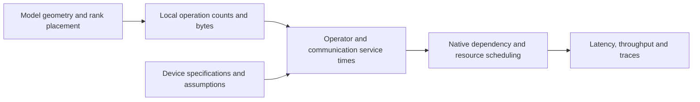

# Groq 3 LPX modeling

NVIDIA Groq 3 LPX is a rack-scale system built from LP30 language processing units (LPUs).
TokenSim's attention/feed-forward network (AF) runtime models its chips, interconnect and model placement explicitly, estimates operator and collective service times from hardware specifications and analytical execution pipelines, and schedules their dependencies on physical resources.



## Data sources

The hardware inputs come from NVIDIA's [LPX architecture description](https://developer.nvidia.com/blog/inside-nvidia-groq-3-lpx-the-low-latency-inference-accelerator-for-the-nvidia-vera-rubin-platform/) and [LPX product specifications](https://www.nvidia.com/en-us/data-center/lpx/).
The [LP30 device catalog](../data/devices/groq_lp30.yaml) records their source identifiers and distinguishes reported specifications from derived peaks and project assumptions.
Storage capacities and byte-rate bandwidths use decimal units.
FP8, FP16 and FP32 denote floating-point formats with 8, 16 and 32 bits; BF16 denotes bfloat16.
PFLOPS denotes 10^15 floating-point operations per second.

| Input | Catalog value | Origin |
| --- | --- | --- |
| Chips per LPX rack | 256, arranged as 16 trays of 16 | NVIDIA rack and tray specifications. |
| SRAM capacity per chip | 500,000,000 bytes | Published 500 MB of static random-access memory (SRAM). |
| SRAM bandwidth per chip | 150 TB/s | Published peak bandwidth. |
| FP8 matrix peak per chip | 1.23046875 PFLOPS | Published rack peak of 315 PFLOPS divided by 256 chips. |
| Chip-to-chip ports | 96 at 112 Gb/s | Published link count and signaling rate. |
| Individual link bandwidth | 14 GB/s per direction | `112 Gb/s / 8`. |
| Aggregate chip injection | 1.25 TB/s per direction | Equal-direction split of the published 2.5 TB/s bidirectional aggregate. |

The FP8 peak uses the rack total, while NVIDIA's rounded tray figure gives `19.2 PFLOPS / 16 = 1.2 PFLOPS` per chip.
The catalog records its selected derivation explicitly with grade C provenance.
The [shared evidence guide](../TokenSim/hardware/README.md#evidence-grades) describes the project's provenance fields.

The following analytical parameters are configured under `assumption-lp30-analytical` (grade D).

| Parameter | Current value | Role in the estimate |
| --- | --- | --- |
| FP16 and BF16 peak | 0.615234375 PFLOPS each | Half the FP8 matrix peak. |
| FP32 peak | 0.15380859375 PFLOPS | One quarter of the FP16 peak. |
| `gemm_mfu` | 0.8 | Effective compute fraction for matrix multiplication. |
| `attention_mfu` | 0.6 | Effective compute fraction for the attention core. |
| `moe_mfu` | 0.7 | Effective compute fraction for mixture-of-experts work. |
| `memory_efficiency` | 0.9 | Effective fraction of peak SRAM bandwidth. |
| `kernel_launch_us` | 0.2 microseconds | Fixed cost per modeled operator. |
| `step_overhead_us` | 0 | Additional fixed cost per composed step. |
| Packed-weight unpacking | 2 vector operations per element; efficiency 0.8 | Additional compute work when the selected format uses vector unpacking. |
| Chip power | 450 W | Modeled processor power, excluding hosts and rack infrastructure. |

The fixed operator cost models deterministic compiler-scheduled transition overhead across operator boundaries.
The [Groq v1 package metadata](../data/operator_data/groqchip_v1/analytical/generation_meta.yaml) provides analytical tables for the first-generation `groqchip_v1` device (described in the [SHIP paper](https://proceedings.mlsys.org/paper_files/paper/2026/hash/9c20f16b05f5e5e70fa07e2a4364b80e-Abstract-Conference.html)), whereas `groq_lp30` models the Groq 3 LPX architecture.

## Operator service time

The default [Groq estimator](../TokenSim/operator_data/analytical/groq.py) uses a roofline calculation for each local operator:

$$
t_{\mathrm{op}} =
\max\left(
\frac{F_{\mathrm{op}}}{P_d\eta_{\mathrm{op}}},
\frac{W_{\mathrm{op}}+A_{\mathrm{op}}+K_{\mathrm{op}}}
{B_{\mathrm{SRAM}}\eta_{\mathrm{mem}}}
\right) + \tau_{\mathrm{op}}.
$$

Here, `F` is the operation count, `P_d` is the peak for the selected compute precision, and `eta_op` is the operator's compute-efficiency assumption.
`W`, `A` and `K` are weight, activation and key/value (KV) traffic in bytes.
`B_SRAM` is peak SRAM bandwidth, `eta_mem` is memory efficiency and `tau_op` is the fixed operator cost.
With the bundled LP30 parameters, effective SRAM bandwidth is `150 * 0.9 = 135 TB/s`.

[Workload formulas](../TokenSim/operator_data/workload.py) derive these quantities from each rank's dimensions and query lengths.
For example, a matrix multiplication with dimensions `m`, `n` and `k` contributes `2mnk` floating-point operations.
Attention work depends on the retained context, local query and KV heads, head dimension and sliding window.
Expert work depends on the tokens assigned to the rank's experts.
Packed-weight unpacking adds a vector-service estimate before comparison with memory time.
The [operator latency guide](operator-latency-model.md) defines the individual query boundaries and byte formulas.

Whole-model latency includes projections, attention, normalization, feed-forward networks (FFNs), model input/output processing and required communication.
A rank's local shapes reflect tensor parallelism (TP), expert ownership and the layers assigned by pipeline parallelism (PP).
Communication contributes its own scheduled service and is not included in the SRAM bandwidth term.

### Optional execution-unit accounting

Setting `analytical.lpx_pipeline` in a custom device catalog selects the [LP30 unit estimator](../TokenSim/operator_data/analytical/lp30.py).
This mapping is absent from the bundled device, so the default runner uses the roofline estimator above.
The optional estimator separates matrix work, vector and conversion work, exponentials, shuffle traffic and SRAM traffic.
It also accounts for external activation precision separately from matrix-weight precision.

| Assumption in `LP30Pipeline` | Default |
| --- | --- |
| Vector service rate / efficiency | 20 trillion operations/s / 0.5 |
| Exponential service rate | 1 trillion operations/s |
| Shuffle service rate / efficiency | 10 TB/s / 0.8 |
| Vector width / attention key tile | 320 bytes / 256 keys |
| `fill_drain_us` | 0.05 microseconds |

NVIDIA's architecture description identifies 320-byte vectors and distinct matrix, vector and switch units.
The `LP30Pipeline` model parameterizes the unit service rates, efficiencies, attention tiling and pipeline fill/drain overhead.

Let `t_j` denote the estimated service of each unit, and let `N` be the analytical tile count.
The default `tiled` schedule computes

$$
t_{\mathrm{tiled}} =
\max_j t_j + \frac{\sum_j t_j-\max_j t_j}{N}
+ \tau_{\mathrm{op}} + \tau_{\mathrm{fill}}.
$$

The `serialized` alternative uses the sum of unit services plus the same fixed costs.
These schedules capture pipelined overlap across functional units within each operator.

## Communication and execution

The [link catalog](../data/topologies/links.yaml) separates one physical link from a chip's aggregate injection budget.
The aggregate 1.25 TB/s budget covers the chip's ports and is applied once per endpoint.
Multiplying it by the 96-port count would overstate the available bandwidth.

| Link | Bandwidth per direction | Fixed latency | Evidence |
| --- | --- | --- | --- |
| `groq_lp30_c2c_112g` | 14 GB/s | 0.05 microseconds | Bandwidth conversion from the published link rate; per-hop latency parameter. |
| `groq_lp30_injection` | 1.25 TB/s | 0.05 microseconds | Derived aggregate per-direction bandwidth and hop latency. |
| `ethernet1600Gb` | 200 GB/s | 2 microseconds | 1600 Gb/s GPU-to-LPX or inter-rack transport specification. |

For a flat collective, the [communication estimator](../TokenSim/comm/flat_collectives.py) computes

$$
t_{\mathrm{comm}} = n_{\mathrm{rounds}}\alpha
+ \frac{S_{\mathrm{wire,rank}}}{B_{\mathrm{direction}}}.
$$

The operation, participant count and algorithm determine the round count and bytes sent per rank.
AllGather takes a local input shard and produces a buffer containing every participant's shard.
`ring` is the default; `auto` compares ring and tree costs, while `direct` models a nonblocking scheduled fabric.
The flat formula models software-scheduled transfers without a separate GPU-style collective-launch cost.

The [LPX topology](../data/topologies/groq_lpx256.yaml) describes tray and rack levels with `direct` collectives for the hierarchical communication backend.
The native decode helper selects `flat_link` endpoint resources and the layout's collective policy, which defaults to `ring`.
These are separate communication paths: the topology's `direct` setting applies to the hierarchical backend, while the decode helper uses its configured collective policy.
Complete-model prefill uses the hierarchical backend, as described in the [AF guide](afd.md#compute-communication-and-overlap).

The native runtime schedules a directed acyclic graph of operators, transfers and collectives.
An operation starts after its producers finish and its physical compute or communication resources become available.
Shared endpoint budgets model queueing contention, while independent work overlaps across resources.
TP and PP jointly determine local work, communication and the critical path.

## Model placement and SRAM capacity

The [Gemma 4 31B text entry](../data/models/gemma-4-31b-text.yaml) transcribes the text architecture from Google's [pinned configuration](https://huggingface.co/google/gemma-4-31B-it/blob/842da3794eaa0b77d5f08bae87a17459d91ff475/config.json) and a [pinned Transformers implementation](https://github.com/huggingface/transformers/blob/e0eb2810ac1b2caf6d082f247d8d37162ecf67a0/src/transformers/models/gemma4/modeling_gemma4.py).
It has 60 text layers, with five sliding-window layers followed by one global-attention layer in each group of six.
Vision processing is excluded.

| Attention layers | Layer count | Window | Head dimension | KV heads | Shared K/V projection |
| --- | --- | --- | --- | --- | --- |
| Sliding-window | 50 | 1,024 tokens | 256 | 16 | No |
| Global | 10 | Full context | 512 | 4 | Yes |

Projection sharing reduces weight and projection work but retains separate transformed K and V cache tensors.
The model's `block_layout` declares its value and output normalization, embedding/layer scaling and final logit softcap.
Both LP30 and Rubin price these operations through the generic providers described in the [AF guide](afd.md#memory-and-precision).
TokenSim's runtime compiler assigns layer-specific geometry, weights and KV heads to physical ranks.
Complete-model prefill prices the same stage ownership, including an explicit `pipeline_layer_counts` partition when configured.
Cached prefill includes the retained context in its attention workload without scaling fixed overhead by a floating-point operation ratio.

For ordinary attention, a rank's logical KV storage for one request is

$$
M_{\mathrm{KV},r} =
\sum_{\ell\in\mathcal{L}_r}
2 b_{\mathrm{KV}} H_{\mathrm{KV},r,\ell} d_\ell
\min(L,w_\ell),
$$

where `L_r` is the rank's layer set, `H_KV,r,l` is its local KV-head count, `d_l` is the head dimension and `b_KV` is bytes per cached element.
`L` is the request context and `w_l` is the layer window, treated as unlimited for global attention.
TP can replicate KV heads when there are fewer KV heads than ranks.
For multiple resident requests, the runtime sums their KV reservations on each physical device.

Compilation records resident weights and protocol buffers, and admission checks that these allocations plus the requested KV reservation fit on every rank.
Optional `analytical.lpx_memory` accounting adds the maximum sequential attention, FFN or output scratch arena, auxiliary weights and an explicit reserve.
Its `prefill_chunk` and `maximum_context` bounds are enforced by the native service.
The [workspace implementation](../TokenSim/af/runtime/lpx_memory.py) defines the tile buffers and retained intermediates.

NVIDIA's LPX product specification includes 12 TB of double data rate 5 (DDR5) memory per rack alongside SRAM.
The LP30 catalog sets `external_dram_modeled: false` so admission checks enforce strict on-chip SRAM residency for weights, workspaces and KV state.
In heterogeneous attention/FFN disaggregation, GPU ranks retain attention and KV while LP30 ranks hold their assigned FFN weights and workspace in SRAM.
The companion [Rubin catalog](../data/devices/rubin.yaml) defines specifications and analytical parameters for Vera Rubin NVL72 deployments.

## Run and interpret results

Run a fixed-batch native decode estimate from the repository root:

```bash
python scripts/run_lpx.py \
  --model gemma-4-31b-text \
  --device groq_lp30 \
  --tp 16 \
  --pp 16 \
  --dtype fp8 \
  --kv-cache-dtype fp8 \
  --batches 1 4 \
  --context 1024 \
  --steps 2 \
  --output outputs/lpx
```

This layout uses `16 * 16 = 256` LP30 chips with attention and FFN on the same ranks.
It evaluates colocated complete-model decode on an LPX256 rack using FP8 weights and KV cache with BF16 activations.
The script selects `analytical_only` and reuses the shared `AFExperimentRunner`.
Use `--collective-algorithm` to select another flat policy and `--help` for the remaining layout, precision and trace options.

`summary.json` contains the model and device snapshot, runtime plan and per-batch summaries.
Each `checkpoint_directory` identifies a directory under `points/` containing the manifest, complete result and optional trace.
Matching completed points are reused; `--no-resume` reruns them.
Operator statistics and trace provenance record the analytical service estimates.
For batch size `B` and average simulated step duration `t_step`, reported throughput is `B / t_step` and per-user speed is `1 / t_step`.

Against NVIDIA's published [long-context Artificial Analysis benchmark](https://developer.nvidia.com/blog/how-nvidia-groq-3-lpx-unlocks-ultrafast-interactivity-at-long-context-on-nvidia-vera-rubin/) for Gemma 4 31B (`3,382` tokens/s at 10K input and `3,431` tokens/s at 100K input), a 256-LPU TP16/PP16 layout (`bf16` weights, `fp8` KV) predicts `3,360.9` tokens/s at 10K (`0.62%` error) and `3,251.5` tokens/s at 100K (`5.23%` error) using the uncalibrated catalog defaults.
Calibrating a single shared efficiency multiplier (`1.0655`) on the 10K point predicts `3,382.1` tokens/s at 10K (`0.003%` error) and `3,277.9` tokens/s on the 100K holdout (`4.46%` error on both 100K speed and the 100K/10K context-speed ratio).
