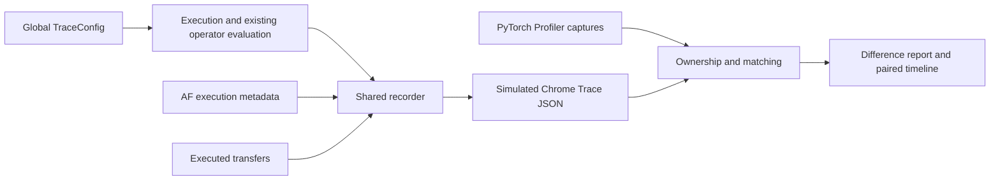

# Operator Latency Model and Tracing

The `operator_table` latency backend (`TokenSim/latency/operator_table/backend.py`) estimates the duration of every scheduler step.
It breaks each worker's model layers into matrix multiplications (GEMMs), attention, mixture-of-experts (MoE) operations, elementwise kernels and communication between groups of workers (collectives).
For each operator, it looks up measurements for that worker's device, inference framework, data type and dimensions.
If measurements cannot answer a query, the configured fallback policy can use a formula-based model of the device family.
`--latency_backend analytical` skips the tables entirely.
Every estimate records its source, so results separate time estimated from measurements and time estimated from formulas.
Tracing reuses evaluated costs to export Chrome Trace JavaScript Object Notation (JSON) and compare simulated operators with PyTorch Profiler activity.
This guide covers estimation, tracing, paired timeline images and validation experiments.

## Global operator tracing

The main simulation CLI supports the same operator tracing configuration for colocated serving, prefill/decode (PD) disaggregation and attention/feed-forward (AF) disaggregation.
Tracing defaults to `off`.
`SimulationConfig(trace=TraceConfig(...))` provides the corresponding Python interface through `TokenSim.trace.config`.

| Argument | Default | Meaning |
| --- | --- | --- |
| `--trace_mode` | `off` | `off` skips recording, `validate` checks and releases completed events, and `full` exports an operator timeline. |
| `--trace_output` | `<results_path>/<result_stem>.trace.json` | Destination for a full trace; distinct result names receive distinct trace files, and binary formats use the corresponding suffix. |
| `--trace_config` | unset | JSON file containing global trace settings; explicitly supplied CLI values override its corresponding fields. |

```bash
python benchmark.py \
  --model llama-3-8b \
  --latency_backend analytical \
  --request_count 2 \
  --prefill_mean_len 32 \
  --decode_mean_len 3 \
  --trace_mode full \
  --results_path outputs/operator-trace
```

The result JSON contains a `trace` descriptor with the output path, schema version and completeness.
Chrome Trace JSON uses microseconds for timeline timestamps and durations, while event arguments retain simulation seconds.
Open the exported JSON in [Perfetto](https://ui.perfetto.dev/) to inspect per-layer operations, rank tracks and dependency arrows.
An interrupted run exports completed work and observed transfer intervals, with incomplete capture identified in metadata.
Synchronous connector records describe consumed blocking invocations, and queued storage transfers expose actual resource admission and service intervals.
Shared asynchronous links identify resource-only ownership when request correlation is unavailable.

`TraceConfig` also accepts `validate`, `format`, `workers`, `phases`, `iterations`, `layers`, `event_types`, `detail` and `fields`.
`format` selects `json`, `msgpack` or `archive`; MessagePack requires the optional `tokensim[trace]` dependencies.
Worker, phase, iteration, layer and event-type selectors filter exported events without changing execution or removing records required for validation.
Layer indices are global model indices, and `-1` represents model-boundary work.
`detail="timing"` exports common timing arguments, while `fields` selects named event payload fields.
Dependency arrows connect selected endpoints only.
Direct JSON exports index dependency endpoints on disk and stream event records.
Standalone AF experiments use the same `TraceConfig`, recorder and output implementations.
Fixed-batch experiment commands explicitly default to full recording and accept the global collection modes.
Their CLI parsing applies that experiment default before validating settings that omit a mode.
Explicit output paths and export selectors require `full` mode.

Operator costs are evaluated once and expanded into their model execution positions when recording is enabled.
Fused module estimates retain their measured boundaries, and shared AF executions contribute physical service once.
Ordinary tensor-parallel tracks that reuse a representative estimate identify the symmetric-rank assumption in their event details.
Tracing does not introduce additional simulated synchronization or modify request batching.
The [recording architecture](#11-tracing-architecture-and-validation) describes event ownership, execution contracts and validation.

## PyTorch Profiler comparison

Use `python -m TokenSim.profiler.compare` to compare a simulated trace with one or more PyTorch Profiler JSON or gzip-compressed JSON files.
The offline tool requires no GPU, PyTorch or vLLM installation.

```bash
python -m TokenSim.profiler.compare \
  --simulated outputs/operator-trace/result_inf.trace.json \
  --collection outputs/profiler/qwen3-8b/manifest.json \
  --output outputs/operator-trace/comparison
```

Central processing unit (CPU) ranges, graphics processing unit (GPU) activity and launch correlation establish operator ownership.
The [collection environment](#collection-environment) and [collector guide](../scripts/collect/README.md#operator-timeline-collection) describe the paired structure/timing protocol and source verification.
`--collection` selects one completed collection's timing sample; `--profile` accepts explicit external trace files.
The importer distinguishes CPU annotations from their GPU counterparts so each forward is counted once.
Unattributed kernels remain in the report.
Lossy simulated exports must retain `node_id`, `worker_id`, `layer_id` and `iteration_id` for comparison.
Full detail retains shape and provenance evidence; timing detail also retains the warmup/profiling distinction.

Matching uses rank, forward occurrence, layer, compatible shapes and operation order.
Forward token counts and an operator's flattened tensor rows are different shape fields.
Matching never uses duration similarity to choose a correspondence.
Order-preserving matching accepts mandatory pairs and retains ambiguity for occurrences without a unique correspondence.
Observed fused residual/normalization kernels and projection or MoE modules containing a reduction can group their corresponding simulated operations, with source member identifiers retained.
Ambiguous and unmatched operations remain visible.
Incomplete simulated service is excluded from duration comparisons.

`--mapping` accepts an optional JSON file with version 1 of this schema:

```json
{
  "schema_version": 1,
  "aliases": {
    "custom_attention": "attention"
  },
  "rank_map": {
    "0": "2"
  },
  "groups": [
    {
      "simulated": ["attention_residual", "ffn_norm"],
      "profiled": "ffn_norm"
    }
  ]
}
```

Alias keys use lowercase operation names.
`rank_map` maps profiled rank identifiers to simulated worker identifiers, independently of `CUDA_VISIBLE_DEVICES` numbering.
Explicit groups combine contiguous simulated operations within a layer and forward.
The known residual/normalization adapter can also group a previous layer's residual with the following layer's input normalization when observed kernel evidence establishes that fusion.

| Artifact | Contents |
| --- | --- |
| `comparison.json` | Input hashes, available identity checks, matching evidence, coverage, timing errors and per-rank/per-clock accounting. |
| `operators.csv` | Matched, unmatched, ambiguous and excluded comparison units. |
| `comparison.trace.json` | Simulated and observed tracks with translated time origins and original timestamps in event arguments. |

The legacy `service_error_us` and relative-error columns compare module invocation spans.
The additional `simulated_device_service_us`, `profiled_device_service_us` and `device_service_error_us` columns compare modeled service with the union of observed device-work intervals.
Aggregate adjusted service is null if any matched scope has unresolved waiting; `comparable_profiled_device_service_us` explicitly sums the comparable subset.
Known waiting totals are named `known_matched_profiled_peer_wait_us` and `known_collective_peer_wait_us`, with unresolved calls retained in diagnostics.
`profiled_internal_gap_us` keeps module gaps separate.
`profiled_collective_residence_us` retains full collective kernel residence.
For the inspected vLLM custom all-reduce kernels with an entry barrier, `profiled_peer_wait_us` records the interval until the last corresponding peer starts.
The remaining device-work intervals retain any computation overlapping that wait.
This attribution requires complete participant groups and a shared host, boot identity, time namespace and Kineto timestamp basis recorded by the collector.
NCCL calls and other kernels without a proven entry-barrier contract retain unknown peer wait and unknown adjusted service.
Unknown clocks, missing peers and nonoverlapping collective intervals also produce null adjusted-service fields with an explicit reason.
After-arrival residence still includes kernel and barrier overhead; it is not a pure network payload-transfer measurement.
The combined timeline preserves original spans and adds `collective_peer_wait` intervals.
Zero observed duration produces a null relative error with a reason.
A module invocation span runs from its earliest attributed GPU start through its latest attributed GPU completion and includes internal gaps.
Kernel-duration sum and device busy-time union are reported separately.
Rank-summed spans and device service are cumulative device quantities; they do not represent request latency or elapsed forward time.
Inputs with a proven shared clock use one common translation so rank-arrival differences remain visible.
Other inputs are translated independently at their earliest unambiguous matches, and cross-rank overlap remains unavailable.
The CLI returns status 2 when no operators match and reports invalid inputs as argument errors.
Small collection samples validate ownership, order and accounting; they do not establish a general prediction-accuracy target.
The [experiment analysis](#12-profiler-experiments-and-findings) separates profiler perturbation, host dispatch gaps, peer-arrival waiting and operator-cost errors.

### Paired timeline images

The offline image exporter produces paired timelines in the layout of [Charon Figure 8](https://arxiv.org/pdf/2605.17164#page=10), with simulated operators above observed GPU activities.
Install the optional plotting dependency and select a layer from an existing comparison report:

```bash
python -m pip install -e '.[plot]'
python -m TokenSim.profiler.plot \
  --comparison outputs/operator-trace/comparison/comparison.json \
  --output outputs/operator-trace/figures/prefill-layer0 \
  --forward 0 \
  --layer 0 \
  --rank 0 \
  --alignment selection
```

The output stem receives `.png`, `.svg` and `.timeline.json` suffixes.
The JSON sidecar retains full labels, original timestamps, display translations, selectors and the source report hash.
Long names are truncated to fit inside visible bars, and intervals too narrow for text retain their complete names in the sidecar.
Scalable Vector Graphics (SVG) labels remain editable text.
Portable Network Graphics (PNG) exports default to 180 dots per inch.

| Argument | Default | Meaning |
| --- | --- | --- |
| `--forward` | all | Forward occurrence, starting at zero. |
| `--layer` | all | Global layer index, or `-1` for model-boundary work. |
| `--rank` | all | Native rank identifier; repeat to select several ranks. |
| `--detail` | `kernel` | Show simulated component intervals and observed kernels/copies; `module` shows module envelopes with device activity overlaid. |
| `--alignment` | `global` | Retain comparison clock translations; `selection` translates each side's selected origin to zero. |
| `--start-us` | selected minimum | Left display boundary in microseconds after alignment. |
| `--end-us` | selected maximum | Right display boundary in microseconds after alignment. |
| `--formats` | `png svg` | Image formats to write. |
| `--width` | `20` | Figure width in inches. |
| `--dpi` | `180` | PNG resolution, from 72 to 600 dots per inch. |
| `--title` | generated | Figure title. |

Both panels use the same time scale and retain execution gaps and collective kernel residence.
Known peer waits appear in red without shortening the original kernels.
Actual streams occupy separate rows, and overlapping intervals use additional rows instead of hiding one another.
Legacy reports without per-activity stream metadata use a row labeled `stream unavailable`.
Regenerate the comparison from its original captures to retain stream metadata.
Clocks without common-clock evidence remain independently aligned and carry a warning about unavailable cross-rank overlap.
Selectors apply to each side's own forward, layer and native rank fields, including unmatched and excluded work when those fields are available.
Selection-relative alignment retains offsets between ranks on proven shared clocks and does not establish global scheduling accuracy.
The exporter imports Matplotlib only when rendering images and adds no dependency to recording-off simulation paths.
The [deferred timing work](#13-deferred-work-and-evidence) documents the remaining execution-boundary and calibration questions for separate pull requests.

An operator's shape is its set of dimensions, such as matrix sizes, batch size and context length.
Its data type is recorded as `dtype`.
Prompt processing is called prefill, and output token generation is called decode.
The attention key/value (KV) cache stores context data for later tokens.
Tensor parallelism (TP) divides work within layers, pipeline parallelism (PP) assigns layers to stages, data parallelism (DP) runs separate request batches, and expert parallelism (EP) distributes MoE experts across workers.
A rank identifies a worker's position in this parallel configuration.

---

## 1. Overview

The system contains data files, a lookup engine that estimates individual operator times and code that adds those times for each scheduler step.

```text
data/devices/*.yaml        Device specs: peak compute per dtype, memory, on-chip storage,
                           interconnect, analytical parameters; every value carries a
                           source_id and an evidence grade
data/topologies/links.yaml Link classes: per-direction bandwidth, hop latency, message-size
                           ramp, collective efficiency
data/topologies/*.yaml     Hierarchical topologies (node -> rack -> cluster); each level
                           records its fan-in, link class and fabric
data/models/*.yaml         Model geometry, per-operator dtypes and operator-module bindings
data/operator_data/<device>/<backend>/
                           Operator tables (parquet) and generation_meta.yaml
        |
        v
TokenSim/hardware          Catalog loading, alias resolution, package selection
                           (HardwareContext)
TokenSim/operator_data     Table schemas, package validation, exact match / interpolation /
                           bounded extrapolation, analytical models, command-line tools
TokenSim/comm              Hierarchical alpha-beta collective model with measured-table
                           override
TokenSim/latency           OperatorTableLatencyBackend and the operator-module estimators
                           (complete attention, residual mixing, fused MoE, MTP draft passes)
```

The lookup tries an exact match, interpolation between compatible measurements, bounded extrapolation and the device-family analytical model, in that order.
The default extrapolation limit is 16x beyond the measured range.
Extrapolation scales the nearest boundary measurement using the analytical model's predicted growth, following AIConfigurator's rule.

Every query records a match type: `exact`, `interpolated`, `extrapolated` or `analytical` (complete-attention module queries raised to the first measured row are reported as `clamped`).
The result JSON counts each match type per table.
Queries that measurements cannot answer are written to `missing_shapes_<qps>.json`, which identifies what to collect in another profiling run (section 9).
Communication lookups (`collective`, `ep_all2all`) follow the same fallback policy and report formula-based estimates (sections 3.5 and 6).

---

## 2. Operator Tables

### 2.1 Common Conventions

All tables contain `latency_us`, the execution time in microseconds, and `source_id`, the identifier of the data source.
Each `source_id` must name a record in the package's `generation_meta.yaml` `sources` list.
That record states how the data was obtained and assigns an evidence grade, defined in section 7.
Rows can also record the kernel or framework call in `kernel` and an evidence grade in `grade`.
Tables for complete operator modules retain additional metadata, such as the source hardware and collection version.

Each table has **key fields** that identify a row.
A key field used for interpolation is called an **axis**.
The lookup combines measured values along that axis using logarithmic or linear coordinates.
The remaining **discrete fields**, such as data type or kernel name, must match exactly.
Dtype fields are normalized to canonical names (`bfloat16` -> `bf16`, `half` -> `fp16`, `float8` -> `fp8`, ...).

### 2.2 Primitive Operator Tables

| Table | Key Fields | Interpolation Axes (outer to inner) | Contents |
| --- | --- | --- | --- |
| `gemm` | `dtype, m, n, k` | `k` (log), `n` (log), `m` (log) | `C[m,n] = A[m,k] x B[k,n]`; `dtype` is the weight (storage) dtype |
| `grouped_gemm` | `dtype, out_dtype, batch_size, m, n, k` | `batch_size`, `k`, `n`, `m` (all log) | One grouped kernel over `batch_size` independent weight matrices, `C[g,m,n] = A[g,m,k] x B[g,k,n]` |
| `context_attention` | `attn_dtype, kv_cache_dtype, batch_size, input_seq_len, num_heads, num_kv_heads, head_dim, window_size` | `num_heads` (linear), `batch_size` (log), `input_seq_len` (log, bound 64x) | Prefill attention core (QK^T, softmax, PV) for `batch_size` sequences padded to `input_seq_len` |
| `generation_attention` | `attn_dtype, kv_cache_dtype, batch_size, context_len, num_heads, num_kv_heads, head_dim, window_size` | `num_heads` (linear), `batch_size` (log), `context_len` (log, bound 64x) | Decode attention core: one query token per sequence against `context_len` cached tokens |
| `moe` | `dtype, distribution, num_tokens, hidden_size, inter_size, top_k, num_experts, tp_size, ep_size` | `num_tokens` (log) | Fused/grouped expert FFN on one rank |
| `elementwise` | `op_name, dtype, num_tokens, hidden_size` | `hidden_size` (log), `num_tokens` (log) | Memory-bound pointwise kernels |
| `collective` | `dtype, operation, group_size, nodes, message_bytes` | `message_bytes` (log) | Collective time, nccl-tests convention |
| `ep_all2all` | `dtype, phase, mode, ep_size, nodes, hidden_size, top_k, num_experts, num_tokens` | `num_experts` (log, bound 1024x), `top_k` (linear, bound 8x), `hidden_size` (log), `num_tokens` (log) | Expert-parallel dispatch or combine for one rank |

#### `gemm` and `grouped_gemm`

`dtype` is the weight precision and a discrete key.
It also selects the compute units used by the analytical model and the bytes per activation element, as listed below.

| dtype | Compute pipe | Activation bytes |
| --- | --- | --- |
| `fp16`, `bf16` | 16-bit tensor cores | 2 |
| `fp8`, `fp8_block` | FP8 | 1 |
| `int8`, `int8_sq` | INT8 (SmoothQuant W8A8 for `int8_sq`) | 1 |
| `int8_wo`, `int4_wo`, `mxfp4_wo` | 16-bit; weight-only formats dequantize the weights | 2 |
| `nvfp4`, `mxfp4` | FP4, falling back to the FP8 (then FP16) peak when the device lists no FP4 peak | 1 |
| `int4_a8` | FP8 (4-bit weights, FP8 activations) | 1 |
| `int4` | INT4, falling back to the INT8 peak | 1 |

The three `gemm` axes are resolved from outer to inner (`k -> n -> m`) with logarithmic blending, which matches the roughly log-linear scaling of GEMM latency with matrix dimension.
`grouped_gemm` adds the group count (`batch_size`) as the outermost axis and an output dtype; the projection plan of compressed-attention models uses it for the grouped low-rank output projection.

#### `context_attention` and `generation_attention`

These tables time the attention calculation, including query-key multiplication, softmax and value multiplication.
The query, key and value (QKV) projections and the output projection are separate GEMM queries.
`num_heads` and `num_kv_heads` are the TP-local head counts, `attn_dtype` is the model's activation dtype and `kv_cache_dtype` its KV-cache dtype.
`window_size` supports sliding-window attention; 0 means full causal attention.
`num_heads` is blended linearly because attention time scales linearly with head count.
Decode requests are grouped into context-length buckets (section 4.4) to limit the number of distinct lookups.

The sequence axes may extrapolate 64x past the measured range: the imported AIConfigurator tables stop at 16,384 prefill tokens and 131,072 decode context tokens, while agentic traces reach about one million tokens.
Processing prompts in chunks keeps prefill queries within the measured range (section 4.3).
The larger extrapolation bound mainly supports decode attention over long contexts and runs that process prompts without chunking.

#### `moe`

The row gives the time of one rank holding `num_experts / ep_size` experts, each sharded `tp_size` ways.
`num_tokens` is the number of tokens entering the layer for the whole expert-parallel group, before top-k expansion; the only interpolation axis is `num_tokens`.
`dtype` is the routed-expert dtype (`operator_dtypes.routed_expert`, default: the model dtype).

`distribution` is a discrete label for the expert-load distribution used during collection (`uniform`, `balanced`, `power_law_1.01`, `power_law_1.2`).
The backend tries the labels in the following table in order until one matches.

| Model routing | Labels tried |
| --- | --- |
| `uniform` (default) | `uniform`, `balanced`, `power_law_1.01` |
| `skew`, `hot`, `burst` | `power_law_1.2`, the routing name, `uniform`, `balanced` |
| model binding `operator_modules.moe.key.distribution` | only that label |

#### `elementwise`

The `elementwise` table covers kernels whose time is mainly limited by reading and writing tensor elements.
`dtype` is the activation data type, and `op_name` selects one of the operations below.

| op_name | Description |
| --- | --- |
| `rmsnorm` | RMS normalization |
| `layernorm` | Layer normalization |
| `rope` | Rotary positional embedding |
| `residual_add` | Residual connection addition |
| `swiglu` | SwiGLU activation (gated) |
| `gelu` | GELU activation |
| `data_reorder` | Token permutation / data layout transform |
| `other_residual` | Other residual-like operations |

#### `collective`

The `collective` table stores group communication times measured by nccl-tests or equivalent benchmarks.
Following the nccl-tests convention, `message_bytes` is the full buffer size and the latency is one out-of-place iteration for `group_size` ranks spread over `nodes` nodes.
Supported operations are `all_reduce`, `all_gather`, `reduce_scatter`, `all_to_all` and `send_recv`.
Queries use the model's activation dtype.
The only axis is `message_bytes`; unmeasured configurations use the analytical communication model (section 6).

#### `ep_all2all`

The `ep_all2all` table stores measured token dispatch or result combination time, selected by `phase`.
Each rank sends `num_tokens` tokens to `top_k` of `num_experts` experts distributed across `ep_size` ranks on `nodes` nodes.
`all2all_backend` selects the `deepep_high_throughput` or `deepep_low_latency` kernel family through `mode`.
The tables also retain vLLM's `deepep_v2_context` and `deepep_v2_generation` variants, which the simulator does not select.
DeepEP work depends on `num_tokens x top_k x hidden_size`, so the lookup permits interpolation along expert count and `top_k`.

### 2.3 Operator-Module Tables

A module table measures several operators together as one complete module.
When selected, its measured time replaces the individual operator estimates already included in that module.
The table names come from the AIConfigurator data families they are imported from.

| Table | Discrete key fields | Axes | Timed scope | Replaces |
| --- | --- | --- | --- | --- |
| `dsv4_attention` | `layer_kind` (`csa`/`hca`), `phase` (`context`/`generation`), `mla_dtype`, `kv_cache_dtype`, `kernel_source`, `kernel_dtype`, `model`, `architecture`, `num_heads` (TP-local), `tp_size`, `compress_ratio` | `batch_size` (log), `input_seq_len` (linear, bound 64x), `context_len` (linear, bound 64x) | One complete compressed sparse-attention layer: input projections, compressor/indexer, sparse attention and output projection | attention projection GEMMs, RoPE and the attention core |
| `mhc` | `op_name` (`pre`/`post`), `architecture`, `kernel_source`, `hidden_size`, `hc_mult`, `num_sites`, `sinkhorn_iters` | `num_tokens` (log) | Residual-mixing (hyper-connection) pre or post module for the recorded sites of one layer | the primitive `residual_add` queries |
| `dsv4_megamoe` | `dtype`, `phase`, `kernel_source`, `kernel_dtype`, `distribution`, `pre_dispatch`, `source_policy`, `hidden_size`, `inter_size`, `top_k`, `num_experts`, `num_fused_shared_experts`, `tp_size`, `ep_size` | `num_tokens` (linear; rank-local tokens) | Fused expert-parallel MoE: routed dispatch, expert compute and combine under CUDA graphs; gate/top-k, buffer initialization and shared experts excluded | the `moe` query and the EP dispatch/combine all-to-all |

Module tables are selected in two steps.
The model's `operator_modules` configuration selects the table and the measured kernel fields that must match exactly.
The model and serving configuration supply the head counts, hidden size, expert counts, compression ratio per layer and parallel layout.
The following excerpt comes from `data/models/deepseek-v4-pro.yaml`.

```yaml
operator_modules:
  attention:
    table: dsv4_attention
    key:
      mla_dtype: bf16
      kv_cache_dtype: fp8
      kernel_source: FLASHMLA_SPARSE_DSV4
      kernel_dtype: fp8_block
      model: deepseek-ai/DeepSeek-V4-Pro
      architecture: DeepseekV4ForCausalLM
  mhc:
    table: mhc
    key:
      architecture: DeepseekV4ForCausalLM
      num_sites: 2
    kernels:
      pre: vllm.model_executor.kernels.mhc.tilelang.mhc_pre_tilelang
      post: vllm.model_executor.kernels.mhc.tilelang.mhc_post_tilelang
  moe:
    table: dsv4_megamoe
    key:
      kernel_source: deepgemm_megamoe
      kernel_dtype: fp8_fp4
      distribution: power_law_1.01
      pre_dispatch: sglang_jit
      source_policy: random
```

The serving flags listed below enable each module.
All three default to `generic`, which estimates individual operators.

| Flag | Binding | Additional requirements |
| --- | --- | --- |
| `--attention_backend module` | `operator_modules.attention` | compressed-attention model (`components`), PP1, CSA/HCA layers |
| `--mhc_backend module` | `operator_modules.mhc` | compressed-attention model |
| `--moe_backend deep_gemm_amxf4_mega_moe` | `operator_modules.moe` (the key must name exactly the five selectors shown) | expert parallelism over more than one rank, PP1, a complete single-node EP group; with DP > 1 also `--dp_lockstep` |

All modules require table-based latency (`--latency_backend operator_table` with `table_first` or `table_only`) and the bound table in the selected package.
An unmet requirement raises a configuration error at startup or at the first step that needs it.
Module queries never fall back to formulas: a query whose discrete key has no rows, or that lies beyond the extrapolation bound, stops the run with an error (complete-attention and residual-mixing misses are also written to the missing-shape report).
The one exception is complete attention, where queries below the first measured batch or length are raised to that row and reported as `clamped`.

Shared expert costs are calculated separately from routed expert costs.
For `fp8_block` shared experts, the default uses formulas to estimate the extra time for computing them within the fused kernel (grade D).
For other precisions, or with `--disable_moe_shared_fusion`, the simulator adds serial `gemm` and `swiglu` query times.
For models with draft layers, a positive `--mtp_num_speculative_tokens` enables timing for multi-token prediction (MTP), which proposes tokens for the model to verify.
`--mtp_acceptance_length` sets the average number of accepted tokens per verification step.
See the [AgentX guide](agentx.md) for a complete configuration.

### 2.4 Package Directory Layout

```text
data/operator_data/<device_id>/<backend>/
  generation_meta.yaml          Dataset version, device_id, backend, sources, calibration,
                                declared row count per table
  <table>_perf.parquet          One file per table present (<table>_perf.csv is read when
                                the parquet file is absent)
  <table>_analysis.parquet      Optional: FLOPs, bytes, compute/memory time, bottleneck and
                                calibration id per row (written by `generate`)
  shape_manifests/<id>.yaml     Manifest a generated package was built from
```

Loading validates the package: `schema_version` 1 and `latency_unit: us`, every declared table present with its declared row count, no undeclared tables, every `source_id` declared and no duplicate keys.
When the simulator loads a package it also requires `device_id` and `backend` to equal the directory names.

`<backend>` names the serving stack whose kernels were measured.
The bundled packages use `vllm`, `trtllm` and `sglang`, plus `nccl` (V100 collectives) and `analytical` (Groq).
A worker group's `operator_backend` in the cluster file takes precedence over `--operator_backend` (choices `vllm`, `sglang`, `trtllm`, `analytical`); naming a backend the device does not have is an error.
When neither setting specifies a backend, the simulator uses the first available entry in this order: `vllm`, `trtllm`, `sglang`, `measured`, `cuda`, `groq`, `analytical`.
Any remaining backend names are tried in alphabetical order.

---

## 3. Lookup Strategy

The lookup engine (`TokenSim/operator_data/lookup.py`) resolves every query in up to four stages.

### 3.1 Stage 1: Exact Match

The query key is normalized (dtype aliases resolved, strings lowercased, float-valued integers cast to int) and looked up in a hash map keyed by the full composite key.
A hit returns immediately with `match_type = "exact"`.

### 3.2 Stage 2: Multi-Axis Recursive Interpolation

When measurements share the query's discrete fields but have different numeric dimensions, the engine interpolates through the following steps.

1. Group rows with matching discrete fields into a grid of measured axis values, allowing gaps in that grid.

2. Resolve axes from outer to inner in the order given by the table's `axes`.
   For a GEMM query, `k` is resolved first, then `n`, then `m`.

3. For each axis, select the nearest measured value below and above the target and compute a weight.
   - Use logarithmic coordinates (`"log"`) for size axes by default, with the following formula.
     ```
     weight = (log(target) - log(lo)) / (log(hi) - log(lo))
     ```
   - Use linear coordinates (`"linear"`) for head counts, `top_k`, `dsv4_attention` sequence axes and the `dsv4_megamoe` token axis, with the following formula.
     ```
     weight = (target - lo) / (hi - lo)
     ```

4. Combine the two latency estimates using the computed weight.
   ```
   latency = lat_lo + weight * (lat_hi - lat_lo)
   ```
   The `source_id` values of all contributing rows are joined with `+`, and `match_type` is `"interpolated"`.

Consider a GEMM query for `(m=2048, n=4096, k=8192)` with measured points at `k = 4096` and `k = 16384`.
The engine interpolates between the two `k` values and, at each of them, recursively resolves `n` and then `m`, so the interpolation follows the nested structure of the measurement grid instead of flattening it.

### 3.3 Stage 3: Bounded Extrapolation

For a query outside an axis's measured range, the lookup scales the nearest boundary row using the `extrapolate` policy listed below.
This policy is defined by `LookupPolicy` in `TokenSim/operator_data/lookup.py`.

| Mode | Behaviour |
| --- | --- |
| `analytical` (**default**) | `latency = measured(boundary) x analytical(target) / analytical(boundary)`, above or below the measured range. The boundary row's measured *efficiency* is kept and an analytical growth reference carries the change. The operator backend uses its device-family model as reference, the collective model its alpha-beta formula, the complete-attention module a work model of the sparse-attention kernel, and the residual-mixing and fused-MoE modules growth proportional to `num_tokens`. Without a usable reference the mode behaves like `scale`. |
| `empirical` | Fits `latency ~ value^alpha` by least squares over the upper quarter (at least three points) of the measured values on that axis, then multiplies the boundary latency by `(target / boundary)^alpha`. Applies only above the measured range; `alpha` is clamped at 0. With fewer than three usable points, or superlinear fitted growth (`alpha > 1`), it falls back to `analytical`. Not used by default; select it with `LookupPolicy(extrapolate="empirical")`. |
| `scale` | Multiplies the boundary latency by `target / boundary` on logarithmic axes when the target is above the range (work grows with the axis); otherwise returns the boundary latency. |
| `hold` | Returns the boundary row's latency unchanged. |
| `none` | Raises `MissingOperatorDataError` (`extrapolation_disabled`). |

The default `analytical` policy scales a boundary measurement by the analytical model's ratio between target and boundary work.
Simple scaling by the dimension ratio suits the GEMM `m` axis, while decode attention and group communication also include fixed costs.
Using the analytical ratio preserves those fixed costs and uses the measurement to set the latency level.
AIConfigurator applies the same boundary-efficiency rule.

`max_extrapolation_ratio` (default **16**) caps how far a query may go past the boundary on any axis, in either direction.
Policy and axis bounds must be finite numbers greater than or equal to one.
Invalid bounds and policy choices cause a configuration error when the configuration is constructed.
Axes may override it: `context_attention.input_seq_len`, `generation_attention.context_len` and the `dsv4_attention` sequence axes allow 64x (the complete-attention module also raises its policy bound to 64x on every axis), `ep_all2all.num_experts` allows 1024x and `ep_all2all.top_k` 8x.
Beyond the bound the lookup raises `MissingOperatorDataError` (`out_of_range`) and the query falls through to Stage 4.

Results that touched extrapolation have `match_type = "extrapolated"`; `detail["flags"]` additionally records `analytical_scaled`, `empirical_scaled`, `linear_scaled` or `held`.

### 3.4 Stage 4: Analytical Fallback

When the table-based stages fail (the table is absent, no row matches the discrete key, or an axis lies beyond the extrapolation bound), the device-family analytical model estimates the query's latency (section 5) and the miss is recorded.
Operator-module tables do not fall back (section 2.3).

### 3.5 Fallback Policy Configuration

`--latency_fallback` selects one of `FALLBACK_POLICIES` (`TokenSim/operator_data/lookup.py`).
A worker applies the policy in the following table to both compute lookups in `OperatorTableLatencyBackend` and communication lookups in `CollectiveModel` (`collective`, `ep_all2all`).

| Fallback | Behavior |
| --- | --- |
| `table_first` (default) | Table lookup first; on failure, use the analytical model **and record the miss** in the worker's `MissingShapeReport` |
| `table_only` | Table lookup only; the first miss, including a communication query without a measured row, raises `MissingOperatorDataError` and stops the run |
| `analytical_only` | Skip tables entirely (`--latency_backend analytical` implies this) |

Each unanswered query records a `kind` from `MISSING_KINDS`.
`table_absent` means the package has no rows for that table, such as missing `elementwise` measurements.
`discrete_key` means rows exist but their exact-match fields differ, such as data type, head layout or `ep_size, nodes`.
`out_of_range` means a dimension exceeds the extrapolation bound.
`no_measured_mode` means the configured `all2all_backend` uses formulas by design.
Other reasons identify disabled policies (`extrapolation_disabled`, `interpolation_disabled`) or invalid queries (`malformed_key`, `unknown_table`).
The report groups misses by `(table, discrete key)`, records the requested range of every axis, the number of recorded misses and a few example keys, and is written to `missing_shapes_<qps>.json` (section 9).
Compute and communication misses share one report per worker, so the file is the collection checklist for the run.
The run summary prints the analytical share per table as a warning whenever it is non-zero.

When the device has no operator package at all, every query is estimated by formulas and recorded as a `table_absent` miss, so the report lists every shape the run needs.
`analytical_only` records no misses.

### 3.6 Result Caching

The backend caches estimates by `(table, key)` in a cache of 262,144 entries, which is cleared when full.
Decode steps with steady batch sizes repeat the same GEMM and elementwise queries, so most steps resolve from the cache.

`OperatorDataPackage.lookup_index` contains the exact-match map and interpolation grids for each axis.
It is built once per loaded package and shared by that package's `OperatorLookup` instances.
Each worker creates separate lookups for operator timing, communication and complete modules, all using that shared index.
A Blackwell vLLM package holds about 365,000 rows; loading and indexing it takes a few seconds once per run.

---

## 4. From Model Config to Operator Queries

`OperatorTableLatencyBackend` uses the model dimensions and parallel configuration to query operators at each TP rank's local dimensions.

### 4.1 Dtypes

| Model field | Used for |
| --- | --- |
| `dtype` | Weight dtype; keys every GEMM-like query unless overridden |
| `operator_dtypes` | Per-operator overrides, e.g. `attention_gemm`, `routed_expert`, `shared_expert`, `router`, `lm_head` |
| `activation_dtype` (default: `dtype`) | `attn_dtype` of the attention tables, `elementwise`, the activation bytes of TP/PP/EP messages, and the `dtype` of `collective` / `ep_all2all` queries |
| `kv_cache_dtype` | `kv_cache_dtype` of the attention tables |

Low-precision checkpoints (fp8, nvfp4, mxfp4) should set `activation_dtype: bf16`; otherwise attention, elementwise and communication queries ask for rows in the weight format (for example `nvfp4` attention), which the tables do not contain, and fall back to formulas.

### 4.2 Local Dimensions Under Tensor Parallelism

Given `TP = tensor_parallel_size`, the backend calculates the following local dimensions.

```text
heads_local        = ceil(num_attention_heads / TP)
kv_heads_local     = local_kv_heads(num_kv_heads, TP)   # replicated when kv_heads < TP
q_dim_local        = heads_local * head_dim
kv_dim_local       = kv_heads_local * head_dim          # kv_cache_dim / TP for latent KV
inter_local        = ceil(intermediate_size / TP)
vocab_local        = ceil(vocab_size / TP)
layers_local       = layers assigned to this PP stage
moe_layers_local   = MoE layers of this PP stage (ExpertPlacement)
dense_layers_local = layers_local - moe_layers_local
```

### 4.3 Step Composition and Chunked Prefill

`LLMPagedAttnScheduler` builds every step under a token budget, `max_num_batched_tokens` (default 8192, vLLM V1's online-serving default; `--no-chunked_prefill` removes the budget).
Running requests are served first in arrival order: a request that has already sampled takes its decode token (with MTP, the accepted draft tokens), and a request whose context is still being built (prefill, or recompute after a preemption) takes the next chunk, `min(remaining_context_tokens, budget_left)`.
`--long_prefill_token_threshold` additionally caps a chunk while other requests are eligible.
Whatever budget is left admits waiting requests, whose first chunk may be partial.
A step therefore mixes decode tokens and prefill chunks (`SchedulePhase.MIXED`), and a prompt longer than the budget is spread over several steps; only the step that completes the context samples a token, so TTFT covers all chunks and the waits between them.

Every request carries `num_computed_tokens` (context tokens whose KV is present, prefix hits included) and `scheduled_tokens` (this step's share).
`Request.step_tokens` is the latter, or the whole remaining context for a request that no paged scheduler scheduled (static and dynamic batching).
The backend uses these token counts to estimate each step, following the rules below.

| Query | Rule |
| --- | --- |
| `T` for GEMM, elementwise, MoE and communication | sum of the step's query tokens (MTP verification positions included) |
| decode attention (request already sampled, not recomputing) | `generation_attention(batch=count, context_len=bucket(kv_len))` |
| context chunk (`q_len` = this step's tokens, `kv_len = num_computed_tokens + q_len`) | requests grouped by `(q_len, kv_len)` issue `context_attention(batch=count, input_seq_len=q_len)`; cached context uses the analytical full-context latency or scales measured rows by analytical latency growth |
| LM head rows | requests sampling this step: decodes plus the last chunk of each context build |

Chunking keeps `input_seq_len <= max_num_batched_tokens`.
With a budget within the measured prefill range, long prompts use table measurements for each chunk, up to 16,384 tokens in the AIConfigurator data.
The cached-context correction includes key/value reads, compute work and fixed overhead through the analytical latency estimate.
Uniform KV caches allocate blocks for the whole prompt when the request is admitted.
Grouped caches reserve pages for each chunk.

For standard decoder models, the following table gives the queries for a step with `T` tokens and `B` requests producing output tokens.
Compressed-attention models differ as described below the table.

| Component | Operator Queries |
| --- | --- |
| **Input** (initial PP stage only) | `embedding_lookup(T, h)` and one TP all-reduce of `T * h * activation_bytes` when TP > 1 |
| **Attention block** (per layer) | `rmsnorm(T, h)` + `gemm(T, q_local + 2*kv_local, h)` + `rope(T, q_local + kv_local)` + attention core + `gemm(T, h, q_local)` + `residual_add(T, h)` |
| **Attention core** | Context chunks grouped by `(query_len, kv_len)` issue one `context_attention` query each, with the cached-context correction below; decode tokens are bucketed by context length (4.4) |
| **Dense FFN** (per dense layer) | `rmsnorm(T, h)` + `gemm(T, g*inter_local, h)` + `swiglu(T, inter_local)` (gated FFNs) + `gemm(T, h, inter_local)` + `residual_add(T, h)`, where `g` is 2 for gated FFNs and 1 otherwise |
| **MoE layer** | `rmsnorm(T, h)` + router `gemm(T, E, h)` + `moe(num_tokens = T * replicas_per_group)` + straggler time (4.5) + `residual_add(T, h)` |
| **Final Norm and LM head** (last PP stage only) | `rmsnorm(T, h)` for every forwarded token; when `B > 0`, `gemm(B, vocab_local, h)`, a TP vocabulary all-gather and `argmax(B, vocab_size)` token selection |
| **Communication** | With TP > 1, one all-reduce per layer after the attention output projection, plus one after the FFN for dense layers and for MoE layers without EP (message `T * h * activation_bytes`). EP MoE layers: one dispatch and one combine each (message `T * top_k * h * activation_bytes`). PP: one point-to-point transfer of `T * h * activation_bytes` per step |
| **Fixed overhead** | `device.step_overhead_us` (0 in every bundled device file, grade D) |

Compressed-attention models use four attention projections, including one `grouped_gemm`.
They also add a formula-based estimate for combining residual streams before the LM head, recorded as `target_hc_head`.
The LM head projects hidden states to vocabulary logits.
The operator modules in section 2.3 replace the individual operations included in their measurements.

Models with per-layer attention windows or head geometries use separate backend groups for the layers owned by each pipeline stage.
Each group prices its actual dimensions and multiplicity, while the stage charges output processing, pipeline transfer and fixed step overhead once.
Shared K/V projections reduce projection work while retaining separate transformed K and V cache tensors.
The model's `block_layout` mapping selects optional value/output normalization, embedding and layer scaling, and final logit softcapping.
The `scale` and `logit_softcap` elementwise operations use the same lookup and analytical-fallback policy as other operators.
Embedding scaling is charged once for the input stage, including stages containing several attention-geometry groups.
An explicit `pipeline_layer_counts` partition is supported for dense ordinary attention and must assign every model layer to one nonempty stage.

#### Prefix-Cache Scaling

When `kv_len > query_len` (prefix-cache hit, or a later chunk of a long prompt), the table value for `input_seq_len = query_len` underestimates the work because queries also attend to the tokens already in KV.
Analytical fallback evaluates the full context directly by supplying `context_len = kv_len`.
For a measured row, the backend scales its latency by `max(1.0, full_analytical_us / base_analytical_us)`.
The two reference estimates use the same query length and differ in whether the cached context is included.
This correction accounts for KV reads and compute growth without multiplying fixed overhead by a floating-point operation count ratio.
Missing analytical references produce a configuration error.

### 4.4 Decode Tokens

Decode tokens are grouped by context length into buckets of `--decode_context_bucket` tokens (default 128, rounding up).
Each bucket uses one `generation_attention(batch=count, context_len=bucket_ceiling)` lookup.
Rounding nearby context lengths to the same boundary reduces the number of distinct queries.
All other operators follow the composition above.

### 4.5 MoE Straggler Modeling

For MoE layers the step waits for the slowest expert rank.
The backend estimates this extra waiting time through the following steps.

1. Build token counts per expert for the step with `ExpertRouting`, using trace data or a generated distribution as described in [MoE](moe.md).
2. Sum the token counts for the experts assigned to each rank.
3. Compute `imbalance = max_rank_load / mean_rank_load`.
4. Query the `moe` table at the balanced token count.
5. If `imbalance > 1`, query again at `tokens * imbalance` and add `(busiest_time - balanced_time) * moe_layers_local`.

Measurements with a `power_law_*` distribution already include the effect of uneven work across ranks.
The simulator therefore adds no separate waiting time for the busiest rank.

The `moe` table is keyed by the tokens entering the layer for the whole expert-parallel group.
TP ranks of a replica see the same tokens, so the group receives `tokens * replicas_per_group`, where `replicas_per_group = expert_parallel_group_size / tensor_parallel_size`: 1 for `expert_parallel_scope = per_dp`, `data_parallel_size` for a full `global` group.
Replicas that share a group are assumed to advance in lockstep; this is an explicit modeling assumption.

### 4.6 Avoiding Double-Counting

- QKV and output projections use separate GEMM queries.
- Softmax **is** included in the attention tables.
- SwiGLU is counted separately only for dense FFN layers; the `moe` table already includes the activation function.
- Dispatch and combine latency is counted in the communication component.
- A complete-attention module includes its projections, RoPE handling and attention core; a residual-mixing module includes the residual additions; a fused MoE module includes routed dispatch and combine (section 2.3).
- Shared expert time is counted once per MoE layer as `gemm` and `swiglu` queries (or the fused incremental estimate); the `moe` table covers routed experts only.

---

## 5. Analytical Fallback

When the fallback policy permits formulas, unanswered table queries use a roofline model for the device family in `TokenSim/operator_data/analytical/`.
This model estimates compute and memory transfer times, takes the slower one and adds kernel launch overhead.

### 5.1 Core Formula

```text
compute_time = FLOPs / (peak_ops(dtype) * efficiency)
memory_time  = total_bytes / (bandwidth * memory_efficiency)
roofline_us  = max(compute_time, memory_time) + kernel_launch_overhead_us
latency_us   = calibration.multiplier * roofline_us + calibration.offset_us
```

The `Calibration` correction scales the roofline estimate and adds an offset: `latency = m * roofline + b`, with defaults `m = 1` and `b = 0`.
Read this correction per table from the package's `calibration:` section or supply it through `generate --calibration`.
The `calibrate` command (section 5.5) fits the efficiency parameters instead.

<a id="analytical-defaults"></a>

### 5.2 Device-Family Defaults

#### `nvidia_gpu` / `generic`

The following defaults apply to GPUs and accelerators with HBM or GDDR memory.

| Parameter | Default (grade D) | Description |
| --- | --- | --- |
| `gemm_mfu` | 0.70 | Tensor-core utilization for GEMM |
| `attention_mfu` | 0.45 | Utilization for attention kernels |
| `moe_mfu` | 0.50 | Utilization for grouped expert FFN |
| `memory_efficiency` | 0.85 | Fraction of peak memory bandwidth achieved |
| `elementwise_memory_efficiency` | 0.70 | Memory efficiency of pointwise kernels |
| `kernel_launch_us` | 4.0 | Software overhead per kernel launch |
| `gemm_small_m_knee` | 64.0 | Below this `m`, tensor-core tiles waste work; FLOPs are computed as if `m = knee` |

- **Small-m GEMMs**: tensor-core tiles process at least `knee` rows per pass, so effective FLOPs are `2 * max(m, knee) * n * k`.
- **MoE overhead**: grouped GEMM kernels issue gate/up and down kernels plus a permutation, so the MoE launch overhead is 3x the kernel launch cost.
- Elementwise kernel time is mainly limited by memory transfers, and the model uses the FP32 peak when the device lists one.

#### `groq_tsp`

The following defaults apply to the Groq Tensor Streaming Processor (LPU).

| Parameter | Default (grade D) | Description |
| --- | --- | --- |
| `gemm_mfu` | 0.80 | Higher utilization due to deterministic scheduling |
| `attention_mfu` | 0.60 | |
| `moe_mfu` | 0.70 | |
| `memory_efficiency` | 0.90 | SRAM bandwidth is more predictable than HBM |
| `kernel_launch_us` | 0.2 | Software-scheduled, no GPU-style launch overhead |

Weights, activations and the KV cache reside in on-chip SRAM.
The memory term therefore uses the on-chip bandwidth, 80 TB/s in `groqchip_v1.yaml`.
The model also reports whether the rank-local weights fit in SRAM; the generator records this as a `fits_on_chip` flag in the analysis table.

#### Device-level overrides and their provenance

A device YAML can override analytical parameters in its `analytical:` block and record their source, as in the following example.

```yaml
analytical:
  source_id: aiconfigurator-system-yaml   # declared in sources:
  grade: C
  memory_efficiency: 0.8        # AIConfigurator mem_bw_empirical_scaling_factor
  kernel_launch_us: 3.0         # mem_empirical_constant_latency
  collective_launch_us: 10.0    # node.p2p_latency
memory:
  reserved_bytes:
    value: 4169138176
    source_id: aiconfigurator-system-yaml
    grade: C
```

All NVIDIA GPU files carry these AIConfigurator-derived values as grade C defaults.
`memory.reserved_bytes` (NCCL buffers plus framework workspace) is subtracted by `CacheConfig` before KV-cache blocks are computed, and `collective_launch_us` replaces the family default launch cost in the communication model.
`DeviceSpec.analytical_grade` and `analytical_source_id` record the evidence grade and source identifier in results.

### 5.3 FLOPs and Bytes Formulas

All work accounting is in `TokenSim/operator_data/workload.py`.

- GEMM work is `FLOPs = 2 * m * n * k`.
  Weight storage uses `k * n * dtype_bytes` bytes, and activations use `(m*k + m*n) * activation_bytes` bytes.
- Grouped GEMM uses `FLOPs = 2 * g * m * n * k`.
  Weights use `g * n * k * dtype_bytes` bytes, and activations use `g * m * (k * activation_bytes + n * out_dtype_bytes)` bytes.
- Prefill attention uses `FLOPs = 4 * B * S * keys_per_query * h_q * causal_factor`, with `h_q = num_heads * head_dim`.
  Causal masking halves the effective key range (`causal_factor = 0.5`); a sliding window shorter than `S` truncates `keys_per_query` to `window_size` with `causal_factor = 1`.
  KV bytes use `h_kv = num_kv_heads * head_dim`.
- Decode attention uses `FLOPs = 4 * B * keys * h_q`, with `keys = min(context_len, window_size)`.
- Routed MoE work is `FLOPs = local_pairs * 2 * hidden * local_inter * (g + 1)`.
  A gated feed-forward network (FFN) has gate, up and down operations, with `g = 2`.
  The calculation uses `local_pairs = (T * top_k / ep_size) * imbalance` and `local_inter = ceil(inter_size / tp_size)`.
- Elementwise operations use the following FLOPs and byte counts per element of the `num_tokens x hidden_size` tensor.

| op_name | FLOPs/element | Bytes/element (reads+writes, activation dtype) |
| --- | --- | --- |
| `rmsnorm` | 4 | 2 + weight vector |
| `layernorm` | 5 | 2 + weight vector |
| `rope` | 3 | 2 |
| `residual_add` | 1 | 3 |
| `swiglu` | 4 | 3 |
| `gelu` | 6 | 2 |
| `data_reorder` | 0 | 2 |
| `other_residual` | 1 | 2 |

### 5.4 Hybrid Fidelity

Combining measured tables with the analytical roofline model captures both discrete hardware behaviors (such as kernel tile selection and wave quantization) and asymptotic scaling beyond the measured grid.
When extrapolating from a measured boundary point, the analytical growth ratio preserves the hardware's measured kernel efficiency while accurately scaling compute and memory work.

### 5.5 Calibration

The default parameters are grade D assumptions.
The `calibrate` command fits `gemm_mfu`, `attention_mfu`, `moe_mfu`, `memory_efficiency`, `elementwise_memory_efficiency`, `kernel_launch_us` and `gemm_small_m_knee` for each table.
It searches parameter combinations to minimize the mean absolute error in log latency against a measured package.
It samples at most 3,000 rows per table and reserves 20% of those rows for validation, as in the following example.

```bash
python -m TokenSim.operator_data.cli calibrate \
    --device a100_sxm_80g \
    --backend trtllm \
    --out tmp/calibration/a100_sxm_80g-trtllm.yaml
```

The following table compares mean relative error using device defaults on fit rows and fitted parameters on held-out rows of the bundled A100 TensorRT-LLM package.

| Table | Before | After (holdout) |
| --- | --- | --- |
| GEMM | 0.36 | 0.30 |
| Prefill attention | 0.41 | 0.18 |
| Decode attention | 0.62 | 0.41 |
| MoE | 0.47 | 0.39 |

The output YAML holds the fitted parameters and error statistics per table plus a merged `analytical` block.
Shared parameters (`memory_efficiency`, `kernel_launch_us`) are fitted per table and the merged block keeps the last table's value, so review the per-table results before copying values into a device YAML's `analytical:` section (mark them grade C).
`generate --calibration <file>` applies the merged block directly.

---

## 6. Communication Model

The hierarchical alpha-beta communication model lives in `TokenSim/comm/collectives.py`.

### 6.1 Core Formula

For each topology level `l`, starting with the innermost level, the model calculates the following transfer cost for the rank group.

```text
steps_l       = algorithm-dependent count of sequential transfer rounds
bytes_l       = total payload each endpoint injects at this level
t_l           = steps_l * alpha_l + bytes_l / (beta_l * links_l * c_l / oversub_l * eff(M_l))
t_collective  = launch_us + sum_l(t_l)
```

The variables have the following meanings.

- `alpha_l` is the hop latency of the level's link class.
- `beta_l` is that link class's bandwidth in each direction.
- `links_l` counts the parallel links used by an endpoint at this level, configured as `links_per_endpoint`.
- `c_l` is `LinkClass.collective_efficiency`, the fraction of peak bus bandwidth achieved by large collective transfers.
- `oversub_l` is the level's `oversubscription` factor, with a default of 1.
- `eff(M) = M / (M + half_bandwidth_bytes)` models how transfer bandwidth increases with message size.
  `half_bandwidth_bytes` is the message size at which bandwidth reaches half its peak value.
- `launch_us` is the software launch and synchronization cost from the device's `analytical.collective_launch_us`, set to 10 us in the bundled NVIDIA files.
  If unset, the family default is 8.0 us for NVIDIA, 0.5 us for Groq TSP and 10.0 us for generic devices.

### 6.2 Algorithms

| Algorithm | Rounds (all-reduce) | Injected bytes (all-reduce) | When used |
| --- | --- | --- | --- |
| `ring` | `2(n-1)` | `2(n-1)/n * M` | Bandwidth-optimal for large messages |
| `tree` | `2 * ceil(log2 n)` | `2 * M` | Latency-optimal for small messages |
| `direct` | `2` | `2(n-1)/n * M` | One-shot over a non-blocking fabric (NVSwitch multicast, Groq software-scheduled network) |
| `auto` | -- | -- | Faster of ring and tree per level (matches the NCCL tuner); `direct` for all-to-all and send/recv, `tree` for broadcast |

A topology level can fix the algorithm with `collective_algorithm`.
Other communication operations use the following round counts and message sizes.

- **all_gather / reduce_scatter**: ring uses `n-1` rounds with `(n-1)/n * M` bytes; tree uses `log2(n)` rounds with `M` bytes; direct uses 1 round.
- **all_to_all**: ring uses `n-1` rounds; direct uses 1 round.
  Both inject `(n-1)/n * M` bytes.
- `send_recv` always uses 1 round and transfers `M` bytes.
- **broadcast**: tree uses `log2(n)` rounds; ring uses `n-1` rounds.
  Both inject `M` bytes.

### 6.3 Hierarchical Decomposition

For multi-level topologies the operation runs level by level, matching NCCL's hierarchical algorithms: reduce-scatter inward, then all-gather outward.
After resolving a level with `fan` participants, the data share handled by the next outer level is divided by `fan` (all-reduce, reduce-scatter and all-gather).
The cost is computed in O(levels), independent of the number of devices.

### 6.4 Measured Table Override

When the device's operator package contains a `collective` table and a row matches the query's `(dtype, operation, group_size, nodes)`, the model uses the measured curve (with the interpolation and extrapolation of section 3; growth past the measured message sizes follows the alpha-beta formula) and tags the result `measured` (exact), `interpolated` or `extrapolated`.
When no measured row matches, the query follows the worker's fallback policy (section 3.5).
`table_first` estimates its time with the formula and records the missing `collective` query, including `dtype, operation, group_size, nodes` and the requested `message_bytes` range.
`table_only` stops the run.

The AIConfigurator packages contain single-node NCCL curves (fp16 and int8; 2, 4 and 8 GPUs, GB200/GB300 2 and 4) and the serving framework's custom all-reduce in bf16 (GB300 up to 16 GPUs in one NVLink domain); the Intel B60 package contains oneCCL curves (fp16 and int8).
The V100 package holds nccl-tests all-reduce curves in fp32.
Because queries use the model's activation dtype, bf16 TP all-reduces resolve against the custom all-reduce rows.

### 6.5 Expert-Parallel Dispatch and Combine

MoE layers under expert parallelism issue one dispatch and one combine per layer.
`CollectiveModel.ep_all2all()` estimates the pair's latency from the `ep_all2all` table when the configured `all2all_backend` is a DeepEP mode (`deepep_high_throughput` / `deepep_low_latency`; the other DeepEP mode is tried when the requested one has no rows).
The query key is this rank's token count, the model's hidden size, `top_k`, expert count, EP group size and the number of nodes the group spans.
Without a measured row, or for `naive` / `allgather_reducescatter`, the pair is two analytical all-to-all collectives scaled by `EP_ALL2ALL_MODE_SCALE` (naive 1.5, allgather_reducescatter 1.0, deepep_high_throughput 0.7, deepep_low_latency 0.5; project assumptions, grade D).
Both cases are reported: a DeepEP query with no row is a `table_absent`, `discrete_key` or `out_of_range` miss keyed by `mode, ep_size, nodes`, a non-DeepEP mode is a `no_measured_mode` miss, and under `table_only` either stops the run.
Results record the outcome in `parallel_comm_match_type_counts`.

The EP group is the expert-parallel group of `ParallelConfig` (`expert_parallel_scope`, `expert_parallel_size`).
With `per_dp` on an 8-GPU node the query is `ep_size=8, nodes=1`, which the B200, B300, H100 and H200 packages cover (GB200 and GB300 measure 4-rank groups); a `global` group over 8 nodes asks for `ep_size=64, nodes=8`, which only the SGLang H100/H200 tables answer.

### 6.6 Validation Against Measurements

The following table compares the formula's estimates with measured NCCL fp16 curves from the TensorRT-LLM packages.
The formula uses the bundled `dgx_a100_8x_hdr` and `hgx_h100_8x_ndr` topologies and a 10 us launch cost.

| Configuration | Message size | Measured | Model |
| --- | --- | --- | --- |
| A100 8-GPU NCCL | 1 MiB all-reduce | 54 us | 92 us |
| A100 8-GPU NCCL | 64 MiB all-reduce | 1169 us | 948 us |
| H100 8-GPU NCCL | 1 MiB all-reduce | 38 us | 63 us |
| H100 8-GPU NCCL | 64 MiB all-reduce | 579 us | 579 us |

The formula is conservative at small message sizes, where launch overhead dominates; the measured tables cover these cases.

### 6.7 Scope

The model calculates TP, PP and EP communication time for each step assuming uncontended links.
It excludes delays from multiple micro-batches competing for the same physical link.
Grouped KV storage separately queues transfers on shared links, as described in [Mooncake](mooncake.md).

---

## 7. Data Sources and Evidence Grades

### 7.1 Evidence Grade System

Every row of an operator package has a `source_id` that identifies a `SourceRecord` in the package's `generation_meta.yaml`.
The following tables describe source fields and evidence grades.

| Field | Description |
| --- | --- |
| `source_id` | Unique identifier (e.g. `aiconfigurator:h100_sxm:gemm:trtllm:1.3.0rc20`) |
| `grade` | Evidence quality: A, B, C or D |
| `method` | How the data was obtained |
| `reference` | URL, paper or path |
| `notes` | Free-form annotation |
| `device` | Device the data was measured on |
| `backend` | Software stack and version |

| Grade | Meaning |
| --- | --- |
| A | Direct measurement on the target device and software stack |
| B | Third-party benchmark, or a measurement on an adjacent device or stack (e.g. module tables borrowed from another system) |
| C | Derived from aggregate specifications or calibrated estimates |
| D | Analytical model output or engineering assumption |

Supported acquisition methods are `measured`, `imported`, `public_benchmark`, `analytical` and `assumption`.

### 7.2 AIConfigurator Imports

The bundled GPU tables are imported from NVIDIA AIConfigurator with `import-aiconfigurator` (pinned commit and rebuild steps: [AIConfigurator data usage](aiconfigurator.md)).
Two source layouts are accepted: the upstream database (`aic-core/src/aiconfigurator_core/systems/data/<system>/<family>/<backend>/<version>/*_perf.parquet`) and a flat collector run directory (`*_perf.parquet` or `*_perf.txt` CSV staging files written by `collector/collect.py` and `network/collect_comm.sh` on your own node; see `scripts/collect/README.md`).
Database rows are recorded as `method: imported` and collector-run rows as `method: measured` with the `source_id` prefix `aiconfigurator-collector:`; both are grade A.
Imported operator-module rows are grade B.

The importer converts milliseconds to microseconds, maps dtype and operation names, keeps the fastest kernel when several cover the same shape (what a framework's autotuner selects) and records `kernel_source` in the `kernel` column.
Within one family it walks every version directory newest-first and keeps the first row seen per key, so a newer partial re-collection (for example the TensorRT-LLM 1.3.0rc23 MXFP4 MoE rows) is layered on top of the previous full collection instead of replacing it.
This mirrors AIConfigurator's own backward-fill rule.
The result is written to `--out` (default `data/operator_data/<device>/<backend>`); writing replaces the package's tables, so merge explicitly (`merge_packages`) when updating only a subset.

Imported data covers `a100_sxm_80g`, `h100_sxm`, `h200_sxm`, `l40s`, `rtx_pro_6000_server`, `b200_sxm`, `b300_sxm`, `gb200` and `gb300` with `vllm`, `trtllm` and `sglang`.
It also covers `intel_arc_pro_b60` with `vllm`, including oneCCL group communication measurements.
The per-device status table and the reasons versions and kernels differ between systems are in `data/devices/README.md`; the coverage of every bundled package is summarized in the [data collection checklist](data-collection-checklist.md).

---

## 8. Command-Line Tools

All operator-data commands are invoked as `python -m TokenSim.operator_data.cli <command>` (installed as `tokensim-operator-data`).
The global option `--data-root` (before the command) selects the data directory; the default is the checkout's `data/` or `TOKENSIM_DATA_ROOT`.
Commands print a JSON summary.
A manifest lists the operator queries needed by the selected models, parallel configurations and workload dimensions.

| Command | Purpose |
| --- | --- |
| `manifest` | Write the operator keys needed for models x parallel layouts x workload grid |
| `generate` | Generate an analytical package for a device |
| `import-aiconfigurator` | Convert an AIConfigurator system or collector run directory |
| `import-nccl` | Add nccl-tests output to a package's `collective` table |
| `validate` | Validate a package directory |
| `coverage` | Report exact / interpolated / extrapolated / missing per manifest key |
| `calibrate` | Fit analytical parameters to a measured package |

`manifest`, `generate` and `coverage` share the shape options `--models` (comma-separated catalog model ids), `--manifest` (an existing manifest, overrides `--models`), `--experiment-id`, `--tp`, `--ep` (comma-separated sizes, default 1), `--batch` (decode batch sizes, default 1-256), `--prefill-tokens` (default 16-8192), `--context` (decode context lengths, default 128-32768) and `--no-collectives` (skip the default collective grid: all-reduce and all-to-all over 2, 4 and 8 ranks, 1 KiB to 1 GiB).

### 8.1 `manifest` -- Generate Shape Manifests

```bash
python -m TokenSim.operator_data.cli manifest \
    --models llama-3-70b \
    --tp 4,8 \
    --out tmp/manifests/llama-3-70b.yaml
```

The manifest lists the primitive operator keys (`gemm`, `grouped_gemm`, `context_attention`, `generation_attention`, `moe`, `elementwise`, `collective`) for the models, TP/EP sizes and workload grid, tagged with the roles that need them.
Operator-module tables are not included.
Without `--out` it is written to `<data-root>/operator_data/manifests/<id>.yaml`.
Use it as the target list for profiling and as input to `coverage` and `scripts/collect/collect_elementwise.py`.

### 8.2 `generate` -- Generate Analytical Packages

```bash
python -m TokenSim.operator_data.cli generate \
    --device rtx_4090 \
    --models llama-3-8b \
    --tp 1,2,4,8
```

The command evaluates the device family's analytical model for every manifest key and writes `data/operator_data/rtx_4090/analytical` (grade D, or C with a calibration), including `*_analysis.parquet` files and the manifest.
Communication keys are skipped; the communication model estimates their latency at run time.
Because `analytical` comes last in the default backend order (section 2.4), the simulator uses a generated package only when the device has none of the serving-stack packages, or when it is selected explicitly.

The command accepts `--backend` (package label, default `analytical`), `--out`, `--calibration <file>` (per-table `multiplier`/`offset_us` entries and/or an `analytical:` parameter block, e.g. `calibrate` output), `--dataset-version`, `--merge` (merge into the package already in the output directory) and `--keep-existing` (on key clashes keep the existing rows), plus the shape options.

### 8.3 `import-aiconfigurator` -- Import Measured Data

```bash
git clone https://github.com/ai-dynamo/aiconfigurator.git /tmp/aiconfigurator
git -C /tmp/aiconfigurator checkout f254959eb89e2f206b8f9a77051644d7c1cbdb89
python -m TokenSim.operator_data.cli import-aiconfigurator \
    --system-dir /tmp/aiconfigurator/aic-core/src/aiconfigurator_core/systems/data/h100_sxm \
    --device h100_sxm \
    --backend vllm \
    --upstream-commit f254959eb89e2f206b8f9a77051644d7c1cbdb89 \
    --out /tmp/h100_sxm-vllm
```

The command accepts `--backend` (default `trtllm`), `--version` (limit the framework collection version), `--nccl-version`, `--dataset-version`, `--upstream-commit` (recorded in source references; default `main`), `--no-custom-allreduce`, `--gpus-per-node` (EP ranks per node for SGLang wide-EP DeepEP tables; defaults to `num_gpus_per_node` in the upstream `systems/<system>.yaml`, and a collector run directory without one must pass it), `--out` and `--module-source table=system_directory` (repeatable; takes an operator-module table from another system and records the source device).

### 8.4 `import-nccl` -- Import nccl-tests Output

The command parses the out-of-place time column of nccl-tests stdout and adds the rows to the `collective` table of the package at `--out` (default `data/operator_data/<device>/<backend>`, backend default `nccl`), merging with the rows already there (new rows win on key clashes).
`scripts/collect/run_nccl_tests.sh` runs nccl-tests and calls this command for every operation.
The following example adds that script's two-node all-reduce measurements to the bundled H100 vLLM package.

```bash
python -m TokenSim.operator_data.cli import-nccl \
    --device h100_sxm \
    --backend vllm \
    --file tmp/nccl/h100_sxm/all_reduce_perf_g8_n2_bfloat16.txt \
    --operation all_reduce \
    --group-size 16 \
    --nodes 2
```

`--operation` is one of `all_reduce`, `all_gather`, `reduce_scatter`, `all_to_all`, `send_recv`, `broadcast`; `--source-id`, `--reference` and `--notes` describe the measurement.
The rows take the dtype printed by nccl-tests; TokenSim queries collectives with the model's activation dtype, so measure with that type (for bf16 models, nccl-tests `-d bfloat16`).

### 8.5 `validate` -- Validate a Package

The command checks the schema, declared row counts, `source_id` references and duplicate keys.

```bash
python -m TokenSim.operator_data.cli validate data/operator_data/h100_sxm/vllm
```

### 8.6 `coverage` -- Coverage Report

The command reports whether each manifest key has an exact match, can be interpolated or extrapolated, or is missing.

```bash
python -m TokenSim.operator_data.cli coverage \
    --device h100_sxm \
    --backend vllm \
    --models llama-3-70b \
    --tp 8 \
    --out tmp/coverage/h100_sxm-llama-3-70b.yaml
```

Without `--backend` the default backend order applies.
`--out` writes the summary and every missing key; without it, the first ten missing keys are printed.

### 8.7 `calibrate` -- Fit Analytical Parameters

See section 5.5.
The command accepts `--backend`, `--holdout` (default 0.2), `--seed` (default 0), `--max-rows` (default 3000 per table) and `--out`.

### 8.8 Simulation-Side Flags

| Flag | Default | Effect |
| --- | --- | --- |
| `--latency_backend` | `operator_table` | `analytical` uses formulas only |
| `--latency_fallback` | `table_first` | `table_only`, `analytical_only` (section 3.5) |
| `--operator_backend` | unset | Package backend for every worker group without its own `operator_backend` |
| `--decode_context_bucket` | 128 | Decode context-length bucket width (section 4.4) |
| `--attention_backend`, `--mhc_backend` | `generic` | `module` selects the bound module table |
| `--moe_backend` | `generic` | `deep_gemm_amxf4_mega_moe` selects the fused MoE module |
| `--disable_moe_shared_fusion` | off | Price shared experts serially with the fused MoE module |
| `--data_root` | checkout `data/` | Directory holding `devices/`, `topologies/`, `models/` and `operator_data/` |

The following example runs a dense model on eight H100 GPUs using TensorRT-LLM timing tables.

```bash
./benchmark.py \
    --model llama-3-8b \
    --cluster data/clusters/8_h100/tp8.json \
    --batching paged-attn \
    --request_count 32 \
    --qps 4 \
    --latency_backend operator_table \
    --latency_fallback table_first \
    --operator_backend trtllm \
    --decode_context_bucket 128 \
    --verbose none
```

The following example runs a compressed-attention MoE model with all three operator modules on eight B200 GPUs.
It uses DP8 with expert parallelism, and the cluster selects `vllm`.

```bash
./benchmark.py \
    --model deepseek-v4-pro \
    --cluster data/clusters/8_b200/dep8.json \
    --batching paged-attn \
    --block_size 256 \
    --max_num_seqs 16 \
    --request_count 16 \
    --prefill_mean_len 2048 \
    --prefill_range_len 0 \
    --decode_mean_len 32 \
    --decode_range_len 0 \
    --qps 4 \
    --dp_lockstep \
    --attention_backend module \
    --mhc_backend module \
    --moe_backend deep_gemm_amxf4_mega_moe \
    --verbose none
```

### 8.9 Attention-FFN Disaggregation (AF)

AF clusters use disaggregation for decode.
Variable-length AF decode attention uses the `ragged_generation_attention` table with an exact `[context_length, request_count]` histogram.
Its analytical estimate sums actual per-request work and pays one attention-kernel launch, including each request's bounded attention window.
Strict lookup requires a compatible ragged measurement, and a missing table remains an explicitly labeled analytical fallback under `table_first`.
The model's `qk_norm` field selects per-head query/key root mean square normalization for both ordinary and AF execution.
Shared F invocations aggregate the exact expert assignment histograms from their ready A owners before operator lookup.
See [Attention-FFN Disaggregation (AFD)](afd.md) for FFN collection windows, token bounds and physical resource accounting.
Prefill uses the ordinary complete-model latency backend.
With `af.latency_provider = operator_table`, the engine builds `OperatorTableAFComputeProvider` and `TopologyAFTransferProvider` from `TokenSim/af/providers/operator_table.py`.
The A stage prices normalization, projections, rotary embeddings and attention on the A domain's TP shard.
The F stage prices dense FFNs or the assigned routed and shared experts.
Routing and combination follow the configured execution protocol.
Every operator uses the shared `OperatorResolver` for measurement matching, extrapolation and analytical fallback.
Cross-domain decode transfers use the configured physical communication domains or explicit flat links.
TP and EP collectives use their declared communication resources.
`af.operator_backend` and `af.latency_fallback` override the run-wide flags for AF devices.
See [Attention-FFN Disaggregation (AFD)](afd.md) for decode execution and complete-model prefill modeling.

---

## 9. Result Provenance

Every simulation result (`result_<qps>.json`) records the data sources and estimation methods in the fields below.

| Field | Description |
| --- | --- |
| `latency_backends` | Per device: backend, fallback policy, dataset version, operator backend, table row counts, analytical model, cost scopes and module descriptions |
| `operator_query_count` | Number of operator queries |
| `operator_match_type_counts` | Counts per match type across all operator queries |
| `operator_table_match_counts` | The same counts per table |
| `operator_component_seconds` | Simulated seconds per component: `gemm`, `attention`, `moe`, `elementwise`, `lm_head`, `comm`, `overhead` |
| `operator_missing_shape_count` | Unique shapes (compute and communication) that no table answered |
| `operator_missing_shape_groups` | Number of `(table, discrete key)` groups those shapes fall into |
| `operator_missing_per_table` | Per table: missing groups, shapes and recorded misses |
| `operator_missing_shapes` | The first 200 groups (format below) |
| `module_stats` | Per operator module (when modules are active): match counts and time composition |
| `parallel_groups` | TP/EP group of rank 0 and the topology level each spans (`ep_group_size`, `ep_group_link`, ...) |
| `parallel_link_type_counts` | Communication event counts per topology level |
| `parallel_comm_match_type_counts` | Communication estimates by match type (measured, interpolated, extrapolated, analytical) |
| `af_latency_providers` | AF runs only: which compute / transfer provider answered (`operator_table` + `topology_links`, or the injected test providers) |
| `af_operator_stats` | AF runs only: the operator match-type counts and missing shapes behind the AF stage service times |

The full missing-shape report is exported to `missing_shapes_<qps>.json` whenever a miss was recorded.
The following report comes from the H100 example in section 8.8.

```json
{
  "group_count": 4,
  "shape_count": 16,
  "query_count": 16,
  "per_table": {
    "elementwise": {
      "groups": 4,
      "shapes": 16,
      "queries": 16
    }
  },
  "groups": [
    {
      "table": "elementwise",
      "key": {
        "op_name": "residual_add",
        "dtype": "bf16"
      },
      "axes": {
        "hidden_size": [4096, 4096],
        "num_tokens": [1, 513]
      },
      "query_count": 4,
      "shape_count": 4,
      "kinds": {
        "table_absent": 4
      },
      "reason": "table has no rows in this package",
      "examples": [
        {
          "op_name": "residual_add",
          "dtype": "bf16",
          "num_tokens": 512,
          "hidden_size": 4096
        }
      ]
    }
  ]
}
```

Each group names the table, the discrete key a collection run must reproduce, the range every interpolation axis was requested over, how many misses were recorded and why.
Each worker caches its estimates, so the report records a shape once per worker.
Measure these shapes and add them to the package to improve coverage.

---

## 10. Modeling Scope and Design Details

- **Ragged and mixed batches**: tables measure batches padded to common sequence lengths, and the simulator groups mixed-length requests by `(query_len, kv_len)` to sum their group latencies.
- **Prefix-cache attention**: prefill attention with cached context (`kv_len > query_len`) scales measured rows by the analytical latency growth ratio `full_analytical_us / base_analytical_us`, capturing KV read traffic and compute growth without inflating fixed launch overhead.
- **EP group synchronization**: when an expert-parallel group spans data-parallel replicas (`expert_parallel_scope = global`), those replicas advance in synchronized lockstep so the group processes `tokens * replicas_per_group` tokens per step.
  `per_dp` groups operate independently within each replica.
- **Expert partitioning**: within an EP group, experts are partitioned `expert_parallel_size` ways (`moe_tp = 1`), and a `per_dp` group matches the replica's TP size.
- **Cross-system module tables**: the B200 and B300 vLLM packages incorporate fused-MoE (`dsv4_megamoe`) measurements collected on GB200 and GB300 with SGLang (grade B), recording the measured operations and collector buffer capacities in source metadata.
- **Per-step communication accounting**: step service time models uncontended collective links, while grouped KV storage and AFD execution model link queueing explicitly.
- <a id="gb300-derivation"></a>**GB200 and GB300 per-GPU peaks**: per-GPU values are derived from NVL72 rack totals (`dense per-GPU value = rack sparse total / 72 / 2`, with FP4 from the dense rack figure, grade C), as documented in `data/devices/gb200.yaml` and `data/devices/gb300.yaml`.
- **H20 specifications**: compute and bandwidth specifications are sourced from published benchmarks (grade B).
- **Groqchip v1 interconnect**: the catalog models 16 links of 4 lanes at 25 Gbps per direction in link class `groq_c2c_25g` following ISCA 2022, alongside the 480 GB/s total bidirectional specification (16 links x 4 lanes x 30 Gbps x 2 directions).

## 11. Tracing Architecture and Validation

| Component | Responsibility |
| --- | --- |
| [`TokenSim/trace`](../TokenSim/trace) | Global configuration, common events, recording, timing validation, bounded storage and export. |
| [`TokenSim/profiler`](../TokenSim/profiler) | Observed ownership, paired captures, operator matching, wait attribution, comparison reports and images. |
| [`TokenSim/latency`](../TokenSim/latency) | Operator evaluation, measured-data lookup, analytical fallback and estimate provenance. |
| [`TokenSim/af/trace/metrics.py`](../TokenSim/af/trace/metrics.py) | AF event fields, archive record registration, resource utilization, critical-chain/message-wait accounting and iteration summaries. |
| [`TokenSim/af/trace/validation.py`](../TokenSim/af/trace/validation.py) | AF payload, endpoint ownership, routing coverage, layer invariants, logical transfer stages and local replica-consumption checks. |
| [`TokenSim/llm/engine/af.py`](../TokenSim/llm/engine/af.py) | AF producer boundaries and request dependencies in the engine's global session through `AFEngineMixin.attach_trace`. |



All deployments use the same recorder, archive implementations, writers and configuration class.
AF executors install an event validator on the shared recorder; generic timing, dependencies and resource capacity are checked before AF-specific invariants.
AF summaries consume the shared recorder through `summarize_iteration`.
Transfer-stage validation shares the AF validator, and session attachment is implemented by its engine caller.
The AF package contains no storage subclasses, configuration subclasses or forwarding modules for shared trace utilities.
Repository callers import shared infrastructure directly from `TokenSim.trace`.
Common recording and offline plotting do not import AF runtime modules.
Archive conversion loads supported AF record definitions on demand, so a fresh process can convert a saved AF trace without constructing its runtime.

### Event contracts

Events retain identities, operation names, layer and phase, modeled placement, dependencies, readiness, service intervals, workload shape and estimate provenance.
Trace time describes simulated execution, independently of the host time spent running TokenSim.
For completed events, readiness precedes service start and service start precedes completion within the larger of one picosecond and four clock units in the last place.
Service duration is completion minus start; readiness waiting and resource queueing remain distinct quantities.
Unavailable payload sizes, ownership or timing are explicit instead of inferred from a name or duration.

Shared physical AF executions retain an execution-group identity and contribute service once.
Fused modules retain their measured boundary when internal timing is unavailable.
Container spans, their children and communication participants must declare which representation contributes to totals.
Modeled resource lanes do not claim to be observed CUDA streams.
Known dependencies appear as flow arrows only when both endpoints remain visible after filtering.

### Execution and recording lifecycle

| Deployment | Recorded boundaries |
| --- | --- |
| Colocated serving | Actual worker start and completion, ordered layer work and supported collectives. |
| PD disaggregation | Independent producer/consumer scopes, executed KV transfer and decode-admission dependencies. |
| AF disaggregation | Ordinary whole-model prefill, AF decode, shared expert execution and cross-pool dependencies in one session. |
| Data-parallel lockstep | Local and dummy work plus waiting for synchronized completion. |

Transfer records come from actual admission and service observations, including shared queues and unfinished DMA.
Incomplete work records its observed interval and does not claim full payload completion.
Recording must preserve batching, cancellation, transfer progress and request results.

The engine chooses the recording path during initialization.
Disabled serving creates no trace session or per-operator trace events and performs no trace I/O.
It does not expand layers, create trace metadata or add simulation events for recording.
Enabled storage keeps active events in memory, archives finalized iterations incrementally and publishes output atomically.
Dependency patches finish before an iteration is archived or discarded.
Warmup and measured records remain distinguishable; cutoff handling retains completed work and labels partial work.

### Collection environment

The agreed GPU host is SSH target `PKUa100`.
The source vLLM checkout at `/home/youwei/bzh/project/TokenCake/RFC/vllm-rfc` must remain unchanged.
Collection uses the independent copy at `/home/youwei/bzh/project/TokenSim/vllm-rfc`.
Remote raw captures and experiment output live under `/home/youwei/bzh/project/TokenSim/profiler`.
Local artifacts live under ignored `outputs/operator_trace/` directories.
Weights, copied environments and raw traces are excluded from commits.

Record source revision and status before copying the checkout, and verify source state after collection.
Record the copied revision, Python, PyTorch, CUDA, vLLM, GPU topology, model configuration and exact invocation in the collection manifest.
Available software can be installed under `~/software` without modifying the source checkout.
The [collector guide](../scripts/collect/README.md#operator-timeline-collection) documents the module invocation and capture artifacts.

Collection separates an annotated structure pass from GPU-only timing passes.
Temporary hooks and method wrappers are removed before timing, including exception cleanup.
Warmups precede measurement; repeated unprofiled baselines are collected before and after profiling.
The selected timing sample is an actual upper-median observation, with all samples retained.
Profiler startup, shutdown and serialization are excluded from measured generation wall time.
The manifest records profile/baseline ratio and baseline drift instead of applying a universal profiler correction factor.

Paired ownership transfer requires identical device/stream activity inventories, operation names and available launch dimensions.
Both structure and timing files are pinned by SHA-256.
Generated token changes or unexpected forward counts fail collection.
Multi-request burst collection pauses admission until the complete batch has been enqueued and resumes it on failure as well as success.
This fixed-batch protocol does not validate mixed continuous batching or complete PD/AF GPU serving pipelines.

### Trace validation

Tests verify observable contracts with deterministic inputs and reduced real-profiler fixtures.
They do not require the remote host, vLLM or a GPU.
Plot rendering tests use the optional Matplotlib dependency.

| Test area | Failure it detects |
| --- | --- |
| Recording mode parity and disabled constructors | Recording changes results or allocates trace work during an off run. |
| Layer and boundary order | Cached layer groups reorder work, or model-boundary operations disappear or repeat. |
| PD, AF and queued transfers | Producer dependencies, admission timing, cancellation or partial execution become inconsistent. |
| Shared storage and dependency validation | Saved formats lose events, filtered arrows become dangling, or cycles/capacity conflicts are accepted. |
| Profiler import and matching | Async ownership, backend fusion, shape compatibility or ambiguous occurrences are misassigned. |
| Paired collection | Structure labels transfer to a different workload, timing sample or changed file; instrumentation survives timing setup. |
| Collective accounting | Peer waiting is priced as service, overlapping work is removed, or unsupported waits appear as measured zero. |
| Paired image export | Output changes durations, loses real streams/rank offsets, hides overlap or misclassifies endpoint roundoff. |

The profiler suite retains two reduced local vLLM captures:

- [`vllm_qwen3_layer.json`](../tests/fixtures/profiler/vllm_qwen3_layer.json) contains Qwen3-8B QKV/RoPE activity and CPU/GPU annotations, covering asynchronous ownership, kernel-name fallback and forward deduplication.
- [`vllm_qwen3_row_parallel.json`](../tests/fixtures/profiler/vllm_qwen3_row_parallel.json) contains a Qwen3-30B-A3B TP 2 output projection with GEMM, device copy and custom all-reduce, covering module grouping and communication accounting.

The slices retain launch correlations and original relative timing, with one common timestamp translation and auxiliary device counters removed.
Their metadata records the vLLM revision, PyTorch version and source capture hash.

Refactors compare deterministic result JSON, full AF events and applicable replay logs with a saved baseline.
Only host execution-time fields and explicit trace descriptors are omitted from result comparisons.
Disabled-mode performance uses alternating paired runs on the same CPU/interpreter and reports timing variation with the median ratio.
A single equal-duration run does not establish zero overhead.
The controlled GPU duration-injection experiment verifies duration propagation and serial operation order through the production estimator without copying observed start times.
Complex overlap and mixed-serving validation remain separate work.
Formatting, file size, full tests and diff checks follow [CONTRIBUTING.md](../CONTRIBUTING.md).

## 12. Profiler Experiments and Findings

The original experiment source is TokenSim `be872a598f41b0829fd03379d1c76998c975d644`.
The timing/attribution follow-ups use `3571b9da65a22f28ea673751f80b61510920bd74`; image export is recorded at `c2f3d771710e429fa614964a1a0dd1d5ce4b908b`.
The copied vLLM source is `9cf0c96c91c690ad2e3dfc8ddd81f20014565327`, running PyTorch `2.13.0+cu132`.
The AISimulate reference checkout is `42e5bb8df6029650c4312db0b5cfbd963047a123`.

Captures use A100 80 GB PCIe GPUs, BF16, 32 input tokens, three output tokens, eager execution, disabled prefix caching and disabled chunked prefill.
Qwen3-8B uses tensor parallelism (TP) 1; Qwen3-30B-A3B uses TP 2 with expert parallelism disabled.
The measured TP pair has twelve active 25 GB/s NVLink connections per GPU.
Simulation uses `analytical_only`, without fitted operator tables.

### Initial cumulative spans

| Matched quantity, ms | Dense TP 1 | MoE TP 2, both ranks summed |
| --- | ---: | ---: |
| Simulated module spans | 31.466 | 83.273 |
| Observed module spans | 81.564 | 701.468 |
| Observed device busy intervals | 32.102 | 490.140 |
| Internal gaps: observed spans minus busy | 49.462 | 211.328 |

Dense internal gaps account for 49.462 ms of the 50.098 ms signed span difference.
Opposite-signed operator errors still give a 10.27% absolute-error sum relative to observed busy time.
Initial MoE native reductions total 2.148 ms on rank 0 and 462.483 ms on rank 1.
Their median start difference is 1767.333 microseconds, while the median completion difference is 0.114 microseconds.
The inspected start and end barriers spin on peer signals, and later captures change which rank waits.
The routing observation has identical expert histograms on both TP ranks, so cross-rank expert-count imbalance does not explain that asymmetry.

### Instrumentation and execution boundaries

A separate ablation switches hooks, PyTorch profiling and shape recording while keeping generated tokens identical.
Unprofiled conditions have seven observations and profiled conditions have two observations.

| Condition | Dense median wall time, ms | MoE median wall time, ms |
| --- | ---: | ---: |
| Unprofiled before capture | 77.339 | 170.600 |
| Hooks without profiler | 92.138 | 194.910 |
| Profiler without hooks or shapes | 122.987 | 240.988 |
| Profiler and hooks without shapes | 169.486 | 267.305 |
| Profiler, hooks and shapes | 151.070 | 285.364 |
| Unprofiled after capture | 90.473 | 186.682 |

Ordering, baseline drift and sample counts prevent a precise independent shape-recording correction.
Across four new annotated captures, matched compute-kernel intervals remain 31.941–31.950 ms for Dense and 33.152–33.176 ms for MoE.
The original totals are 31.957 ms and 33.203 ms.
One original Dense Attention invocation has a 577.637-microsecond gap with the following correlated CUDA launch late in that gap.

A direct native all-reduce probe warms each shape and validates eager and CUDA Graph outputs.
It uses five CUDA-event samples, 100 calls per eager sample and 100 graph replays of twenty calls per graph sample.

| BF16 message | Simulator, us | Eager medians, us | Graph medians, us |
| --- | ---: | ---: | ---: |
| 4096 bytes | 43.099 | 37.100–43.489 | 4.745–4.779 |
| 131072 bytes | 44.040 | 29.184–43.008 | 5.609–5.620 |

Eager event measurements expose host submission between calls; graph replay amortizes submission.
Kernel residence, eager invocation and graph execution therefore require separate timing boundaries.

### Implemented corrections and updated captures

Collection separates structure from timing, removes temporary instrumentation, reports perturbation and gates fixed-batch admission.
An ungated four-request capture exposed an extra forward; the corrected importer rejects that capture.
Comparison preserves raw residence, attributes qualified waits and retains unknown NCCL waiting.
Ordinary and PD execution include embedding lookup, embedding TP reduction, logits all-gather and argmax token selection.
Final Norm covers all forwarded rows, including chunks with no logits, and AF value normalization precedes Attention.
Cutoff roundoff does not label completed final operations as interrupted.

| Updated capture | Matched | Unmatched | Baseline wall, ms | Profile wall, ms | Profile/baseline |
| --- | ---: | ---: | ---: | ---: | ---: |
| Dense, one request | 1200 | 63 | 67.637 | 96.155 | 1.422 |
| MoE TP 2, one request | 2904 | 126 | 169.798 | 193.916 | 1.142 |
| Dense, four-request gated burst | 1200 | 63 | 88.042 | 86.632 | 0.984 |

All three comparisons have zero ambiguous or incomplete units, and their off/full result JSONs agree after removing wall time and trace descriptors.
The two single-request captures remain marked perturbed.
The four-request capture is a controlled batch with before/after baseline medians of 84.037 and 94.126 ms.
Added boundary work increases the one-request simulated duration by 19.084 microseconds for Dense and 232.097 microseconds for MoE.

The exported-figure audit checks all twelve retained timing captures and source report hashes.
For four-request Dense, simulated elapsed time is 34.878 ms, observed device elapsed time is 80.409 ms and observed device activity totals 37.324 ms.
The remaining 43.085 ms comprises 34.481 ms before the following CUDA API entry, 6.160 ms inside that API and 2.445 ms after it returns.
Those gaps account for about 94.6% of the signed elapsed difference, without assigning every gap to Python, scheduling, the operating system or profiling.
Three timing repetitions contain 37.312, 37.313 and 37.324 ms of activity and 41.790, 44.765 and 43.085 ms of gaps.
Unmatched device activity totals only 0.222 ms in the selected capture.

The matched four-request Dense subset has 34.878 ms simulated service and 37.102 ms observed service.
Its absolute per-pair service-error sum is 15.1% of observed service, or 11.4% after excluding Attention.
The prefill layer-0 span is 314.075 microseconds simulated and 1130.883 microseconds observed, with 369.023 microseconds of observed device activity.
The matched window contains 16.787 ms of intra-module gaps and 24.568 ms between module envelopes.

### Operator and MoE findings

The original Dense Attention estimate totals 0.368 ms against 1.410 ms of device activity, including separate cache-write and FlashAttention work.
Its generic analytical scope has one fixed 3-microsecond overhead.
Attention parameters remain unchanged under the agreed scope.
Grouping simulated residual and Norm operations for matching retains two separately estimated overheads.
Initial fused residual/Norm scopes total 1.371 versus 0.931 ms for Dense and 3.556 versus 1.966 ms for MoE.

| Four-request Dense scope | Simulated service, ms | Observed service, ms |
| --- | ---: | ---: |
| QKV | 3.900 | 4.277 |
| Attention output projection | 2.717 | 3.184 |
| FFN up | 14.551 | 13.944 |
| FFN down | 7.451 | 8.057 |
| Attention/FFN Norm, including grouped residuals | 1.582 | 0.973 |
| Token selection | 0.012 | 0.116 |

Updated MoE device windows are 189.903 and 190.520 ms against 42.481 ms simulated elapsed time.
The comparator attributes 108.718 ms of rank-summed peer waiting in 582 custom all-reduce calls: 99.942 ms on rank 0 and 8.776 ms on rank 1.
Six NCCL all-gather calls retain unknown waiting.
The corresponding simulated custom reductions total 25.266 ms across ranks, compared with 4.176 ms of observed after-arrival residence before staging copies.
Rank-summed waiting overlaps other execution and cannot be subtracted from elapsed time.
The generic simulated DGX topology is an approximation of the measured bridged PCIe GPU pair.

Repeated token ID 42 activates eight experts in each prefill layer in a separate routing observation; the analytical footprint assumes 128.
Varied seed-123 tokens touch an average of 54.5625 experts, ranging from 36 to 94.
Replacing only the active-weight footprint diagnostically changes one rank's analytical prefill expert total from 19.243 to 1.686 ms, while the original observed compute total is 3.360 ms.
That substitution is not a fitted production correction.

| Updated expert compute only, both ranks | Simulated, ms | Observed, ms |
| --- | ---: | ---: |
| Prefill | 38.487 | 6.687 |
| Decode 1 | 3.210 | 4.672 |
| Decode 2 | 3.210 | 4.666 |

These rows exclude TP reduction.
Routing assumptions affect expert work but do not explain host gaps, fused Norm overhead or communication timing boundaries.

## 13. Deferred Work and Evidence

The user deferred further host-submission, collective-rendezvous and calibration changes to separate pull requests.
The current tracing work records observed eager execution and exports comparisons without fitting those gaps into operator costs.
Ordinary execution retains its representative symmetric TP estimate; comparison-side wait attribution does not add independently modeled rank arrivals.
Existing AF runtime mechanisms remain separate from that ordinary-execution limitation.

| Follow-up | Required evidence |
| --- | --- |
| Host and profiler boundaries | Distinguish submission, API residency and device execution; report unprofiled baseline drift and reconcile existing analytical launch floors. |
| Collective rendezvous | Generate waits from participant arrivals on shared clocks without charging the wait again as payload service. |
| Backend fusion and cost tables | Measure the physical fused scope and retain graph/eager regimes and shape coverage. |
| MoE routing assumptions | Retain histograms or identify the synthetic distribution; validate prefill and decode independently. |
| Complex serving | Exercise mixed continuous batching and PD/AF dependencies with equal injected service durations before fitting costs. |

The AISimulate review uses `collector/helper.py`, `collector/network/collect_all_reduce.py`, its Attention cost/table modules, declared overlap composition and `docs/perf-model/methods/whole-forward.md`.
Those references retain eager/graph regimes, explicit KV-write work and the distinction between forward timing and scheduler-inclusive serving.
Its analytical MoE path also lacks observed routing distributions.
No AISimulate implementation is copied and no accuracy claim for this deployment follows from that reference.

Initial raw evidence, ablations, routing observations and collective probes remain under `outputs/operator_trace/investigation/`.
Updated captures, mode parity, source configurations and verification summaries remain under `outputs/operator_trace/improvement/`.
That directory's `figures/audit_differences.py` reproduces the quantitative audit in `figures/timing-difference-audit.json`.
The paired PNG/SVG samples and geometry sidecars are under `figures/charon/`.
Remote copies are under `/home/youwei/bzh/project/TokenSim/profiler/improvement-verification/`.
Logs and raw artifacts remain ignored by Git; committed documentation retains the measurements and their source revisions.
