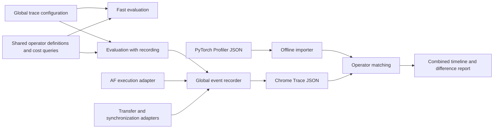

# Global Operator Tracing and Profiler Comparison

Status: development specification; the proposed global interfaces are not implemented.
This document records the agreed scope, architecture, migration, experiments and acceptance criteria.

## 1. Scope and requirements

TokenSim will provide one optional operator tracing facility for ordinary colocated serving, prefill/decode (PD) disaggregation and attention/feed-forward (AF) disaggregation.
The trace will describe the simulated execution of each layer, including matrix multiplication (GEMM), attention, normalization, communication and backend-specific fused modules.
An offline comparison tool will import PyTorch Profiler traces, match comparable operations and produce timing differences and a combined timeline.
Chrome Trace JavaScript Object Notation (JSON) is the primary interchange format.
The reference behavior is the operator timeline and profiling comparison in [Charon, Sections 3.2 and 4.2, Figure 8](https://arxiv.org/html/2605.17164v2#S4.SS2).

The implementation must satisfy these requirements:

- Expose a global configuration shared by all three serving modes and their supported entry points.
- Default to tracing disabled and introduce no measurable performance regression in that state.
- Keep simulation results independent of the tracing mode.
- Reuse the existing AF tracing implementation and remove duplicate infrastructure during migration.
- Preserve the execution boundaries of fused modules whose internal timing is unavailable.
- Record computation, communication, dependency readiness, resource waiting and synchronization where the execution model represents them.
- Read PyTorch Profiler output and match operators automatically, with explicit unmatched and ambiguous results.
- Validate execution order and overlap with a small set of graphics processing unit (GPU) experiments, progressing from vLLM Dense models to mixture-of-experts (MoE) models.
- Keep the existing remote vLLM checkout unchanged and run collection from an independent copy.

This work does not introduce training simulation, a PyTorch graph tracer, instruction-level GPU simulation or an extensive latency calibration campaign.
It does not require a one-to-one correspondence between every simulated operator and every GPU kernel.
Existing unsupported model or parallelism combinations remain subject to the simulator's configuration checks.
Adding trace export does not establish execution support for such combinations.

## 2. Existing implementation and constraints

| Area | Existing implementation | Consequence for this work |
| --- | --- | --- |
| Global serving configuration | [`SimulationConfig`](../TokenSim/config/simulation.py) and [`CLI translation`](../TokenSim/cli/configuration.py) | Add the common trace configuration here and pass it through engine initialization. |
| Operator latency | [`backend.py`](../TokenSim/latency/operator_table/backend.py) and [`composition.py`](../TokenSim/latency/operator_table/composition.py) | Ordinary execution returns a scalar step duration after aggregating operator costs. |
| Layer reuse | [`layers.py`](../TokenSim/latency/operator_table/layers.py) | Layers with matching attention geometry can share an estimator; their original layer indices must remain recoverable. |
| Ordinary execution | [`worker.py`](../TokenSim/llm/engine/worker.py) and [`af_worker.py`](../TokenSim/llm/engine/af_worker.py) | Attach detailed timing to the executed step, including ordinary prefill in an AF deployment. |
| Data-parallel synchronization | [`dp_coordinator.py`](../TokenSim/llm/dp_coordinator.py) | Preserve local work, dummy batches and waiting for the slowest rank. |
| AF tracing | [`config.py`](../TokenSim/af/trace/config.py), [`metrics.py`](../TokenSim/af/trace/metrics.py) and [`recorder.py`](../TokenSim/af/trace/recorder.py) | Extract common recording behavior and separate AF-specific validation and metadata. |
| Trace output | [`export.py`](../TokenSim/af/trace/export.py), [`pipeline.py`](../TokenSim/af/trace/pipeline.py) and [`formats.py`](../TokenSim/af/trace/formats.py) | Reuse incremental writing, atomic publication and existing archive formats. |
| Reporting | [`reporting/export.py`](../TokenSim/reporting/export.py) and [`reporting/af.py`](../TokenSim/reporting/af.py) | Publish a global trace reference while retaining AF-specific serving statistics. |
| Request timing | [`timing.py`](../TokenSim/timing.py) | Request completion timing remains separate from operator event storage. |

The ordinary latency backend adds component totals and communication costs without retaining a complete execution timeline.
The order in which it queries latency tables is not a sufficient specification of GPU execution order.
For example, attention input projections and output projections contribute to one aggregate even though attention executes between them.
The new execution description must preserve that ordering explicitly.

The analytical backend uses the same operator backend with analytical fallback selected.
Tracing must therefore support both measured-table and analytical estimates through the shared implementation.
Existing estimate provenance, missing-shape reports, routing seeds and lookup counters must remain intact.

The AF event record contains both reusable timing fields and AF endpoint, routing and tensor-layout types.
Moving that record unchanged into a global namespace would retain an unwanted dependency on AF.
The extraction must separate the common event contract from deployment-specific metadata and validators.

The neighboring `../aisimulate` checkout provides useful references for operator composition, overlap groups and optional per-operation results.
Its Rust callback implementation does not establish the cost of an equivalent Python callback.
Reuse concepts where appropriate and measure the Python execution path independently.
Any copied or adapted implementation must retain applicable source attribution and license notices.

## 3. Architecture and ownership

Introduce a deployment-independent `TokenSim/trace/` package for configuration, event storage, generic validation and export.
Introduce `TokenSim/profiler/` for offline import, operator normalization, matching and comparison reporting.
Keep operator definitions and latency evaluation under `TokenSim/latency/`.
Keep request scheduling, transfers and AF execution in their existing modules.
These package names describe the target responsibilities; implementation should extend existing helpers before adding files.



The engine owns the recording session and gives execution components a shared run identity.
Standalone AF experiment entry points construct the same session through the common factory.
Local iteration counters are qualified by execution scope so that different workers cannot produce colliding event identifiers.
Offline comparison imports neither vLLM nor GPU runtime libraries.
Ordinary simulation does not load profiler importers or comparison code.

AF-specific adapters translate execution metadata and invoke AF validators after generic timing checks.
They do not own another writer, archive implementation or configuration parser.
Generic recording modules must not import AF planning, provider or executor classes.
Deployment metadata must have a stable serialized representation that remains readable without constructing AF runtime objects.

## 4. Configuration and entry points

Add an immutable `TraceConfig` to `SimulationConfig` and use it in standalone execution factories.
The command-line interface (CLI) will expose `--trace_mode`, `--trace_output` and `--trace_config`.
These options are proposed additions and must not be documented as currently available until implemented.
`--trace_config` names a JSON file; explicitly supplied CLI options override its corresponding fields.
Defaults are applied only after merging explicit settings.
Unknown keys, invalid selections and conflicting legacy settings raise the existing `ConfigurationError`.

| Field | Default | Contract |
| --- | --- | --- |
| `mode` | `off` | `off` disables recording; `validate` retains active records for validation; `full` retains and exports selected events. |
| `validate` | `true` | Run generic and applicable deployment checks when records exist; `off` performs no trace validation. |
| `output` | unset | The main CLI derives a trace path in the run result directory; standalone callers may retain records and export explicitly. |
| `format` | `json` | Chrome Trace JSON by default; migrate existing `msgpack` and `archive` support without a duplicate AF implementation. |
| `iterations` | unset | Select iteration identifiers within their recorded execution scopes. |
| `layers` | unset | Select global model layer indices; retain the existing `-1` convention for model boundaries. |
| `workers` | unset | Select worker identities represented in the trace. |
| `phases` | unset | Select prefill, decode or mixed forward phases. |
| `event_types` | unset | Select event categories from the common schema. |
| `detail` | `full` | Preserve the existing full and timing-only export choices. |
| `fields` | unset | Preserve explicit optional payload-field selection without removing required envelope fields. |

Selectors apply to export and comparison views, following the existing AF filtering contract.
They do not remove dependencies needed for validation or alter the executed workload.
Metadata records the selection and identifies references to omitted events.
Large recordings use the existing incremental archive strategy; filtering alone does not provide a memory bound.
`validate` mode requires validation enabled and releases completed records after dependent checks finish.
Explicit output paths and export selectors are rejected in modes that do not export.

This is a proposed configuration example:

```json
{
  "mode": "full",
  "validate": true,
  "format": "json",
  "output": "outputs/operator_trace/simulated.json",
  "iterations": [0, 1, 2],
  "layers": [0, 1],
  "detail": "full"
}
```

Repository scripts and examples will migrate to the global configuration.
Legacy AF configuration keys may be accepted by a small boundary translator during migration, with explicit deprecation and conflict handling.
An omitted legacy field must not inherit the old AF default of recording enabled.
The global default remains `off`, including AF serving and standalone experiments.
Compatibility imports must be thin re-exports or adapters to the common implementation.

Add an offline entry point through `python -m TokenSim.profiler.compare` with `--simulated`, `--profile`, `--mapping` and `--output` options.
Allow multiple profile files for distributed workers and an optional mapping file for aliases, rank identities and known fused groups.
Keep this entry point separate from the existing simulation CLI to avoid restructuring unrelated command parsing.

## 5. Event schema and timeline semantics

Use a versioned event envelope with deployment-neutral identifiers and optional metadata.
Internal timestamps remain simulation seconds; Chrome Trace timestamps and durations are converted to microseconds at export.
The recording clock describes simulated execution and is independent of the host time spent running TokenSim.

| Field group | Required semantics |
| --- | --- |
| Identity | Schema version, run identity, event identifier, execution scope, iteration and physical execution identifier. |
| Operator | Canonical operator name, category, global layer index, phase, module boundary and occurrence within that boundary. |
| Placement | Worker, device, modeled resource lane and applicable tensor, pipeline, data and expert parallel ranks. |
| Timing | Dependency readiness, service start, service end and resource reservation intervals when they differ from service. |
| Dependencies | Stable predecessor identifiers and communication correlation identifiers. |
| Workload | Request and token counts, relevant tensor shapes, precision and communication payload size when available. |
| Provenance | Latency source, table/module identity, match type and whether timing is estimated, observed or supplied for validation. |
| Extensions | Namespaced AF metadata, request membership, run phase and partial-execution status. |

Optional or unavailable information is represented explicitly and is not inferred from the event name alone.
CUDA is NVIDIA's GPU execution platform.
A CUDA stream is a GPU command sequence whose ordering is observed in a real profile.
Simulated resource lanes must be labeled as modeled resources; exported lane identifiers do not claim to be observed CUDA stream identifiers.
Kernel-level measurements and logical operator-level estimates retain distinct granularity labels.

For complete events, timestamps must be finite and satisfy `ready_at <= start_at <= end_at` within a documented floating-point tolerance.
Service duration is `end_at - start_at`.
The interval from readiness to service start is scheduling delay; resource queueing is reported separately when explicit queue intervals exist.
Dependency waiting before readiness must not be added again to service time.
An idle gap in an imported GPU profile is not sufficient evidence of a particular resource wait or dependency.

Use Chrome complete events for service spans, metadata events for process and track names, and flow events for known dependencies.
Allocate separate tracks for concurrent work that cannot be represented as nested spans on one track.
Keep flow identifiers stable and emit arrows only when their endpoints are present in the selected view.
Preserve omitted dependency identities in metadata so filtered output does not imply a complete graph.
[Perfetto documents supported Chrome event types and overlap constraints](https://perfetto.dev/docs/getting-started/other-formats).

AF batching may expose one physical execution to several logical requests or blocks.
Retain a shared physical execution identifier and count its service and resource occupancy once.
Apply the same rule to collective parent spans, transport legs, module parent spans and their child kernels.
Reporting must declare which representation contributes to each total.

## 6. Execution integration and the disabled path

### Operator evaluation

Introduce an ordered operator description that expresses layer position, cost scope, dependencies, placement and supported overlap groups.
Construct reusable templates at model/backend initialization and cache the shape-dependent evaluation work already reused by the latency backend.
Use one definition of operator costs and dependency semantics for both execution paths.
Do not maintain an independent set of latency formulas for tracing.

The fast evaluator preserves aggregation across equivalent layers and returns the duration needed by the existing scheduler.
The recording evaluator additionally retains the evaluated components and expands the executed forward into timestamped layer events.
Both evaluators must use the same workload snapshot, routing assignments, latency values and arithmetic grouping for reported simulation results.
Cache lookup order, random draws and statistical counters must not change when recording is enabled.
Recording must not query the same operators again solely to reconstruct a trace.

Repeated layers may share cost evaluation, but event expansion must restore their actual model order and global layer indices.
Mixed attention geometries and alternating Dense/MoE layers must not appear grouped by estimator type on the timeline.
Model boundary operations, output projections, final normalization and the language-model head retain their actual positions and multiplicities.
Prefill/decode mixed batches retain the model's shared computation boundaries and separate attention work where applicable.

For a serial block, use ordered cumulative service offsets.
For supported overlap groups, calculate completion from dependency readiness and resource availability using the same rules that determine the step duration.
Do not impose a general per-operator SimPy event loop on the fast path merely to obtain timestamps.
If a scheduling correction requires additional work in both paths, retain a compact evaluation or cached template and benchmark it before accepting the change.

The recording path must never add synchronization that changes request admission, batching, cancellation or transfer progress.
An event's duration must not be adjusted to force the trace to match an independently calculated total.
Unexpected accounting differences are validation failures requiring a correction to the shared execution description.

### Deployment adapters

| Mode | Integration requirements |
| --- | --- |
| Ordinary colocated serving | Anchor each expanded forward to its actual worker start time and include supported tensor/pipeline collectives. |
| PD disaggregation | Preserve independent prefill and decode execution scopes, key/value (KV) cache transfer completion and the dependency that admits decode. |
| AF disaggregation | Reuse existing scheduling timestamps, shared expert execution and cross-pool transfer dependencies; expand non-fused provider estimates where data exists. |
| Data-parallel lockstep | Record local work and dummy batches separately from waiting until the synchronized step completes. |

AF prefill currently uses the ordinary complete-model path and must be included in the same global recording session as AF decode.
Resolve physical rank tracks from the declared placement, including ranks represented by a shared cost estimate.
Record the symmetry assumption when one estimate is reused across ranks, and preserve rank-specific work or waiting when the model provides it.
Transfer events must come from actual simulated transfer execution or its authoritative service record.
Latency estimation calls alone must not create executed communication events.
Measured fused attention or MoE modules remain indivisible when their latency source already includes projections, dispatch or combine.
Additional primitives and transfers already included in such a module must not be charged again.

### Disabled execution

Choose the fast or recording implementation once during initialization.
The disabled path must not construct trace event objects, trace-only identifiers, trace metadata dictionaries, export iterators or serializers.
It must not allocate a recording session with per-iteration history or invoke a no-op recorder for every operator.
It must not add trace-specific per-operator branches, per-layer expansion or SimPy events.
Optional archive dependencies and profiler parsers are imported only by the paths that use them.

The zero-overhead requirement is an acceptance condition supported by structural checks and repeated measurements.
Elapsed-time equality in a single run is not evidence of zero overhead.
A reproducible slowdown beyond measured run variation fails acceptance and requires revision of the implementation.

## 7. Recording lifecycle, validation and migration

The common recorder owns active records, indexing, completed-record archival and export publication.
Retain the existing bounded incremental writing and temporary-file publication mechanisms.
Finalized prefixes must not be published while active execution can still change their dependency information.
Trace selection, archive readback and metadata encoding must preserve deterministic ordering.

Warmup resets clear performance counters without reusing event identifiers or losing active dependencies.
Mark warmup and measured execution separately so comparison selects an explicit measurement window.
Canceled or interrupted work is labeled incomplete and records the observed interval only.
Planned completion times must not be exported as completed work after a simulation time limit or failure.
Resource accounting and comparison must exclude unobserved portions of partial events.
Successful partial exports carry the run termination reason and capture boundary.
An export failure preserves an existing destination and raises an actionable error.

Generic validators check identifier uniqueness, valid times, dependency order, duration consistency, execution-group consistency and resource capacity.
AF validators continue checking tensor coverage, routing assignments, producer ownership and protocol-specific invariants.
Validation dependencies that outlive a completed iteration require compact retained completion metadata or deferred checks.
Validation-only mode must release full history when those checks no longer need it.

Migrate the shared implementation in small changes with tests around existing exported semantics.
Move generic configuration, storage and export behavior before changing AF producer code.
Replace AF-specific fields in the common envelope with typed adapters and serialized extensions.
Migrate `scripts/af_trace_options.py`, experiment helpers, result integration and import sites to the shared implementation.
Retain existing MessagePack and archive readers or provide explicit schema-version conversion for saved traces.
Never silently interpret an older AF archive as a new global event schema.
Remove superseded implementations after all repository callers migrate.

Result JSON will contain a compact global trace descriptor with mode, schema version, artifact path, selection and completeness.
Large event lists belong in trace artifacts.
AF serving statistics remain available, including deployment-specific utilization and provider provenance.
Any migration of the existing `af_trace` result field must be documented with its replacement and compatibility behavior.

## 8. Import and automatic operator matching

The importer accepts a Chrome Trace event array or an object containing `traceEvents`, including gzip-compressed input.
Normalize complete events and matched begin/end events while retaining original names, timestamps and source identifiers.
Recognize process metadata, GPU kernels, transfers, central processing unit (CPU) annotations and correlation records through a versioned PyTorch/vLLM adapter.
Reject malformed timing records and report unsupported records without silently treating them as GPU work.
Support multiple worker files without assuming their local process, stream or correlation identifiers are globally unique.

GPU activity supplies device execution durations.
CPU ranges and launch correlation supply ownership evidence and remain separate from device duration.
Module information is optional; profiler settings do not guarantee that every execution exposes layer names.
For the controlled collection campaign, add narrowly scoped layer and forward annotations in the copied environment if the existing trace lacks the required ownership information.
Record those annotations and their overhead in the collection manifest.
The [PyTorch Profiler API](https://docs.pytorch.org/docs/stable/profiler.html) defines the export and recording controls; the copied installation determines the supported options used by the collector.

Matching proceeds through explicit stages:

1. Verify compatible model, workload, precision, parallel layout and capture policy from manifests where available.
2. Select comparable forward windows and map worker/rank identities explicitly.
3. Normalize operator names with versioned aliases for projections, attention, normalization, activation, routing, experts and communication.
4. Associate kernels with logical operators through correlation, annotations and known fusion rules.
5. Match within phase, layer and rank using shape evidence and dependency/occurrence order.
6. Emit matched, unmatched, ambiguous and excluded records with the evidence used for each decision.

Within a sequential scope, matching must preserve operation order and allow insertions and omissions.
Independent resource lanes use dependency constraints and must not be forced into an arbitrary global sequence.
Duration similarity is not a matching criterion, because selecting pairs by similar latency would bias the error report.
Repeated unannotated operations remain ambiguous when several assignments satisfy the available evidence.
Mappings may be one-to-one, one-to-many or many-to-one only when a declared semantic boundary supports the grouping.
Retain member event identifiers so aggregate comparisons can be audited.

Provide a mapping-file schema for aliases, rank mappings, capture anchors and fusion rules.
Record its schema version and content hash in the output.
Missing optional shapes reduce matching evidence without inventing values.
Unknown framework/kernel patterns remain visible in the report and can be added to the adapter from inspected examples.

Align the selected simulated and observed windows using an explicit common anchor and translation only.
Do not rescale durations or independently shift each operator to hide ordering differences.
Preserve relative timing between workers when source clocks are comparable.
If clock synchronization or a shared anchor cannot be established, allow local comparisons and mark cross-rank overlap unavailable.
Do not infer cross-rank causality solely from similar timestamps.

## 9. Comparison outputs and accounting

Produce `comparison.json`, `operators.csv` and `comparison.trace.json` under a caller-selected output directory.
The JSON report is authoritative and records input hashes, manifest compatibility, schema versions, mapping evidence, coverage and metrics.
The comma-separated values (CSV) file provides a flat table for inspecting matched and unmatched operations.
The combined trace allocates separate simulated and observed tracks with the same operation grouping and alignment anchor.
Preserve original timestamps in event arguments for inspection.

| Metric | Definition |
| --- | --- |
| Signed service error | Simulated comparable duration minus observed comparable duration. |
| Absolute service error | Absolute value of the signed service error. |
| Relative service error | Signed error divided by observed duration; undefined for zero observed duration. |
| Start/end offset | Difference between corresponding boundaries after the documented translation. |
| Invocation span | Earliest member start through latest member end, including internal gaps. |
| Device busy time | Union of physical service intervals on the declared device/resource scope. |
| Compute/communication overlap | Intersection of compute and communication interval unions within a comparable clock domain. |
| Forward makespan | End of the selected forward minus its start; distinct from the sum of operator durations. |
| Match coverage | Matched operation counts and matched duration coverage, with unmatched and ambiguous denominators visible. |

For an imported group of kernels, report invocation span, kernel-duration sum and busy-time union separately.
Choose the comparable duration according to the simulated operator's declared cost scope and record that choice.
Do not compare a fused module's wall duration with a nested CPU range plus all child kernel durations.
Cross-rank cumulative device time must not be labeled forward wall time.
Relative error for an undefined denominator is `null` with a reason.
Empty windows, malformed inputs and incompatible required identities fail clearly.
Partial matching is a valid result with visible coverage; a window with no matches must not receive a successful accuracy verdict.

## 10. Remote environment and collection

Use the Secure Shell (SSH) target `PKUa100` for the agreed experiments.
The user-provided vLLM installation is the source for the collection environment.
Its source and virtual environment must remain unchanged.

| Purpose | Path on `PKUa100` |
| --- | --- |
| Read-only vLLM source | `/home/youwei/bzh/project/TokenCake/RFC/vllm-rfc` |
| Independent vLLM copy | `/home/youwei/bzh/project/TokenSim/vllm-rfc` |
| Existing TokenSim checkout | `/home/youwei/bzh/project/TokenSim/TokenSim` |
| Collection and analysis root | `/home/youwei/bzh/project/TokenSim/profiler` |

Create a source snapshot that includes the installed checkout's working-tree changes and compiled artifacts required by that installation.
Record its commit, relevant working-tree changes and package versions in a manifest stored under the collection root.
Preserve existing content in the destination parent and avoid destructive synchronization options.
Use independent file copies or copy-on-write storage; mutable files must not be shared through hard links to the source.
Inspect symbolic links, editable-install mappings, interpreter launchers and generated entry-point shebangs before using the copy.
Rebind editable vLLM imports to the copied checkout and direct compilation, package and runtime caches to writable locations outside the source.
Reuse the existing compatible dependencies and compiled artifacts where possible.
Run package-management operations only against the copied environment with explicit paths.
Follow the copied repository's environment instructions, including its `uv` and virtual-environment requirements.

Verify the loaded vLLM module path, installed distribution metadata and compiled extension paths from a process launched in the destination.
Check that mutable vLLM artifacts resolve outside the source and compare the source state before and after setup.
Do not run collection, installs or builds with the source checkout as the working directory.
An existing shared Python interpreter may remain a read-only runtime dependency; it does not authorize modifying that interpreter installation.

Use one run directory beneath the collection root for each model/configuration sample.
Store raw profiler files, launch configuration, environment manifest, simulator inputs, logs, comparison outputs and experiment conclusions together.
Record model revision, inference framework revision, PyTorch/CUDA versions, device identities, selected ranks, precision, attention backend, fusion options and CUDA-graph policy.
CUDA graph capture policy can change the visible kernel and launch structure.
Pin the installed environment used for collection instead of assuming current online documentation describes the copied checkout exactly.

The local artifact root is `/home/zhuohang/TokenSim/TokenSim-Open/outputs/operator_trace/`.
It is covered by the repository's existing `/outputs/` ignore rule.
Verify ignore coverage in the actual checkout used on the remote host if any generated files are placed inside it.
Raw traces, model weights, copied environments and experiment logs must not be committed.
Commit reusable collectors, small deterministic fixtures and configuration examples only.

### Experiment matrix

Use a small PyTorch program to exercise sequential operations, independent CUDA streams and explicit synchronization with observable dependencies.
Use [Qwen3-8B](https://huggingface.co/Qwen/Qwen3-8B) as the Dense serving sample and [Qwen3-30B-A3B](https://huggingface.co/Qwen/Qwen3-30B-A3B) as the MoE sample, subject to availability in the copied framework.
Derive TokenSim model configurations from the pinned model metadata and retain the same precision and workload dimensions.
Start with eager execution for readable operator attribution, then collect a small CUDA-graph sample when the copied framework exposes usable metadata.
Warm up the workload and record only a short prefill/decode interval.
Use single-device and two-device configurations to cover computation and communication without a broad parameter sweep.
Inspect current device availability and topology when launching; the inspected host has an NVLink connection between devices 2 and 3.
Preserve the actual device variants and topology in the simulator configuration.

The real-serving campaign validates vLLM import and matching for Dense and MoE execution.
PD and AF coverage also requires simulator integration tests and deterministic transfer/dependency cases.
A colocated vLLM trace does not establish measured PD or AF deployment accuracy.
No fixed percentage latency target is required for this campaign.
Report the observed differences and structural findings without fitting every operator.

## 11. Validation and performance acceptance

### Behavioral tests

| Test area | Required evidence |
| --- | --- |
| Mode equivalence | `off`, `validate` and `full` preserve request outcomes, scheduling, routing, transfer completion and simulated time. |
| Disabled recording | Event constructors, metadata encoders and archive writers can be replaced with failing sentinels without breaking an `off` run. |
| Layer order | Repeated and mixed layer types retain original model positions despite cost caching and estimator grouping. |
| Accounting | Trace boundaries agree with authoritative forward completion; fused modules and shared AF batches are counted once. |
| Parallel execution | Sequential, overlapping and synchronized cases respect dependencies and modeled resource capacity. |
| Deployment coverage | Ordinary serving, PD transfer/admission and AF prefill/decode all produce coherent global traces. |
| Lifecycle | Warmup, cancellation, bounded simulation, empty selections and interrupted export preserve valid status and identifiers. |
| Import and matching | Exercise actual minimal PyTorch traces, fused groups, repeated names, missing annotations, multiple ranks and malformed input. |
| Export | Verify units, metadata, flow endpoints, filtered dependencies, archive readback and atomic publication. |
| Migration | Existing AF validation, shared-execution semantics and supported saved formats survive the extraction. |

Extend nearby tests before adding new suites and use small deterministic inputs.
Real profiler fixtures must be reduced without removing the correlation and annotation structures the parser needs.
Do not make CPU-only unit tests depend on the remote GPU host or installed vLLM.

### Equal-duration execution checks

For a selected workload, associate observed service durations with the simulator's declared operations.
Supply only those durations through a validation-only latency provider while preserving the simulator's own dependencies, resources and workload description.
Keep this provider outside normal configuration defaults and tag its output as duration-injected validation.
Do not copy observed start/end times, queue intervals or stream ordering into the simulator to manufacture agreement.
Expected schedules must come from independent fixtures or the GPU program's explicitly defined dependency structure.
Check relative order, legal overlap, synchronization and completion time under those controlled assumptions.
Separately report differences caused by unmodeled launch delays or incomplete profiler attribution.

### Performance measurements

Capture a baseline revision and representative deterministic workloads before changing the implementation.
Use ordinary Dense serving, MoE or synchronized serving, PD and AF cases with tracing disabled in both baseline and candidate.
Run paired repetitions on the same CPU host and interpreter, alternating baseline and candidate execution order.
Measure startup, simulation execution and export separately, and retain peak-memory measurements and workload sizes.
Use warm runs to inspect steady execution and cold runs to detect newly introduced initialization or import cost.
Report the paired timing distribution and run variation alongside the median paired ratio.
If the samples cannot distinguish a regression from noise, improve the workload duration or repeat the measurement before declaring acceptance.
Do not introduce an arbitrary slowdown allowance as a substitute for the agreed zero-overhead requirement.
Measure enabled tracing time and memory separately to check streaming behavior and document its cost.

For result-preserving changes, compare result JSON and applicable AgentX replay logs with the baseline, excluding host execution-time fields and explicitly migrated trace metadata.
If a scheduling defect is corrected, record its intended result changes separately and require tracing modes to agree within the corrected model.
Keep deterministic result comparisons exact; use a documented numerical tolerance only for derived trace invariant checks.
GPU profiling perturbation does not change the requirement that the simulator's recording switch preserve its own results.

## 12. Implementation sequence and completion criteria

| Milestone | Deliverable | Completion evidence |
| --- | --- | --- |
| Baseline and contracts | Related-code review inventory, frozen baseline, event/config schema and representative workloads | Existing behavior, identified defects and disabled-mode performance captured outside version control. |
| Common tracing extraction | Shared configuration, storage, export and generic validation | AF tests pass through the common implementation; core tracing has no AF imports. |
| Ordinary and PD integration | Ordered operator evaluation, layer expansion and transfer dependencies | Deterministic schedules, fused-cost accounting and mode equivalence pass. |
| AF migration and cleanup | Global producer adapters, standalone integration and migrated callers | AF semantics and archives preserved; redundant implementations removed. |
| Offline comparison | Importer, mappings, metrics and combined trace export | Minimal real traces and ambiguity/failure cases pass. |
| GPU verification | Independent remote environment and Dense/MoE samples | Source checkout unchanged; manifests and reports retained in the agreed collection directory. |
| Performance and documentation | Regression evidence, user guidance and completed repository checks | No measurable disabled-mode regression and no unresolved execution/accounting failures. |

Keep each source, test and script file within the repository's 500-line limit.
Document public configuration and result semantics in the existing operator-latency and AF guides when the interfaces become available.
Update this document's implementation status as milestones are completed, with links to committed code and durable evidence summaries where appropriate.
Measured run logs and raw artifacts remain under the ignored artifact directories.

Before committing a completed feature or submitting code changes, run the checks required by [CONTRIBUTING.md](../CONTRIBUTING.md):

```bash
python -m black \
  TokenSim tests benchmark.py scripts examples/storage/hbf
python -m black --check \
  TokenSim tests benchmark.py scripts examples/storage/hbf
python -m unittest discover \
  -s tests \
  -t .
git diff --check
```

Documentation-only updates require checks of sentence layout, terminology, links, configuration examples and the diff.
The implementation is complete when all three serving modes use the global facility, automatic comparison works on the agreed real samples, execution checks pass, the remote source is preserved and disabled-mode performance meets the stated acceptance condition.

## 13. Mandatory development workflow

These requirements apply throughout implementation, including the review and repair of existing code used by this feature.
An existing implementation or passing historical test does not establish that its execution model is correct.

### Review the related existing code

Before changing a subsystem, inspect its implementation, callers, configuration, tests and documented contracts.
Review complete related files, including unchanged functions, and follow their dependencies across latency estimation, execution, transfers, recording, reporting and collection.
Maintain a review inventory in the ignored experiment directory with each reviewed path, findings, supporting evidence and disposition.
The inventory must cover the existing components listed in Section 2 and additional files discovered through their call paths.
Check each related source, test and script file against the repository's size, formatting, validation, determinism and module-boundary requirements.
Resolve violations in files developed or refactored for this feature and record remaining related findings explicitly.

### Establish the basis for each change

Associate each behavior change with a requirement, an inspected execution contract, a minimal reproducer or measured evidence.
Document the current behavior, expected behavior, cause and expected impact on simulated results before implementing a fix.
Distinguish a verified defect from a hypothesis that still needs an experiment.
Repair existing defects that affect the requested feature or invalidate its verification.
Check other callers of the corrected behavior and verify their relevant cases as part of the same repair.
Record unrelated findings separately to keep the implementation focused.

### Reuse code and keep the implementation small

Search existing implementations, helpers, configuration fields and tests before introducing a new abstraction.
Extend a suitable shared implementation and migrate its callers when common behavior is extracted.
Remove superseded implementations, dead branches and redundant state after migration.
Keep configuration, latency evaluation, simulation behavior, validation and export in the modules responsible for them.
Use explicit inputs and small functions, and keep each source, test and script file at 500 physical lines or fewer.
Compatibility adapters must delegate to the common implementation and must not retain independent business logic.

### Test during development

Run the relevant existing tests before changing a subsystem and record baseline failures.
For a verified defect, add or adapt a regression case that demonstrates the failure and passes after the fix.
Use the smallest meaningful test that checks the observable contract, including applicable boundary cases and failure paths.
Run targeted tests after each behavior change and integration tests when a change crosses subsystem boundaries.
Compare deterministic outputs when refactoring or changing performance-sensitive code, using the rules in Section 11.
Run the required formatter, format check, full test suite and diff check before committing a completed feature.
Resolve failures caused by the change and investigate existing failures that affect the feature's correctness claims.
A skipped or unavailable check must be identified with its reason and must not be reported as passing.

### Analyze logs and correct the cause

Preserve the exact invocation, source revision, configuration, seed, environment, exit status and relevant output for failed tests and experiments.
Store full logs under the agreed ignored artifact roots and keep a concise diagnosis alongside each experiment.
For a timing or scheduling discrepancy, inspect predecessor identities, readiness, service intervals, resource reservations, physical execution groups and operator provenance.
Use the simulator and profiler logs to locate the earliest point where the expected and observed behavior diverge.
Verify whether the cause is execution, estimation, attribution, matching or export before changing the corresponding module.
Correct the responsible implementation and rerun the reproducer and affected integration cases.
Do not hide failures by weakening assertions, changing expected values without evidence, discarding unmatched events or adjusting latency values to conceal a scheduling error.
Retain unresolved hypotheses and their supporting observations until an experiment resolves them.

### Commit complete features

A commit must contain a coherent, working capability or completed infrastructure migration with its tests and relevant documentation.
Commit each completed feature after the required checks pass; the development workflow does not require a new permission request for each commit.
Include directly related defect repairs and the tests that establish their correctness.
Review the complete diff before staging and verify that only intended files are included.
Keep raw traces, copied environments, model weights, logs and temporary experiment files out of commits.
The commit description must state the resulting behavior, the reason for the change, validation performed and any intended change to simulated results.
Report the commit identifier and validation outcome when delivering a completed feature.
