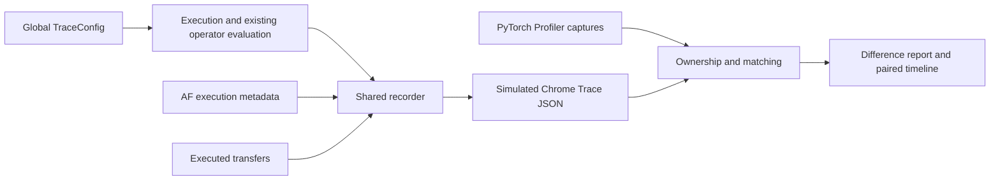

# Operator tracing, profiler comparison and validation

TokenSim provides default-off operator tracing for colocated serving, prefill/decode (PD) disaggregation and attention/feed-forward (AF) disaggregation.
The offline tools match simulated operations to PyTorch Profiler activity and export timing reports, Chrome Trace JSON and paired timeline images.
The timeline layout follows [Charon, Section 4.2, Figure 8](https://arxiv.org/pdf/2605.17164#page=10).
This document combines the implementation contract, experiment findings and work deferred to separate pull requests.
The [operator latency guide](operator-latency-model.md#global-operator-tracing) contains CLI examples and the complete option reference.

## Architecture and ownership

| Component | Responsibility |
| --- | --- |
| [`TokenSim/trace`](../TokenSim/trace) | Global configuration, common events, recording, timing validation, bounded storage and export. |
| [`TokenSim/profiler`](../TokenSim/profiler) | Observed ownership, paired captures, operator matching, wait attribution, comparison reports and images. |
| [`TokenSim/latency`](../TokenSim/latency) | Operator evaluation, measured-data lookup, analytical fallback and estimate provenance. |
| [`TokenSim/af/trace/metrics.py`](../TokenSim/af/trace/metrics.py) | AF event fields, routing record registration and iteration summaries. |
| [`TokenSim/af/trace/validation.py`](../TokenSim/af/trace/validation.py) | AF payload, endpoint ownership, routing coverage and layer invariants. |
| [`TokenSim/af/trace/stages.py`](../TokenSim/af/trace/stages.py) | AF logical transfer stages and local replica-consumption checks. |
| [`TokenSim/af/trace/session.py`](../TokenSim/af/trace/session.py) | AF producer boundaries and dependencies in the engine's global session. |

All deployments use the same recorder, archive implementations, writers and configuration class.
AF executors install an event validator on the shared recorder; generic timing, dependencies and resource capacity are checked before AF-specific invariants.
AF summaries consume the shared recorder through `summarize_iteration`.
The AF package contains no storage subclasses, configuration subclasses or forwarding modules for shared trace utilities.
Repository callers import shared infrastructure directly from `TokenSim.trace`.
Common recording and offline plotting do not import AF runtime modules.

## Configuration and event contract

`SimulationConfig.trace` accepts the immutable `TraceConfig` or a configuration mapping.
The main CLI exposes `--trace_mode`, `--trace_output` and `--trace_config`.
Explicit CLI settings override the corresponding file settings.

| Configuration | Contract |
| --- | --- |
| `mode="off"` | Default for serving; skip recording and trace I/O. |
| `mode="validate"` | Validate active records and release completed iterations. |
| `mode="full"` | Retain readback and export events. |
| `validate` | Enable common and applicable deployment checks when recording is enabled. |
| `format` | Select `json`, `msgpack` or `archive`; MessagePack requires `tokensim[trace]`. |
| `output` | Explicit export destination; the main CLI otherwise derives a distinct path for each result. |
| `iterations`, `layers`, `workers`, `phases`, `event_types` | Filter exported views without removing records needed by validation. |
| `detail`, `fields` | Select complete payloads, timing fields or named event fields. |

Output paths and export selectors require `full` mode.
Layer indices are global; `-1` identifies model-boundary operations.
Standalone AF fixed-batch experiments explicitly select full recording by default and use the same `TraceConfig` to select other modes.
Their CLI parsing applies that experiment default before validating settings that omit a mode.

Events retain identities, operation names, layer and phase, modeled placement, dependencies, readiness, service intervals, workload shape and estimate provenance.
Internal timestamps use simulation seconds; Chrome Trace timestamps and durations use microseconds.
Trace time describes simulated execution, independently of the host time spent running TokenSim.
For completed events, readiness precedes service start and service start precedes completion within the larger of one picosecond and four clock units in the last place.
Service duration is completion minus start; readiness waiting and resource queueing remain distinct quantities.
Unavailable payload sizes, ownership or timing are explicit instead of inferred from a name or duration.

Shared physical AF executions retain an execution-group identity and contribute service once.
Fused modules retain their measured boundary when internal timing is unavailable.
Container spans, their children and communication participants must declare which representation contributes to totals.
Modeled resource lanes do not claim to be observed CUDA streams.
Known dependencies appear as flow arrows only when both endpoints remain visible after filtering.

## Execution and recording lifecycle

Operator costs are evaluated through the existing latency backend once.
Recording expands those evaluated costs into execution positions without additional latency queries, random draws or statistics updates.
Cached estimates for equivalent layers retain their original global layer order.
Input embedding, projections, normalization, attention, feed-forward work, model output and communication retain their physical multiplicities.

| Deployment | Recorded boundaries |
| --- | --- |
| Colocated serving | Actual worker start and completion, ordered layer work and supported collectives. |
| PD disaggregation | Independent producer/consumer scopes, executed KV transfer and decode-admission dependencies. |
| AF disaggregation | Ordinary whole-model prefill, AF decode, shared expert execution and cross-pool dependencies in one session. |
| Data-parallel lockstep | Local and dummy work plus waiting for synchronized completion. |

Ordinary tensor-parallel execution that reuses one representative estimate labels that assumption `symmetric_tp`.
Transfer records come from actual admission and service observations, including shared queues and unfinished DMA.
Incomplete work records its observed interval and does not claim full payload completion.
Recording must preserve batching, cancellation, transfer progress and request results.

The engine chooses the recording path during initialization.
Disabled serving creates no trace session or per-operator trace events and performs no trace I/O.
It does not expand layers, create trace metadata or add simulation events for recording.
Enabled storage keeps active events in memory, archives finalized iterations incrementally and publishes output atomically.
Dependency patches finish before an iteration is archived or discarded.
Warmup and measured records remain distinguishable; cutoff handling retains completed work and labels partial work.

## Collection environment

The agreed GPU host is SSH target `PKUa100`.
The source vLLM checkout at `/home/youwei/bzh/project/TokenCake/RFC/vllm-rfc` must remain unchanged.
Collection uses the independent copy at `/home/youwei/bzh/project/TokenSim/vllm-rfc`.
Remote raw captures and experiment output live under `/home/youwei/bzh/project/TokenSim/profiler`.
Local artifacts live under ignored `outputs/operator_trace/` directories.
Weights, copied environments and raw traces are excluded from commits.

Record source revision and status before copying the checkout, and verify source state after collection.
Record the copied revision, Python, PyTorch, CUDA, vLLM, GPU topology, model configuration and exact invocation in the collection manifest.
Available software can be installed under `~/software` without modifying the source checkout.
The [collector guide](../scripts/collect/README.md#operator-timeline-collection) documents the module invocation and capture artifacts.

Collection separates an annotated structure pass from GPU-only timing passes.
Temporary hooks and method wrappers are removed before timing, including exception cleanup.
Warmups precede measurement; repeated unprofiled baselines are collected before and after profiling.
The selected timing sample is an actual upper-median observation, with all samples retained.
Profiler startup, shutdown and serialization are excluded from measured generation wall time.
The manifest records profile/baseline ratio and baseline drift instead of applying a universal profiler correction factor.

Paired ownership transfer requires identical device/stream activity inventories, operation names and available launch dimensions.
Both structure and timing files are pinned by SHA-256.
Generated token changes or unexpected forward counts fail collection.
Multi-request burst collection pauses admission until the complete batch has been enqueued and resumes it on failure as well as success.
This fixed-batch protocol does not validate mixed continuous batching or complete PD/AF GPU serving pipelines.

## Matching, accounting and images

Launch correlation and CPU annotations establish observed GPU ownership, including launches whose kernels execute after the CPU range ends.
The matcher uses rank, forward occurrence, layer, compatible shapes and operation order.
An operator's flattened tensor rows and the forward's token count remain separate fields.
Matching never chooses a pair by duration similarity.
Order-preserving matching accepts mandatory pairs, retains ambiguity and preserves unmatched or excluded work.
Observed backend fusion can group the corresponding modeled operations, including residual/Norm and projection/collective scopes.

| Artifact or quantity | Meaning |
| --- | --- |
| `comparison.json` | Matches, ownership evidence, source hashes, coverage, clocks and accounting. |
| `operators.csv` | Per-pair span errors, device-service errors, internal gaps and qualified waits. |
| `comparison.trace.json` | Both timelines with translated origins and original timestamps retained in arguments. |
| Module invocation span | Earliest attributed GPU start through latest attributed GPU completion; includes internal gaps. |
| Device busy time | Union of attributed kernel/copy intervals; collective residence may include waiting. |
| Adjusted device service | Observed device work after removing only qualified peer-arrival wait intervals. |
| Rank-summed spans or service | Cumulative device quantities across ranks; these do not represent request latency. |

Known custom all-reduce entry barriers allow observed time until the last matching peer starts to be attributed as peer-arrival waiting.
This requires complete participants and common-clock evidence from host, boot, time namespace and profiler clock basis.
The comparator retains raw kernel residence and computation overlapping waiting.
After-arrival residence can still include execution and barrier overhead.
Unsupported NCCL waits, missing peers, nonoverlapping calls or unproven clocks retain unknown adjusted service.
Reports expose comparable-subset and known-wait totals alongside their coverage.

Proven common clocks receive one shared translation so rank offsets remain visible.
Other clocks remain independently aligned, with cross-rank overlap unavailable.
The offline `TokenSim.profiler.plot` exporter renders simulated operators above observed kernels/copies or module envelopes.
It supports forward, layer, native-rank and time-window selection and exports PNG, SVG and a source-hashed geometry sidecar.
Both panels use the same scale and preserve gaps and kernel residence.
Selection-relative views translate each side's selected origin and retain offsets on proven shared clocks.
Actual streams and overlapping intervals occupy separate rows; full names remain available when labels are truncated.
Matplotlib is an optional `plot` dependency loaded during rendering.

## Validation retained after cleanup

Tests verify observable contracts with deterministic inputs and reduced real-profiler fixtures.
They do not require the remote host, vLLM or a GPU.
Plot rendering tests use the optional Matplotlib dependency.

| Retained test area | Failure it detects |
| --- | --- |
| Recording mode parity and disabled constructors | Recording changes results or allocates trace work during an off run. |
| Layer and boundary order | Cached layer groups reorder work, or model-boundary operations disappear or repeat. |
| PD, AF and queued transfers | Producer dependencies, admission timing, cancellation or partial execution become inconsistent. |
| Shared storage and dependency validation | Saved formats lose events, filtered arrows become dangling, or cycles/capacity conflicts are accepted. |
| Profiler import and matching | Async ownership, backend fusion, shape compatibility or ambiguous occurrences are misassigned. |
| Paired collection | Structure labels transfer to a different workload, timing sample or changed file; instrumentation survives timing setup. |
| Collective accounting | Peer waiting is priced as service, overlapping work is removed, or unsupported waits appear as measured zero. |
| Paired image export | Output changes durations, loses real streams/rank offsets, hides overlap or misclassifies endpoint roundoff. |

Compatibility-only tests are removed with the AF forwarding modules and configuration/storage subclasses.
Repeated simulations for the same layer order and boundary assertions are replaced by checks in the existing mode-parity run.
Simple argument-validation and arithmetic-only tests are removed where they duplicate implementation checks or existing integration coverage.
Collector tests share the profiler suite, and queued-transfer tests share the recorder suite.
The AF normalization regression lives beside the existing whole-model AF tests.

Refactors compare deterministic result JSON, full AF events and applicable replay logs with a saved baseline.
Only host execution-time fields and explicit trace descriptors are omitted from result comparisons.
Disabled-mode performance uses alternating paired runs on the same CPU/interpreter and reports timing variation with the median ratio.
A single equal-duration run does not establish zero overhead.
The controlled GPU duration-injection experiment verifies duration propagation and serial operation order through the production estimator without copying observed start times.
Complex overlap and mixed-serving validation remain separate work.
Formatting, file size, full tests and diff checks follow [CONTRIBUTING.md](../CONTRIBUTING.md).

## Experiments and findings

The original experiment source is TokenSim `be872a598f41b0829fd03379d1c76998c975d644`.
The timing/attribution follow-ups use `3571b9da65a22f28ea673751f80b61510920bd74`; image export is recorded at `c2f3d771710e429fa614964a1a0dd1d5ce4b908b`.
The copied vLLM source is `9cf0c96c91c690ad2e3dfc8ddd81f20014565327`, running PyTorch `2.13.0+cu132`.
The AISimulate reference checkout is `42e5bb8df6029650c4312db0b5cfbd963047a123`.

Captures use A100 80 GB PCIe GPUs, BF16, 32 input tokens, three output tokens, eager execution, disabled prefix caching and disabled chunked prefill.
Qwen3-8B uses tensor parallelism (TP) 1; Qwen3-30B-A3B uses TP 2 with expert parallelism disabled.
The measured TP pair has twelve active 25 GB/s NVLink connections per GPU.
Simulation uses `analytical_only`, without fitted operator tables.

### Initial cumulative spans

| Matched quantity, ms | Dense TP 1 | MoE TP 2, both ranks summed |
| --- | ---: | ---: |
| Simulated module spans | 31.466 | 83.273 |
| Observed module spans | 81.564 | 701.468 |
| Observed device busy intervals | 32.102 | 490.140 |
| Internal gaps: observed spans minus busy | 49.462 | 211.328 |

Dense internal gaps account for 49.462 ms of the 50.098 ms signed span difference.
Opposite-signed operator errors still give a 10.27% absolute-error sum relative to observed busy time.
Initial MoE native reductions total 2.148 ms on rank 0 and 462.483 ms on rank 1.
Their median start difference is 1767.333 microseconds, while the median completion difference is 0.114 microseconds.
The inspected start and end barriers spin on peer signals, and later captures change which rank waits.
The routing observation has identical expert histograms on both TP ranks, so cross-rank expert-count imbalance does not explain that asymmetry.

### Instrumentation and execution boundaries

A separate ablation switches hooks, PyTorch profiling and shape recording while keeping generated tokens identical.
Unprofiled conditions have seven observations and profiled conditions have two observations.

| Condition | Dense median wall time, ms | MoE median wall time, ms |
| --- | ---: | ---: |
| Unprofiled before capture | 77.339 | 170.600 |
| Hooks without profiler | 92.138 | 194.910 |
| Profiler without hooks or shapes | 122.987 | 240.988 |
| Profiler and hooks without shapes | 169.486 | 267.305 |
| Profiler, hooks and shapes | 151.070 | 285.364 |
| Unprofiled after capture | 90.473 | 186.682 |

Ordering, baseline drift and sample counts prevent a precise independent shape-recording correction.
Across four new annotated captures, matched compute-kernel intervals remain 31.941–31.950 ms for Dense and 33.152–33.176 ms for MoE.
The original totals are 31.957 ms and 33.203 ms.
One original Dense Attention invocation has a 577.637-microsecond gap with the following correlated CUDA launch late in that gap.

A direct native all-reduce probe warms each shape and validates eager and CUDA Graph outputs.
It uses five CUDA-event samples, 100 calls per eager sample and 100 graph replays of twenty calls per graph sample.

| BF16 message | Simulator, us | Eager medians, us | Graph medians, us |
| --- | ---: | ---: | ---: |
| 4096 bytes | 43.099 | 37.100–43.489 | 4.745–4.779 |
| 131072 bytes | 44.040 | 29.184–43.008 | 5.609–5.620 |

Eager event measurements expose host submission between calls; graph replay amortizes submission.
Kernel residence, eager invocation and graph execution therefore require separate timing boundaries.

### Implemented corrections and updated captures

Collection separates structure from timing, removes temporary instrumentation, reports perturbation and gates fixed-batch admission.
An ungated four-request capture exposed an extra forward; the corrected importer rejects that capture.
Comparison preserves raw residence, attributes qualified waits and retains unknown NCCL waiting.
Ordinary and PD execution include embedding lookup, embedding TP reduction, logits all-gather and argmax token selection.
Final Norm covers all forwarded rows, including chunks with no logits, and AF value normalization precedes Attention.
Cutoff roundoff does not label completed final operations as interrupted.

| Updated capture | Matched | Unmatched | Baseline wall, ms | Profile wall, ms | Profile/baseline |
| --- | ---: | ---: | ---: | ---: | ---: |
| Dense, one request | 1200 | 63 | 67.637 | 96.155 | 1.422 |
| MoE TP 2, one request | 2904 | 126 | 169.798 | 193.916 | 1.142 |
| Dense, four-request gated burst | 1200 | 63 | 88.042 | 86.632 | 0.984 |

All three comparisons have zero ambiguous or incomplete units, and their off/full result JSONs agree after removing wall time and trace descriptors.
The two single-request captures remain marked perturbed.
The four-request capture is a controlled batch with before/after baseline medians of 84.037 and 94.126 ms.
Added boundary work increases the one-request simulated duration by 19.084 microseconds for Dense and 232.097 microseconds for MoE.

The exported-figure audit checks all twelve retained timing captures and source report hashes.
For four-request Dense, simulated elapsed time is 34.878 ms, observed device elapsed time is 80.409 ms and observed device activity totals 37.324 ms.
The remaining 43.085 ms comprises 34.481 ms before the following CUDA API entry, 6.160 ms inside that API and 2.445 ms after it returns.
Those gaps account for about 94.6% of the signed elapsed difference, without assigning every gap to Python, scheduling, the operating system or profiling.
Three timing repetitions contain 37.312, 37.313 and 37.324 ms of activity and 41.790, 44.765 and 43.085 ms of gaps.
Unmatched device activity totals only 0.222 ms in the selected capture.

The matched four-request Dense subset has 34.878 ms simulated service and 37.102 ms observed service.
Its absolute per-pair service-error sum is 15.1% of observed service, or 11.4% after excluding Attention.
The prefill layer-0 span is 314.075 microseconds simulated and 1130.883 microseconds observed, with 369.023 microseconds of observed device activity.
The matched window contains 16.787 ms of intra-module gaps and 24.568 ms between module envelopes.

### Operator and MoE findings

The original Dense Attention estimate totals 0.368 ms against 1.410 ms of device activity, including separate cache-write and FlashAttention work.
Its generic analytical scope has one fixed 3-microsecond overhead.
Attention parameters remain unchanged under the agreed scope.
Grouping simulated residual and Norm operations for matching retains two separately estimated overheads.
Initial fused residual/Norm scopes total 1.371 versus 0.931 ms for Dense and 3.556 versus 1.966 ms for MoE.

| Four-request Dense scope | Simulated service, ms | Observed service, ms |
| --- | ---: | ---: |
| QKV | 3.900 | 4.277 |
| Attention output projection | 2.717 | 3.184 |
| FFN up | 14.551 | 13.944 |
| FFN down | 7.451 | 8.057 |
| Attention/FFN Norm, including grouped residuals | 1.582 | 0.973 |
| Token selection | 0.012 | 0.116 |

Updated MoE device windows are 189.903 and 190.520 ms against 42.481 ms simulated elapsed time.
The comparator attributes 108.718 ms of rank-summed peer waiting in 582 custom all-reduce calls: 99.942 ms on rank 0 and 8.776 ms on rank 1.
Six NCCL all-gather calls retain unknown waiting.
The corresponding simulated custom reductions total 25.266 ms across ranks, compared with 4.176 ms of observed after-arrival residence before staging copies.
Rank-summed waiting overlaps other execution and cannot be subtracted from elapsed time.
The generic simulated DGX topology is an approximation of the measured bridged PCIe GPU pair.

Repeated token ID 42 activates eight experts in each prefill layer in a separate routing observation; the analytical footprint assumes 128.
Varied seed-123 tokens touch an average of 54.5625 experts, ranging from 36 to 94.
Replacing only the active-weight footprint diagnostically changes one rank's analytical prefill expert total from 19.243 to 1.686 ms, while the original observed compute total is 3.360 ms.
That substitution is not a fitted production correction.

| Updated expert compute only, both ranks | Simulated, ms | Observed, ms |
| --- | ---: | ---: |
| Prefill | 38.487 | 6.687 |
| Decode 1 | 3.210 | 4.672 |
| Decode 2 | 3.210 | 4.666 |

These rows exclude TP reduction.
Routing assumptions affect expert work but do not explain host gaps, fused Norm overhead or communication timing boundaries.

## Deferred work and evidence

The user deferred further host-submission, collective-rendezvous and calibration changes to separate pull requests.
The current tracing work records observed eager execution and exports comparisons without fitting those gaps into operator costs.
Ordinary execution retains its representative symmetric TP estimate; comparison-side wait attribution does not add independently modeled rank arrivals.
Existing AF runtime mechanisms remain separate from that ordinary-execution limitation.

| Follow-up | Required evidence |
| --- | --- |
| Host and profiler boundaries | Distinguish submission, API residency and device execution; report unprofiled baseline drift and reconcile existing analytical launch floors. |
| Collective rendezvous | Generate waits from participant arrivals on shared clocks without charging the wait again as payload service. |
| Backend fusion and cost tables | Measure the physical fused scope and retain graph/eager regimes and shape coverage. |
| MoE routing assumptions | Retain histograms or identify the synthetic distribution; validate prefill and decode independently. |
| Complex serving | Exercise mixed continuous batching and PD/AF dependencies with equal injected service durations before fitting costs. |

The AISimulate review uses `collector/helper.py`, `collector/network/collect_all_reduce.py`, its Attention cost/table modules, declared overlap composition and `docs/perf-model/methods/whole-forward.md`.
Those references retain eager/graph regimes, explicit KV-write work and the distinction between forward timing and scheduler-inclusive serving.
Its analytical MoE path also lacks observed routing distributions.
No AISimulate implementation is copied and no accuracy claim for this deployment follows from that reference.

Initial raw evidence, ablations, routing observations and collective probes remain under `outputs/operator_trace/investigation/`.
Updated captures, mode parity, source configurations and verification summaries remain under `outputs/operator_trace/improvement/`.
That directory's `figures/audit_differences.py` reproduces the quantitative audit in `figures/timing-difference-audit.json`.
The paired PNG/SVG samples and geometry sidecars are under `figures/charon/`.
Remote copies are under `/home/youwei/bzh/project/TokenSim/profiler/improvement-verification/`.
Logs and raw artifacts remain ignored by Git; committed documentation retains the measurements and their source revisions.
